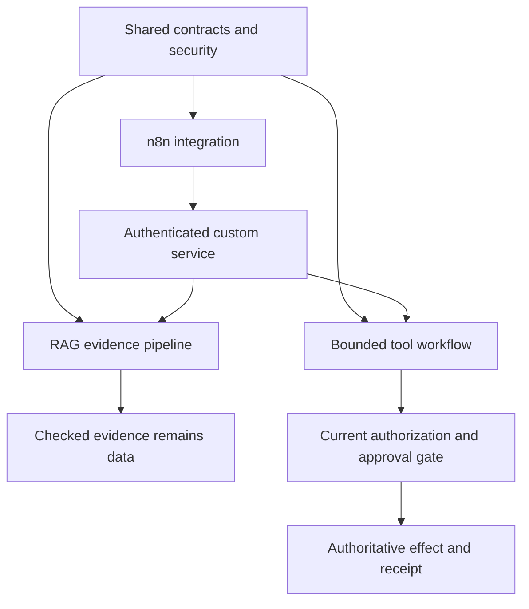

# Applied AI: evidence, actions and automation

The shared domain is a small **authorized notes catalogue**. A RAG assistant answers from current note spans; a tool workflow may propose a versioned rename; n8n can deliver a bounded refresh event to a custom service. They reuse identities and failure policies without giving retrieved text control over permissions.

## Reading order and prerequisites

1. [Python prerequisites](../python-for-ai/index.md): typed functions, validation, owned async I/O and service boundaries. The existing JS/TypeScript/Node path remains a useful alternative implementation background.
2. [Shared foundations](./shared/index.md): model adapter, structured outputs, tools, state, security, budgets, evaluation and safe diagnostics.
3. [RAG](./rag/index.md): ingestion/provenance → representations/lifecycle → retrieval → checked answers → evaluation and deletion.
4. [Agent workflows](./workflows/index.md): fixed workflow first, then bounded model proposals, durable artifacts, approvals, receipts and recovery.
5. [n8n](./n8n/index.md): items/expressions/triggers, bounded service integration, testing/errors and deployment ownership.

The [coverage map](./coverage-map.md) links each requirement to inspected explanations, examples and practice. The [integrated practice sequence](../practice/applied-ai/index.md) refines P-334/P-335 before adding one n8n checkpoint. **All learner practice remains outstanding.** Material completion means usable explanations and specifications, not live model quality or a deployed product.

## Separate the responsibilities

| Layer | Owns | Must not infer |
|---|---|---|
| Shared application boundaries | Authenticated identity, schemas, current permissions, budgets, logs and evaluation policy | A valid schema is true or authorized |
| RAG | Selecting and attributing current permitted evidence | Relevance grants tool/action authority |
| Agent workflow | Allowed next steps, persisted progress/artifacts and exact effect recovery | A model's plan or claimed approval is permission |
| n8n automation | Trigger/dataflow/integration orchestration under configured credentials | A canvas or an AI node supplies idempotency, current source ACL or human consent |

## Where the material lives

- `docs/applied-ai/shared/`, `rag/`, `workflows/`, `n8n/`: topic homes and missing integration explanations.
- `docs/python-for-ai/`: established detailed Python lessons, with their existing URLs preserved. Grouped indexes replace the old flat forty-step reading list; there is no second copy of each lesson.
- [Applied-AI workbench](../workbench/applied-ai/index.md): canonical Python source/checks and dependency-complete optional labs; n8n transformation/local-adapter fixtures are separate.
- [Practice](../practice/applied-ai/index.md): staged projects and relocated chapter assignments. Historical author observations remain labeled observations in the textbook.

Start with lexical search or direct database lookup when it meets the question. Add embeddings, learned reranking, autonomous routing or a visual orchestrator only for a measured need. Multiple agents, PDF/OCR, production ANN and distributed workflow hosting are optional extensions rather than prerequisites.
