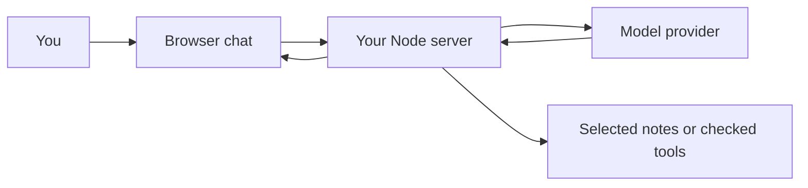

# Understand the pieces {#_0-understand-the-pieces}

An AI application is ordinary software with a model inside it. You still write the UI, validation, storage, error handling and tests. The model supplies a useful but fallible operation: generating text, selecting a proposed tool call, or representing text for search.

You need functions, arrays/objects, modules, JSON, promises and `async`/`await`. If those are unfamiliar, use the [Node prerequisites](../../node-js/prerequisites-and-boundaries.md). You do not need Python, calculus or model-training experience to begin.

## Give each word a concrete meaning

Imagine asking a notes assistant, “How do I cancel a request?”

| Term | Meaning in this project |
|---|---|
| Model | The remote service that generates a possible answer |
| Prompt | Task instructions and input sent to that service |
| Context | Relevant messages or note excerpts included with the request |
| Token | A model-specific piece of input/output used for context limits and often billing; not exactly a word |
| Chat history | Previous conversation messages stored by the application or a configured provider feature |
| Structured output | A result shaped as fields your application can validate |
| Tool | A function the application may execute after checking a proposed call |
| Workflow | A sequence such as validate→retrieve→answer→check |
| Agent | A system in which a model selects some next actions within application limits |
| RAG | Retrieve relevant source material, then use it as evidence for generation |
| MCP | A standard interface through which a host connects to a server's tools, resources and prompts |

A model can generate a plausible answer without reading your notes. That does not mean it searched them. Your application must retrieve the notes and provide them. Similarly, “I renamed the note” is text until an authorized function actually performs the write.

## Trace one request

The browser sends a question to **your server**. Your server validates it, supplies instructions/history, calls a model if configured, and returns a usable result. The provider key stays on the server. Your service, the model provider and an MCP server are separate roles even when all appear in one diagram.

## Start with fewer moving parts

We begin with JavaScript modules and Node's built-in HTTP server. You can see what a request does without learning a new framework at the same time. The browser example uses plain DOM code; the chatbot lesson explains how the same contract fits React. Introduce TypeScript after you can trace the data: types help development, but runtime validation still protects external input.

Offline mode returns an intentionally obvious simulation. It proves that your console or UI can reach a function and display its result. A live mode uses the Responses REST endpoint through `fetch`; you can later replace that small adapter with the official SDK. No API call occurs merely by reading or running the mock example.

## Predict before running

For “What is my name?”, predict the answer if no prior name was supplied. Then imagine a previous message, “My name is Alex.” What would the application need to include? The model does not read a JavaScript variable just because it exists in your server.

**Your exercise:** draw the request path and mark where you would put a key, history and a private notes database. Explain why retrieved text is evidence, not permission to execute a command inside it.

**Ready to continue:** you can explain the pieces without naming a framework, and distinguish using an assistant to write code from building an application that calls a model. [Next: first request](./first-call.md).
