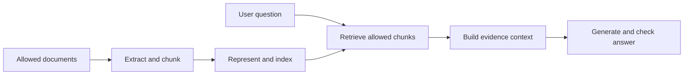

# Build RAG from your notes {#_5-build-rag-from-your-notes}

RAG means **retrieval-augmented generation**: find useful source material, then ask a model to answer using it. It does not mean training the model on your files. You can update your source catalogue without changing model weights.

For a learning assistant, ask “How do I cancel fetch?” First find the cancellation note. Then provide that note as evidence. If no note supports an answer, say so rather than filling the gap with an invented citation.

## First run the search baseline

Run `npm run demo` in the [starter](../../workbench/applied-ai/javascript/). Its `retrieve` function splits text into lowercase terms, removes a small English stop-word list, ranks overlapping terms and returns at most two notes. Ties use stable note IDs.

`cancel fetch` finds `n1`. `Who won the tennis tournament?` returns no matches. Try `terminate a network request`: simple word overlap may miss a relevant note. This is the limitation to investigate before adding embeddings.

The fixture is **lexical retrieval**, not semantic search and not a complete RAG assistant. Its score is not a probability. The default chatbot does not call it; connecting retrieval and generation is your next project increment.

## Build the two pipelines

**Ingestion** happens when documents enter or change. Keep source ID/version, chunk ID, exact text and location. Start with one small text file per note, then split longer notes on headings/paragraphs. Test that a boundary does not separate a rule from its exception. Chunk size in characters does not prove token fit.

**Answering** happens for each question. Validate the question and user, retrieve only current permitted chunks, fit them into the model's input budget, generate an answer and validate its citations. Retrieved text stays data even when it says “ignore your instructions.”

For your first generated answer, use a result shape such as `{ answer, citations: [{ noteId, quote }] }`. Resolve every citation against the exact supplied source version. Exact quote membership prevents invented excerpts but does not prove the answer's claim follows from them. Review claim support separately.

## Add embeddings when you can measure their value

An embedding model converts text into a vector. Embed the question with the same compatible model/configuration used for the stored chunks, then find similar vectors. A vector database stores/searches them; it is not the answer generator.

For a tiny corpus, a local exact vector scan is enough to learn. A hosted Pinecone adapter is an optional later exercise: create an index with the actual embedding dimension/metric, upsert stable IDs and metadata, query a namespace, and test updates/deletion. OpenAI's default `text-embedding-3-large` output is 3072 dimensions, not 768; an explicit supported `dimensions` setting changes the output size. [Embedding guide](https://developers.openai.com/api/docs/guides/embeddings), checked 2026-10-28.

Do not compare vectors from unrelated embedding spaces or assume a similarity threshold transfers between models. Keep query/chunk preprocessing and index versions in your evidence record.

## Check failure cases before claiming success

Use five question types: exact wording, paraphrase, unsupported question, misleading near-match and an updated/deleted source. In a multi-user app add a forbidden source. Compare retrieval independently of generation: did the right chunk appear? Then judge whether the answer used it correctly.

**Your exercise:** connect the lexical retriever to your chatbot using synthetic documents, add citations and no-evidence behavior, and freeze a small labeled question set. Then compare an embedding version. Keep unsupported, provider-error and missing-evidence states distinct.

**Done:** show actual retrieval ranks and answer judgments, including one failure. [Next: MCP](./mcp.md). Use [RAG engineering](../rag/) when you reach access control, hybrid search, lifecycle and evaluation depth.
