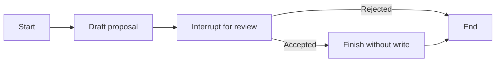

# Stateful workflows with LangGraph.js {#_7-stateful-workflows-with-langgraph-js}

Three fixed functions usually do not need a framework. A graph becomes useful when branches, pauses and resumed state are hard to follow. Learn those mechanisms with deterministic nodes before adding a model that chooses routes.

Our worked graph proposes a note title, waits for a synthetic review decision, then finishes or rejects. It **never edits a note**. This keeps graph mechanics separate from authorization and durable write recovery.

## Follow state, nodes and edges

**State** is the shared task record. **Nodes** perform stages and return updates. **Edges** choose the next stage. These are code concepts: a graph is not automatically an autonomous agent or a learning system.



Inspect the actual example from the [integration workbench](../../workbench/applied-ai/javascript-integrations/):

<<< ../../workbench/applied-ai/javascript-integrations/graph.mjs

The state annotation specifies fields; it is not complete runtime validation. The `draft` node calls the already checked `proposeRename`. The review node validates the resumed decision's type. `addConditionalEdges` selects the terminal path, and `compile` creates the executable graph.

## Pause and resume the same task

In the sibling integration directory, run `npm run build` and `npm run test` after the MCP setup. The test creates a graph with `MemorySaver`, invokes it with a `thread_id`, observes `__interrupt__`, and resumes the same thread:

```js
await graph.invoke(new Command({ resume: { approved: true } }), config);
```

The accepted branch ends as `finished_without_write`; a separate rejected thread ends as `rejected`. The check also confirms the first thread's proposal is not replaced by the second. This is synthetic task separation, not a multi-user authentication test.

Code before `interrupt()` can execute again on resume. Keep irreversible effects out of that region, or design and test idempotency. A pause is not a transaction around an external API call.

## Understand what memory does

`MemorySaver` keeps checkpoints **in RAM**. A new process loses them. A database-backed checkpointer can add durability, but needs ownership, schema/migrations, access control and deletion. A thread ID selects state; it is not proof the caller owns it.

State storage does not change model weights and does not automatically provide every stored field to a model. An LLM node still needs an explicit request builder and a bounded context policy. A graph recursion limit is a step guard, not an overall time, cost or token budget.

For a real approved write, your application must bind approval to the exact command/current identity/resource version and record an authoritative outcome. A lost remote response can leave the outcome unknown even if the graph remembers a timeout. See [workflow recovery depth](../workflows/resumable-runs.md) after you have reproduced a RAM pause/resume.

## When to add model-directed routing

First build a fixed `read→draft→review` workflow. If varied user requests need flexible selection, let a model propose one of a small set of routes. Validate the proposal and enforce whole-run limits. Compare quality and complexity with the fixed workflow. Multiple agents are optional; functions and graph nodes do not each need to become separate agents.

**Your exercise:** add a deterministic `needs_clarification` branch, check both accepted/rejected paths, and demonstrate that restarting loses RAM checkpoints. Then plan a durable continuation; do not claim it works until you test reopening actual stored state.

**Done:** show an interrupt/resume result and explain the limits of the memory/approval demonstration. [Next: extensions](./extensions.md).

References checked 2026-10-28: [JavaScript Graph API](https://docs.langchain.com/oss/javascript/langgraph/graph-api), [interrupts and resume](https://docs.langchain.com/oss/javascript/langgraph/interrupts). Use the pinned fixture version when reproducing it.
