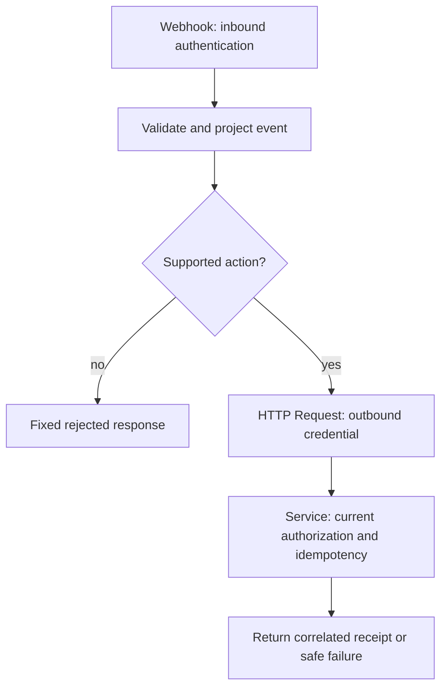

# A webhook-to-service integration

Use one small operation: request a refresh of an authorized synthetic note. n8n validates/projects an event and calls an application-owned endpoint. The service maps its credential to scope, checks the source/version and returns a stable local receipt. It does not let an incoming tenant field choose authority or let note text approve a rename.



## Test and production URLs are different

Configure POST and a specific test path. A Webhook node exposes a test URL for a listening manual execution and a production URL registered when the workflow is published. Copy the URL shown by the installed version; do not hardcode or interchange the two. Production execution data is inspected in execution history rather than the live test canvas. This review publishes neither endpoint. [Official Webhook behavior](https://docs.n8n.io/integrations/builtin/core-nodes/n8n-nodes-base.webhook/).

The webhook envelope commonly puts submitted JSON under `body` alongside request metadata. Explicitly select `body`, validate its allowed fields and project the output. Do not forward request headers/cookies/query parameters, arbitrary URLs, owner fields or source text to the next service. The reference's raw body is:

```json
{"event_id":"evt_1","source_id":"public","revision":1,"action":"refresh"}
```

A malformed field goes to a controlled validation response before integration I/O. Use an explicit response mode: Respond to Webhook after the service result for a short synchronous demo, or acknowledge durable job acceptance with an operation ID and a separate authorized status lookup. An immediate success response does not prove refresh completion. Bound payload size at ingress as well as after item materialization.

## Credentials have distinct scopes

Inbound webhook authentication decides which sender may trigger the workflow. Outbound HTTP credentials decide what the workflow may request from the service. Configure both in n8n credential records, never literal secrets in expressions, Code, URLs, pinned data or exported workflow JSON. An inbound shared secret is not automatically an end-user identity; the service must map an approved integration identity to its allowed tenant/source set or use a reviewed delegated-user contract.

For the local recipe use Header Auth. The outbound service expects an Authorization bearer credential for a synthetic integration identity. Store a separate credential for that destination; do not blindly relay the incoming authorization header. Credential encryption at rest does not make arbitrary workflow editors or community nodes trustworthy. Restrict editor/integration access and egress, and review exports/logs before sharing. [HTTP Request credentials](https://docs.n8n.io/integrations/builtin/credentials/httprequest/), [Webhook credentials](https://docs.n8n.io/integrations/builtin/credentials/webhook/).

## Node recipe and idempotency

| Node | Parameters / observable handoff |
|---|---|
| Webhook | POST, test listener, configured inbound Header Auth, explicit response mode |
| Normalize (Code/Edit Fields) | Accept only event/source/revision/action; cap batch/items/strings and retain correlation |
| If | Supported action `refresh`; invalid events never enter HTTP Request |
| HTTP Request | Fixed reviewed service URL; configured outbound credential; JSON body from the normalized current item; finite timeout; no arbitrary redirect destination |
| Respond to Webhook | Return projected status/receipt tied to the same event; do not return credentials/raw service errors |
| Error handling path | Classify failure and retain safe event/execution references; no email/message node is necessary |

Use a stable business event/operation ID independent of the n8n execution ID. A retried execution gets another execution identity but may represent the same event. The service binds the event ID to exact command bytes and current authorized scope: same event/same command returns the original receipt, changed command conflicts. A timeout after commit is uncertain; reconcile/replay the same key under that service contract. n8n retries alone cannot implement exactly-once external effects.

## Connection to RAG and agents

Replace the synthetic refresh receipt with a durable authorized ingestion job only after P-334 has source versions, tombstones and derivative cleanup. The request should reference the source; the service loads authorized bytes. A refresh callback must not resurrect a deleted revision or let a source URL select arbitrary egress.

For P-335, n8n may notify an owned UI that a proposal awaits review, but must not turn model output or a generic Wait/form response into trusted approval automatically. The application stores the exact authenticated command-bound decision and receipt. The local workbench demonstrates only transformation and adapter contracts, not these complete integrations.

[Separate practice and evidence](../../practice/applied-ai/n8n-integration.md) · [Errors and deployment](./operations.md)
