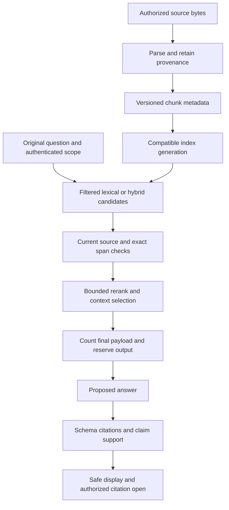

# RAG: ingestion to supported answers

Retrieval-augmented generation selects external evidence for a generation request. It does not change model weights or establish that a retrieved statement is true. The application must preserve current access, provenance, failure categories and evidence sufficiency throughout.

## Reading and implementation order

1. [Extraction and chunk provenance](../../python-for-ai/document-processing.md): bounded text/CSV first; complex formats need separate isolation/fidelity decisions.
2. [Embeddings, lexical and hybrid retrieval](../../python-for-ai/embeddings-and-similarity.md): exact identifiers versus paraphrases, compatible spaces, filters before top-k, separately observable branch rankings.
3. [Persistent index/data lifecycle](../../python-for-ai/vector-storage-lifecycle.md): current sources/ACLs, source versions, staged index generation and update/delete. Learn this before composing the full query pipeline.
4. [Evidence/citations](../../python-for-ai/retrieval-context.md): resolve exact current spans; mechanical membership does not prove entailment.
5. [Retrieval/reranking/context](../../python-for-ai/retrieval-pipeline.md): original query retained, bounded union, rerank only permitted text, final request budgeting.
6. [Answering boundary](./answering-and-failures.md): compose generation, publication and recovery without hiding missing adapters.
7. [Evaluation](../../python-for-ai/evaluation-lab.md), [debugging/freshness](../../python-for-ai/retrieval-debugging.md), [derivative lifecycle](../../python-for-ai/provider-data-lifecycle.md): labeled relevance/support, oracle diagnostics and deletion reconciliation.

## Two paths with different owners

Ingestion metadata binds tenant/logical source, immutable bytes/version, extraction/chunk policy, locator/span, embedding-space identity and index generation. Query scope comes from authentication, never a generated rewrite. Changes in any representation policy require a deliberate migration; equal vector dimensions alone do not make spaces compatible.

## When simpler retrieval is sufficient

| Need | Prefer first | Add complexity only if evidence justifies it |
|---|---|---|
| Exact known record/aggregate | Authorized parameterized database query | A model is unnecessary for a deterministic field |
| Error codes, names, exact phrases | Lexical lookup/full-text search | Semantic similarity can miss a critical identifier/negation |
| Small authorized source set | Direct search or bounded context | Count real payload and evaluate omissions before adding a vector service |
| Paraphrases across a growing corpus | Compare semantic and lexical baselines | Add hybrid/ANN/reranking after labeled recall/support and operational checks |

The runnable lexical scorer is Jaccard overlap, not BM25. Hand-authored vectors demonstrate geometry/access order, not learned semantic quality. Rank fusion is not raw score addition. A reranker cannot recover evidence absent from candidates; a nonempty ranking is not proof that an answer exists.

[Practice: staged P-334](../../practice/applied-ai/rag-assistant.md) · [Workbench and limits](../../workbench/applied-ai/python/index.md)
