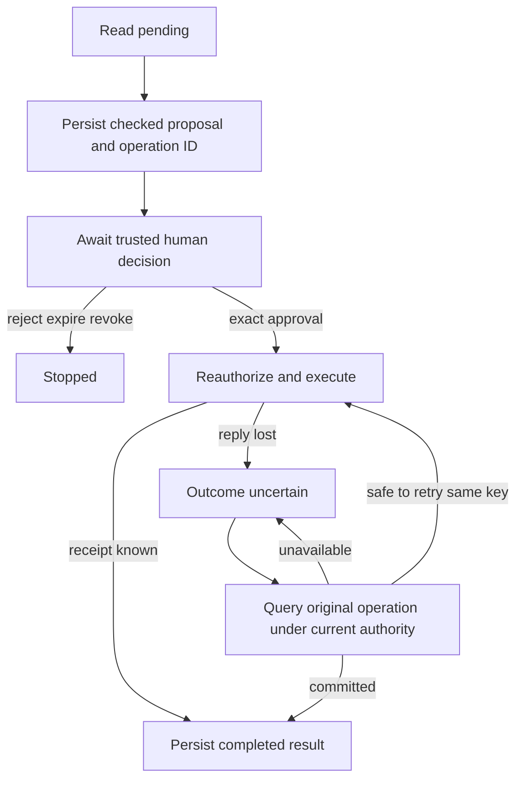

# Resumable execution and uncertain effects

Persisting a stage name is not enough to resume useful work. The next step also needs its immutable input, checked result, current authority, configuration, remaining budget and any stable operation identity. The existing `JobStore`, approval executor and spend ledger each solve one part; their independent transactions do not automatically compose.

## A checkpoint is an application contract

A versioned record binds authenticated tenant/subject/job, revision, allowed stage, artifact IDs/digests/schema, source/configuration versions, remaining call/byte/spend reservations, trusted UTC expiry and next permitted operation. References resolve only through an owned authorized store with a retention policy. A model-provided path, principal, “approved” flag or free-form function name is not a checkpoint.

Persist checked artifact plus advancing checkpoint in one transaction where possible. With separate object storage, stage the immutable bounded artifact, then commit a reference under compare-and-set; collect unreferenced staging objects later. Check digest/schema/owner on resume. A missing artifact is a recoverable failure or a documented safe-read restart, not an invitation to invent it.

## Recover according to the boundary

| Interruption | Durable evidence / permitted continuation |
|---|---|
| Before a read dispatch | Reserved attempt/checkpoint; retry only within remaining deadline/caps |
| After a read, before checkpoint | Read can repeat under current scope and another charged attempt; orphan artifact cleanup required |
| Awaiting approval | Reload exact command and authenticated decision; model/tool text grants nothing |
| After approval, before local mutation | Recheck owner/version/expiry/digest and use the same operation ID |
| After local commit, before reply/checkpoint | Replay the exact approved operation to obtain its existing receipt; do not create a new key |
| Remote write timed out | Persist unknown; reconcile the remote authority's status/idempotency contract before retry |
| Current access revoked/configuration stale/artifact missing | Stop or take an explicitly reviewed safe transition; never publish cached private text |

The SQLite rename executor commits title/version and receipt atomically in one database. Its receipt replay is narrower than exactly-once delivery. A transaction on the job row cannot roll back an email or payment. For an external system use its supported operation key/status semantics and, where needed, a transactional outbox; an outbox consumer must still be idempotent.

## Retries, cancellation and clocks

A retry policy classifies temporary read failures, applies backoff/jitter and respects server minima within the overall budget. Credential/schema/permission failures and ambiguous effect outcomes do not receive the same automatic policy. Disable stacked SDK retries when the application owns attempts. Cancellation propagates and releases local tasks/clients; do not catch it as a transient error and restart work.

Use monotonic time within one process. Persist UTC expiry with a declared clock/skew policy across restarts, then derive a conservative remaining local duration. Check expiry before dispatch and wrap actual awaited work in an enforced cooperative timeout. A preflight timestamp alone cannot stop a blocking parser or a noncooperative adapter; those need a separate worker/process owner.

Once a mutation commits, request cancellation cannot undo it. A requested undo is a new authorized versioned operation. Cancellation before dispatch may revoke pending approval; after dispatch preserve uncertainty until the authoritative outcome is known.

## Concurrent owners and resource accounting

Reserve an attempt **atomically before dispatch**, not after reading a shared counter. Persist a stable operation intent so another owner does not interpret a stale checkpoint as new work. Compare-and-set protects row updates; it does not prevent two workers from both making an external call before saving. Production concurrent runners need a claim/lease with fencing and reconciliation for expired claims. Lease expiry alone proves neither that work stopped nor that money is refundable.

Reserve a conservative whole-job spend maximum in the shared ledger. Pending means reconcile, settled means reuse a result, and unknown usage stays held under policy. Account counts/bytes and monetary reservation are distinct. Real provider charges can exceed a bad estimate; alert/stop new work rather than silently report the estimate as an enforced remote cap.

## What the workbench establishes

The [runnable collection](../../workbench/applied-ai/python/index.md) has real-file state/CAS, approval/receipt/reopen/rollback, shared reservation and projected trace tests. These components do not implement the full artifact transaction, authenticated approval UI, distributed claim/lease or remote-effect reconciliation service above. The explanation makes those integration obligations concrete; [P-335 checkpoints](../../practice/applied-ai/resumable-workflow.md) specify independent implementation and evidence.

Evaluate complete tasks under normal, denial, interruption, revocation, budget and unknown-outcome schedules. Safe traces correlate stage/revision/attempt/duration and fixed outcomes; durable receipts/audit provide separate authority. No amount of fluent model explanation can replace those observations.
