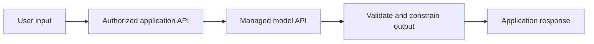

# AWS AI services: understand the integration boundary

The Associate material introduces AI services for developers. This adds useful service awareness; it does not turn the course into machine-learning engineering or a full production AI curriculum.

## Three different responsibilities

| Service | Main purpose | Developer responsibility |
|---|---|---|
| Amazon Bedrock | Access foundation models and related managed capabilities | Inputs, permissions, model choice, evaluation and application behavior |
| Amazon SageMaker AI | Build, train and deploy machine-learning workflows | Data, training/evaluation design, model lifecycle and serving configuration |
| Amazon Q Developer | Assist software development and AWS work | Review, test and understand generated suggestions |

Specific models, Regions and integrations change. Consult the live service documentation before depending on an availability claim or a copied console workflow. [Bedrock documentation](https://docs.aws.amazon.com/bedrock/latest/userguide/what-is-bedrock.html), [SageMaker AI documentation](https://docs.aws.amazon.com/sagemaker/latest/dg/whatis.html), [Q Developer documentation](https://docs.aws.amazon.com/amazonq/latest/qdeveloper-ug/what-is.html).

## Integrating a model into an AWS application

The backend's role authorizes service access. Customer authorization still controls which data the backend may submit. A managed model does not know your record-ownership rules merely because the request comes from an AWS account.

Treat model output as untrusted application input. Validate structured results, escape displayed content, and apply normal authorization before any resulting operation. Retrieved documents are evidence, not instructions granting authority. Do not let model text directly select unrestricted AWS actions.

## Cost and failure behavior

Model latency, throttling and usage charges add another dependency to the application. Bound input size, timeouts and retry attempts. Streaming improves perceived responsiveness but does not make an incomplete response valid. Track useful outcomes alongside latency and usage, and protect sensitive prompts and outputs in logs.

Q Developer can help explain APIs and draft infrastructure, but generated policies and code require review. Successful compilation does not prove that a generated IAM policy is appropriately scoped or that a retry is duplicate-safe.

For deeper treatment, continue with the existing [applied AI path](../applied-ai/). The AWS chapter owns service integration context; the AI path owns retrieval, evaluation and agent-workflow depth.
