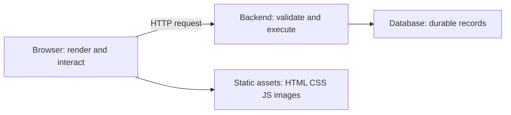

# Beginner guide: understand the cloud before the services

Cloud computing is a way to obtain computing resources through a provider rather than buy and maintain all the physical equipment yourself. The software still runs on computers. What changes is how you obtain capacity, manage it and pay for it.

## What an application actually needs {#_1-what-an-application-actually-needs}

A browser downloads HTML, CSS and JavaScript. That JavaScript can render a page locally and call an API. The API executes backend code, which may read a database or store a file. These jobs can run on different machines and fail independently.

A **server** is a computer or program that responds to requests. A **process** is a running instance of a program. A **deployment** puts a particular software version and its configuration into an environment where it can run. Uploading source files alone does not necessarily start a server.

A static React build can be served as files because the browser executes its JavaScript. Server-side rendering requires a runtime that executes code for requests. S3 stores objects; it does not start a Node.js process or execute a NestJS application.

## Cloud service models {#_2-cloud-service-models}

| Model | What you receive | What you still manage | Familiar example |
|---|---|---|---|
| IaaS | Virtual machines, networks and storage | OS configuration, runtime, application and data | A Node server on EC2 |
| PaaS | A managed application platform | Application code, configuration, dependencies and data | A managed application hosting platform |
| SaaS | A complete application | Account access, settings and responsible use | Hosted email |

These describe responsibility boundaries, not an absolute ranking. Managed databases and serverless functions offer different boundaries within the same application. **Serverless** means the provider handles server provisioning and much of scaling; it does not mean no servers, no configuration or no cost.

A public cloud is provider infrastructure offered to customers. A private cloud is dedicated to an organization. Hybrid systems connect cloud and on-premises environments. Using multiple providers adds integration and operational responsibilities; it does not automatically improve reliability.

## The networking vocabulary {#_3-the-networking-vocabulary}

| Term | Plain meaning | Example |
|---|---|---|
| IP address | A network address used to route traffic | A private address inside a VPC |
| Port | The destination service endpoint on a host | HTTPS commonly uses port 443 |
| DNS | Resolves names to records used to locate services | Looking up `shop.example.com` |
| HTTP | Request/response application protocol | `GET /products` |
| HTTPS | HTTP protected by TLS | Encrypted browser-to-API traffic |
| Subnet | A range of addresses within a network | One application subnet in an Availability Zone |
| Route | A rule choosing where matching traffic goes | Internet traffic through a gateway |
| Firewall rule | A rule allowing or rejecting traffic | Allow API-to-database connections |

**Routing and permission are different questions.** A request can have valid credentials but no network path. It can also reach a service and be denied by authorization.

IPv4 addresses contain 32 bits. CIDR notation describes how many bits identify a network: `10.0.0.0/16` is a larger range than `10.0.1.0/24`. The latter fits inside the former. You do not need subnet arithmetic before reading the first chapters, but the [networking chapter](./networking.md) builds on this distinction.

## AWS geography and scope {#_4-aws-geography-and-scope}

A **Region** is a geographic area containing multiple **Availability Zones (AZs)**. An AZ comprises one or more discrete data centers with independent supporting infrastructure. A subnet belongs to one AZ; a VPC spans a Region. **Edge locations** place content delivery closer to viewers and are a different concept from AZs.

A resource's scope matters when finding it. A Lambda deployed in one Region will not appear in another Region's Lambda list. IAM identities are global within an account, while many application resources are regional. An account is an ownership, billing and access boundary, not a Region.

**High availability** means keeping a service usable despite failures. **Durability** means preserving stored data. A service can preserve your data while temporarily being unavailable. A backup can help recover data but does not itself keep an API online.

## Shared responsibility {#_5-shared-responsibility}

AWS operates physical infrastructure. Your responsibilities depend on the chosen service. With EC2, you manage the guest operating system and application. With managed services, AWS takes over more platform work, but you still own your data, permissions and application behavior.

A managed database does not validate your business rules. Encryption does not fix an overly broad access policy. Using AWS does not automatically make an application compliant. See the [AWS shared responsibility model](https://aws.amazon.com/compliance/shared-responsibility-model/).

## Identity and access {#_6-identity-and-access}

**Authentication** establishes identity; **authorization** decides whether that identity may perform an action. An IAM role supplies permissions to a workload such as Lambda. A customer login belongs to application identity, often through Cognito. A customer does not need an IAM user merely to use your store.

The browser, API handler and database connection each have different identities. Logging a customer in does not grant the backend unlimited AWS permissions, and a powerful backend role does not prove the customer owns a requested record.

## Cloud economics {#_7-cloud-economics}

Cloud resources may be billed by running time, requests, storage, data transfer or provisioned capacity. Low traffic does not imply zero cost: a database or NAT gateway may incur charges while idle. Stopping compute can leave disks, snapshots and addresses behind.

A budget alert informs you about spending; it is not inherently a hard spending cap. Free-tier eligibility depends on the offer, service and account. Read your account's current terms rather than assume every tutorial is free.

## Reliability vocabulary {#_8-reliability-vocabulary}

| Concept | What it answers |
|---|---|
| Latency | How long does one operation take? |
| Throughput | How much work completes per unit of time? |
| Concurrency | How much work is happening simultaneously? |
| Vertical scaling | Can one worker become more powerful? |
| Horizontal scaling | Can more workers share the work? |
| Elasticity | Can capacity grow and shrink with demand? |
| Retry | Should a failed or uncertain operation be attempted again? |
| Idempotency | Can repeating an operation avoid repeating its business effect? |
| Eventual consistency | Can a read briefly lag a completed write? |
| Recovery | How does useful service resume after failure? |

Imagine a payment succeeds but its response is lost. A timeout does not prove the payment failed. Retrying without an idempotency mechanism could charge twice. This is why cloud application design includes failure behavior alongside the happy path.

Continue with [account, tools and costs](./account-and-tools.md). No separate cloud certification is required before this reading path.
