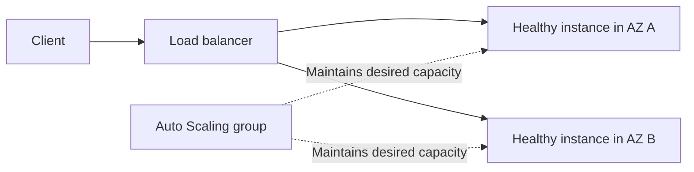

# EC2, load balancing and scaling

EC2 provides virtual machines. Compared with Lambda, it gives you more control over the operating system and long-running processes, while assigning you more maintenance work.

## The instance building blocks

An instance type determines a balance of CPU, memory, networking and storage capability. An AMI supplies an operating-system image and initial software. EBS provides attached block storage; instance-store storage is tied to instance lifecycle and should not be treated as durable database storage. [EC2 overview](https://docs.aws.amazon.com/AWSEC2/latest/UserGuide/concepts.html).

A launch template records instance configuration for repeatable launches. User data can initialize an instance, often through cloud-init. Initialization failure requires inspecting boot and cloud-init logs; an instance being “running” does not prove the application started successfully.

Instance metadata provides instance context and access to instance-role credentials through supported mechanisms. Protect metadata access and use IMDSv2 as appropriate. Never expose a proxy endpoint that allows untrusted callers to retrieve metadata credentials. [Instance metadata](https://docs.aws.amazon.com/AWSEC2/latest/UserGuide/configuring-instance-metadata-service.html).

## Capacity and purchasing choices

| Choice | Main consideration |
|---|---|
| On-Demand | Flexible usage without a long-term purchasing commitment |
| Spot | Interruption-tolerant work using spare capacity |
| Savings Plans / Reserved Instances | Discounts associated with commitment and applicable conditions |
| Burstable instance families | CPU-credit behavior affects sustained workload suitability |

A discount model is not an availability strategy. Spot workers need interruption handling and recoverable work. Persistent services need more than a low hourly price.

## Load balancing and Auto Scaling

A listener receives traffic. Rules select a target group, and health checks determine eligible targets. Application Load Balancers suit HTTP routing features; Network Load Balancers suit transport-level requirements. Choose based on protocol and behavior, not only the service name.

Auto Scaling maintains a desired instance count within configured bounds and can adjust it using policies. New instances need startup time. Scaling cannot instantly absorb every spike, and distributing traffic does not fix a saturated shared database.

Keep application state outside replaceable instances where needed. An uploaded file on one instance's local disk will not automatically appear on another instance. An in-memory login session can disappear when an instance is replaced.

## Availability is a system property

Multiple instances in one AZ do not protect against that AZ becoming unavailable. Multiple AZs do not protect against every bad deployment or accidental database deletion. A useful design combines appropriate redundancy with health checks, recoverable state and a release strategy.

SSH access requires network reachability and operating-system credentials. IAM permissions alone do not log you into the OS. Systems Manager Session Manager can provide managed access when its prerequisites are configured; a bastion is another design with its own maintenance and access controls.

## Observe what is actually measured

Default EC2 metrics do not automatically expose every guest operating-system metric. Memory and filesystem details often require an agent or custom telemetry. Track service health, application latency and errors alongside host utilization.

Use [VPC networking](./networking.md) to understand why a healthy instance may still be unreachable, and [delivery](./delivery-and-operations.md) for release and recovery behavior.
