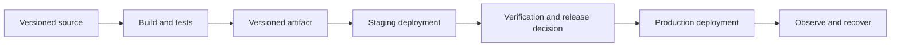

# Delivery, observability and resource cleanup

An application is not finished when it first responds successfully. It needs a repeatable release process, meaningful diagnostics and a controlled resource lifecycle.

## CI, delivery and deployment

**Continuous integration** checks changes frequently through automated builds and tests. **Continuous delivery** keeps changes ready for release with an explicit production decision. **Continuous deployment** automatically releases qualifying changes. The distinction is the release policy, not a particular vendor tool.

CodeBuild runs configured build commands, commonly from a buildspec. CodePipeline orchestrates stages and actions. CodeDeploy supports supported deployment targets and strategies. CodeCommit is AWS's repository service, but a pipeline can use other supported sources. Service availability and onboarding change; verify current options rather than depend on a screenshot. [AWS developer tools](https://aws.amazon.com/products/developer-tools/).

Build an identifiable artifact once and promote it with environment-specific configuration. Rebuilding separately for production can produce different dependencies from the version tested in staging. Give build and deployment roles only the authority their stages need.

App Runner offers managed application deployment from supported source/image workflows. ECS with Fargate is another container-oriented option. Their convenience does not remove database migrations, access control or application monitoring.

## Release strategies and data compatibility

An in-place update changes existing capacity. A rolling release replaces it gradually. Blue/green keeps separate environments for switching traffic. A canary sends limited traffic to a new version before wider promotion. Each needs health criteria and a recovery decision.

Application rollback does not necessarily reverse a schema migration. If old and new versions run simultaneously, their database and message contracts need a compatibility window. A destructive column removal can break the old version even if its code is redeployed successfully.

## Logs, metrics, traces and audit records

| Signal | Best question |
|---|---|
| Logs | What happened during this operation? |
| Metrics | How often, how much and how slowly? |
| Traces | Where did time and failures occur across dependencies? |
| CloudTrail audit events | Which recorded AWS API action was performed by which identity? |

CloudWatch collects supported metrics and logs. Structured logs should connect request, import and message identifiers without exposing credentials or unnecessary personal data. Trace coverage depends on instrumentation and sampling, so absence of a trace is not proof that no request occurred.

Monitor API errors and latency, Lambda errors/duration/throttling, queue age and DLQ depth, and database connections and resource pressure. CPU alone is not a user-experience metric. An alarm needs an owner and a meaningful response; a dashboard nobody checks is not incident handling. [CloudWatch concepts](https://docs.aws.amazon.com/AmazonCloudWatch/latest/monitoring/WhatIsCloudWatch.html).

## Troubleshoot by boundary

A `403`, a connection timeout and a malformed proxy response suggest different boundaries. Establish the failing operation and correlate its logs before changing configuration. Check account and Region first, then identity, routing, integration contract and application code.

For a growing queue, distinguish more incoming work, slower processing, repeated failures and inadequate capacity. Increasing concurrency can help a CPU-bound consumer but overwhelm a constrained database. For a DLQ, inspect whether side effects already occurred before replaying.

## Backups and recovery

A backup policy needs retention, access control and a known restoration process. Replication can copy a bad change, and infrastructure templates do not contain live business data. Recovery point objectives describe tolerable data loss; recovery time objectives describe tolerable downtime. Both affect cost and design.

## Cleanup order and remaining charges

Remove learning resources through their owning stack where possible. Understand retention before deleting state. Disable producers or schedules before removing consumers; remove dependents before underlying network resources. For CloudFront, disable a distribution before deletion according to the current workflow.

| Area | Resources easily left behind |
|---|---|
| Compute | Instances, Auto Scaling groups, load balancers, EBS volumes, snapshots, AMIs |
| Networking | NAT gateways, allocated addresses, endpoints, dependent ENIs |
| Storage | Object versions, delete markers, multipart uploads, retained buckets |
| Databases | Instances/clusters, snapshots, retained backups and proxies |
| Serverless and messaging | Functions, API stages, schedules, queues, topics and subscriptions |
| Delivery and telemetry | Build projects, pipelines, artifacts, log groups and alarms |
| Access | Learning-only roles, policies, keys and identities |

Do not delete shared account infrastructure merely because it appears in a course cleanup list. A retained resource is still owned by someone even after its stack is gone. Recheck relevant Regions and billing after cleanup; cost reporting may lag. [AWS resource cleanup guidance](https://repost.aws/knowledge-center/terminate-resources-account-closure).

Continue with [AI service awareness](./ai-services.md) or [course sources and certification](./coverage-and-sources.md).
