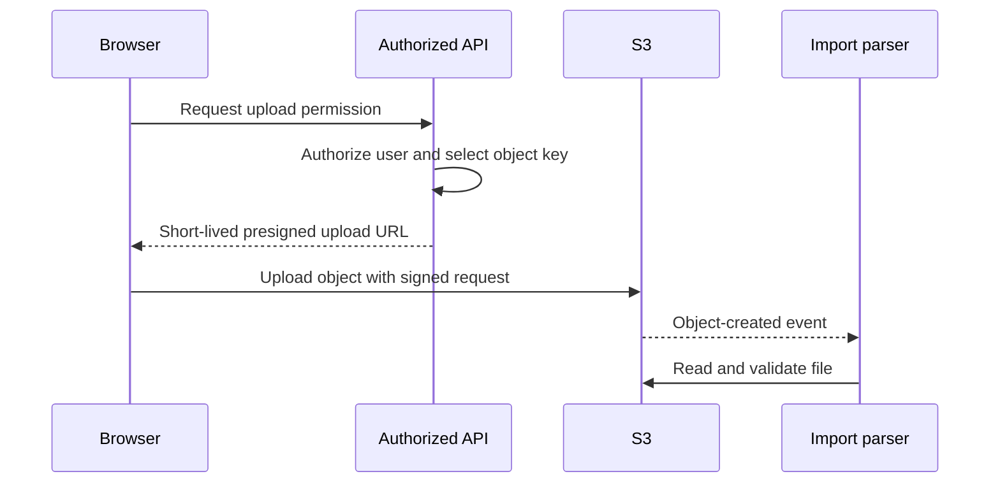

# S3 uploads and event-driven imports

File transfer and file processing are separate operations. A browser can finish uploading a CSV before its records have been validated and persisted.

## Presigned upload flow

A presigned URL authorizes a particular request using the signer's permissions. It is a bearer capability: someone who obtains it may use it while valid. Do not put it into public logs. Choose keys on the server so a caller cannot overwrite arbitrary objects, and define constraints suitable for the chosen upload mechanism. [Presigned uploads](https://docs.aws.amazon.com/AmazonS3/latest/userguide/PresignedUrlUploadObject.html).

The API does not need to relay every file byte through Lambda. Browser-to-S3 upload avoids turning the API into a file-transfer bottleneck, while the API still controls who obtains upload permission.

## Object events need a deliberate boundary

An S3 event identifies objects; it is not the full file body. Decode the event key correctly and fetch the intended object. Event delivery can repeat and ordering is not universal. Track a stable import identity and, where needed, object version to distinguish duplicate delivery from a genuinely new upload. [S3 event notifications](https://docs.aws.amazon.com/AmazonS3/latest/userguide/EventNotifications.html).

Separate input and output prefixes, such as `incoming/` and `processed/`. A handler that writes into its own triggering prefix can produce a processing loop. Filters reduce accidental triggers, but application logic must still validate the event.

## CSV is structured input

Splitting on commas does not handle quoted fields, escaped quotes or embedded newlines. Use a parser with explicit delimiter, header and encoding rules. Streaming can reduce memory consumption, but it still needs bounded file size, row size and downstream concurrency.

Convert strings explicitly. Decide whether an empty description is valid, whether a price must be positive, and whether zero stock is allowed. Rejecting a row should not silently turn it into a partially valid record.

The parser can submit individual validated row messages to SQS. Batching can reduce API overhead, but each batch API response must be checked for individual failures. Record progress so retrying a file does not blindly recreate every successful product.

## Completion and failure are business states

A useful import lifecycle distinguishes accepted, uploaded, processing, completed, partially failed and failed. “Upload succeeded” is a file-transfer statement; “import completed” is a business-processing statement.

Keep enough information to connect the user request, file, import, row and created record. Do not expose raw file contents or sensitive rows in general logs. If the worker persists records and publishes notifications, plan for failure between those operations; an outbox or equivalent recovery mechanism may be needed.

Continue with [SQS and SNS](./messaging.md) for the consumer's failure contract.
