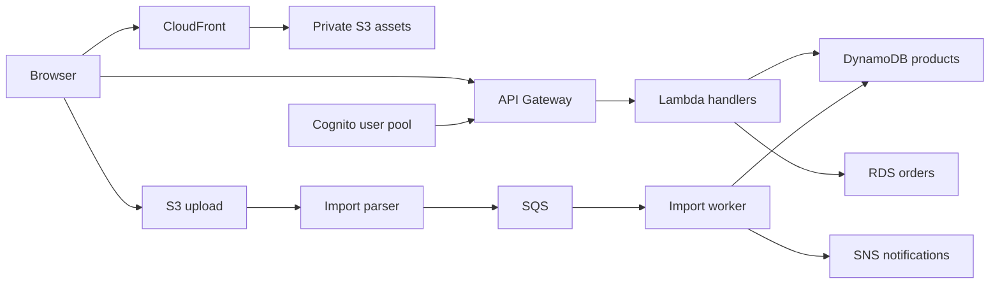

# AWS: from cloud foundations to application development

Understand where an application runs, how its parts communicate, and who can access them. Then connect AWS services into a system you can explain and troubleshoot. This path combines the supplied **CloudX: AWS Practitioner for JS** and **CloudX Associate: AWS JavaScript Developer** material, with additional beginner explanations and corrections to older examples.

No previous cloud experience is required. Familiarity with JavaScript, promises, npm, a terminal, HTTP and JSON will help with the development chapters. Start with the beginner guide if servers, DNS or networking are unfamiliar.

## Reading order

### Cloud foundations

| Chapter | What it explains |
|---|---|
| [Beginner guide](./beginner-guide.md) | Servers, cloud models, networks, regions, responsibility, cost and reliability |
| [Account, tools and costs](./account-and-tools.md) | Account setup, MFA, CLI profiles, SDK credentials, budgets and resource lifetime |
| [IAM and security](./iam-and-security.md) | Identities, permissions, roles, policies, STS and least privilege |
| [CDK and CloudFormation](./infrastructure-as-code.md) | Infrastructure definitions, stacks, deployment changes and resource ownership |

### Application services

| Chapter | What it explains |
|---|---|
| [S3 and CloudFront](./storage-and-frontend.md) | Object storage, frontend hosting, caching, versioning and private origins |
| [Lambda and API Gateway](./serverless-and-apis.md) | Request handling, execution environments, concurrency, packaging and API boundaries |
| [DynamoDB and RDS](./databases.md) | Access patterns, indexes, transactions, SQL, connections and recovery |
| [S3 imports and events](./file-imports.md) | Presigned uploads, validation, event processing and duplicate handling |
| [SQS and SNS](./messaging.md) | Queues, fanout, ordering, retries, batch failures and dead-letter queues |
| [Cognito and application access](./authentication.md) | Tokens, user pools, identity pools, API authorizers and resource ownership |

### Infrastructure and operations

| Chapter | What it explains |
|---|---|
| [VPC and networking](./networking.md) | Subnets, routing, gateways, security groups, DNS and private connectivity |
| [EC2 and scaling](./compute-and-scaling.md) | Virtual machines, storage, instance configuration, load balancing and availability |
| [Delivery and operations](./delivery-and-operations.md) | CI/CD, observability, deployment recovery, cost review and cleanup |

### Optional depth and references

| Chapter | What it explains |
|---|---|
| [AWS AI services](./ai-services.md) | Bedrock, SageMaker and Q Developer; application integration and boundaries |
| [Course sources and certification](./coverage-and-sources.md) | Course mapping, expected proficiency, source corrections and exam preparation |

Read networking and compute before RDS if private networking is new to you. Infrastructure as code comes early because both courses reuse it across services. AWS AI services are a continuation for applications that need model integration.

## One application, several responsibilities

A small store provides a consistent example throughout the notes. Its frontend displays products, an API handles requests, databases preserve state, and an asynchronous import path processes uploaded files. Diagrams explain responsibilities; they are not deployment instructions or homework.

## What level this path supports

Understanding the material and independently implementing its patterns can support **strong junior AWS application-development proficiency** for an existing JavaScript developer. Intermediate knowledge in individual services is possible. Medior proficiency also requires independent design decisions, unfamiliar troubleshooting, safe releases and operational ownership; reading a broad syllabus alone does not demonstrate those abilities.

Course completion and certification are separate outcomes. Use the official exam guide to identify exam-specific gaps. [AWS homework](../practice/aws/index.md) now supplies the required Practitioner and Associate tracks, including every original optional/bonus task. Repeating work is marked; newly proposed gap exercises remain optional.

## Connections to the rest of the hub

[Node.js](../node-js/) explains the runtime, HTTP and database code that executes on AWS. [Resilient distributed systems](../node-js/module-12-resilient-distributed-systems.md) goes deeper into failure and recovery patterns. [Engineering security](../engineering/security.md) and [delivery](../engineering/delivery.md) supply cross-platform context. AWS adds service configuration, permissions, networking and managed infrastructure to those foundations.
