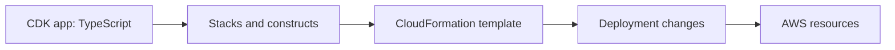

# CDK and CloudFormation: infrastructure as code

Infrastructure as code records the resources and relationships an application needs. It makes changes reviewable and repeatable, but does not make every deployment reversible.

## The translation pipeline



A **construct** models a resource or reusable group of resources. A **stack** is a CloudFormation deployment unit. A CDK **app** can contain several stacks. CDK synthesis produces templates; CloudFormation provisions resources from them. [AWS CDK overview](https://docs.aws.amazon.com/cdk/v2/guide/home.html).

CloudFormation can also be authored directly in YAML or JSON. Resources describe desired infrastructure; parameters supply inputs; outputs expose selected results. References and dependencies influence creation order. Repeated template sections can be factored into suitable reusable abstractions.

## A small infrastructure definition

This TypeScript fragment defines storage, not an entire deployable project:

```ts
import { RemovalPolicy, Stack } from 'aws-cdk-lib';
import { Bucket, BlockPublicAccess } from 'aws-cdk-lib/aws-s3';

export function defineAssets(stack: Stack) {
  return new Bucket(stack, 'Assets', {
    blockPublicAccess: BlockPublicAccess.BLOCK_ALL,
    enforceSSL: true,
    versioned: true,
    removalPolicy: RemovalPolicy.RETAIN,
  });
}
```

Retaining storage protects it from automatic stack deletion, but leaves it for separate lifecycle management. A `DESTROY` removal policy is not a universal empty-bucket mechanism. Versioned objects and retained resources still need an explicit cleanup decision.

## Read the workflow before running it

| Step | Purpose | Changes AWS resources? |
|---|---|---|
| Build | Compile and check the project | Normally no |
| `cdk synth` | Generate a CloudFormation template | Normally no provisioning; context lookups can contact AWS |
| `cdk diff` | Compare desired and deployed state | May perform lookups or create a comparison change set |
| `cdk bootstrap` | Prepare deployment support resources for an environment | Yes |
| `cdk deploy` | Apply infrastructure changes | Yes |
| `cdk destroy` | Request stack deletion | Yes; retention and service rules still apply |

An environment is an account/Region pair. In CDK stack configuration, the property is **`env`**, not `environment`. Lambda's `environment` property instead supplies runtime environment variables. The correct CLI spelling is `bootstrap`; `boostrap` in the source is a typo.

## Deployment identity versus workload identity

The deployment role needs to provision resources and configure approved roles. A runtime Lambda role should only need the operations performed by that function. Avoid giving runtime code deployment-level permissions.

CDK permission helpers express intent, such as granting one function read access to a bucket. Review the synthesized policies and deployment diff: convenient abstractions can create additional resources and permissions.

## Replacement, drift and rollback

Some property changes update a resource; others replace it. Renaming a construct can change its logical identity and lead to replacement. Inspect this carefully for databases and buckets.

A change set previews proposed operations, not their complete business impact. CloudFormation rollback concerns infrastructure state; it does not reverse emails already sent or automatically restore every database mutation. Manual console edits can create **drift**, where deployed settings differ from the template. Capture lasting changes in the owned infrastructure definition.

Separate environments with explicit configuration, keep secrets out of templates, and avoid circular stack dependencies. A public queue property passed to another stack is a code dependency; cross-stack exports also introduce deployment-order and lifecycle constraints.

Continue with [Lambda and APIs](./serverless-and-apis.md).
