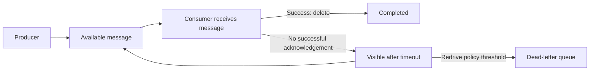

# SQS and SNS: asynchronous communication

SQS keeps work until a consumer can process it. SNS distributes notifications to subscribers. Both decouple components, but they answer different questions.

| Need | Typical choice | Reason |
|---|---|---|
| Buffer work during a consumer slowdown | SQS | Consumers pull available work |
| Deliver an event to multiple independent consumers | SNS | Publish/subscribe fanout |
| Give each subscriber its own durable backlog | SNS → separate SQS queues | Each consumer has independent processing and recovery |

## The SQS message lifecycle



Receiving a message hides it for the visibility timeout; it does not permanently remove it. Successful consumers delete it. If processing or acknowledgement fails, it can become available again. A DLQ requires a configured redrive policy; creating a second queue alone does not connect recovery behavior.

Long polling reduces empty receives. A delay postpones initial visibility; a visibility timeout protects work already received. Neither is the same as message retention, which limits how long a queue can keep a message.

## Standard and FIFO

Standard queues provide at-least-once delivery with best-effort ordering. Consumers must tolerate duplicates and out-of-order work.

FIFO queues support ordered processing within message groups and send deduplication within supported semantics. They do **not** make arbitrary database writes, emails or payments execute exactly once. A worker can commit a write and crash before acknowledgement. Idempotency remains necessary. Throughput depends on configuration, Region and quotas; fixed numbers in old slides should not be treated as timeless limits. [SQS queue types](https://docs.aws.amazon.com/AWSSimpleQueueService/latest/SQSDeveloperGuide/welcome.html).

## Lambda batch processing

An event source mapping polls SQS and invokes Lambda with records. The Lambda integration deletes messages after successful processing. By default, a failed batch can cause successful records to be delivered again. With partial batch responses enabled on the mapping, return failed message IDs so successful records do not need to repeat. [Lambda with SQS](https://docs.aws.amazon.com/lambda/latest/dg/with-sqs.html).

```ts
import type { SQSEvent, SQSBatchResponse } from 'aws-lambda';

// processMessage must validate input and make business effects duplicate-safe.
export function makeHandler(processMessage: (body: string) => Promise<void>) {
  return async (event: SQSEvent): Promise<SQSBatchResponse> => {
    const batchItemFailures: { itemIdentifier: string }[] = [];
    for (const record of event.Records) {
      try {
        await processMessage(record.body);
      } catch {
        batchItemFailures.push({ itemIdentifier: record.messageId });
      }
    }
    return { batchItemFailures };
  };
}
```

This illustrates a **Standard queue** batch response, not a complete deployment. For FIFO processing, stop after a failure and report failed and unprocessed records as required to preserve ordering. Configure visibility timeout, function timeout, batching and concurrency together. Reading only `Records[0]` silently ignores other records in a batch.

## Idempotency and retries

Choose a stable business operation ID. Use conditional persistence or a transaction to claim and complete that operation safely. A random new ID on every retry does not identify duplicate work. A database write and a later notification are two effects with a gap between them; see the [transactional outbox discussion](../node-js/module-12-resilient-distributed-systems.md).

Retry transient failures with bounded backoff and jitter. Invalid input usually needs rejection or separate failure handling, not endless retries. A DLQ is a place to investigate and recover messages, not proof that the business operation never succeeded. Replaying requires the same duplicate-safe design as ordinary processing.

## SNS fanout and filtering

An SNS topic publishes to subscriptions such as SQS, Lambda and supported notification endpoints. Subscription filters select relevant messages by configured attributes or body rules. They reduce unnecessary delivery but do not validate the business content.

Use separate queues when consumers require independent backlogs. Delivery retries, retention and replay depend on topic type and configuration; the source's blanket “SNS has no retention” statement is too broad. Standard and FIFO subscriptions have different supported behaviors. [SNS documentation](https://docs.aws.amazon.com/sns/latest/dg/welcome.html).

For the store, a product-created event can notify interested subscribers after persistence. An email subscription must be confirmed before it receives normal deliveries. Publishing successfully does not prove every recipient has received or acted on a message.

Next: [application authentication](./authentication.md).
