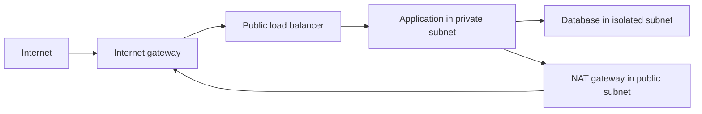

# VPC networking: trace the path before changing rules

A VPC is a logically isolated network in a Region. It controls network paths and boundaries, while IAM separately controls AWS API permissions.

## Addresses, subnets and routes

A VPC has address ranges; subnets divide them and each subnet belongs to one AZ. For example, `10.0.0.0/16` can contain `10.0.1.0/24` and `10.0.2.0/24`. Non-overlapping ranges matter when connecting networks. [VPC concepts](https://docs.aws.amazon.com/vpc/latest/userguide/what-is-amazon-vpc.html).

A route table directs traffic by destination. The most specific matching route wins. A **public subnet** has a route to an internet gateway. An IPv4 instance also needs appropriate addressing and traffic permissions to communicate over that path. Merely putting it in a subnet named `public` changes nothing.

A private subnet can use a NAT gateway for suitable outbound IPv4 internet traffic. NAT does not make its private instances generally reachable from unsolicited internet connections. NAT placement and cross-AZ paths affect both cost and failure scope.

## A typical application layout

This is a conceptual traffic path, not a complete highly available layout. A real multi-AZ design repeats the required components and checks return paths and dependencies. Isolated database subnets can avoid internet routes entirely.

## Security groups versus network ACLs

| | Security group | Network ACL |
|---|---|---|
| Attached to | Network interfaces / supported resources | Subnet boundary |
| Rule model | Allow rules | Allow and deny rules, evaluated in order |
| State | Stateful | Stateless |
| Return traffic | Tracked for allowed connections | Must be permitted by the rules |

Stateful does not mean unrestricted: new connections still need permission. Prefer narrow sources and ports, such as allowing the application security group to connect to the database port. Do not expose a database to the entire internet to diagnose one missing route.

An ENI is a virtual network interface with addresses and security-group associations. An Elastic IP is an allocated static public IPv4 address with its own lifecycle and pricing. Private addresses, public addresses and DNS names have different scope and persistence.

## Private connectivity

A VPC endpoint provides a supported private path to a service. Gateway and interface endpoints have different configuration, routing and policy behavior. An endpoint policy can further restrict access; it does not replace the caller's IAM permissions.

VPC peering connects networks directly, but is not a universal transitive routing hub. Transit Gateway provides a hub model with explicit attachment and routing configuration. VPN connects networks through encrypted tunnels. These are deeper infrastructure topics; a small serverless application does not need every connectivity option.

## DNS and Route 53

DNS record types describe different information. An A record returns IPv4 addresses; AAAA returns IPv6 addresses; CNAME aliases one name to another under DNS rules. Route 53 alias records integrate with supported AWS targets and differ from ordinary CNAMEs. Public and private hosted zones determine who can resolve the records.

A DNS response identifies a destination; it does not guarantee that traffic can reach it. VPC DNS settings and private DNS for endpoints affect which destination a workload receives.

## Lambda accessing a private database

Attaching Lambda to a VPC provides network connectivity through configured subnets and security groups. It does not give the function an EC2-like public IP merely because a subnet is public. Outbound access to other services needs suitable routes, endpoints or NAT where applicable. [Lambda VPC networking](https://docs.aws.amazon.com/lambda/latest/dg/configuration-vpc.html).

For a timeout, follow DNS resolution → destination address → subnet routes → security groups → NACLs → listener → application. VPC Flow Logs help investigate accepted or rejected network flows; they do not record full HTTP request bodies or prove the backend succeeded.

Next: [delivery and operations](./delivery-and-operations.md).
