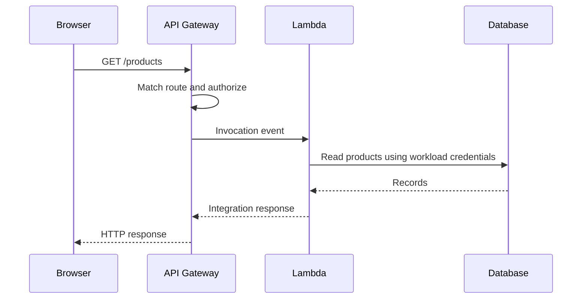

# Lambda and API Gateway: serverless application boundaries

Lambda executes a handler in response to an invocation. API Gateway accepts HTTP or WebSocket traffic and integrates it with backend services. They remove server administration work while leaving application correctness with you.

## Follow one request



With a Lambda proxy integration, the handler must return the response format expected by that API type. REST API and HTTP API payload versions differ. Non-proxy integrations use configured mappings instead; examples for one contract are not automatically interchangeable.

```ts
// Illustrative REST API proxy response; no infrastructure is provisioned here.
export async function handler() {
  return {
    statusCode: 200,
    headers: { 'Content-Type': 'application/json' },
    body: JSON.stringify({ message: 'Hello from Lambda' }),
  };
}
```

The exported name, deployment handler configuration and packaged JavaScript must agree. A TypeScript source file copied into a ZIP is not automatically executable JavaScript. Bundle or compile it, include required dependencies and choose a currently supported runtime. Lambda layers can share packaged dependencies, but add version and compatibility responsibilities.

## Execution environment lifetime

Initialization runs before a handler can process work. A newly prepared environment can add **cold-start latency**. Later invocations may reuse the environment, but reuse is not guaranteed. In-memory data and temporary files are not durable application storage.

Initialize reusable SDK clients outside the handler, but keep request-specific identity and mutable user data inside the invocation. Await work required for the response; do not rely on an unawaited promise finishing after the handler returns. [Lambda development guidance](https://docs.aws.amazon.com/lambda/latest/dg/best-practices.html).

More configured memory also affects available CPU. Measure duration, memory and downstream latency together before assuming the smallest configuration is cheapest. A function timeout bounds its execution; it does not automatically cancel a remote write that already reached another service.

## Concurrency is not a request-rate limit

Concurrency counts simultaneous executions. A slow dependency can raise concurrency even when request rate stays constant. More Lambda executions can exhaust database connections.

**Reserved concurrency** reserves capacity and limits concurrency for a function. **Provisioned concurrency** prepares execution environments to reduce initialization latency. They solve different problems. Account quotas and source-specific scaling behavior also matter; avoid copying a single fixed concurrency number from old slides.

## API design concerns

| Concern | Where to reason about it |
|---|---|
| Authentication | API authorizer or supported identity integration |
| Record ownership | Backend business authorization |
| Input shape | API validation where supported, plus handler validation |
| CORS | Preflight and actual responses, including failure paths |
| Throttling | API limits and workload capacity |
| Error responses | Stable client contract without internal secrets |
| Logging | Correlation IDs and useful context without credentials |

API Gateway API keys primarily support usage identification and usage plans for REST APIs; do not treat them as customer authentication. Choose REST API, HTTP API or WebSocket API based on needed features rather than assuming all API Gateway products share every capability. [API Gateway documentation](https://docs.aws.amazon.com/apigateway/latest/developerguide/welcome.html).

A Lambda function URL provides another HTTP entry point with a smaller feature surface. It does not inherit API Gateway authorizers or usage plans. Every exposed endpoint needs its own access decision.

## Invocation source changes failure behavior

A synchronous API caller observes a response or timeout. An asynchronous event source may retry after the original producer has finished. SQS uses an event source mapping that polls and invokes the handler with batches. Returning an HTTP-style `statusCode: 500` from a queue handler does not itself signal an invocation failure; use the source's failure contract.

Next: [databases](./databases.md), then [imports](./file-imports.md) and [messaging](./messaging.md).
