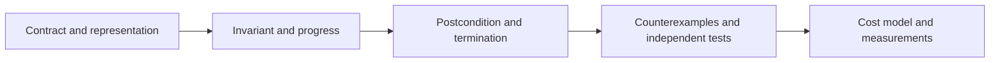

# Correctness, iteration and recursion

An algorithm is correct **relative to a contract**. “It passed my example” is useful evidence, but does not establish what happens for every permitted input.

## A repeatable reasoning method

1. Specify input representation, valid values, ownership and output. Does search return any match, the first match or an insertion position?
2. State the **precondition** and **postcondition**. A sorted-input precondition cannot be replaced by hoping the test data is sorted.
3. Find an invariant that is true initially and preserved by every step.
4. Explain why termination plus the invariant implies the postcondition.
5. Show termination with a decreasing nonnegative measure, or a finite set of items processed once.
6. Search for the smallest counterexample: empty input, one item, duplicates, a cycle, invalid data or a failed assumption.
7. Analyze time/storage under the same contract, then test independently of the implementation.

For sorting, “ascending output” is insufficient: returning `[]` is ascending. The postcondition must also require a **permutation of the input**, with duplicates preserved, and the documented mutation/stability policy. For a bounded queue, include full/empty behavior as well as FIFO order.



## Recursion: smaller problems with a base case

For a nonnegative integer `n`, factorial satisfies `0! = 1` and `n! = n × (n−1)!`. A bounded exact-integer worked example is:

```js
function factorial(n) {
  if (!Number.isSafeInteger(n) || n < 0 || n > 100) throw new RangeError('Expected 0..100');
  function visit(k) {
    return k === 0 ? 1n : BigInt(k) * visit(k - 1);
  }
  return visit(n);
}
```

The base case is correct by definition. If `visit(k−1)` is correct, multiplying it by `k` gives `k!`; this is induction. The argument decreases by one until zero, proving termination. Input validation happens once, outside the recursive helper.

There are O(n) multiplications and O(n) call frames. Those multiplications are **not constant-cost** as BigInt values grow; count operations separately from bit complexity. The bound of 100 is a teaching policy, not a portable call-stack limit.

## Iteration: carry the partial answer

```js
function factorialIterative(n) {
  if (!Number.isSafeInteger(n) || n < 0 || n > 100) throw new RangeError('Expected 0..100');
  let result = 1n;
  for (let k = 1; k <= n; k++) result *= BigInt(k);
  return result;
}
```

Before iteration `k`, `result = (k−1)!`. Multiplication preserves the next prefix result. After the last step it is `n!`. This uses constant **count of live numeric variables**, not constant bits of storage: the result grows. Unlike recursion it needs no O(n) call stack.

These versions have no overlapping subproblems in one call, so memoization would add no benefit to that call. Fibonacci and shared dependency calculations can revisit states. Caching then needs an equality/key policy, capacity and invalidation: the [existing memoization explanation](../senior_growth/Other/What_is_memoization.md#correct-keys-ownership-and-invalidation) provides those limits. Its bounded linear-search LRU is not an O(1) hash cache.

## Call stack versus explicit stack

Recursive tree traversal keeps “where to resume” in call frames. Iterative DFS can store `{ vertex, nextIndex }` frames explicitly. The same dependency on path depth remains, but explicit state avoids relying on the JavaScript call-stack limit and can support an owned work budget.

A base case alone is insufficient: quicksort must reduce partition sizes, and graph traversal must mark visited vertices. A cycle can cause infinite recursion even though leaf handling is correct. A recursive algorithm is not automatically slow; its recurrence and retained state determine its costs. Do not assume tail-call optimization in the target runtime.

## Evidence and counterexamples

Use exact fixtures, exhaustive small domains and deterministic generated cases. Compare against an independent simple oracle: linear search for binary search, sorted arrays for a heap, and an all-pairs distance computation for BFS. Record the seed/counterexample and failing output, not only “tests passed.”

Tests check executions; invariants explain all permitted iterations. Types check declared shapes; parsers validate unknown data. Neither proves authorization, runtime liveness or correctness of external effects. The existing [property and concurrency testing chapter](../node-js/module-04-testing.md#_15-contract-property-and-concurrency-testing) extends this reasoning to service boundaries without repeating it here.

[Separate practice sequence](../practice/cs-foundations/index.md) · [Next: data structures](./data-structures.md)
