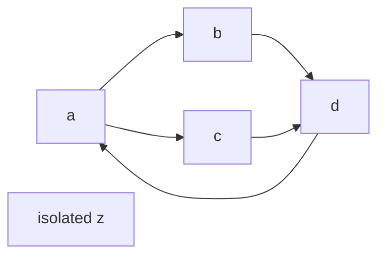

# Trees, graphs and traversal

A traversal must define **what is reachable**, what order matters and what result it promises. A visited set ensures “once per vertex”; it does not by itself prove acyclicity, dependency order or shortest weighted paths.

## Represent the problem

Our directed graph is `Map<string, readonly string[]>`: each vertex has an ordered neighbor list. All referenced vertices must exist; duplicate adjacency entries reject. Cycles and self-loops are valid. Bounds are 200 vertices, 2,000 directed neighbor entries, and IDs of 1–40 ASCII letters/digits/underscore/hyphen. This is a small owned teaching graph, not a parser for arbitrary JSON or a global dependency service.

| Representation | Storage | Useful operation / cost |
|---|---|---|
| Adjacency list | O(V+E) entries | Iterate one vertex's actual neighbors; edge membership may scan degree |
| Adjacency matrix | O(V²) cells | O(1) indexed edge check; enumerate a row in O(V) |
| Edge list | O(V+E) including explicit isolated vertices | Simple import/export; finding neighbors without an index scans edges |

An undirected edge usually needs two adjacency entries; count both. Vertex identity and missing-vertex policy are part of the contract. Traversing from one start visits only its reachable component, even when validation examines the whole graph.

## Worked cyclic and disconnected graph

With neighbor order `a:[b,c], b:[d], c:[d], d:[a], z:[]`:

| Traversal from a | Result |
|---|---|
| BFS discovery/processing order | a, b, c, d |
| BFS hop distances | a:0, b:1, c:1, d:2 |
| DFS preorder | a, b, d, c |
| DFS postorder | d, b, c, a |

Neither visits z. Changing neighbor order can change ties/preorder/postorder without changing reachable sets or shortest hop distances.

## BFS distance invariant

BFS uses a FIFO queue and records distance when **enqueuing**, not when dequeuing. Initially only the start is known at distance zero. When a vertex at distance `k` is removed, newly discovered neighbors get distance `k+1`.

The queue processes layers in nondecreasing distance order. If a newly discovered neighbor had a shorter path, its previous layer would already have discovered it, a contradiction. Thus first discovery establishes a shortest **unweighted hop count**. Marking at enqueue ensures each reachable vertex enters the queue once, including cycles and self-loops.

The code uses a head index instead of repeated `shift()`. It retains the consumed queue entries for this one run. Validation plus traversal costs O(V+E) under expected constant-cost Map/Set operations and bounded IDs; queue, distances and output each use O(V) entries. Reachable-component work alone is O(Vr+Er), but the full validator still examines all V/E.

## DFS frame invariant

Each explicit frame stores a vertex and the index of its next unexamined neighbor. Frames describe the current active path. A newly discovered vertex is marked before pushing its frame; preorder records that discovery. When a frame has no neighbors left, postorder records its finish and the frame pops.

The saved index prevents rescanning completed edges after returning from a child. Each reachable vertex is pushed/popped once and each outgoing edge examined once. The frontier stack is at most O(V), plus O(V) visited/output. Validation still contributes O(V+E).

This is a reachability DFS. A single visited set cannot distinguish a gray active ancestor from a black finished vertex. To detect directed cycles use active/finished state; to compute a topological order first establish the graph is acyclic. Reversing this code's postorder does not magically topologically sort the cyclic fixture. Those extensions are optional.

## Inorder and tree correctness

A binary node has `value`, `left` and `right`. Inorder descends left, emits the node, then visits right. The explicit stack holds ancestors waiting for that emission/right subtree; after finishing a left subtree, popping the next ancestor is exactly the next inorder step.

For root 2 with children 1 and 3, output is `[1,2,3]`. For root 1 with left 3 and right 2 it is `[3,1,2]`. **Inorder produces sorted values only for a valid BST**, not for any binary tree. A BST must specify its duplicate-key policy; “all left smaller, all right larger” excludes duplicates, while a one-sided duplicate convention changes that rule.

The retained source rejects nonfinite values, more than 200 nodes, cycles and shared child identities. Unknown JSON still needs shape validation; TypeScript declarations do not parse it. For an already validated proper tree, the traversal stack uses O(h), where height is O(log n) when balanced and O(n) for a chain. This implementation also keeps an O(n) validation set and O(n) output, so quoting only O(h) total auxiliary memory is wrong.

## Scope and failure boundaries

[Canonical traversal source](../workbench/cs-foundations/traversals.md) retains the original Big O page's implementations unchanged. Proper inputs are application-owned and unchanged during traversal; readonly types do not freeze objects. Empty graph/start mismatch rejects; a null tree returns `[]`. Graph cycles are allowed; tree cycles/shared children reject because their contracts differ.

These synchronous bounded functions do not implement cancellation, CPU isolation or arbitrary weighted shortest paths. Large jobs need separate work/resource policies from the [Node runtime course](../node-js/index.md); the data structure alone does not provide them.

[Separate dependency-explorer exercise](../practice/cs-foundations/dependency-explorer.md#cs-p05-note-dependency-explorer) · [Next: priority scheduling](./priority-queues.md)

Primary terminology references: [Boost traversal overview](https://www.boost.org/doc/libs/latest/libs/graph/doc/html/graph/algorithms/traversal/traversal_overview.html), [NIST inorder](https://xlinux.nist.gov/dads/HTML/inorderTraversal.html). Correctness/cost reasoning above is for the retained source and its explicit validation policy.
