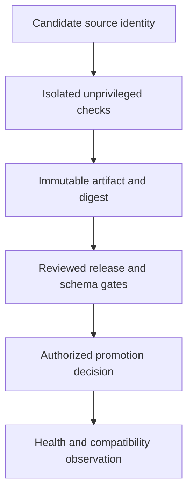

# Git, CI and release integrity

**Prerequisites:** Local status/diffs, project checks and the primary Node artifact/database material. Review baseline: 2026-10-27. All learner practice remains outstanding.

## Select a release policy

[Branching model comparison](../senior_growth/Git/GIT_flow_vs_Trunk-based_Development%2C_Differences%2C_benefits_each_of_branching_model.md) → [Local strategy and conflict recovery](../senior_growth/Git/Please_explain_the_git_strategy_in_your_project.md) → [Merge/rebase mechanics](../senior_growth/Git/What%27s_the_difference_between_merge_and_rebase_in_git_What%27s_prefferable.md). Team size is not the deciding variable. A branch label is not protection; a conflict-free merge can still be wrong. Never push from this assistant workflow.

## Enforce without damaging work

[Staged-aware hooks](../senior_growth/Git/What_is_GIT_hooks_Which_git_hooks_you_are_using_on_your_current_project_and_why.md) and [Isolated CI jobs](../senior_growth/CD_CI/Do_you_run_tests_within_CICD.md). Local hooks may be bypassed; required remote checks are separate policy. Check exact candidate bytes; caches are optional accelerators, artifacts are explicit handoffs.

## Separate build from promotion

[CI/delivery/deployment](../senior_growth/CD_CI/What_is_Continuous_Integration%2C_Continous_Delivery%2C_Continous_Deployment.md) → [Schema-compatible rollout](../senior_growth/CD_CI/Release_strategies._What_strategy_do_you_use_on_project_How_will_you_build_a_release_strategy_for_open_source_project.md) → [real artifact compatibility](../node-js/release-artifact-compatibility.md). Rolling deployment, canary and version/support policy are distinct choices. A code rollback is unsafe after incompatible data/messages have been committed.

## Keep untrusted CI code outside release authority

A dependency install or build can execute repository-controlled code. Use isolated unprivileged checks for untrusted changes; do not expose production secrets or a privileged runner merely to run a PR test. Lockfiles and hashes identify inputs/bytes but do not establish trust. Privileged promotion needs a reviewed candidate/artifact provenance and narrow authority. No hosted pipeline or deployment is activated by these notes.

## Promotion is a separate authority

This is a conceptual ownership map. It neither publishes a pipeline nor grants a check job production credentials.

## Practice and verification

Use [the shared increments](../practice/engineering/) and linked focused requirements. [Workbench](../workbench/engineering/) contains canonical references; [verification](../review/verification.md) distinguishes current checks, preserved historical evidence and unperformed integrations.
