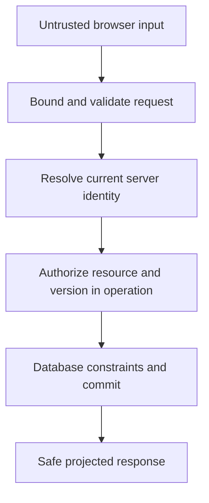

# Application and transport security boundaries

**Prerequisites:** HTTP methods/status, unknown-input validation, identity and asynchronous lifetimes. Review baseline: 2026-10-27. All learner practice remains outstanding.

## Begin with actor, resource and sink

[Threat model and OWASP editions](../senior_growth/Communication_and_Security/Can_you_provide_several_examples_of_Web_Security_related_issues__like_types_of_attack__and_how_can_we_prevent_them__OWASP_10.md) → [Authentication versus authorization](../senior_growth/Communication_and_Security/What_authentication_authorization_mechanisms_do_you_use_on_your_project_Please_describe_how_they_work.md). Derive the principal server-side and enforce owner/tenant/version in the actual operation. OWASP Top 10:2025 is an awareness taxonomy, not a complete verification standard.

## Choose one browser transport

[Token/session placement](../senior_growth/Communication_and_Security/Where_do_you_prefer_to_store_auth_token__Where_is_it_most_secure.md) → [CORS and CSRF](../senior_growth/Communication_and_Security/What_is_CORS__Can_proper_CORS_configuration_protect_against_CSRF_attacks__What_other_measures_can_be_taken_to_mitigate_CSRF_attacks.md) → [Headers and nonces](../senior_growth/Communication_and_Security/Do_you_remember_any_security_headers.md). Cookie attachment, credentialed CORS, CSRF policy and protected mutations need their own checks. HttpOnly limits token reads, not every authenticated action by hostile script.

## Protect protocol and data lifecycle

[TLS boundaries](../senior_growth/Communication_and_Security/HTTPS._Could_you_please_describe_advantages_and_disadvantages_of_this_protocol.md); [HTTP method semantics](../senior_growth/Communication_and_Security/Could_you_please_provide_me_a_detailed_explanation_about_HTTP_verbs.md); [Bounded WebSocket ownership](../senior_growth/Communication_and_Security/RESTful_API_HTTP__and_WebSockets_-_why_and_when_we_need_them._Limitations.md). TLS authenticates/protects a hop; it does not authorize a record. Transport closure does not establish remote rollback.

## Use the canonical implementations

The [Node authorization course](../node-js/module-09-authentication-authorization.md), [retention/deletion](../node-js/retention-and-deletion.md) and [Next boundary](../frontend/next.md) own server/database implementation. These browser/HTTP notes complement them, rather than create a second authentication system.

## Shared authority boundary

Parsing, actor identity and operation authorization answer separate questions. A validated field or a hidden UI button cannot replace the later checks.

## Practice and verification

Use [the shared increments](../practice/engineering/) and linked focused requirements. [Workbench](../workbench/engineering/) contains canonical references; [verification](../review/verification.md) distinguishes current checks, preserved historical evidence and unperformed integrations.
