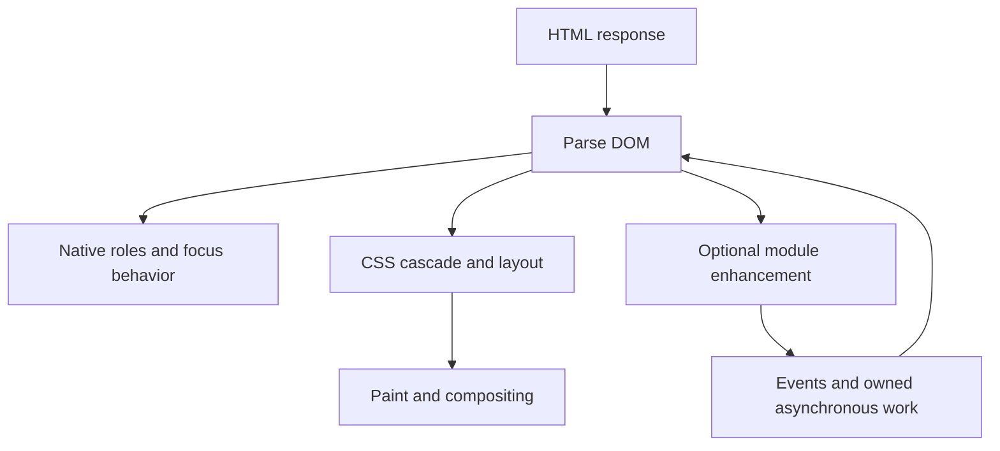

# Documents, browser behavior and accessible interaction

Prerequisites: basic files/URLs and the ability to inspect an HTML document. Start with [semantic HTML](../senior_growth/A11y/What_is_semantic_HTML.md); use native links, buttons, labels, fieldsets and tables before inventing a widget.

## From bytes to an interactive document

HTML parsing builds a DOM; CSS supplies cascade and layout constraints. JavaScript can change that DOM. The browser performs style, layout, paint and compositing as needed; these are distinct from a React render. Reading geometry after a style write can force synchronous layout. Group measurements and writes when profiling shows a problem; requestAnimationFrame schedules work before a rendering opportunity, not a guaranteed fixed frame rate.

A classic script without async/defer normally blocks parser progress while fetched/executed. Deferred classic scripts execute after parsing in document order; ordinary module scripts are deferred by default and have dependency loading. Async scripts execute when ready, so they must not depend on document order. DOMContentLoaded follows parsing and deferred/module evaluation; it does not wait for every image. Load handlers alone do not prove a meaningful or responsive page.

## Navigation, events and forms

| User intent | Baseline | Enhancement boundary |
|---|---|---|
| Navigate to a resource | Link with a real href | Preserve modified clicks, Back/Forward and direct URLs |
| Search public data | GET form with named controls | Intercept only once ready; keep regular results on failure |
| Change private data | Authorized server mutation | Validate again, protect against CSRF, preserve uncertain outcomes |
| Reveal local content | Button and associated content | Keep expanded state, visibility and focus consistent |

Capture, target and bubble describe event propagation; preventDefault requests cancellation of a cancelable default action, while stopPropagation changes propagation. Neither authorizes a request. Keyboard-generated clicks should use the same native activation path as pointer clicks; adding keydown handlers to a button can accidentally activate twice.

Native validation improves input feedback but is bypassable. requestSubmit uses submission validation/events; form.submit bypasses them. Disabled fields are absent from FormData; repeated names require getAll. A label persists when the value is present; a placeholder does not replace it. The [worked form and table](../senior_growth/A11y/What_is_semantic_HTML.md) explains these contracts with examples.

## Focus and announcements have owners

Keep DOM reading order meaningful. Avoid positive tabindex and visual reordering that disconnects focus from the visible sequence. A disclosure allows Tab to leave; a modal contains Tab, makes the background inert and restores focus to the trigger or a logical survivor. A portal only changes DOM placement. Use [the native dialog and form examples](../senior_growth/A11y/Can_you_provide_some_examples_for_a11y.md) rather than treating ARIA attributes as a keyboard implementation.

An accessible name identifies a control; descriptions add instructions/errors; role and state expose interaction meaning. Use one coherent error-summary/focus strategy and a surviving status region. Role/name assertions are structural evidence, not proof of what a screen reader announces.

## Browser security and lifecycle

The same-origin policy limits cross-origin reads; CORS relaxes specified browser read restrictions and is not authentication. Client storage, route guards and hidden controls are not server permission boundaries. Render untrusted text through textContent or ordinary escaped JSX; avoid interpreting it as markup or executable URLs.

A page can be frozen, discarded or restored from the back/forward cache. pagehide cleanup followed by a persisted pageshow requires a deliberate reinstall policy. beforeunload cannot guarantee saving. Cancel obsolete work and invalidate its owner so late callbacks cannot commit; a canceled mutation may already have reached the server.

The [public-search workbench](../workbench/frontend/browser/) demonstrates a native GET baseline, optional fetch, response ownership and failure fallback. Its fixed corpus is deliberately public and tiny: post-parse item checks are not a pre-parser byte limit for arbitrary responses.

## Standards and scope

Living HTML/DOM and WCAG 2.2; official references checked 2026-10-27: [script processing](https://html.spec.whatwg.org/multipage/scripting.html), [form submission](https://html.spec.whatwg.org/multipage/form-control-infrastructure.html#form-submission), [WAI page structure](https://www.w3.org/WAI/tutorials/page-structure/), [modal dialog pattern](https://www.w3.org/WAI/ARIA/apg/patterns/dialog-modal/), [MDN page lifecycle events](https://developer.mozilla.org/en-US/docs/Web/API/Window/pageshow_event). Browser support and assistive behavior require a declared test matrix.

Apply [F01 and F02](../practice/frontend/#staged-sequence); this explanation awards no practice credit.
