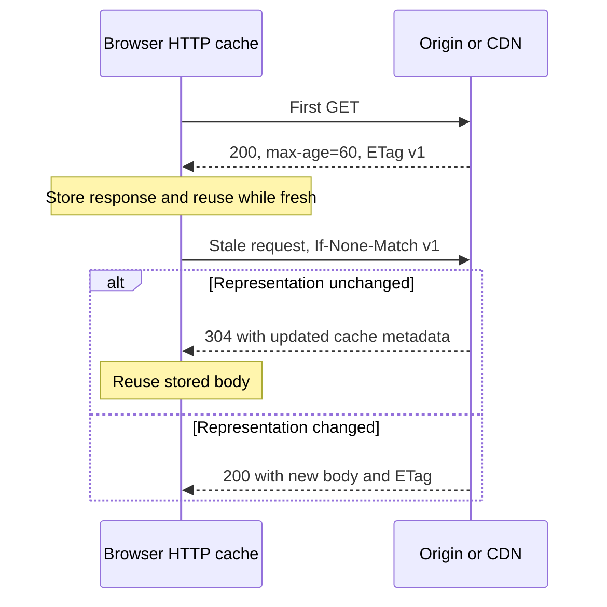
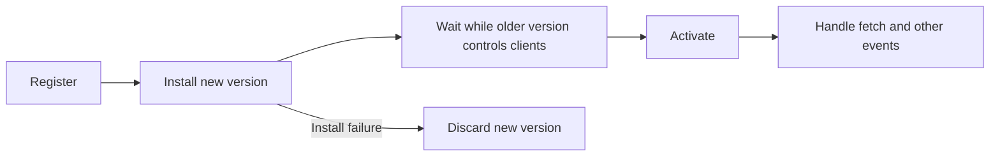

# Caching, delivery and repeat visits

**Prerequisite:** HTTP responses, browser origins and resource lifetime. Caching trades freshness and storage for reuse. Begin with a resource policy, not “cache everything.” A public course thumbnail, a logged-in management response and an application HTML entry need different treatment.

## Name the cache and its authority

| Layer | What it can reuse | Ownership question |
|---|---|---|
| HTTP browser cache | Responses under HTTP freshness/validation rules | When must this user revalidate? |
| CDN/shared HTTP cache | Eligible responses across users | Could a cache key or policy expose private content? |
| Service-worker Cache Storage | Request/response entries managed by application code | Who versions, expires and deletes them? |
| Application/query cache | Parsed domain results | Which query/user/version owns a value and its invalidation? |

A request intercepted by a controlling service worker can be answered from Cache Storage or forwarded using fetch, which may then use HTTP caching and a CDN. This is not an automatic mandatory cache ladder. Without an appropriate fetch handler, cached entries are not automatically served. Cache Storage does not automatically enforce HTTP Cache-Control freshness like an HTTP cache. [HTTP caching](https://developer.mozilla.org/en-US/docs/Web/HTTP/Guides/Caching), [Cache interface](https://developer.mozilla.org/en-US/docs/Web/API/Cache).

## Freshness versus validation



`no-store` instructs caches not to store this response; it is not retroactive deletion of every prior copy. `no-cache` allows storage but requires successful validation before reuse. `max-age` defines freshness; `must-revalidate` constrains stale reuse. ETags can be weak or strong; Last-Modified can be another validator. A 304 carries validation metadata, not the full representation body. [Cache-Control reference](https://developer.mozilla.org/en-US/docs/Web/HTTP/Reference/Headers/Cache-Control).

Illustrative policies for an owned deployment:

```http
# Content-hashed public assets; never overwrite a URL with different bytes
Cache-Control: public, max-age=31536000, immutable

# Public HTML that should validate before reuse
Cache-Control: no-cache

# Sensitive response chosen not to be stored
Cache-Control: no-store
```

Choose the actual policy with security/freshness needs. `private` prevents shared-cache storage but is not encryption or authorization. Personalized output must not enter public caches accidentally. Account/tenant scope and logout behavior also matter in an application cache and service-worker code, not just headers. Service-worker code should explicitly bypass sensitive APIs when offline caching is unnecessary.

## CDN and compression

A nearby edge and warm shared cache can reduce origin round trips; a cold miss, wrong cache key or origin bottleneck still matters. Inspect hit/miss headers and actual geographic/user conditions. Serve negotiated compression for text resources, and compare transferred versus decoded bytes. Already compressed image/font formats do not automatically benefit from another compression layer. Cache keys and variation must preserve the correct content representation.

The old S3/CloudFront console screenshots teach a provider-specific workflow with dated public-bucket settings. They are not needed to learn the delivery model. Keep infrastructure setup in [full-stack deployment](../../node-js/full-stack-deployment.md), and review current provider documentation before configuring a real environment. Do not copy a public bucket policy to solve a frontend timing problem.

## Service workers are an optional offline capability

A service worker requires a secure context (localhost is a development exception), registration and appropriate scope. First navigation usually precedes control. A successful registration does not mean every open page is immediately controlled or cached. Separate registration, installation, waiting, activation and fetch handling. [Service Worker API](https://developer.mozilla.org/en-US/docs/Web/API/Service_Worker_API).



The waiting step can be skipped when there are no existing controlled clients. Forced activation/claiming needs deliberate compatibility decisions. Precache essential versioned files with `install`/`event.waitUntil`; keep activation short and delete only caches owned by this application. Deleting every origin cache can break another application. Cache writes after responding still need lifetime/error handling; cloning a Response permits separate consumers of its body.

| Strategy | Useful when | Failure mode |
|---|---|---|
| Cache first | Versioned public assets | Old content persists without version cleanup |
| Network first | Fresh public content with acceptable offline fallback | Slow network delays fallback; use an explicit policy/deadline |
| Stale while revalidate | Stale public content is temporarily acceptable | Background failure or unbounded storage can go unnoticed |
| Network only / bypass | Sensitive or mutation endpoints | Requires honest offline/unavailable UI |

Cache only can fail offline if an expected entry was evicted; persistence is never a reason to omit recovery. Do not cache arbitrary URLs or opaque/private responses indiscriminately. Read storage usage through `navigator.storage.estimate()` where supported; `persist()` is a request, not an unconditional guarantee. Push/background sync are optional capabilities with separate support and permission concerns, not prerequisites for frontend performance.

## Deployment is a cache correctness test

Retain old content-hashed assets for a defined compatibility window, revalidate entry HTML, and test an old open tab after a new release. A stale HTML entry plus deleted chunks causes feature-open failures. Test offline behavior and update/rollback separately from warm navigation timing. Framework caches are additional layers: use the explicitly selected [Next cache model](../next.md), not assumptions copied from another version.

Core practice: plan appropriate delivery/cache improvements in [Hometasks 2–3](../../practice/frontend/performance/). Implementing an offline service worker is an optional extension with its own lifecycle, eviction and privacy acceptance cases.
