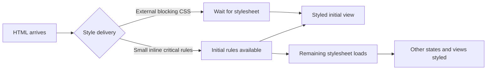

# Critical CSS and font delivery

**Prerequisite:** cascade/layout, resource discovery and layout stability. CSS and fonts determine whether early content is styled, readable and stable. Their optimization must survive JavaScript failure and supported viewport/content variants.

## Critical CSS is a dependency trade-off

A normal matching stylesheet can block rendering until it is ready. Critical CSS places the minimum initial-view rules in HTML so useful rendering can begin without waiting for the complete stylesheet. It increases HTML and repeats those rules across responses; the inlined bytes do not have a separately reusable stylesheet cache. The benefit can disappear if HTML grows or the remaining CSS is needed immediately.



Start by reducing unused/duplicate CSS and shipping route-specific styles. Only extract critical rules when a trace shows CSS delaying the relevant paint. DevTools Coverage identifies rules unused in recorded states, not safe deletion across dialogs, validation, themes and other routes. Include keyboard focus, loading/error states and content-dependent wrapping in the extraction review.

For a controlled first demonstration, add a small critical block **while retaining the normal blocking stylesheet**. Expect that external sheet still to gate the initial paint: this exposes why inlining rules alone is insufficient. To test the intended performance benefit, make the remaining genuinely noncritical CSS nonblocking in a separate variant. Provide a no-JS fallback, retain cascade order, avoid unstyled interactions, and comply with the actual CSP using an allowed nonce/hash or delivery approach. Event-handler-based `onload` tricks can be blocked by CSP. Measure HTML growth and repeat-visit caching as well as the initial paint.

EPAM's iPhone/iPad/desktop extraction task is useful for learning viewport sensitivity; three presets do not prove every content or layout works. The named plugin is an original-course constraint, not the learning objective. Choose a compatible maintained tool only if automating extraction is worthwhile. See [critical CSS](https://web.dev/articles/extract-critical-css) and the existing [critical-path reference](../../senior_growth/Web_Performance/What_is_the_critical_rendering_path%2C_how_to_measure_and_optimize.md).

## Font discovery is often an extra dependency

The browser generally requests a font when used styles require it, not merely because `@font-face` exists. A critical face discovered inside external CSS can start late. Prefer a small WOFF2 subset for the actual supported scripts/weights. Additional formats are support-policy decisions; WOFF and WOFF2 are not both simply gzip files. Font licensing and subset coverage are part of the asset contract.

```html
<link rel="preload" href="/fonts/catalogue-latin.woff2"
      as="font" type="font/woff2" crossorigin>
```

```css
@font-face {
  font-family: 'Catalogue';
  src: url('/fonts/catalogue-latin.woff2') format('woff2');
  font-style: normal;
  font-weight: 400;
  font-display: swap;
  /* Must match the generated subset, including supported accents. */
  unicode-range: U+0000-00FF, U+0100-024F;
}
body { font-family: 'Catalogue', system-ui, sans-serif; }
```

These are illustrative asset paths; supply actual licensed binaries in practice. `unicode-range` selects when a face applies; it does not remove bytes from its file. Verify Hungarian ő/ű and all supported scripts, punctuation and combining sequences. The example range is not a promise of full language coverage. A variable font can replace several files but may exceed a small static subset.

Preload only initial-view faces that are actually needed; the URL must match the later CSS request and use the right CORS mode. For remote fonts, the server also needs valid CORS response headers. `local()` is optional: it can avoid downloads but use a different locally installed font version, undermining reproducible metrics. A fallback font is configured in `font-family`, which is separate from `src: local(...)` within a face.

## Visible fallback and stable geometry

| Strategy | Intended behavior | Cost to examine |
|---|---|---|
| System fonts | No custom-font dependency | Typography differs by platform |
| `font-display: swap` | Very short block period, then visible fallback with later replacement | Font replacement can change wrapping and CLS |
| `font-display: optional` | Very short block period and no later swap period | Custom face may remain unused for that visit |
| `font-display: block` | Longer invisible-text period before fallback | Can delay readable content |

FOUT and FOIT describe visible outcomes, not separate network protocols. `swap` is appropriate for learning FOUT, but it does not guarantee no shift. Font preload plus `optional` does not guarantee every page is stable either. Compare the actual font pair, font availability and target browsers. [Font loading and rendering practices](https://web.dev/articles/font-best-practices).

Calibrate fallback metrics with `size-adjust`, ascent/descent and line-gap overrides when appropriate; do not copy percentages from another family. See the existing [typography calibration example](../../senior_growth/Web_Performance/Do_you_know_some_ways_to_measure_and_improve_initial_load.md#typography-fallback-metrics-and-subsets). Block/delay font requests and inspect readable text, line wraps, shifts and request duplication. Test at narrow/wide widths, 200% text enlargement and supported translations.

Practice: choose a justified CSS or font intervention in [Hometask 2](../../practice/frontend/performance/02-improve.md). Retain the original two-family Roboto/Raleway exercise as an optional comparison, not a requirement to ship two fonts in every application.
