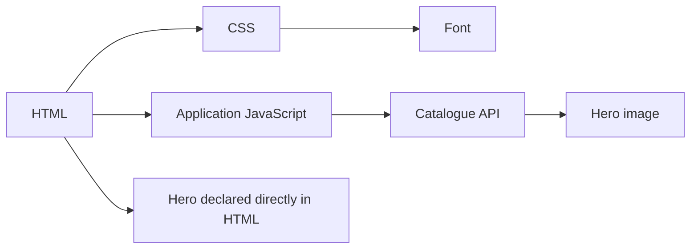

# Browser loading, script attributes and JavaScript delivery

**Prerequisite:** HTML parsing and JavaScript execution. Continue the existing [URL-to-pixels reference](../../senior_growth/Web_Performance/Can_you_describe_the_process_from_time_you_type_appliaction_url%2C_to_it_finished_state_on_your_screen.md) and [script-category examples](../../senior_growth/Web_Performance/Do_you_know_some_script_tag_properties_to_alter_loading_behavior_async_vs_defer.md).

## Discover resources before tuning their bytes

HTML reveals CSS, scripts and images incrementally; CSS can reveal fonts/backgrounds; executed JavaScript can reveal API calls and image URLs. Network work is asynchronous, but the next dependent step still waits. Fetching an image does not normally freeze the main thread until the response arrives. JavaScript execution, style/layout and processing downloaded data can occupy it. A render-blocking stylesheet delays rendering without being the same mechanism as a parser-blocking script.



The diagram shows alternative discovery paths, not timings. If the hero is available in initial HTML, the browser can discover it without waiting for JS and API execution. Confirm the real initiator chain before adding preloads. Reused connections and HTTP/2 or HTTP/3 multiplexing change costs; summing request durations or routinely spreading assets across domains is misleading.

## Script timing is an execution contract

| External script | Fetch | Execution and ordering |
|---|---|---|
| Classic with no attributes | Parser may wait for fetch | Executes at its parser position; can wait for earlier blocking stylesheets |
| Classic `async` | Can overlap parsing | Executes when ready; no document-order guarantee among async scripts |
| Classic `defer` | Can overlap parsing | After parsing, before DOMContentLoaded, in document order |
| `type="module"` | Loads its dependency graph | Deferred by default; module dependencies determine ordering |
| Module with `async` | Loads its graph | Executes when ready; do not depend on deferred document ordering |

Inline classic `defer` is ineffective. `defer` avoids blocking the parser during fetch; executing deferred code can still block the main thread and delay input or paint. Async does not make expensive code cheap. DOMContentLoaded and load are lifecycle events, not proof of usable application data or responsive controls. Native links/forms can work before hydration.

Keep dependent application scripts ordered; choose async only when independent execution is acceptable. Module fetches use CORS rules. Explore the existing [script trace lab](../../senior_growth/Web_Performance/Do_you_know_some_script_tag_properties_to_alter_loading_behavior_async_vs_defer.md#small-browser-trace-lab-not-a-benchmark); official semantics: [HTML script element](https://developer.mozilla.org/en-US/docs/Web/HTML/Reference/Elements/script).

## Resource hints solve different problems

| Mechanism | Purpose | Failure to watch for |
|---|---|---|
| `preconnect` | Begin connection setup to a known needed origin | Too many speculative connections waste work |
| `dns-prefetch` | Resolve a hostname early | Does not fetch content or complete TLS |
| `preload` | Discover a specific current-page resource early | Wrong URL/type/credentials can waste or duplicate fetches |
| `modulepreload` | Prepare a module for later execution | Overpreloading competes with critical content |
| `prefetch` | Speculate on a likely later resource | May be ignored; can waste bandwidth |
| `fetchpriority` | Influence scheduling of an already discovered fetch | Does not discover the resource; “high” everywhere removes useful distinction |

```html
<!-- Only when this face is needed for the initial view. -->
<link rel="preload" href="/fonts/catalogue-latin.woff2"
      as="font" type="font/woff2" crossorigin>
<script type="module" src="/assets/catalogue.js"></script>
```

A preload does not apply a stylesheet or execute a script. Match the eventual request's URL, destination and CORS/credentials mode. Font preloads need the appropriate anonymous CORS mode even for same-origin fonts. Use `fetchpriority`, not historical `importance`. Modern speculative navigation belongs to an optional, feature-detected enhancement with bandwidth/privacy and side-effect considerations; do not import old `rel="prerender"` advice as a universal recipe. [Resource hints](https://web.dev/learn/performance/resource-hints), [Fetch Priority](https://web.dev/articles/fetch-priority).

## Browser targets are a product contract

Choose supported browsers from actual audience and product requirements, then document syntax transforms separately from missing runtime APIs. Babel can transform syntax without supplying every browser API. Prefer feature detection to user-agent guessing for optional capabilities.

The original course's “last two versions / not dead / over 5%” is a query exercise, not an appropriate policy for every product. Browserslist comma-separated queries form a union; exclusions filter the result. Save the resolved target list to make the intended combination reviewable. `type="module"`/`nomodule` distinguishes module support, not support for every modern feature. Differential builds add testing and delivery complexity; require an audience need before adopting them. [Browserslist query composition](https://github.com/browserslist/browserslist#query-composition).

## Bundle analysis: distinguish four mechanisms

- **Splitting** changes when code loads. A route or expensive optional editor is a meaningful boundary; excessive splits can create waterfalls.
- **Deduplication/shared chunks** avoid shipping the same dependency in multiple entry bundles. They can also make a small entry fetch unnecessary shared code.
- **Tree shaking** removes unused exports when the module format, analysis and side-effect contracts permit it. A deep CommonJS import can reduce included code without demonstrating ESM tree shaking.
- **Minification and compression** reduce representation/transfer cost. Gzip/Brotli do not remove the remaining parse and execution work.

Analyze the actual production graph before choosing a remedy. EPAM's two-entry Lodash example is useful for exposing duplication. Compare full import, supported function-level import and ESM alternatives using equivalent output; avoid claiming a fixed number of output files proves success.

Styles and polyfills can be intentionally side-effectful. Incorrect `sideEffects: false` can remove required behavior. The source material's descriptions of `usedExports` and `providedExports` are reversed; use maintained documentation rather than copying that table. Follow [Webpack tree shaking](https://webpack.js.org/guides/tree-shaking/) and the existing [production graph fixture](../../senior_growth/Web_Performance/What_are_some_general_practices_and_techniques_to_optimize_in_the_area_Explain_tree_shaking%2C_code_splitting_and_bundling%2C_minimizing%2C_data_caching..md#worked-production-analysis-module-contracts-before-chunk-tuning).

Dynamic `import()` needs loading/error recovery. Compare cold initial navigation **and first feature open**. Keep old hashed chunks available during deployment or provide a safe recovery path for old tabs; avoid unlimited reload retries that can discard user work. PRPL remains a useful historical mnemonic for prioritizing, rendering, caching and lazy loading; it does not require server push or precaching the entire application.

Next: [images](./images.md), then [CSS/fonts](./css-fonts.md). Practice: [Hometask 2](../../practice/frontend/performance/02-improve.md).
