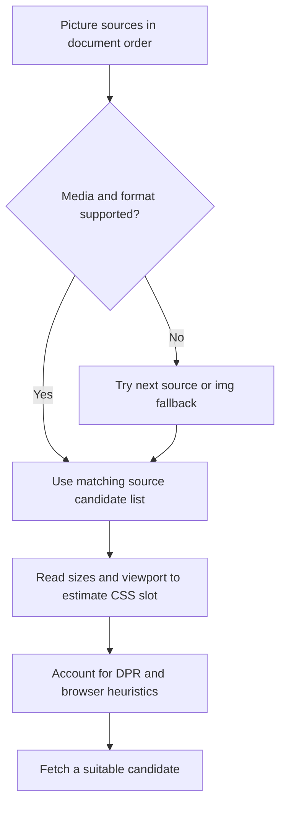

# Responsive images without delaying the main content

**Prerequisite:** responsive CSS, resource discovery and LCP. Images cost transferred bytes, decode work and decoded memory. A compressed file can be small yet decode into a large bitmap. Start with the real display size and visual purpose.

## Resolution switching and art direction

`srcset` with width descriptors declares intrinsic candidate widths. `sizes` describes the image's expected CSS slot width at a viewport size. The browser uses these inputs, device pixel density and its selection heuristics; it is not required to fetch an exact viewport-matched file. CSS controls actual layout. `<picture>` additionally supports format selection and art direction, such as a different mobile crop. [Responsive image semantics](https://developer.mozilla.org/en-US/docs/Web/HTML/Guides/Responsive_images).



The following example assumes generated 320/768/1024/1920-pixel versions with the same 2:1 crop. Paths are illustrative: generate real assets before running the exercise. If different crops have different ratios, reserve the appropriate geometry for each layout.

```html
<picture>
  <source type="image/avif"
    srcset="/images/course-320.avif 320w, /images/course-768.avif 768w,
            /images/course-1024.avif 1024w, /images/course-1920.avif 1920w"
    sizes="(max-width: 48rem) 100vw, 50vw">
  <source type="image/webp"
    srcset="/images/course-320.webp 320w, /images/course-768.webp 768w,
            /images/course-1024.webp 1024w, /images/course-1920.webp 1920w"
    sizes="(max-width: 48rem) 100vw, 50vw">
  
</picture>
```

```css
/* Keep these slot rules aligned with sizes. */
picture { display: block; width: 100%; }
picture img { display: block; width: 100%; height: auto; }
@media (min-width: 48.001rem) { picture { width: 50%; } }
```

In a real container, account for gutters and maximum widths instead of copying `100vw`. Source order prefers AVIF, then WebP, then JPEG when types are supported; inspect visual quality and bytes rather than assuming every AVIF beats every WebP. Transparent graphics may need different fallbacks. An unsupported format can fall through; a broken URL in a selected source does not promise automatic retry of every other format. Keep meaningful alt text; use empty alt for decorative images.

## Eager hero, deferred offscreen content

Keep the likely LCP image discoverable in HTML and eager. Use `fetchpriority="high"` selectively when it helps; early discovery and scheduling are separate concerns. Do not lazy-load the LCP image. Below-the-fold cards can use native loading:

```html

```

`decoding="async"` is a hint, not a guarantee of better LCP. Native lazy loading may start before an image becomes visible; the exact distance depends on browser heuristics. Preserve dimensions so delayed content does not collapse its slot. [Image loading and LCP](https://web.dev/articles/optimize-lcp).


*User-supplied course illustration. The 2 MB/1 MB labels are conceptual, not measured savings or guarantees. Visible images remain available in both cases.*

Native lazy loading is the default exercise. Only add a feature-detected fallback if the support policy requires one. Prefer eager images as the safe unsupported-browser fallback over leaving all `src` attributes empty when enhancement fails. An IntersectionObserver loader itself needs capability/failure handling; shipping a polyfill to everyone defeats the conditional requirement.

## Verify the selected resource

In a fresh navigation at 320, 768, 1024 and 1920 CSS-pixel widths, record DPR, the element's displayed width, `currentSrc`, intrinsic dimensions, response type and transferred bytes. Also test a high-DPR case. Browser caches can retain a larger suitable candidate after resizing; resizing one warm tab is not a reliable clean candidate-selection experiment.

Use the waterfall to locate discovery and transfer, and a Performance trace to inspect LCP and shifts. Test delayed/broken images, narrow layouts and scrolling. Exporting HAR is useful, but classify images by response MIME type rather than only filename extensions: transformed image endpoints may have no `.jpg` suffix. Summed image request durations describe cumulative work; they do not equal elapsed loading time because requests overlap.

An image service or build pipeline can generate size/format variants; the browser consumes them. Keep Node image processing implementation in the backend lane. Compare quality, total bytes and journey outcomes in [Hometask 2](../../practice/frontend/performance/02-improve.md).
