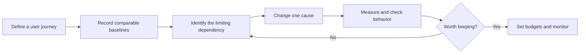

# Frontend performance: from a slow journey to evidence

Performance is part of a usable frontend: useful content arrives promptly, interactions respond, and the page stays stable while it loads and updates. A smaller bundle is useful only when the resulting experience and delivery cost justify the change.

**Prerequisites:** [HTML/browser behavior](../html-browser.md), CSS layout, JavaScript tasks and async ownership. Complete the browser stages before framework-specific profiling; React and Next sections require their respective foundations. **All learner homework remains outstanding.** Material merged with the supplied EPAM Web Performance path on **2026-10-28**; see [source mapping and corrections](./sources.md).

## Reading and practice order

| Stage | Read | What you should be able to explain |
|---|---|---|
| 1 | [Metrics and investigation](./measurement.md) | Distinguish loading, responsiveness, stability and task completion; record a reproducible baseline |
| 2 | [Browser loading, scripts and bundles](./delivery.md) | Trace discovery and execution dependencies; choose hints and split points |
| 3 | [Responsive images](./images.md) | Deliver an appropriate candidate without delaying the hero or shifting content |
| 4 | [Critical CSS and fonts](./css-fonts.md) | Keep content styled and readable while controlling discovery and swap costs |
| 5 | [Runtime responsiveness](./runtime.md) | Separate CPU, rendering and network waits; choose scheduling, workers or fewer DOM nodes |
| 6 | [Caching and repeat visits](./caching.md) | Define freshness, private/public scope, version compatibility and offline behavior |
| 7 | [Hometasks](../../practice/frontend/performance/) | Investigate, improve and verify the same application |

Use the course catalogue from [frontend practice](../../practice/frontend/). Initial navigation, searching a large catalogue and opening course detail are different journeys with different critical dependencies. A fast landing-page audit says little about editing a long form after ten minutes of use.

For example, a late hero request suggests a discovery problem; an early hero request followed by a long gap before paint suggests other work is delaying display. Compressing an already-small hero may not fix the second case. Read the trace before choosing an optimization.

## Existing reference owners

The [engineering performance guide](../../engineering/performance.md) remains the cross-topic investigation entry. The [senior-growth catalogue](../../senior_growth/Web_Performance/) retains deeper worked references for URL-to-pixels, script categories, module graphs, debounce, layout, animation, retention and SSR. This sequence integrates those references with the supplied course rather than duplicating every interview page.

Continue to [React performance](../react.md#performance-follows-correctness) for component identity and profiling, and [Next delivery](../next.md) for server/client and cache boundaries. A React render is not a browser paint; SSR can expose content earlier while hydration still consumes client CPU. Keep server diagnostics with [Node performance](../../node-js/module-11-performance-diagnostics.md).

## What counts as completion

Required practice consists of [three hometasks](../../practice/frontend/performance/): investigation, one loading plus one interaction improvement, and regression prevention. Each produces a before → hypothesis → change → evidence → trade-off report. Optional Webpack, browser compatibility, critical-CSS automation and service-worker exercises deepen a demonstrated need.

A build passing establishes documentation or code validity at that boundary. It does not establish learner mastery, field Web Vitals, real-device performance or a successful production rollout. No numeric improvement in these lessons is a measured result unless explicitly recorded as such.
