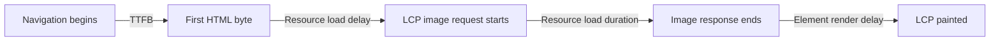

# Metrics and a reproducible investigation

**Prerequisite:** browser parsing, tasks and rendering. Start with a user complaint expressed as an action: “the course cards arrive late” or “typing stalls while filtering.” Define what must become visible or usable, on which device, with which data.

## Choose an outcome before a tool

| Metric | Question | Interpretation |
|---|---|---|
| LCP | When does the largest eligible visible content appear? | Good field p75 ≤ 2.5 s; inspect the actual candidate |
| INP | How promptly do qualifying interactions receive their next paint over a visit? | Good field p75 ≤ 200 ms; more than the first event's waiting time |
| CLS | How much unexpected movement occurs in the largest qualifying shift session window? | Good field p75 ≤ 0.1; unitless |
| FCP | When does the first eligible content paint? | Early feedback; does not prove the main task is ready |
| TTFB | How long until the first response byte? | Navigation timing includes more than server computation; inspect redirects, connection and server work |
| TBT | How much long-task blocking occurs in the lab loading window? | Sum each task's excess over 50 ms; not field INP |
| Task completion | When can the user finish search/open/save? | Define a custom mark or observable outcome for this product |

For Core Web Vitals, evaluate each metric at the 75th percentile, separating mobile and desktop. Field measurements represent real visits and conditions; a local trace or three Lighthouse runs cannot establish a field percentile. INP approximates the worst qualifying interaction with an outlier allowance for long visits; it is not the sum of all click durations. Definitions and thresholds: [Web Vitals](https://web.dev/articles/vitals).

*User-supplied course figure. The times are illustrative, not targets. A painted background differs from visible text or imagery; neither proves the intended interaction works.*

FID described only the first input's delay; retain it as historical context. TTI and FMP belong in the historical glossary, not today's acceptance criteria. [Lighthouse removed TTI in version 10](https://developer.chrome.com/blog/lighthouse-10-0). Do not rename informal “time to first interaction” as INP.

## Read the cause behind LCP and INP

For an image LCP, partition navigation-to-paint into TTFB, resource load delay, resource load duration and element render delay. These are consecutive diagnostic parts for that candidate, not a rule to add unrelated request times. For text LCP there may be no image resource; fonts and render-blocking CSS can still matter. See [LCP optimization](https://web.dev/articles/optimize-lcp).

**Illustrative diagnosis:** TTFB 400 ms + load delay 900 ms + download 200 ms + render delay 300 ms = LCP 1,800 ms. Making download twice as fast saves only 100 ms in this simplified case. Discovering the resource earlier could address the larger 900 ms gap, but contention and paint work must be remeasured.

An interaction spans **input delay → event processing → presentation delay**. An expensive unrelated task can delay a tiny click handler; a fast handler can schedule expensive DOM/layout work before the next paint. A network-backed search can paint “Searching…” promptly and finish results much later. Measure both feedback latency and task completion. [INP diagnosis](https://web.dev/articles/optimize-inp).

## CLS deserves its own investigation

Reserve image/video space with dimensions or aspect ratio; reserve reasonable slots for async content; compare fallback and loaded font metrics. Inspect shift events and their affected nodes in the Performance panel. The moved node is sometimes the victim: an inserted banner above it is the cause. Not every DOM update or animation is a layout shift counted by CLS. Shifts shortly after qualifying discrete input can be excluded; delayed updates and scrolling still need investigation. Session windows group shifts less than one second apart for at most five seconds. Test beyond initial load, including late fonts, banners and navigation. [CLS optimization](https://web.dev/articles/optimize-cls).

## A repeatable tool workflow

1. Serve a fixed **production artifact** with a fixed dataset. Record revision, browser/tool versions, route, viewport/DPR, CPU/network profile, extension state and interaction steps.
2. Capture a cold navigation and a warm repeat separately. State which HTTP, service-worker, CDN and app caches were cleared or bypassed; DevTools “Disable cache” is not proof every cache is cold.
3. Run at least three comparable trials per variant; use more when noise is substantial. Retain all runs and summarize median and range. Alternate variants where feasible to reduce environmental drift.
4. Use Lighthouse for load diagnostics, Network for initiators/headers/waterfalls, and Performance for CPU, interactions, layout and paint. Use Memory for retaining paths and React Profiler for component work. Coverage means unused **in the recorded states**, not safe to delete globally.
5. Make one causal change and repeat. Check content, keyboard behavior, failures and supported layouts. Keep regressions and inconclusive results in the report.

Lighthouse's score is derived from weighted metric scores; suggested audits do not each add points directly. Equal transferred and decoded sizes alone do not prove missing compression: inspect Content-Encoding, cache state and resource type. HAR files can contain credentials and personal data; use a public lab or remove sensitive fields before sharing.

## Production monitoring and budgets

Synthetic CI catches controlled regressions. Real-user monitoring reveals device/route populations that the lab misses. Plan maintained `web-vitals` instrumentation using the installed version's `onLCP`, `onINP` and `onCLS` exports, release labels and a bounded first-party reporting endpoint. Route templates and coarse device categories are more useful and safer than raw private URLs or user-entered text. Avoid unbounded metric-label cardinality. Some visits provide no qualifying INP; absence is not zero.

Use attribution to investigate a degraded segment, then reproduce locally. CrUX is aggregated eligible Chrome field evidence and may lack a low-traffic URL; distinguish URL-level data from origin fallback and your own RUM. Define a sample/window before comparison and allow collection time after release. Never average p75 values from separate groups to obtain a combined p75.

Set project-specific initial-JS/image transfer budgets and journey timing budgets from a baseline. Fixed lab conditions and repeated trials reduce noise; allow documented tolerances and require review for intentional increases. A green CI budget does not establish field success. Continue with [delivery](./delivery.md) and [Hometask 1](../../practice/frontend/performance/01-investigate.md).
