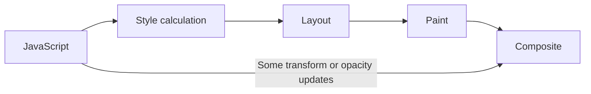
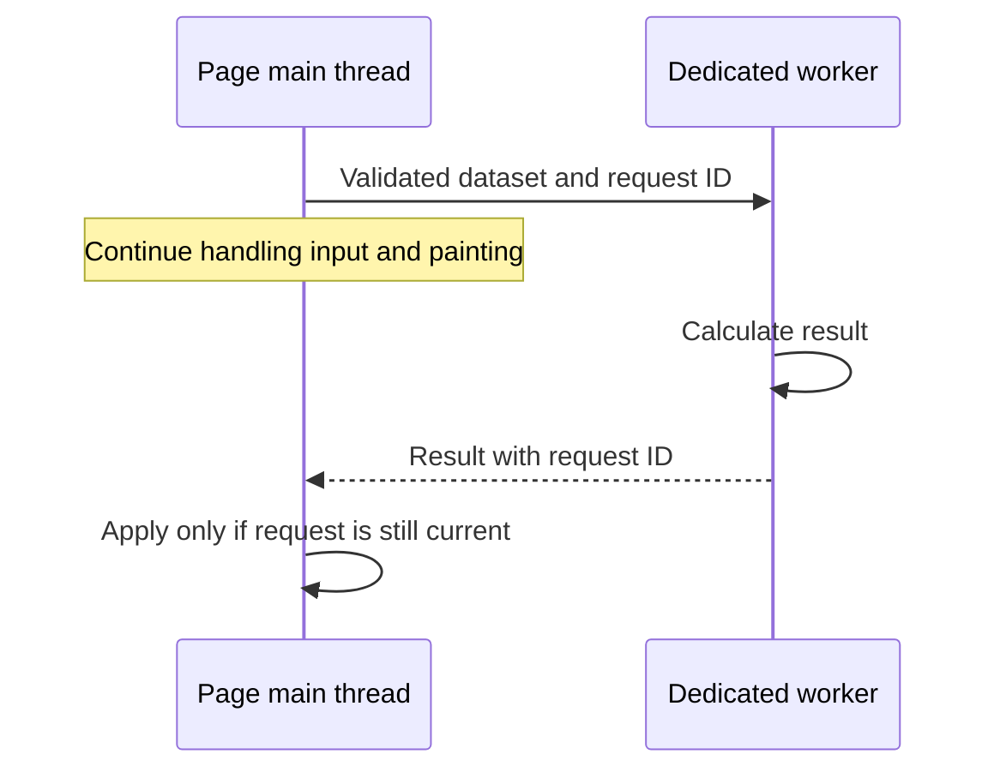

# Runtime responsiveness: scheduling, rendering and workers

**Prerequisite:** tasks/microtasks, DOM and resource ownership. Loading quickly is only the start. Typing into search, scrolling results and opening a detail panel must remain usable with the actual data size.

## Separate waiting from work

A fetch waits asynchronously for network data; synchronous JSON processing, filtering and constructing thousands of DOM nodes can still monopolize the main thread. Promise syntax does not move CPU work to another thread. Repeated microtasks can starve rendering; `requestAnimationFrame` schedules a callback before a rendering opportunity but does not make a long callback cheap.

Input delay, handler work and the next paint all matter. Show prompt pending feedback for network operations while measuring eventual results separately. For pure CPU work, first reduce algorithmic cost and data volume. Then choose smaller tasks, off-thread computation or fewer rendered nodes based on the trace. [INP optimization](https://web.dev/articles/optimize-inp).

## Rendering is a pipeline, not a React render count

This is a simplified dependency model. Not every frame performs every stage; transforms and opacity can often avoid layout/paint, but layer setup, effects and content can still cost work. Reading geometry after a style write can force synchronous layout. Group reads and writes when correctness permits, then confirm the effect in the trace. Avoid blanket `will-change`: extra layers consume memory.

A 60 Hz display has roughly 16.7 ms per refresh and 120 Hz roughly 8.3 ms, shared with browser work. The 50 ms long-task boundary is not a safe animation budget. Smoothness depends on refresh rate and workload; do not teach “60 fps” as an invariant browser standard or human-vision limit. Respect reduced-motion preferences and stop animation/timers when their owner goes away.

Continue the existing [layout fixture](../../senior_growth/Web_Performance/What_is_reflow_and_repaint%2C_what_causes_those_events%2C_why_is_it_important_to_have_them_in_mind.md#worked-read-write-ordering-with-explicit-ownership) and [animation lifecycle](../../senior_growth/Web_Performance/What_is_the_best%2C_most_efficient_way_of_performing_animations_in_webpages.md).

## Dedicated workers and service workers have different jobs

| Mechanism | Appropriate job | Ownership/cost |
|---|---|---|
| Main-thread task chunks | Moderate work separable into cheap units | Yield between tasks; cancel obsolete work |
| Dedicated Web Worker | Expensive independent calculations | Startup, data copying/transfer, messaging, termination |
| Service worker | Intercept requests, cache/offline behavior and supported background events | Event-driven lifecycle; can be stopped between events |

Use a dedicated worker for the supplied course's calculation exercise. A service worker runs off the page thread too, but its lifecycle is inappropriate as the default long-running compute abstraction. Neither has direct DOM access; the page owns UI updates. [Using Web Workers](https://developer.mozilla.org/en-US/docs/Web/API/Web_Workers_API/Using_web_workers).

For a worker lab, define an input cap and result schema, handle `error` and `messageerror`, and terminate on disposal. Ignore stale replies by request ID. If a worker is executing one long synchronous loop, posting a cancellation message cannot interrupt that loop immediately. Chunk within the worker or terminate/recreate it when hard cancellation is needed. Transferable buffers avoid copying some data but detach ownership from the sender; do not transfer a buffer the UI still needs.

The existing [bounded task scheduler](../../senior_growth/Web_Performance/What_if_you_have_to_create_an_app_with_some_pretty_sophisticated_UI_%28views%2C_animations%2C_etc%29._What_are_the_pitfalls_%28UI_interractions%2C_60fps%2C_split_into_chunks%2C_workers_etc%29._Stages_to_build_frame.md#worked-decision-process-a-large-catalogue-without-blocking-interaction) demonstrates yielding without pretending to be a worker. Compare equivalent workloads and include startup/message costs. A worker can improve responsiveness while total computation takes longer.

## React and large collections

Profile the browser first, then React commits when component work is a plausible cause. Keep draft/entity identity correct before memoization; a comparator that hides changed callbacks can create stale behavior. A normal production React build may need a separate profiling configuration for component timing. Development StrictMode behavior is not a production performance benchmark. Follow [React mechanisms and examples](../react.md#performance-follows-correctness).

For a large catalogue, distinguish filtering cost, DOM count and network volume. Pagination reduces fetched/rendered work; virtualization reduces mounted rows but needs stable keys, focus/selection recovery and accessible navigation. Neither fixes an unbounded retained cache. Inspect [memory retaining paths](../../senior_growth/Web_Performance/What_is_the_memory_leak._Any_real_world_example_How_would_you_find_memory_leaks.md) after repeated navigation; distinguish deliberate bounded retention, bloat and leaks.

## Recovery is part of performance

A fast spinner that never resolves is not success. Keep deadlines/retry limits, chunk failure recovery and stale-result handling explicit. A network request cancellation does not undo an accepted mutation. Test repeated mount/unmount, rapid query replacement and navigation during work. Practice: the interaction portion of [Hometask 2](../../practice/frontend/performance/02-improve.md); worker specialization is [optional](../../practice/frontend/performance/#optional-extensions).
