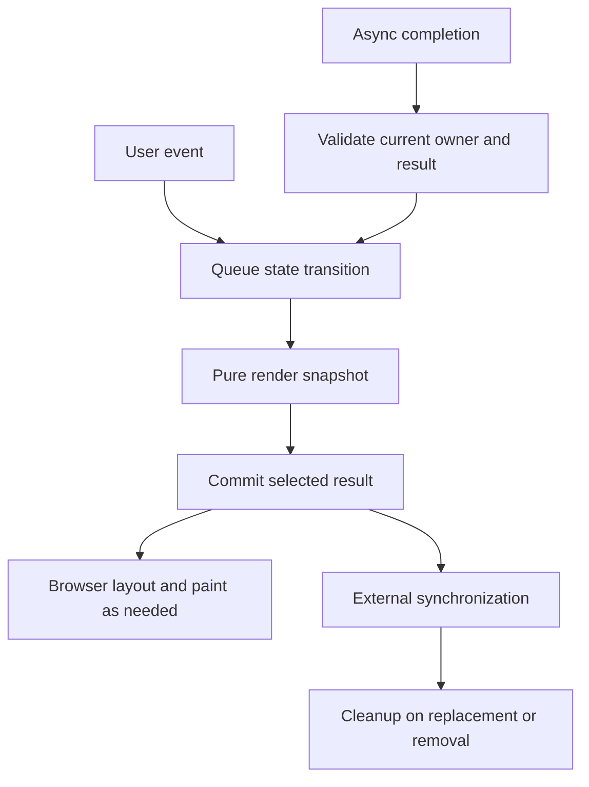

# React: render, state and synchronization

Prerequisites: [HTML/browser interaction](./html-browser.md), [JavaScript](./javascript.md) and [TypeScript](./typescript.md). React baseline: **19.3.0**. The path favors function components; classes remain relevant for existing code and Error Boundaries.

## Recommended order

1. [JSX and its runtime](../senior_growth/React/What_is_JSX_Can_browsers_use_it_directly.md), then [render snapshots, queues and commit](../senior_growth/React/Change_Detection_in_React.md).
2. [Entity identity and keys](../senior_growth/React/Could_you_explain_how_change_detection_mechanism_works_in_React%2C_tradeoffs_and_benefits.md) and [immutable data flow](../senior_growth/React/What_unidirectional_dataflow_means_Why_immutabilit_166e8106c24d8080ab3ce9dc309b32a3.md).
3. [Hooks, reducers, refs and effects](../senior_growth/React/What_Are_React_Hooks_Good_For_Rules_of_Hooks.md), then [lifecycle and races](../senior_growth/React/Lifecycle_Methods_and_the_Virtual_DOM.md).
4. [Controlled input/data binding](../senior_growth/React/Data_Binding_in_React_and_Comparison_to_Other_Majo.md) → [forms, drafts and remote data](../senior_growth/React/complex-forms-and-data.md) → [submission uncertainty/idempotency](../senior_growth/React/Submission_Idempotency.md).
5. [Composition, tabs and HOC contracts](../senior_growth/React/Composition_and_Higher-Order_Components_%28HOCs%29_in.md), [modal behavior](../senior_growth/React/Modals_in_react%2C_portal_or_not.md), [testing](../senior_growth/React/React_testing.md).
6. [Memoization mechanisms](../senior_growth/React/What_is_memoization_and_how_to_achieve_it_in_React.md) → [comparator correctness](../senior_growth/React/react_memo.md) → [measured performance experiments](../senior_growth/React/performance_potimization.md).

## Render calculates; events and effects own different work

Render reads a snapshot of props/state/context and returns a description. It can run again or be abandoned; keep it pure. A setter queues an update, and a functional updater receives the preceding queued value. A changed key/type can reset state; memoization cannot repair a wrong domain identity.

User-event writes belong to the event owner. An Effect synchronizes an external system with committed reactive inputs. Include every reactive dependency it reads; cleanup releases the previous subscription/request before replacement and on removal. Development StrictMode deliberately probes setup/cleanup. Effects do not run during server rendering, so initial HTML must not depend on an Effect having already read browser storage.

Abort requests reduce obsolete work when supported; an owner/generation guard prevents late commits even when abort is ignored. Network errors, invalid data, canceled work and uncertain writes need distinct recovery decisions. Error Boundaries catch supported render failures, not arbitrary rejected event-handler promises.

## Forms and identity

Choose one owner for each value: input draft, URL intent, accepted server record and pending command. Derive filtered/summary values during render instead of copying them into duplicate state via Effects. Stable entity IDs preserve draft identity across sorting; a server version is a conflict token rather than automatically a new React key.

Native form semantics, labels and focus remain required in JSX. Controlled input value/onChange stay paired; an uncontrolled default is an initialization rule. Do not overwrite a dirty draft on every refetch or announce success before confirmed persistence. A hidden panel may remain mounted and keep effects alive; choose its resource policy explicitly.

## Performance follows correctness

memo compares each prop with Object.is by default; context/local state can still cause work. useMemo caches a calculation, useCallback a function identity. Neither is persistent application storage or an exactly-once guarantee. A comparator that ignores a callback can retain old behavior even when text looks correct. React Compiler, when enabled, can reduce manual memoization; the reference demo leaves it off to expose these mechanisms.

Measure the user interaction, workload and build mode before/after a change. Render logs do not prove commits, paint, input responsiveness or a speedup. Server pagination, virtualization, resource bytes and browser work have different costs and accessibility implications.

[Reference workbench](../workbench/frontend/react/) contains the actual code included in the lessons and a bounded interactive demo. [F05](../practice/frontend/f05-react.md) reuses P-328/P-329 rather than prescribing another full application.

Official documentation checked 2026-10-27: [render/commit](https://react.dev/learn/render-and-commit), [Effect lifecycle](https://react.dev/reference/react/useEffect), [state identity](https://react.dev/learn/preserving-and-resetting-state), [memo](https://react.dev/reference/react/memo). Executed browser observations and unperformed assistive checks are recorded in [verification](./verification.md).
