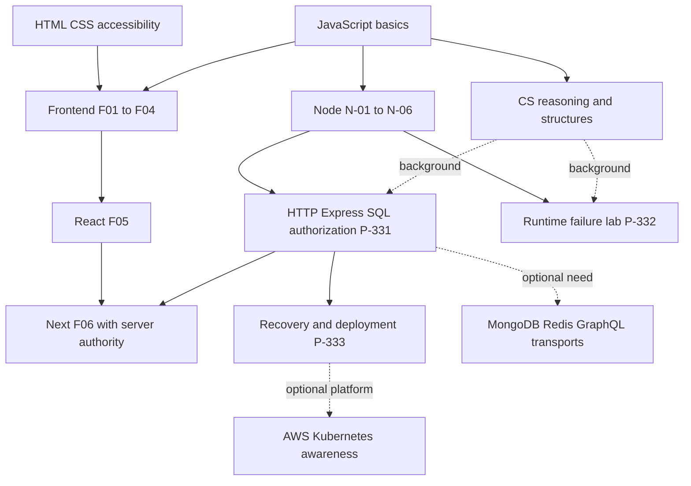
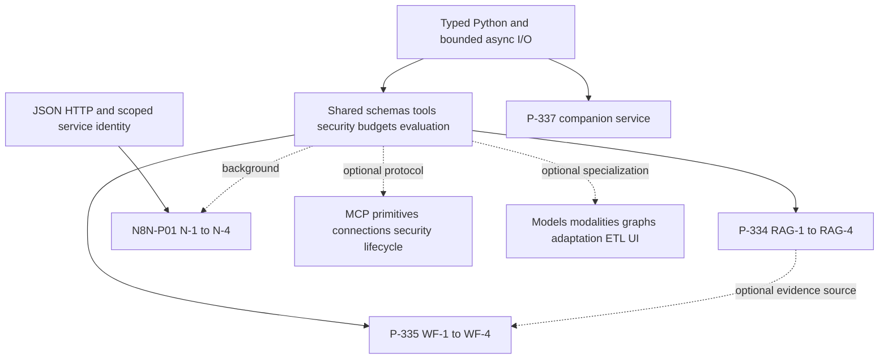

# Whole-hub roadmap and why it is grouped this way

[Guide home](./) · [Track sequences](./tracks.md) · [Every topic](./topics.md)

## A readable journey

Begin with a programming and ownership foundation: JavaScript values, scope, collections, promises, modules and error handling. Add basic terminal/Git habits and the ability to state an input/output contract. For your current goal, go straight into Node's bounded analyzer. HTML/CSS/accessibility is essential for the browser branch, rather than a gate for all programming.

From there, study CS reasoning in parallel: costs, invariants and representations make stream counters, queues and concurrency limits easier to defend. Grow one browser document through typed UI and React only when you want an interface. Grow one Node program through HTTP, validation, SQL transactions and authorization only when you want a backend. Integrate these at an actual UI/API contract, rather than assuming shared types enforce runtime authority.

After a working service, learn lifecycle, observability, failure recovery, distribution and artifact/schema compatibility. Begin locally; hosted deployment requires its own actual evidence. Python is another implementation route for typed, bounded data preparation, then model/evaluation/security foundations, RAG and controlled tool workflows. n8n is an integration/orchestration branch after JSON/HTTP and service authority; it is not a substitute for those boundaries.

Engineering practice accompanies all of these: testing early, security at trust boundaries, state ownership when sharing data, performance measurement once a real flow exists, and architecture/release decisions once there is something concrete to operate. Specialist frameworks are optional after a relevant primary path.

## Prerequisite relationships

Solid arrows mean required capability for **the shown implementation milestone**, not a requirement to finish every chapter. Dashed arrows marked background are helpful; dashed optional branches are choices. These are this guide's synthesis of the existing prerequisite statements.

For a larger view, open the real rendered captures: [runtime/browser prerequisite diagram](/learner-guide/screenshots/10-prerequisites.png) and [Python/AI prerequisite diagram](/learner-guide/screenshots/11-prerequisites.png). Narrow screens shrink the diagrams; use the full-size images with your browser image zoom, or follow the adjacent prose and track tables.

RAG is the recommended reading sequence before workflows in the hub, but a fixed authorized tool workflow need not implement a retrieval engine. n8n can start with deterministic item transformations before service integration. A Python service can begin with pure functions before deployment reading.

## Repository rationale versus recommendation

| Group | Rationale visible in current sources | Recommendation in this guide |
|---|---|---|
| Frontend | Browser DOM, focus, layout, forms and state have distinct host responsibilities; coverage map assigns canonical lessons | Build one document → enhancement → typed UI → React → Next; defer optional stores until ownership needs them |
| Node | Runtime first; backend, persistence and delivery are explicit continuations | N-01–06 now, P-332 next, P-331 when service work is useful |
| CS | Correctness, cost and representation are independent of frameworks | Pair selected reasoning with analyzer bottlenecks; do not delay Node for the entire course |
| Build AI Apps — JavaScript First | Beginner JS chatbot→tools→RAG→MCP→graphs; existing Python remains optional depth | Start with JS-00–02 before choosing deeper reference topics |
| Engineering | State, measured performance, security, quality, delivery and design reuse P-328–337 | Add each control at the boundary it protects, then use E01–E07 to deepen the same product |
| AI-assisted engineering | Issue → local diff → checks → traceability; distinct from autonomous product workflows | Start P-336 with a small real/study issue once you can explain its contract |
| Senior Growth | Interview-origin subject collections retained behind canonical paths | Use as linked depth/reference; alphabetical folders are not another mandatory curriculum |

## Menu order is not study order

Learning paths distinguishes **Build AI Apps — JavaScript First** from **AI for Software Development**. For your AI goal begin with the JS app path; use the coding workflow path in parallel. Node remains the runtime foundation. Node module numbers put testing before networking, MongoDB before PostgreSQL and diagnostics after production: the current Node reading guide instead prioritizes core runtime/testing/HTTP/diagnostics/lifecycle, with PostgreSQL the main persistence route. Shared backend project IDs put P-331 before P-332; smaller runtime practice is recommended first. Materials, assessment, technical checks and historical audit files are resources/records, not next chapters.

## Keep optional scope bounded

After the primary branch, choose at most one relevant comparison: Redux/alternative stores, advanced conditional types, custom widgets/virtualization, RxJS, workers/custom elements, microfrontends, alternative renderers or legacy jQuery/Flux; MongoDB/Redis/GraphQL/real-time transports; AWS/IaC/Kubernetes awareness; model theory/modalities, MCP, graph data/adaptation, ETL/Streamlit/cache/batch. Their exact local lessons and practice are retained in the mapping. External course catalogues provide links; their unseen content has not been certified as covered here.
