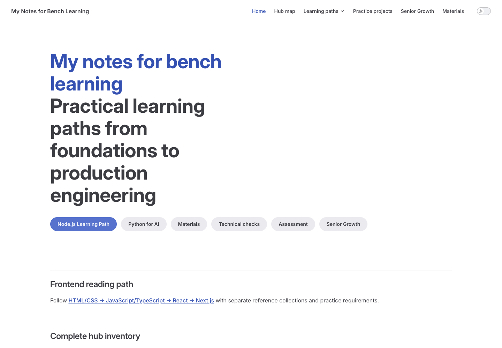
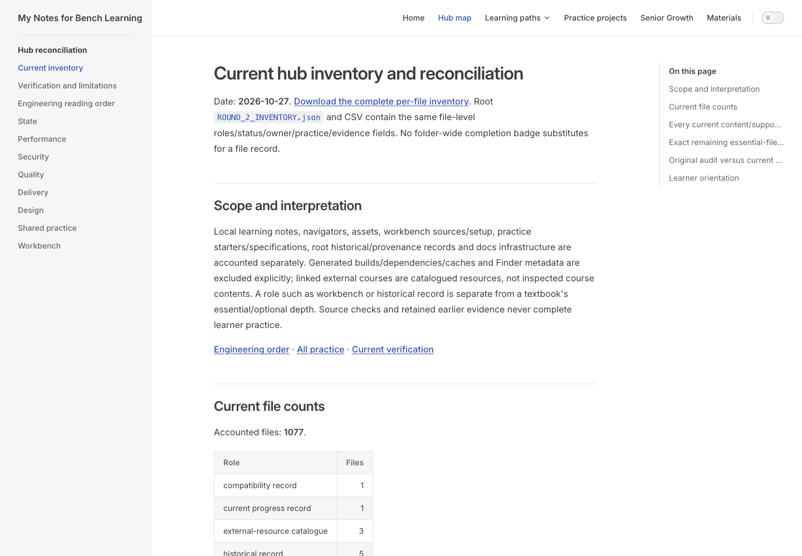
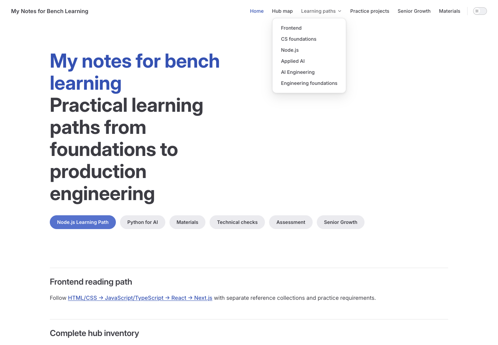
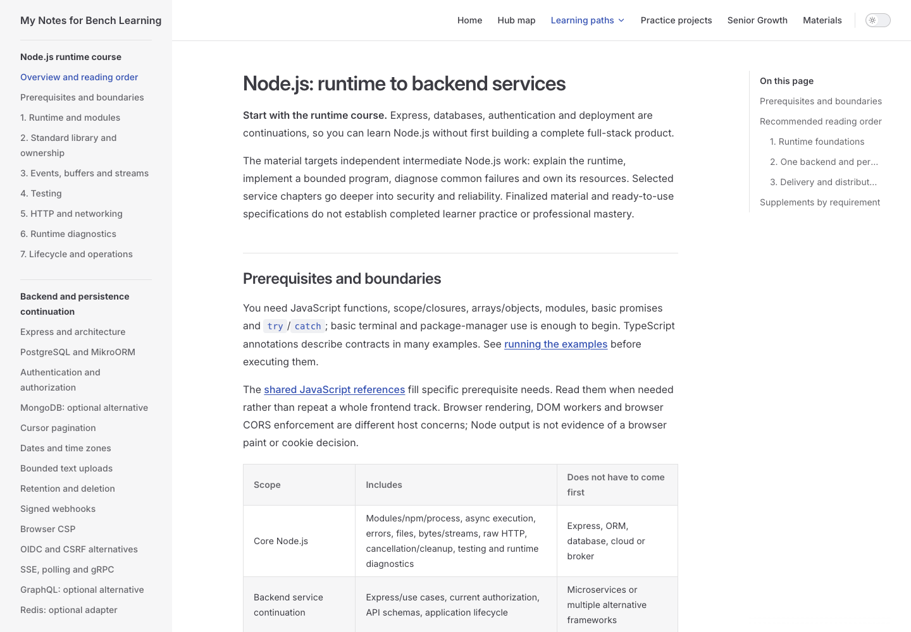
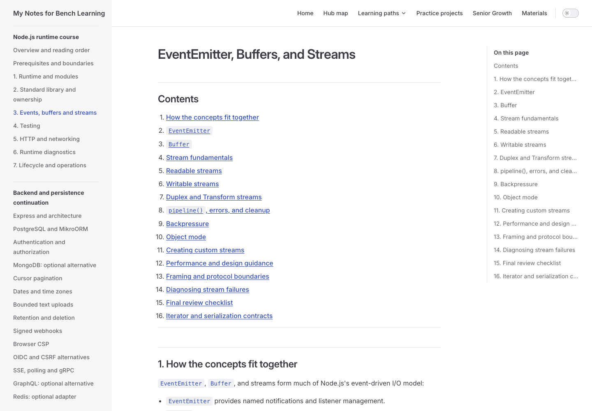
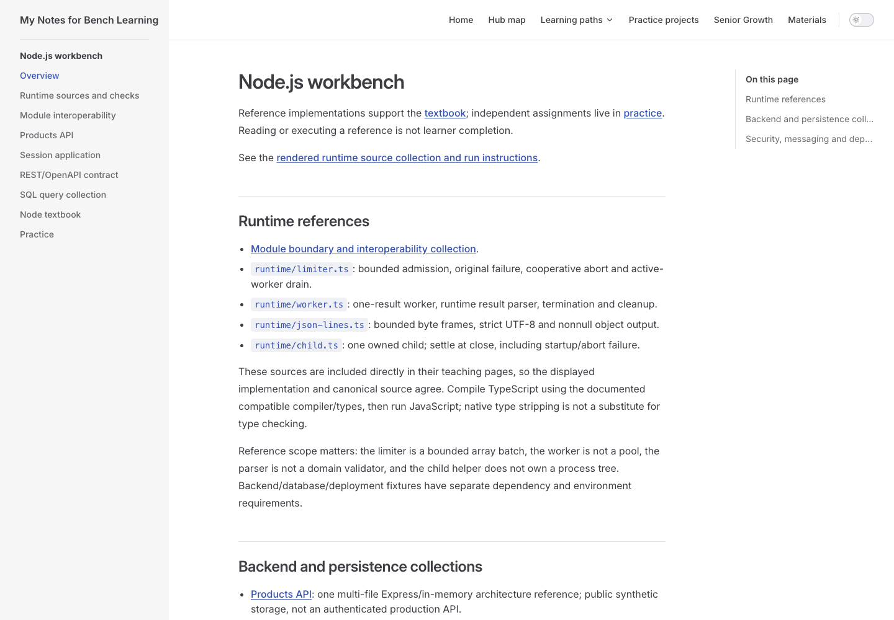
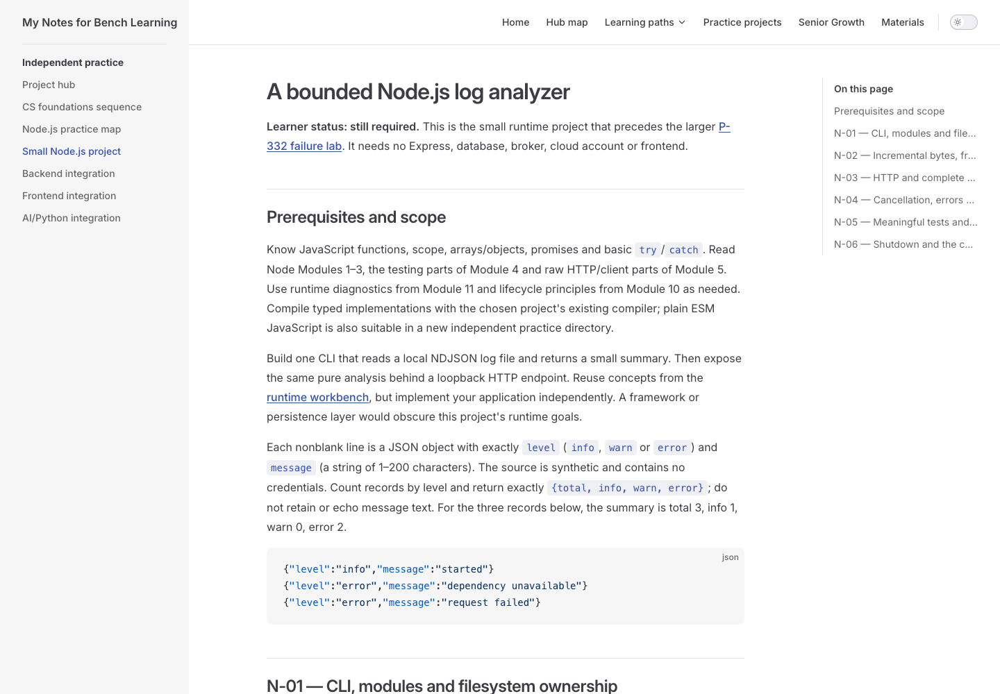
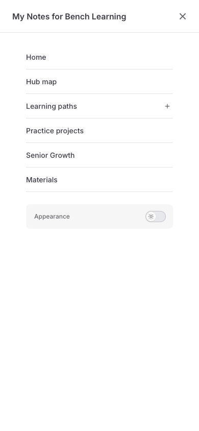
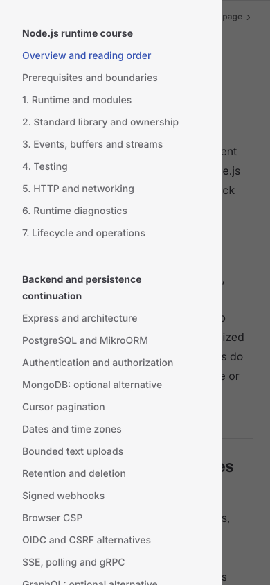
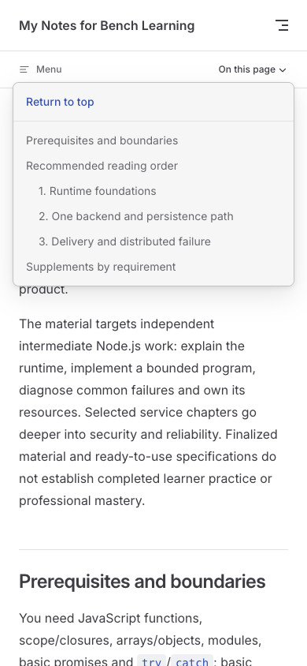

# Illustrated guide to the current application

[Guide home](./) · [Start Node now](./node-start.md)

Real local application captures: Google Chrome **156.0.8078.48**, automated headless desktop rendering on macOS, 2026-10-28. Desktop viewport **1440 × 1000 CSS pixels**; narrow viewport **390 × 844 CSS pixels** in the same browser, not a physical mobile device. Captures show the existing UI; labels below describe controls without altering the screenshots. This walkthrough is navigation evidence, not a full accessibility evaluation.

## Home: choose a purpose {#_1-home-choose-a-purpose}

**Where:** Home. **Controls:** the top bar offers Home, Hub map, Learning paths, Practice projects, Senior Growth and Materials; hero buttons offer direct destinations including Node.js Learning Path and Build AI Apps — JavaScript First. The appearance switch is at the far right. **Next:** choose Build AI Apps — JavaScript First for your AI goal; use the learner-guide link on Home to return to this orientation. The hero is an entry menu, not a required sequential syllabus.

## Hub map: locate ownership {#_2-hub-map-locate-ownership}

**Where:** Hub map (`/review/`). **Controls:** the left navigation links inventory, verification and engineering reading guides. Main-content links connect the current topic owners. **Next:** use it to resolve overlap or find the current verification ledger, then return to your recorded milestone. Inventory counts are material accounting, not your progress.

## Learning paths: switch tracks deliberately {#_3-learning-paths-switch-tracks-deliberately}

**Navigation update 2026-10-28:** the screenshots below predate the AI selector rename; current text/links describe the new labels.

**Where:** Home with Learning paths expanded. **Controls:** Frontend, CS foundations, Node.js, AWS Cloud, Build AI Apps — JavaScript First, AI for Software Development and Engineering foundations route to their overview pages. **Next:** record your current lesson and N-ID before switching; use a second tab for a prerequisite. Return to the saved Node milestone after the bounded detour. Menu order is not a dependency graph; [the roadmap](./roadmap.md) explains the differences.

## Topic navigation: follow the reading plan {#_4-topic-navigation-follow-the-reading-plan}

**Where:** Node.js overview. **Controls:** left sidebar separates runtime, backend/persistence, delivery/distribution and reference/practice sections; right On this page links the overview's sections. **Next:** follow runtime reading order or open [N-01](./node-start.md#n-01-first-cli). Skip optional alternatives until a requirement calls for them. A selected sidebar item tells you the current page, not completion.

## Lesson: choose a bounded section {#_5-lesson-choose-a-bounded-section}

**Where:** Events, buffers and streams. **Controls:** the article's Contents and the right On this page outline jump to headings; left sidebar changes lessons. Text cross-links connect prerequisites, canonical sources and practice. **Next:** for N-02, read bytes/encoding/framing/backpressure/cleanup, predict a split UTF-8 trace, then attempt that behavior. Long outline labels can truncate visually at desktop width; the article heading remains the full reference. Use browser Back after a cross-link or retain the original lesson in another tab.

## Workbench: inspect execution boundaries first {#_6-workbench-inspect-execution-boundaries-first}

**Where:** Node workbench. **Controls:** runtime collection and backend/database/security/deployment links lead to source and setup. **Next:** choose only the relevant example, read its dependencies and what it does not prove, then run it in an owned isolated copy if useful. TypeScript requires the documented compiler/types; a source fragment is not a runnable service. Database/broker/container fixtures have separate setup and cleanup; do not point reset scripts at existing user data. A passing reference never completes N-01–06 for you.

## Homework: contract, acceptance and evidence {#_7-homework-contract-acceptance-and-evidence}

**Where:** practice → Node → core project. **Controls:** article sections/outline locate prerequisites, N-01–06, acceptance, failure cases and evidence; links return to explanations and P-332. **Next:** read the input contract and current N-ID, write an expected/observed ledger, attempt it independently, then check the exact negative cases. Keep reading status separate from actual exercise/check/explanation status.

## Narrow screen: global destinations {#_8-narrow-screen-global-destinations}

**Where:** Node overview, 390 × 844 viewport. **Controls:** top navigation button opens the global destination menu; Learning paths expands its track choices. **Next:** select a path or close global navigation before opening the topic menu. This capture demonstrates responsive Chrome layout, not touch, iOS/Safari or Android behavior.

## Narrow screen: topic menu and outline {#_9-narrow-screen-topic-menu-and-outline}

**Where:** Node overview with local Menu expanded. **Controls:** Menu opens the course sidebar; On this page opens the current article outline when the drawer is closed. **Next:** select the runtime lesson, close the drawer if needed, then use On this page to reach the bounded section. Keep your own milestone record; navigation has no learner-completion tracker.

## Narrow screen: article outline {#_10-narrow-screen-article-outline}

**Where:** Node overview, topic drawer closed. **Controls:** On this page expands the article headings and Return to top; it does not switch courses. **Next:** choose Recommended reading order, then resume the saved N-ID. This menu was opened in Chrome during verification.

The screenshots capture representative states; they do not show every scroll position. [Verification](./verification.md) records the actual clicked controls, anchor checks and limitations.
