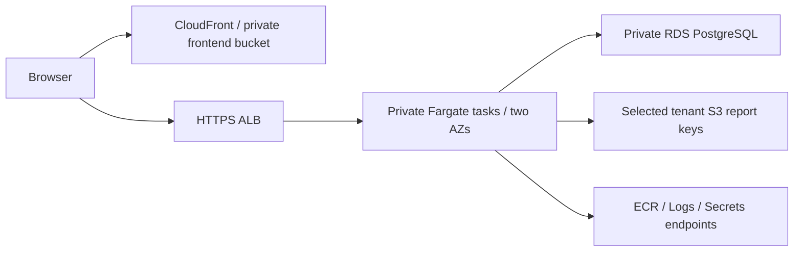

# A Minimal AWS Service Slice: Topology, IAM and Cost

This intermediate full-stack lesson selects one deployment path: private S3/CloudFront for built frontend assets, HTTPS ALB→ECS Fargate for a Node API, and private RDS PostgreSQL. It is a design and locally linted **API service slice**, not a completed cloud deployment. No account credentials, resources, spending or notifications were changed. Kubernetes is awareness-only here; do not learn several orchestrators before one reproducible service path.

## Topology and prerequisites



The template below assumes an **existing reviewed** VPC, two private task subnets in different AZs, matching private RDS/security group, an internet-facing HTTPS ALB/certificate/listener and an IP-type target group already attached to it. The target group must route port3000, use /readyz and the application's declared healthy status, and have ALB egress to the task group. RDS is not public; use a dedicated application database identity with only required schema/table operations, connection limits and verified TLS/CA handling. Migrations use a separate controlled identity. IAM does not automatically grant SQL authorization.

For this no-public-task-IP/no-general-egress path, provision same-region ECR API/DKR, Secrets Manager and CloudWatch Logs interface endpoints with private DNS, plus the required S3 gateway route/prefix list for image layers/report reads. Endpoint policies, DNS, routes and their security groups must allow only the intended traffic. Endpoint costs can exceed compute costs for a small app; compare a reviewed NAT design rather than assume private endpoints are free. Fargate does not require the ECS interface endpoints merely because the workload uses ECS. The existing ALB/RDS/endpoint groups must have no broader conflicting rules that would defeat the intended boundary.

Use a prebuilt same-region private ECR image identified by digest and matching the repository ARN. It must be Linux x86_64/Node24 compatible, read-only-root safe, readable by UID/GID10001, listen on0.0.0.0:3000, expose /healthz and /readyz, and consume the injected DATABASE_URL without logging it. The existing database URL secret uses the AWS-managed Secrets Manager encryption key in this narrow example. A customer KMS key requires additional scoped decrypt/key-policy configuration, not a wildcard permission. None of these existing resources/image/runtime contracts are created or proven by a successful template lint.

Frontend bucket access through CloudFront requires its own reviewed origin-access control/bucket policy, immutable asset/cache policy, DNS/TLS and deployment identity. CORS/auth/CSRF remain application responsibilities. That frontend and the database/network foundations are prerequisites, not hidden resources supplied by this service slice. The complete deployed application requirement remains a separate practice/integration task.

## Three identities with different purposes

| Identity | Purpose and concrete authority | Excluded authority |
|---|---|---|
| Deployment operator/CI role | Reviewed change set for this stack; narrowly permitted pass-role and referenced resources | Not the app's runtime credential; no blanket account admin implied |
| ECS execution role | Pull one ECR repository, emit to this log group's streams, read exactly one database secret | Not provided to application SDK code as its ordinary task role |
| Application task role | GetObject under one configured tenant reports prefix | No bucket listing/deletion, other tenant prefix, IAM administration or general secret reads |

The unavoidable resource wildcard for ecr:GetAuthorizationToken is isolated to that action; repository download operations are scoped. The task role's prefix wildcard permits objects within the one configured tenant prefix, not every tenant. This is a per-tenant workload example. A shared multi-tenant service cannot make one global task role a substitute for per-request authorization; use the application's current scope and an appropriately designed storage access boundary.

Effective AWS permissions also depend on other identity/resource policies, boundaries, SCPs, explicit denies, KMS and network controls. A local JSON shape test is not the IAM policy simulator or proof of effective denial in an account. Use Access Analyzer/policy simulation where applicable and actual allowed/denied integration checks with the approved deployment identity before accepting the design. Do not embed access keys or secret values in templates, image layers, outputs or logs.

## Versioned CloudFormation definition

The template creates a cluster, task/execution roles, retained log group, task security group, narrow ingress rules into the existing owned DB/endpoint groups, a Fargate task and rolling service. It does not provision the whole VPC/frontend/database/ALB. Review that modification of shared security groups is within the stack operator's authority. AssignPublicIp is disabled; desired2 tasks and maximum200% can temporarily require4 tasks, available addresses and extra capacity/cost during rollout.

<<< ./aws-service-slice.json

The health command runs in a separate short-lived Node process with a one-second fetch deadline. Liveness should not depend on every downstream service; readiness checks dependencies under owned budgets. ECS deployment rollback needs an eligible previously completed deployment and does not reverse database changes. Use the [release compatibility boundary](./release-artifact-compatibility.md) before allowing old artifacts to return. First-deployment failure has no known good service revision to restore.

## Validate before a real change set

Locally validated with cfn-lint1.57.2, pinned in an isolated Python3.13 environment:

```sh
cfn-lint -t docs/node-js/aws-service-slice.json -r eu-central-1
```

The bundled schema accepts the template; adding an invented task property is rejected. Local contract checks verify role separation, digest-only image input, no public task IP, non-root/read-only configuration, single-secret scope and the task policy's one prefix/action. Positive/negative ARN examples are evaluated only under that declared simple policy shape, not the full IAM engine. No network account validation or deployment ran.

For a real authorized sandbox, inspect the exact parameters and change set, effective IAM/pass-role scope, security-group/routes/DNS/endpoints, image scan/architecture and secret/database policy. Then verify target health, invalid probe/startup behavior, allowlisted S3 read plus cross-prefix/delete denial, SQL permission denial, log redaction and bounded shutdown/rollout. Record actual resource IDs, command outcomes and teardown/retention owner without publishing secrets. Do not interpret a lint success as permission to apply a chargeable stack. No apply/deploy command is part of this note's executed evidence.

## Concrete workload and estimate worksheet

Assume730 hours/month,2 always-on tasks at0.25vCPU/0.5GiB each, one continuously running database instance with20GiB baseline storage, one ALB, one million API responses averaging10KiB, and1000 cold frontend loads of5MiB. That yields365 vCPU-hours,730 memory GiB-hours,730 ALB-hours,730 database instance-hours and roughly14.42GiB payload transfer before protocol/compression/cache/routing effects. A rollout to4 tasks temporarily doubles task consumption; autoscaling needs a separately bounded peak scenario.

To practice arithmetic only, use fictitious rates USD0.05/vCPUh,0.006/memory-GiBh,0.025/ALBh,0.03/DB-instanceh,0.12/storage-GiB-month and0.10/payload-GiB. The priced subset is USD66.62195556640625. **These are not AWS prices or a usable full cloud budget.** The Decimal check supplies a transparent hypothetical example without inventing a live quote.

For the actual region/OS/architecture/database availability mode and current price tier, enter the workload into the official calculator and retain the dated estimate. Include ALB capacity units, endpoint AZ-hours/data, NAT if selected, public IPv4 where applicable, CloudFront/S3 storage/requests, ECR, logs/metrics/alarms, backups/snapshots, database I/O/extra storage, transfer paths, support/taxes and discounts. Unknown components remain unpriced, not zero. Database Multi-AZ and endpoint-per-AZ choices materially change the estimate; do not reuse a single-instance figure for a different topology.

Tag resources by environment/owner/project and compare forecast/actual cost by service and usage unit after an approved deployment. Define example actual80%/100% and forecast100% notifications to a real owner/channel under the organization's policy; no notification was sent here. Budgets/alerts have billing delays and do not provide an instantaneous hard spending stop. Monitor capacity, request/DB/egress/log volume and orphaned resources; review anomalies and revise the workload estimate. A retained log group/snapshot can keep costing after stack removal. Validate teardown and retained-data policy rather than promise “delete stack means zero bill.”

## Shared responsibility and alternatives

AWS secures its underlying service infrastructure; the customer still owns identities, application code/configuration, data access/classification, network exposure and selected operational controls. Managed-service boundaries differ from self-managed EC2. AWS compliance attestations cover their stated service/scope; they do not make your app automatically compliant. Multi-AZ placement, autoscaling, backup/restore and monitoring need deliberate configuration/testing. Durability is not availability or protection from authorized deletion/bad writes.

For a small study app, a simpler approved managed host or one local deployment may be enough before AWS. Fargate reduces host administration while retaining image/network/IAM/database work. EC2 offers more host control and maintenance; Lambda has a different execution/connection/cold-start model. EKS adds Kubernetes control-plane/workload/operator concepts and operational cost; understand deployments/services/config/secrets/health awareness without requiring cluster administration for this target. CloudFormation provides a concrete chosen IaC path here; Terraform is an alternative, not an additional mastery requirement.

**Practice acceptance:** lint and explain every template identity/network/prerequisite; inject an invalid property and broader task permission and show the local gates reject them. In a separately authorized sandbox, validate effective allow/deny, probes, startup/rollback compatibility and safe teardown; retain evidence. Produce a region-specific current calculator estimate plus peak/idle scenarios and reconcile actual tagged costs/notifications afterward. A source template and conceptual topology do not establish a deployed app, professional cloud experience or learner completion.

**Validation2026-10-25:** cfn-lint1.57.2 passed eu-central-1 schema validation; invented-property negative and narrow configuration/policy-shape contracts passed. Workload units and hypothetical priced subset were checked with exact Decimal arithmetic. No AWS credential/account request, effective IAM test, image/service deployment, real quote/bill/notification or teardown was performed. Initial sandbox-only package resolution failed DNS; the approved isolated linter installation then succeeded without changing project dependencies.

Official references: [task role](https://docs.aws.amazon.com/AmazonECS/latest/developerguide/task-iam-roles.html), [execution role](https://docs.aws.amazon.com/AmazonECS/latest/developerguide/task_execution_IAM_role.html), [VPC endpoints](https://docs.aws.amazon.com/AmazonECS/latest/developerguide/vpc-endpoints.html), [deployment rollback](https://docs.aws.amazon.com/AmazonECS/latest/developerguide/deployment-circuit-breaker.html), [shared responsibility](https://aws.amazon.com/compliance/shared-responsibility-model/), [Budgets behavior](https://docs.aws.amazon.com/cost-management/latest/userguide/budgets-managing-costs.html), [Pricing Calculator](https://calculator.aws/). Checked2026-10-25; recheck exact selected service/region/account contracts before live use.
