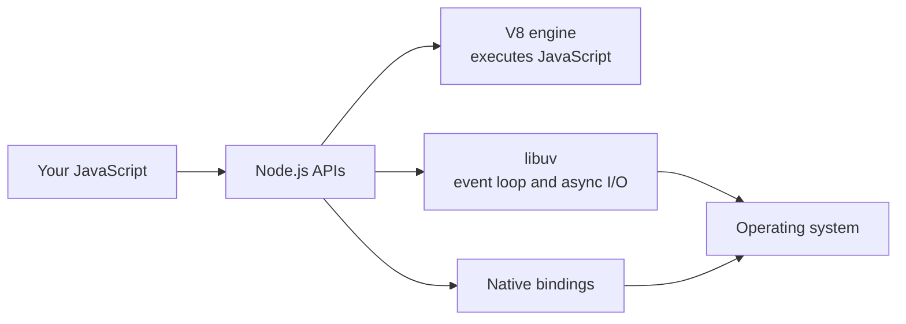
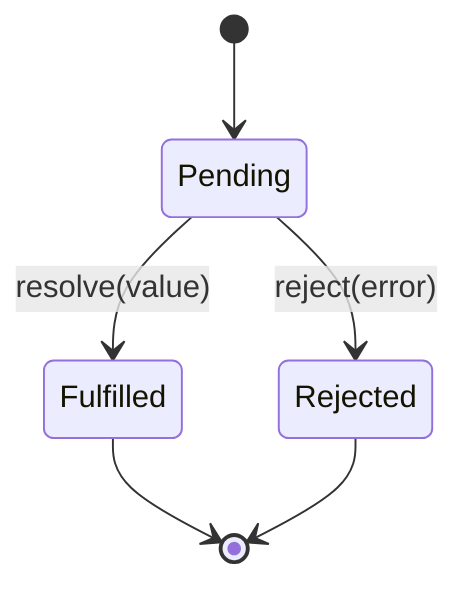
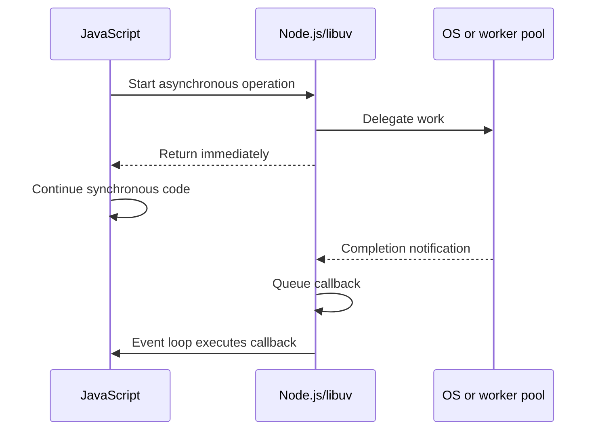

# Node.js Foundations

Compatibility baseline: Node.js 22.7+; examples below also checked on Node.js 24.18.0. The pinned Node 22 setup is a compatibility example, not a claim about the newest release. Version-sensitive behavior was checked against official documentation on 2026-10-20.

## Contents

1. [What Node.js is](#_1-what-node-js-is)
2. [Installation and project setup](#_2-installation-and-project-setup)
3. [Running Node.js and using globals](#_3-running-node-js-and-using-globals)
4. [Module systems: CommonJS and ES modules](#_4-module-systems-commonjs-and-es-modules)
5. [npm, `package.json`, lockfiles, and npx](#_5-npm-package-json-lockfiles-and-npx)
6. [Asynchronous programming patterns](#_6-asynchronous-programming-patterns)
7. [Event loop basics](#_7-event-loop-basics)
8. [Event loop deep dive](#_8-event-loop-deep-dive)
9. [Cancellation and time budgets](#_9-cancellation-and-time-budgets)
10. [Bounded concurrency](#_10-bounded-concurrency)
11. [Diagnosing event-loop problems](#_11-diagnosing-event-loop-problems)
12. [Final review checklist](#_12-final-review-checklist)

---

## What Node.js is {#_1-what-node-js-is}

Node.js is an open-source, cross-platform runtime for executing JavaScript outside a web browser. It combines the V8 JavaScript engine with native APIs for files, networking, processes, timers, and other operating-system capabilities.

Node.js is:

- A JavaScript runtime environment.
- A way to build servers, command-line tools, automation, and backend services.
- Available on macOS, Linux, and Windows.

Node.js is not:

- A programming language; the language is JavaScript.
- A web framework; Express, Fastify, and NestJS are frameworks or libraries that run on Node.js.
- A browser; it does not provide browser-only APIs such as the DOM (`document`, `window`) by default.

### Runtime architecture at a glance



### Main characteristics

| Characteristic                      | Meaning                                                        | Practical effect                                                  |
| ----------------------------------- | -------------------------------------------------------------- | ----------------------------------------------------------------- |
| V8-powered                          | V8 parses and compiles JavaScript to machine code              | JavaScript execution is fast and continually optimized            |
| Single JavaScript thread by default | One main thread executes JavaScript callbacks                  | Long synchronous work blocks other JavaScript callbacks           |
| Event-driven                        | Completion events schedule callbacks                           | Programs react when timers, I/O, or messages are ready            |
| Non-blocking I/O                    | Node.js can continue while many I/O operations are pending     | One process can handle many concurrent connections efficiently    |
| Cross-platform                      | Node.js normalizes many OS differences                         | The same program can run on major operating systems               |
| Standard library                    | Built-in modules expose files, HTTP, crypto, streams, and more | Many applications need fewer third-party dependencies             |
| npm ecosystem                       | Packages can extend the runtime                                | Avoid rebuilding solved problems, but evaluate dependency quality |

### “Single-threaded” does not mean “only one thread exists”

The phrase means your JavaScript normally runs on one main thread. Node.js, V8, the operating system, and libuv may use other threads internally. Some operations use OS asynchronous facilities; others use libuv's worker pool. Your completion callbacks still return to the JavaScript thread and execute one at a time.

```text
JavaScript callback starts
        ↓
runs to completion on the main thread
        ↓
next ready callback can run
```

Node.js can also create explicit worker threads or child processes, but these are tools you choose for specific workloads.

### Non-blocking I/O in practice

When a program starts a file read, database query, or network request, it usually does not wait synchronously. Node.js registers the operation, continues executing other JavaScript, and later runs the associated callback or promise continuation.

```ts
import { readFile } from 'node:fs/promises';

const pendingRead = readFile('message.txt', 'utf8');
console.log('The read has started');

const text = await pendingRead;
console.log(text);
```

`await` pauses only the current async function. It does not freeze the whole event loop.

### Good use cases

| Use case                      | Why Node.js fits                                                           |
| ----------------------------- | -------------------------------------------------------------------------- |
| REST and GraphQL APIs         | Handles many concurrent I/O-bound requests efficiently                     |
| Real-time applications        | Event-driven networking works well for chat, collaboration, and dashboards |
| CLI tools and automation      | Fast development, portable scripts, rich package ecosystem                 |
| Microservices                 | Lightweight services can share JavaScript tooling and models               |
| Streaming systems             | Streams process large or continuous data incrementally                     |
| Serverless functions          | Node.js has broad platform support and suits short I/O-heavy handlers      |
| Backend-for-frontend services | Frontend and backend teams can share language and validation logic         |

### Less natural use cases

CPU-heavy synchronous work blocks the main thread. Examples include large calculations, video encoding, and expensive parsing.

Move suitable work to worker threads, child processes, native programs, or a separate service. Node.js can coordinate the work without performing it on the request-serving event loop.

### Node.js versus browser JavaScript

| Capability                                         | Browser    | Node.js                                |
| -------------------------------------------------- | ---------: | -------------------------------------: |
| JavaScript and standard ECMAScript APIs            | Yes        | Yes                                    |
| DOM and page rendering                             | Yes        | No, not by default                     |
| Direct general-purpose filesystem access           | Restricted | Yes                                    |
| Create TCP/HTTP servers                            | No         | Yes                                    |
| Access process arguments and environment variables | No         | Yes                                    |
| `window` and `document`                            | Yes        | No                                     |
| `process`, `Buffer`, Node.js built-ins             | No         | Yes                                    |
| Timers and `fetch()`                               | Yes        | Yes, with environment-specific details |

Do not assume an API exists merely because both environments run JavaScript. Check whether it is an ECMAScript API, a Web API, or a Node.js API.

---

## Installation and project setup {#_2-installation-and-project-setup}

Use a version manager when possible. It allows several Node.js versions to coexist and makes project version requirements reproducible.

### Version manager choices

| Tool             | Platform            | When to use                                                  |
| ---------------- | ------------------- | ------------------------------------------------------------ |
| `nvm`            | macOS/Linux         | Common choice with broad documentation and community use     |
| nvm-windows      | Windows             | Windows-specific manager inspired by nvm                     |
| `fnm`            | macOS/Linux/Windows | Fast, cross-platform alternative                             |
| Direct installer | macOS/Linux/Windows | Simple single-version setup; less convenient across projects |

Get installation commands from the tool's official documentation rather than copying an old installer URL.

For example, install and select the Node.js 22 compatibility baseline:

```sh
nvm install 22
nvm use 22
```

**What it does:** `nvm install` downloads that Node.js release, and `nvm use` activates it in the current shell.

**When to use it:** use a version manager when you work on projects that require different Node.js versions, or when a team wants a reproducible runtime version.

Verify both Node.js and npm:

```sh
node --version
npm --version
```

### Pin the project version

An `.nvmrc` file communicates the expected major version:

```text
22
```

Then developers using nvm can run:

```sh
nvm install
nvm use
```

The file does not force Node.js to switch by itself in every shell. It gives tools and team members a shared version target.

Projects may also declare an advisory version range in `package.json`:

```json
{
  "engines": {
    "node": ">=22 <23"
  }
}
```

The `engines` field communicates compatibility. Whether npm treats a mismatch as a warning or an error depends on configuration.

### Minimal project setup

```sh
mkdir my-node-app
cd my-node-app
npm init -y
```

**What it does:** creates an empty folder and generates a default `package.json`, which records project metadata, scripts, and dependencies.

**When to use it:** use this sequence when starting a small Node.js application from scratch. Existing projects already have a manifest, so install their dependencies instead of reinitializing them.

A useful minimal layout is:

```text
my-node-app/
├── .gitignore
├── .nvmrc
├── package.json
├── package-lock.json
└── src/
    └── index.js
```

Typical `.gitignore` entries:

```text
node_modules/
.env
dist/
coverage/
```

Commit `package-lock.json`. Do not commit `node_modules`, generated build output, coverage output, or secret-bearing `.env` files unless a project explicitly requires otherwise.

---

## Running Node.js and using globals {#_3-running-node-js-and-using-globals}

### Run a script

Create `hello.js`:

```js
console.log('Hello from Node.js!');
```

Run it from a terminal:

```sh
node hello.js
```

Node.js loads the entry file, evaluates it, performs pending work, and exits when there are no active handles, requests, or scheduled callbacks keeping the process alive.

### JavaScript examples and TypeScript examples

Fences marked `js` can run as JavaScript with the indicated `.mjs` or `.cjs` extension. Fences marked `ts` use TypeScript annotations for contracts. For the course application, compile them with its existing TypeScript configuration and run the emitted JavaScript; do not paste a typed function into a `.js` file.

Node 24 can also strip **erasable** TypeScript syntax when running supported `.ts` files. That does not type-check, read `tsconfig.json`, resolve path aliases or transform every TypeScript feature. Parameter properties and some other constructs in these notes require compilation. Runtime validation is still needed for unknown input even after a successful type check.

Use the fixture's pinned runtime and lockfile for reproduction. A compatibility example on Node 22 and a checked fixture on Node 24 are distinct baselines, not an instruction to change an Autocode template. [Node 24 TypeScript support](https://nodejs.org/download/release/v24.18.0/docs/api/typescript.html).

### Command-line arguments

`process.argv` contains the command that launched the program:

```ts
// greet.js
const name = process.argv[2] ?? 'World';
console.log(`Hello, ${name}!`);
```

```sh
node greet.js Alice
# Hello, Alice!
```

```text
process.argv[0]  Node.js executable path
process.argv[1]  entry script path
process.argv[2]  first user argument
process.argv[3]  second user argument
...
```

For several positional arguments, use destructuring:

```ts
const [source, destination] = process.argv.slice(2);
```

For a serious CLI with flags such as `--verbose`, use `parseArgs()` from `node:util` or a carefully selected CLI library.

### Useful globals

| Global             | Purpose                                                                     | Important detail                                        |
| ------------------ | --------------------------------------------------------------------------- | ------------------------------------------------------- |
| `process`          | Process arguments, environment, platform, version, streams, and exit status | Available in both module systems                        |
| `console`          | Logging to standard output and standard error                               | `console.log` and `console.error` use different streams |
| `Buffer`           | Raw binary data                                                             | Node.js-specific extension of `Uint8Array`              |
| `setTimeout()`     | Schedule a one-time callback after a minimum delay                          | The delay is not a precise execution time               |
| `setInterval()`    | Schedule repeated callbacks                                                 | Slow callbacks and event-loop load affect timing        |
| `setImmediate()`   | Schedule work for the event loop's check phase                              | Ordering relative to timers depends on context          |
| `queueMicrotask()` | Schedule a standard microtask                                               | Runs before the event loop proceeds to later phases     |
| `URL`              | Parse and construct URLs                                                    | Standards-compatible and available globally             |
| `fetch()`          | Make HTTP requests in modern Node.js                                        | Returns a promise; check HTTP status yourself           |

### `__filename` and `__dirname`

These are CommonJS variables, not universal globals:

```js
// CommonJS
console.log(__filename);
console.log(__dirname);
```

In ES modules on Node.js 22, use:

```js
console.log(import.meta.filename);
console.log(import.meta.dirname);
```

`process.cwd()` is different: it reports where the command was launched, not where the current source file lives.

### Environment variables

Read external configuration through `process.env`:

```ts
const environment = process.env.NODE_ENV ?? 'development';
const port = Number(process.env.PORT ?? 3000);

if (!Number.isInteger(port) || port < 1 || port > 65_535) {
  throw new Error('PORT must be an integer from 1 to 65535');
}
```

Set variables for a command on macOS/Linux:

```sh
PORT=8080 NODE_ENV=production node server.js
```

What to know:

- Environment values are strings or `undefined`; convert and validate them.
- `'false'` is a non-empty string and therefore truthy.
- `.env` is a file convention, not something Node.js historically loaded automatically in every setup. The course may use a loader or Node's environment-file option.
- Never commit production secrets or log them.
- Prefer failing during startup when required configuration is invalid.

### REPL

Run `node` without a file to start the Read-Eval-Print Loop:

```text
$ node
> 2 + 2
4
> 'hello'.toUpperCase()
'HELLO'
> process.version
'v22.x.x'
```

Useful REPL commands:

| Command         | Action                       |
| --------------- | ---------------------------- |
| `.help`         | List REPL commands           |
| `.editor`       | Enter multiline editor mode  |
| `.save file.js` | Save the current session     |
| `.load file.js` | Load JavaScript from a file  |
| `.exit`         | Exit the REPL                |
| `Ctrl+C` twice  | Exit or cancel current input |

Use the REPL to inspect values and try small API calls. Use tests or a scratch file for behavior that needs to be repeatable.

---

## Module systems: CommonJS and ES modules {#_4-module-systems-commonjs-and-es-modules}

Modules divide a program into files with explicit public interfaces. Node.js supports CommonJS (CJS) and ECMAScript modules (ESM).

### CommonJS

CommonJS uses `require()` and `module.exports`:

```js
// math.cjs
function add(a, b) {
  return a + b;
}

function multiply(a, b) {
  return a * b;
}

module.exports = { add, multiply };
```

```js
// app.cjs
const { add, multiply } = require('./math.cjs');

console.log(add(2, 3));
console.log(multiply(4, 5));
```

CommonJS facts:

- `require()` loads modules synchronously.
- `require()` can appear inside a function or condition.
- Each file has a `module` object and an `exports` alias.
- Required modules are cached after their first successful load.
- `.cjs` always means CommonJS.
- `.js` is explicitly CommonJS with nearest controlling `"type": "commonjs"`. With no explicit type, modern Node can detect ESM syntax; see the decision table below.

#### `exports` versus `module.exports`

Initially, `exports` refers to the same object as `module.exports`:

```js
exports.add = add; // Works: mutates the shared export object.
```

Reassigning `exports` breaks that link:

```js
exports = { add }; // Does not replace the module's exported value.
module.exports = { add }; // Correct replacement.
```

Use `module.exports = ...` when exporting one replacement value. Use `exports.name = ...` when attaching named properties.

### ES modules

ES modules use `import` and `export`:

```js
// math.js
export function add(a, b) {
  return a + b;
}

export function multiply(a, b) {
  return a * b;
}
```

```js
// app.js
import { add, multiply } from './math.js';

console.log(add(2, 3));
console.log(multiply(4, 5));
```

Enable ESM in either of these ways:

```json
{
  "type": "module"
}
```

Or give a file the `.mjs` extension. `.mjs` always means ESM, and `.cjs` always means CommonJS.

ESM facts:

- Static `import` and `export` declarations must be at the top level.
- Imports are statically analyzable and use live bindings.
- Relative file imports normally include the file extension.
- Top-level `await` is supported.
- Use `import()` for runtime-conditional or lazy loading.
- ESM is the JavaScript standard and is the usual default for new projects.

### Named and default exports

```js
// logger.js
export const LOG_LEVEL = 'info';

export default function log(message) {
  console.log(message);
}
```

```js
import log, { LOG_LEVEL } from './logger.js';
```

Named imports must use the exported names unless aliased:

```js
import { LOG_LEVEL as level } from './logger.js';
```

A module can have many named exports but only one default export. Named exports often make refactoring and autocomplete clearer because the imported name is explicit.

### Namespace and dynamic imports

```js
import * as math from './math.js';
console.log(math.add(2, 3));
```

Dynamic import returns a promise:

```js
if (shouldLoadFeature) {
  const feature = await import('./feature.js');
  feature.run();
}
```

Use dynamic import when loading truly depends on runtime state or when deferring a large optional module has measurable benefit. Prefer static imports for ordinary dependencies because they are easier to analyze and validate.

### CommonJS versus ESM

| Feature                   | CommonJS                               | ES modules                                              |
| ------------------------- | -------------------------------------- | ------------------------------------------------------- |
| Import syntax             | `require()`                            | `import`                                                |
| Export syntax             | `module.exports` / `exports`           | `export` / `export default`                             |
| Loading model             | Synchronous                            | Module loading/linking supports asynchronous behavior   |
| Conditional loading       | Direct `require()`                     | Dynamic `import()`                                      |
| Always-explicit extension | `.cjs`                                 | `.mjs`                                                  |
| `.js` interpretation      | Explicit `type: commonjs`              | Explicit `type: module`; ambiguous input may be detected |
| Top-level `await`         | No                                     | Yes                                                     |
| Browser-standard syntax   | No                                     | Yes                                                     |
| `__filename`, `__dirname` | Provided                               | Use `import.meta.filename` and `.dirname` in Node.js 22 |
| Typical use               | Existing Node.js projects and packages | New projects and cross-environment code                 |

Do not mix `require` and static `import` casually. First identify the current file's module type and the imported package's supported entry points.

### Explicit module type, resolution, and cycles

Node 22.7+ enables syntax detection by default (also backported to 20.19). An ambiguous `.js` file may become ESM when it contains static imports/exports, `import.meta`, or top-level await. Dynamic `import()` alone is valid in CJS too. Explicit markers avoid reparsing and accidental interpretation changes.

| Input | Interpretation / debugging action |
|---|---|
| `.mjs` / `.cjs` | ESM / CommonJS regardless of surrounding package type |
| `.js` with nearest `"type": "module"` / `"commonjs"` | Explicit ESM / CJS |
| `.js` without type | Inspect syntax and runtime version; declare the intended type |
| `node --input-type=module --eval '...'` | Explicit ESM for string input |

A missing ESM relative extension can produce `ERR_MODULE_NOT_FOUND`; an unexported package subpath can produce `ERR_PACKAGE_PATH_NOT_EXPORTED`. Check the nearest manifest, exact filename/case, package `exports`, and installed version before changing the compiler configuration. `createRequire(import.meta.url)` is an explicit bridge to a CJS-only interface. Prefer `import()` when a CJS caller needs asynchronous ESM loading; synchronous `require(esm)` support depends on Node version and cannot load a graph with top-level await.

ESM imports are live bindings, not copied values:

```js
// counter.mjs
export let count = 0;
export function increment() { count += 1; }
```

```js
// app.mjs
import { count, increment } from './counter.mjs';
increment();
console.log(count); // 1; importing code cannot assign to count
```

Cycles have different failure modes. ESM can access an uninitialized imported binding and throw a ReferenceError; CJS can observe partially initialized exports. Move shared contracts into an independent module or inject dependencies. A module singleton is shared only within its module graph/process; it is unsuitable as an implicit per-request user store.

[Related practice](../practice/node-js/module-01-nodejs-foundations.md).

### Built-in modules and the `node:` prefix

```js
import fs from 'node:fs';
import path from 'node:path';
import { promisify } from 'node:util';
```

The `node:` prefix makes it explicit that the dependency belongs to the Node.js standard library. Prefer it in new code.

Specifier categories:

| Import                     | Meaning                                       |
| -------------------------- | --------------------------------------------- |
| `'node:fs'`                | Built-in Node.js module                       |
| `'express'`                | Package resolved from dependencies            |
| `'./math.js'`              | File relative to the importing module         |
| `'../config.js'`           | File in a parent directory                    |
| `'/absolute/path/file.js'` | Absolute filesystem location; rarely portable |

### Module caching and side effects

A module normally evaluates once per resolved module identity and later imports reuse it. This makes module-level state effectively shared within that module graph.

```js
// counter.cjs
let count = 0;
module.exports = () => ++count;
```

Every `require()` of that resolved file generally shares the same counter. Avoid surprising import-time side effects such as opening servers, modifying global state, or starting timers. Export a function that performs the action explicitly.

---

## npm, `package.json`, lockfiles, and npx {#_5-npm-package-json-lockfiles-and-npx}

npm is both a package registry and a command-line tool installed with Node.js. It installs dependencies, runs project scripts, and manages package metadata.

### `package.json`

`package.json` is the project's manifest:

```json
{
  "name": "my-app",
  "version": "1.0.0",
  "description": "Example Node.js application",
  "private": true,
  "type": "module",
  "scripts": {
    "start": "node src/index.js",
    "test": "node --test",
    "build": "tsc"
  },
  "dependencies": {
    "express": "^5.0.0"
  },
  "devDependencies": {
    "typescript": "^5.0.0"
  },
  "engines": {
    "node": ">=22 <23"
  }
}
```

The `node --test` manifest above is for a standalone scratch project. Autocode submissions must retain the supplied template's Jest `test` script, build settings and Module4 coverage command; do not copy this scratch manifest over a course template.

### Important fields

| Field             | Purpose                              | What to know                                             |
| ----------------- | ------------------------------------ | -------------------------------------------------------- |
| `name`            | Package identity                     | Must follow npm naming rules if published                |
| `version`         | Semantic version                     | Required for published packages                          |
| `private`         | Prevent accidental publication       | Set to `true` for applications not intended for npm      |
| `type`            | Interpretation of `.js` files        | Set `"module"` or `"commonjs"` explicitly; omission permits detection  |
| `scripts`         | Named project commands               | Run with `npm run <name>`                                |
| `dependencies`    | Runtime packages                     | Needed when the application runs                         |
| `devDependencies` | Development-only packages            | Test runners, compilers, linters, formatters             |
| `engines`         | Supported runtime/tool versions      | Often advisory unless enforcement is configured          |
| `main`            | Traditional package entry point      | Mainly relevant to consumable packages, especially CJS   |
| `exports`         | Explicit modern package entry points | Controls public imports and can separate ESM/CJS entries |

### Initialize a manifest

```sh
npm init
npm init -y
```

The first form prompts for fields. The second accepts defaults. Review generated metadata instead of treating it as final.

### Install dependencies

```sh
npm install express
npm install --save-dev typescript
npm install
```

Short forms:

```sh
npm i express
npm i -D typescript
```

| Command                    | Effect                                                         |
| -------------------------- | -------------------------------------------------------------- |
| `npm install <package>`    | Install and record a runtime dependency                        |
| `npm install -D <package>` | Install and record a development dependency                    |
| `npm install`              | Install the dependency tree described by manifest and lockfile |
| `npm ci`                   | Perform a clean, lockfile-exact install; commonly used in CI   |
| `npm uninstall <package>`  | Remove a dependency and update metadata                        |
| `npm update`               | Update packages within permitted ranges                        |

Put a package in `dependencies` if production execution imports or requires it. Put it in `devDependencies` if it is only used to build, test, lint, format, or develop the application.

Examples:

| Package role                              | Classification    |
| ----------------------------------------- | ----------------- |
| HTTP framework used by the running server | `dependencies`    |
| Runtime validation library                | `dependencies`    |
| TypeScript compiler                       | `devDependencies` |
| Jest or another test runner               | `devDependencies` |
| ESLint or formatter                       | `devDependencies` |

### `node_modules`

Installed packages live under `node_modules`. The directory can be large and is generated from project metadata.

- Do not edit files in `node_modules`; reinstalls replace them.
- Do not commit it to source control.
- Do not rely on a package that is present only because another dependency happened to install it. Declare direct dependencies explicitly.

### `package-lock.json`

The lockfile records the resolved dependency graph, including exact versions and integrity information. It makes installs more reproducible across machines and CI.

```text
package.json
  └─ declares allowed dependency ranges and project intent

package-lock.json
  └─ records the concrete resolved dependency tree
```

Commit both files. When resolving a merge conflict, do not casually delete the lockfile; regenerate it using the project's expected npm version and verify the resulting changes.

### Semantic-version ranges

For a version `2.4.1`:

```text
2 = major: incompatible API changes
4 = minor: backward-compatible functionality
1 = patch: backward-compatible fixes
```

Common range forms:

| Range          | Simplified meaning               |
| -------------- | -------------------------------- |
| `"2.4.1"`      | Exactly `2.4.1`                  |
| `"^2.4.1"`     | Compatible updates below `3.0.0` |
| `"~2.4.1"`     | Patch updates below `2.5.0`      |
| `">=2.4.1 <3"` | Explicit bounded range           |
| `"*"`          | Any version; usually too broad   |

The lockfile still pins a concrete installed version until dependency resolution is updated.

### npm scripts

```json
{
  "scripts": {
    "start": "node src/index.js",
    "build": "tsc",
    "test": "jest",
    "lint": "eslint src"
  }
}
```

Run scripts with:

```sh
npm start
npm test
npm run build
npm run lint
```

`start` and `test` have convenient aliases. Custom script names require `npm run`.

During a script, npm adds `node_modules/.bin` to the executable path. A local compiler or linter can therefore be invoked by name without a global installation.

Use scripts as the team's stable interface. CI and developers should run the same commands rather than maintaining separate undocumented command lines.

### npx and `npm exec`

`npx` runs a package-provided executable:

```sh
npx eslint .
npx tsc --init
```

Resolution generally prefers an executable already installed in the project. If it is absent, npx may offer to fetch a package into npm's cache for the invocation.

Prefer locally declared dev dependencies for tools required by the project:

```sh
npm install -D eslint
npx eslint .
```

This keeps the tool version recorded and reproducible. For unfamiliar package names, verify the package before allowing npx to download and execute code. Do not assume a similarly named package is trustworthy.

### Safe package-management habits

- Commit `package.json` and `package-lock.json` together.
- Review dependency names, maintainers, update history, licenses, and advisories.
- Prefer fewer direct dependencies for trivial functionality.
- Avoid global installs for project-specific tooling.
- Run the project's documented install command; CI commonly uses `npm ci`.
- Review lockfile changes in code review because dependency code is part of the application supply chain.
- Never put registry tokens or other secrets directly in a committed `.npmrc`.

---

## Asynchronous programming patterns {#_6-asynchronous-programming-patterns}

Node.js code uses three major asynchronous styles: callbacks, promises, and `async`/`await`. Understand all three; prefer promise-based APIs and `async`/`await` for new application code.

### Pattern comparison

| Pattern              | Completion               | Error delivery                  | Use it when                                                  |
| -------------------- | ------------------------ | ------------------------------- | ------------------------------------------------------------ |
| Error-first callback | Callback invocation      | First callback argument         | Maintaining legacy APIs or using an API with no promise form |
| Promise chain        | Fulfillment or rejection | `.catch()` or rejection handler | Transforming values through a deliberate chain               |
| `async`/`await`      | Awaited promise settles  | `try/catch`                     | Default choice for readable sequential async logic           |

### Callbacks

A callback is a function supplied to another function. Whether it runs synchronously or asynchronously depends on the API; the `fs.readFile()` completion callback below runs asynchronously:

```ts
import { readFile } from 'node:fs';

readFile('hello.js', 'utf8', (error, data) => {
  if (error) {
    console.error('Failed to read file:', error.message);
    return;
  }

  console.log(data);
});

console.log('This runs before the read callback');
```

Node.js error-first convention:

```ts
callback(error, result);
```

- On failure, `error` is an `Error` and the result is normally unavailable.
- On success, `error` is `null` and the result contains the value.
- Return immediately after handling the error to avoid running the success path.
- Do not throw an asynchronous callback error expecting an outer synchronous `try/catch` to catch it.

### Callback nesting

Dependent callback operations create deeply nested control flow:

```ts
readFile('config.json', 'utf8', (configError, configText) => {
  if (configError) return handleError(configError);

  let config;
  try { config = JSON.parse(configText); }
  catch (parseError) { handleError(parseError); return; }
  // Validate config.dataFile against the application's schema/access policy before using it.
  readFile(config.dataFile, 'utf8', (dataError, data) => {
    if (dataError) return handleError(dataError);

    writeFile('output.txt', data, (writeError) => {
      if (writeError) return handleError(writeError);
      console.log('Done');
    });
  });
});
```

This partial callback sketch assumes imported I/O functions and an application-owned error boundary. Parsing must be caught inside the callback; an outer synchronous try/catch cannot catch a later callback throw. Application data/path validation is still required. This “callback pyramid” makes branching, cleanup, and error propagation harder. Promises flatten the sequence.

### Convert a callback API with `promisify()`

```ts
import { readFile } from 'node:fs';
import { promisify } from 'node:util';

const readFileAsync = promisify(readFile);
const text = await readFileAsync('hello.js', 'utf8');
```

Use `promisify()` only with functions that follow the conventional callback shape. Prefer a native promise API such as `node:fs/promises` when one exists because it is designed and typed for promises.

Some methods depend on their object as `this`; binding may be required before promisifying them.

### Promise states



A promise settles once. Resolving with a pending promise adopts its outcome and can leave the outer promise pending; resolution is not necessarily immediate fulfillment. Later resolve/reject calls cannot change the adopted outcome.

### Promise chains

```ts
import { readFile, writeFile } from 'node:fs/promises';

readFile('config.json', 'utf8')
  .then((configText) => JSON.parse(configText))
  .then((config) => readFile(config.dataFile, 'utf8'))
  .then((data) => writeFile('output.txt', data))
  .then(() => console.log('Done'))
  .catch((error) => console.error('Processing failed:', error));
```

Every `.then()` returns a new promise. Return a promise or value from each handler so the next step receives it:

```ts
// Correct: the chain waits for saveData().
.then((data) => saveData(data))

// Bug: no return, so the chain continues immediately with undefined.
.then((data) => {
  saveData(data);
})
```

A `.catch()` handles rejections from earlier parts of that chain, including errors thrown inside `.then()` handlers.

### `async` and `await`

```ts
import { readFile, writeFile } from 'node:fs/promises';

async function processFile(): Promise<void> {
  try {
    const configText = await readFile('config.json', 'utf8');
    const config = JSON.parse(configText);
    const data = await readFile(config.dataFile, 'utf8');
    await writeFile('output.txt', data);
    console.log('Done');
  } catch (error) {
    console.error('Processing failed:', error);
    throw error;
  }
}
```

Rules to remember:

- Calling an `async` function always returns a promise.
- Returning a value fulfills that promise with the value.
- Throwing rejects the promise.
- `await` unwraps a fulfilled value or throws the rejection.
- `await` pauses the current async function, not the entire thread or process.
- A promise must still be awaited, returned, or deliberately handled.

```ts
async function answer(): Promise<number> {
  return 42;
}

console.log(answer());       // Promise, not 42
console.log(await answer()); // 42
```

### Sequential versus concurrent work

Sequential awaits are correct when each step depends on the previous result:

```ts
const user = await loadUser(userId);
const account = await loadAccount(user.accountId);
```

Independent operations should often start together:

```ts
const [profile, settings, notifications] = await Promise.all([
  loadProfile(userId),
  loadSettings(userId),
  loadNotifications(userId),
]);
```

```text
Sequential:  [operation A------][operation B------][operation C------]
Concurrent:  [operation A------]
             [operation B----------]
             [operation C----]
Total time: approximately the slowest operation, not their sum
```

Concurrency is not the same as parallel JavaScript execution. The operations overlap in time; external systems or libuv may do work concurrently while callbacks still execute on the main thread.

### Promise combinators

| API                    | Resolves when        | Rejects when                                 | Typical use                                   |
| ---------------------- | -------------------- | -------------------------------------------- | --------------------------------------------- |
| `Promise.all()`        | Every input fulfills | First observed rejection                     | All results are required                      |
| `Promise.allSettled()` | Every input settles  | It does not reject due to an input rejection | Need a report for every operation             |
| `Promise.race()`       | First input settles  | First input rejects if it wins               | Race outcomes; combine carefully for timeouts |
| `Promise.any()`        | First input fulfills | Every input rejects                          | Use the first successful source               |

`Promise.all()` does not automatically cancel operations that are already running when one fails. Use APIs with `AbortSignal` when cancellation matters.

Do not start an unbounded number of operations for a huge input collection. Use batching or a concurrency limit to protect memory, file descriptors, databases, and remote services.

### Common async mistakes

#### Forgetting to await or return

```ts
async function main(): Promise<void> {
  saveReport(); // Floating promise: failure may become unhandled.
}
```

Use `await saveReport()` or `return saveReport()`. If work is intentionally detached, attach an explicit rejection handler and document the lifetime behavior.

#### Using `forEach()` with async callbacks

```ts
// Does not wait for the callbacks.
items.forEach(async (item) => {
  await save(item);
});
```

Sequential version:

```ts
for (const item of items) {
  await save(item);
}
```

Concurrent version:

```ts
await Promise.all(items.map((item) => save(item)));
```

#### Wrapping an existing promise unnecessarily

```ts
// Avoid the Promise constructor when readFile already returns a promise.
return new Promise((resolve, reject) => {
  readFile(path, 'utf8').then(resolve, reject);
});

// Simpler.
return readFile(path, 'utf8');
```

#### Catching without a useful response

Do not swallow a failure. Recover, add context, convert it, log it at an application boundary, or let it propagate.

---

## Event loop basics {#_7-event-loop-basics}

The event loop decides when ready JavaScript callbacks can run. It allows one JavaScript thread to coordinate many pending timers and I/O operations.

### High-level flow



### Predicting basic output

```ts
import { readFile } from 'node:fs';

readFile('data.txt', 'utf8', () => {
  console.log('file ready');
});

console.log('next line');
console.log('another line');
```

The synchronous lines run first:

```text
next line
another line
file ready
```

Calling `readFile()` registers asynchronous work and returns. Its callback cannot run in the middle of the current synchronous call stack; it runs later when the read completes and the event loop reaches an appropriate opportunity.

### Call stack, runtime work, and queues

```text
┌────────────────────┐       ┌─────────────────────────┐
│ JavaScript stack   │       │ OS / libuv worker pool │
│ one callback runs  │──────>│ performs delegated work │
│ at a time          │       └────────────┬────────────┘
└─────────┬──────────┘                    │ completion
          │                               ▼
          │                    ┌─────────────────────────┐
          └────────────────────│ Ready callback queues  │
             event loop picks  └─────────────────────────┘
             eligible work
```

### Blocking versus non-blocking

Blocking:

```ts
import { readFileSync } from 'node:fs';

const text = readFileSync('large-file.txt', 'utf8');
console.log(text.length);
```

The main thread cannot execute another JavaScript callback until the read completes.

Non-blocking:

```ts
import { readFile } from 'node:fs';

readFile('large-file.txt', 'utf8', (error, text) => {
  if (error) { console.error('Read failed'); return; }
  console.log(text.length);
});

console.log('Other work can run while the read is pending');
```

### What blocks the event loop?

- Synchronous filesystem and child-process APIs.
- Long loops and expensive calculations.
- Parsing or serializing extremely large payloads synchronously.
- Catastrophic regular-expression backtracking.
- Large synchronous crypto or compression operations.
- A callback that simply does too much work before returning.

An asynchronous function can still block before or between its `await` expressions:

```ts
async function misleading(): Promise<void> {
  expensiveSynchronousCalculation(); // Still blocks.
  await saveResult();
}
```

`async` changes return/error semantics; it does not move JavaScript onto another thread.

### When synchronous APIs are acceptable

Synchronous methods can be reasonable in:

- Small one-off scripts.
- Build tooling where simplicity matters more than concurrency.
- Startup code before a server begins accepting traffic.
- Tests with small controlled inputs.

Avoid synchronous I/O inside request handlers and other frequently invoked server paths.

### Timer delays are minimum thresholds

```ts
setTimeout(() => console.log('timer'), 10);
blockMainThreadForOneSecond();
```

The callback cannot run at 10 ms because JavaScript is busy. A timer becomes eligible after its delay; it runs only when the event loop can execute it.

---

## Event loop deep dive {#_8-event-loop-deep-dive}

> The older event-loop illustration (`assets/nodejs-event-loop-deep-dive.png` in the source tree) is retained as a historical aid. Its uniform next-tick-first checkpoint and timer routing are simplified; use the context-specific rules and diagrams below as the scheduling reference.

Four mechanisms explain the runtime behavior:

1. The reactor pattern describes delegation and notification.
2. libuv provides a cross-platform event loop and worker pool.
3. Event-loop phases organize macro-task callbacks.
4. Microtask queues run at checkpoints between callbacks and phases.

### Reactor pattern

The reactor pattern is a conceptual model, not one literal object in Node.js:

```text
1. Application registers an I/O operation and its continuation.
2. Runtime delegates the operation.
3. Main JavaScript execution continues.
4. Completion is detected.
5. The associated callback becomes ready.
6. The event loop executes it when its queue is eligible.
```

The “event demultiplexer” represents OS-specific mechanisms and runtime machinery that monitor pending I/O. libuv gives Node.js a consistent interface across operating systems.

### libuv

libuv is a native cross-platform library used by Node.js. It supplies:

- The event-loop implementation.
- Abstractions over OS networking and I/O mechanisms.
- A worker thread pool for operations that cannot use efficient OS asynchronous APIs in the same way.
- Timers, process handling, and other native coordination utilities.

Application code normally interacts with libuv indirectly through Node.js APIs.

### OS async I/O versus the libuv worker pool

Not every asynchronous Node.js operation uses a worker thread.

| Work                                  | Common execution mechanism                                            |
| ------------------------------------- | --------------------------------------------------------------------- |
| Network sockets                       | OS event-notification facilities                                      |
| Filesystem operations                 | Often libuv worker pool                                               |
| `dns.lookup()`                        | Usually libuv worker pool because it uses system name resolution      |
| Other DNS APIs                        | May use network-based resolver facilities rather than the worker pool |
| Async `crypto.pbkdf2()` / `scrypt()`  | libuv worker pool                                                     |
| Some async random and zlib operations | libuv worker pool                                                     |
| JavaScript callback                   | Main JavaScript thread                                                |

Worker-pool threads perform native operations; they do not execute your normal JavaScript callback. Completion returns to the event loop, which schedules the callback on the main JavaScript thread.

The worker pool defaults to a small fixed size. `UV_THREADPOOL_SIZE` can change it when set before Node.js starts:

```sh
UV_THREADPOOL_SIZE=8 node app.js
```

Do not automatically set it to the CPU count. The best value depends on workload, memory, deployment limits, operation mix, and concurrency. Measure under realistic load.

### Event-loop phases

The following diagram lists the conceptual phases, not a fixed starting point for every iteration. Since libuv 1.45 / Node 20, recurring timer processing occurs after poll rather than on both sides of poll; a compatibility timer pass can occur before entering the loop. Read the timers box as the iteration boundary, not a guarantee that timers always beat immediates. The image above is a conceptual illustration with this version qualification:

```text
┌───────────────┐
│ 1. timers     │  eligible setTimeout / setInterval callbacks
└───────┬───────┘
        ▼
┌───────────────┐
│ 2. pending    │  selected deferred system/I/O callbacks
└───────┬───────┘
        ▼
┌───────────────┐
│ 3. idle/prepare│ libuv internal work
└───────┬───────┘
        ▼
┌───────────────┐
│ 4. poll       │  retrieve and execute most I/O callbacks
└───────┬───────┘
        ▼
┌───────────────┐
│ 5. check      │  setImmediate callbacks
└───────┬───────┘
        ▼
┌───────────────┐
│ 6. close      │  selected close callbacks
└───────┬───────┘
        └──────────────> next iteration while work remains
```

| Phase             | Main responsibility                                                     |
| ----------------- | ----------------------------------------------------------------------- |
| Timers            | Run eligible `setTimeout()` and `setInterval()` callbacks               |
| Pending callbacks | Run selected callbacks deferred from an earlier iteration               |
| Idle/prepare      | Internal libuv bookkeeping                                              |
| Poll              | Retrieve new I/O events and run most I/O callbacks; may wait for events |
| Check             | Run `setImmediate()` callbacks                                          |
| Close callbacks   | Run certain close handlers such as abrupt socket close events           |

This model is for reasoning, not a promise that every callback maps to a single simple queue. Node.js and libuv details evolve, and context affects observable ordering.

### Macro tasks and microtasks

The course model groups timers, I/O callbacks, immediates, and close callbacks as macro tasks. Microtasks have higher scheduling priority at their checkpoints.

Node.js has two especially important high-priority queues:

1. `process.nextTick()` callbacks.
2. Promise reactions and other standard microtasks, including `queueMicrotask()`.

When returning from ordinary callbacks to Node, next ticks are drained before regular microtasks. Top-level ESM evaluation is already processing a microtask, so its queued promise reactions and queueMicrotask callbacks run before its next ticks. Context matters; do not apply a CJS top-level ordering rule inside a promise continuation.

```ts
console.log('sync start');

setTimeout(() => console.log('timer'), 0);
setImmediate(() => console.log('immediate'));

Promise.resolve().then(() => console.log('promise'));
queueMicrotask(() => console.log('queueMicrotask'));
process.nextTick(() => console.log('nextTick'));

console.log('sync end');
```

Save the example as `ordering.cjs` (it has no import declarations). Its beginning is:

```text
sync start
sync end
nextTick
promise
queueMicrotask
```

Save the same statements as `ordering.mjs`; its beginning is:

```text
sync start
sync end
promise
queueMicrotask
nextTick
```

Promise and queueMicrotask entries share FIFO ordering in this example. Reversing their registration reverses their relative order. Browser scheduling also includes rendering opportunities; Node phases do not define browser paint timing.

[Related practice](../practice/node-js/module-01-nodejs-foundations.md).

The relative order of the zero-delay timer and `setImmediate()` should not be treated as universally fixed from top-level code. It depends on runtime context and timing.

### Why promise callbacks run later

```ts
console.log('A');

Promise.resolve().then(() => console.log('B'));

console.log('C');
```

Output:

```text
A
C
B
```

The `.then()` handler is queued as a microtask. It never interrupts the current synchronous stack.

### `process.nextTick()`

`process.nextTick(callback)` schedules a callback before the event loop continues to its later work. It is useful in narrow compatibility cases, such as making an API consistently asynchronous.

```ts
function definitelyAsync(callback: () => void): void {
  process.nextTick(callback);
}
```

Prefer promises or `queueMicrotask()` for general application scheduling. Recursive next-tick scheduling can starve I/O and timers:

```ts
function starve(): void {
  process.nextTick(starve);
}

starve(); // The event loop cannot progress normally.
```

### `setImmediate()` versus `setTimeout(..., 0)`

| API                       | Scheduling target                     | Use it when                                             |
| ------------------------- | ------------------------------------- | ------------------------------------------------------- |
| `setImmediate(callback)`  | Check phase                           | Yielding until after the poll phase in Node.js          |
| `setTimeout(callback, 0)` | Timers processing after its threshold | Scheduling after at least the specified delay threshold |

Inside some I/O callbacks, `setImmediate()` commonly runs before a zero-delay timer because the loop proceeds from poll to check. At the top level, ordering can vary. Do not build correctness around a race between them.

### Event-loop starvation

Starvation occurs when higher-priority or long-running work prevents other callbacks from receiving execution time.

Causes include:

- Recursive `process.nextTick()` calls.
- An endless chain of microtasks.
- Large synchronous loops.
- Processing an unlimited batch in one callback.

Mitigations include:

- Split CPU work into bounded chunks and yield between chunks.
- Move substantial CPU work to worker threads.
- Apply concurrency and queue limits.
- Avoid recursive scheduling with `process.nextTick()`.
- Measure event-loop delay and callback duration in production.

### When a Node.js process exits

A Node.js process normally exits when no active work remains that keeps the event loop alive. **A pending promise alone does not keep it running**; a referenced timer, socket or another active resource must own the work. Unsettled top-level `await` is a distinct module-entry failure condition. Examples of active work include a listening server, referenced timer, open socket, or pending operation.

```ts
const timer = setInterval(() => {
  console.log('still alive');
}, 1_000);

timer.unref();
```

`unref()` tells Node.js that this timer alone should not keep the process alive. Use it deliberately; the callback may never run if no other work remains.

Unexpectedly hanging tests or scripts often have an open server, database connection, socket, timer, worker, or child process. Close those resources during cleanup.

### Practical event-loop reasoning method

When predicting output:

1. Execute all top-level synchronous statements in order.
2. Record scheduled next-tick callbacks.
3. Record promise and other microtasks.
4. Identify the checkpoint context: ordinary Node callback versus ESM evaluation or an already-running microtask; use the appropriate next-tick/microtask ordering.
5. Identify each macro callback's phase and whether it is eligible yet.
6. Remember that every callback can schedule more next ticks and microtasks.
7. Do not assume external I/O completes in a deterministic order unless the program coordinates it.

---

## Cancellation and time budgets {#_9-cancellation-and-time-budgets}

Promises describe eventual completion. They do not cancel the underlying work by themselves.

`AbortController` provides a shared cancellation signal:

```ts
const controller = new AbortController();

const timer = setTimeout(() => controller.abort(), 2_000);

try {
  const response = await fetch('https://example.test/data', {
    signal: controller.signal,
  });

  if (!response.ok) {
    await response.body?.cancel();
    throw new Error(`Unexpected status: ${response.status}`);
  }
  const data = await response.json(); // The deadline includes reading the body.
  console.log(data); // Validate unknown data before using it in application logic.
} finally {
  clearTimeout(timer);
}
```

**What it does:** budgets both headers and body reading for two seconds. A fetch promise can fulfill after headers while its body is still arriving; clearing the timer then would leave the body unbounded in time. The caller must handle rejection. `finally` releases the timer on every path. A deadline does not limit payload size or interrupt synchronous JSON parsing: use bounded streaming for large or untrusted responses.

[Related practice](../practice/node-js/module-01-nodejs-foundations.md).

**When to use it:** add a time budget to network calls, stream pipelines, long-running calculations, and work tied to a client request.

Cancellation must propagate through every layer:

```ts
async function loadProfile(id: string, signal: AbortSignal) {
  signal.throwIfAborted();
  return profileClient.get(id, { signal });
}
```

If one layer accepts a signal but the next ignores it, the caller stops waiting while the abandoned work continues to consume resources.

### Timeout is not failure recovery

A timeout answers: “How long will this caller wait?” It does not prove the remote operation failed.

The remote server may have completed a write after the client stopped waiting. Retrying that write can duplicate the effect. Use idempotency keys or a safe read-after-timeout strategy when the outcome is ambiguous.

### Cancellation checklist

- Give every external operation a finite budget.
- Pass one signal through the complete operation tree.
- Remove timers and listeners after completion.
- Distinguish cancellation from business failure in logs and metrics.
- Do not retry a timed-out write unless repetition is safe.

---

## Bounded concurrency {#_10-bounded-concurrency}

Concurrent work can reduce total latency. Unbounded concurrency can exhaust sockets, memory, database connections, or third-party quotas.

This code starts every task at once:

```ts
await Promise.all(items.map(processItem));
```

That is safe only when the collection is known to be small and the downstream system can handle the burst.

### Small concurrency limiter

<<< ../workbench/node-js/runtime/limiter.ts

**What it does:** runs at most `limit` mapper calls at one time. Results remain in input order.

**When to use it:** bound bulk API calls, file operations, database work, and other repeated asynchronous tasks.

A shared failure flag stops new assignments once a worker observes failure. The first failure aborts cooperative in-flight operations; the function drains all workers before rejecting with the original reason. `Promise.all` alone would reject early while the other workers continued consuming the queue. The mapper must honor its signal and have a finite deadline: cancellation cannot force an arbitrary promise to settle. Side effects completed before abort are not rolled back.

**Trade-offs:** draining prevents detached work but delays rejection until active work settles. Collect-all mode would store a result union for each input and continue intentionally; fail-fast mode suits batches whose remaining results are useless. This array implementation retains all inputs/results but rejects above its explicit maxItems budget (default10,000, configurable lower). That bounds the batch waiting population, not bytes per input/result. It does not implement streaming admission or per-tenant fairness.

Dense application-owned inputs are required; sparse arrays reject rather than passing an undeclared undefined value. For huge sources, use a bounded producer queue or async iterator and stream results.

[Related practice](../practice/node-js/module-01-nodejs-foundations.md).

### Choose a concurrency number

Do not choose a number because it “looks reasonable.” Start from the constrained dependency:

- database pool size;
- remote service quota;
- file descriptor budget;
- CPU cores for CPU-bound work;
- acceptable memory per active task.

Measure latency and saturation. Increase concurrency until throughput stops improving or failure/latency rises sharply.

---

## Diagnosing event-loop problems {#_11-diagnosing-event-loop-problems}

### Symptom: every request becomes slow together

Likely causes include synchronous CPU work, huge JSON parsing, regular-expression backtracking, synchronous file APIs, or too many microtasks.

Ask:

1. Is CPU usage high?
2. Does event-loop delay rise?
3. Is one input shape much slower than others?
4. Does a CPU profile show one hot function?

Move large CPU work to a worker thread or another service. First reduce unnecessary work and choose a better algorithm.

### Symptom: the process never exits

Something still owns an active handle:

- a listening server;
- a database pool or socket;
- a repeating timer;
- a worker or child process;
- a message consumer;
- a stream waiting for completion.

Do not fix this with an unconditional `process.exit()`. Close the owner of the resource. Diagnostic tools such as Jest's open-handle detection can help locate the leak.

### Symptom: memory grows during a batch

Common causes:

- starting every promise at once;
- retaining completed results unnecessarily;
- reading entire files instead of streaming;
- adding listeners without removing them;
- queues growing faster than consumers.

Measure heap, external/Buffer memory, queue depth, and active operations separately. A stable heap does not rule out growth in buffers or native resources.

### Diagnostic exercise

[Exercises and learner checklist](../practice/node-js/module-01-nodejs-foundations.md).

## Final review checklist {#_12-final-review-checklist}

[Exercises and learner checklist](../practice/node-js/module-01-nodejs-foundations.md).

### One-minute recap

Node.js executes JavaScript outside the browser by combining V8 with runtime APIs and libuv. Its event-driven, non-blocking I/O model lets one JavaScript thread coordinate many concurrent operations, but long synchronous work still blocks every other callback. Projects organize code with CommonJS or, preferably for new work, ES modules. npm records dependencies and shared commands in `package.json`, while the lockfile makes the resolved dependency tree reproducible.

Modern asynchronous code uses promises and `async`/`await`, starts independent operations concurrently when appropriate, and handles every rejection. The event loop then coordinates timers, I/O, immediates, close callbacks, next ticks, and promise microtasks according to their queues and checkpoints.


## Official references and verification scope

- [Node package type, syntax detection, resolution and exports](https://nodejs.org/api/packages.html).
- [Node nextTick and queueMicrotask context](https://nodejs.org/api/process.html#when-to-use-queuemicrotask-vs-processnexttick).
- [Node event loop and Node 20 timer change](https://nodejs.org/en/learn/asynchronous-work/event-loop-timers-and-nexttick).
- [AbortController and AbortSignal](https://nodejs.org/api/globals.html#class-abortcontroller).
- [Node ESM interoperability](https://nodejs.org/api/esm.html#interoperability-with-commonjs).

The examples illustrate contracts; completing the exercises and retaining measurements is separate learner work. Keep Autocode submissions on the supplied template's build/Jest configuration and database settings.


## Worked module failures and interoperability lab

[This reference collection now lives in the Node.js workbench](../workbench/node-js/runtime/modules.md).

## Pinned runtime verification and boundary practice

[This reference collection now lives in the Node.js workbench](../workbench/node-js/runtime/historical-verification.md).

## Cross-layer cancellation and optional API continuation

Rechecked2026-10-25: an actual owned loopback HTTP fixture sends headers immediately and delays the body; consuming that body is aborted by the caller deadline. Fast valid JSON succeeds, malformed JSON rejects, an HTTP-error body is cancelled, client/server-owned timers return to zero and the owned server is closed. This checks full body lifetime rather than stopping the clock at headers; it does not impose a byte cap or interrupt synchronous parsing. Local socket binding required the approved test permission. The original exercise remains learner work.

For frontend ownership, [the complete paginated React example](../senior_growth/EngX_Quality/Large_Data_Workflow.md) has six executed component checks including an API that ignores abort: a stale response cannot overwrite a later result, scope replacement clears state and unmount aborts active work. Cancellation and result ownership are distinct requirements. For an optional API model, continue with [the worked GraphQL catalogue](./graphql-basics.md), covering schema/resolvers, scoped pagination, N+1 and query-cost admission. REST remains the primary course stack.
