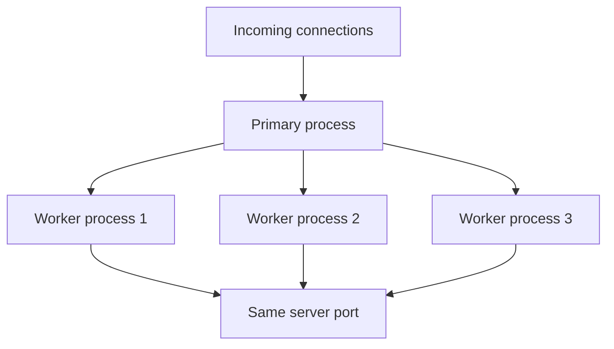
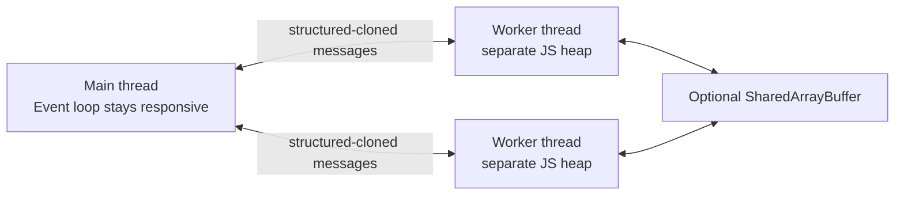
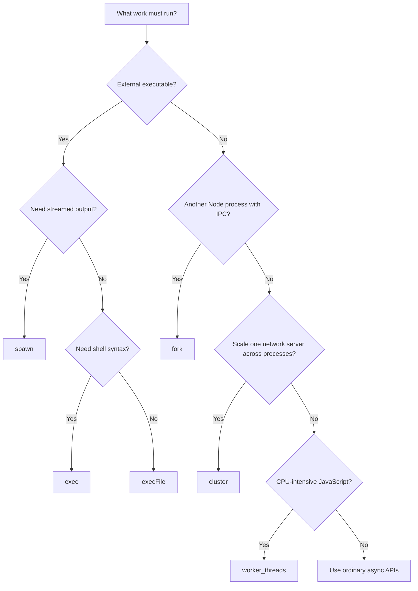

# Node.js Standard Library

## Contents

1. [`process`](#1-process)
2. [Errors](#2-errors)
3. [Buffers and the file system](#3-buffers-and-the-file-system)
4. [`path`](#4-path)
5. [`crypto`](#5-crypto)
6. [`child_process`](#6-child_process)
7. [`cluster`](#7-cluster)
8. [`worker_threads`](#8-worker_threads)
9. [Choosing a concurrency tool](#9-choosing-a-concurrency-tool)
10. [Safe subprocess design](#10-safe-subprocess-design)
11. [Worker pools and bounded CPU work](#11-worker-pools-and-bounded-cpu-work)
12. [Resource ownership and diagnostics](#12-resource-ownership-and-diagnostics)
13. [Final review checklist](#13-final-review-checklist)
14. [Boundary and ownership labs](#14-boundary-and-ownership-labs)

---

## 1. `process`

`process` is a global object that describes and controls the current Node.js process. Do not import it unless an explicit import improves clarity or typing.

### Quick reference

| API                  | What it provides                   | Use it when                                                | Important detail                                      |
| -------------------- | ---------------------------------- | ---------------------------------------------------------- | ----------------------------------------------------- |
| `process.argv`       | Command-line arguments             | Building a CLI script                                      | User arguments normally start at index `2`            |
| `process.env`        | Environment variables              | Reading deployment configuration and secrets               | Values are strings or `undefined`                     |
| `process.cwd()`      | Current working directory          | Resolving paths relative to where the command was launched | It is not necessarily the script's directory          |
| `process.exit(code)` | Immediate process termination      | A process cannot safely continue                           | Pending output and asynchronous work may be abandoned |
| `process.exitCode`   | Exit code used after work finishes | Reporting failure while allowing cleanup                   | Usually safer than immediate `process.exit()`         |
| `process.stdin`      | Standard input stream              | Reading piped or interactive input                         | It is a readable stream                               |
| `process.stdout`     | Standard output stream             | Writing a program's intended output                        | Keep machine-readable output here                     |
| `process.stderr`     | Standard error stream              | Writing errors and diagnostics                             | It can be redirected separately from stdout           |
| `process.version`    | Current Node.js version            | Diagnostics and compatibility checks                       | Example: `v22.x.x`                                    |
| `process.platform`   | Operating-system platform          | Handling unavoidable platform differences                  | Common values include `linux`, `darwin`, and `win32`  |
| `process.on(...)`    | Process-level event listener       | Final logging and graceful shutdown                        | It is not a replacement for local error handling      |

### Command-line arguments

The launch command determines the shape of `process.argv`:

```text
node script.mjs /source /destination
│    │          │       └─ process.argv[3]
│    │          └───────── process.argv[2]
│    └──────────────────── process.argv[1]: script path
└───────────────────────── process.argv[0]: Node executable
```

Use `slice(2)` for a few positional arguments:

```ts
const [sourceDir, destinationDir] = process.argv.slice(2);

if (!sourceDir || !destinationDir) {
  console.error('Usage: node script.mjs <source> <destination>');
  process.exitCode = 1;
} else {
  console.log({ sourceDir, destinationDir });
}
```

**What it does:** removes the Node executable and script path from `process.argv`, validates two positional arguments, and records a failing exit code when either is missing.

**When to use it:** this is enough for small internal scripts with a fixed argument order. Prefer `parseArgs()` or a CLI library once you need named flags, generated help, subcommands, or richer validation.

Use `util.parseArgs()` when the CLI has named flags, short aliases, or a mixture of flags and positional values:

```ts
import { parseArgs } from 'node:util';

const { values, positionals } = parseArgs({
  options: {
    verbose: { type: 'boolean', short: 'v', default: false },
    config: { type: 'string', short: 'c' },
  },
  allowPositionals: true,
});

// node app.mjs -v --config=prod.json ./source
console.log(values.verbose); // true
console.log(values.config); // 'prod.json'
console.log(positionals); // ['./source']
```

Use `process.argv.slice(2)` for a tiny internal script. Use `parseArgs()` once validation, optional flags, or helpful usage messages matter.

### Environment variables

Environment variables keep configuration outside source code:

```sh
PORT=3000 NODE_ENV=production node server.mjs
```

```ts
const port = Number(process.env.PORT ?? 4000);

if (!Number.isInteger(port) || port < 1 || port > 65535) {
  throw new Error('PORT must be an integer from 1 through 65535');
}
```

What to know:

- Every `process.env` value is a string or `undefined`; parse numbers and booleans explicitly.
- The string `'false'` is truthy. Compare it explicitly: `process.env.DEBUG === 'true'`.
- Fail early when required configuration is absent.
- Do not print secrets or commit them to source control.
- Changing `process.env` affects the current process and child processes created afterward, not the parent shell.

### Standard streams

```ts
process.stdout.write('normal result\n');
process.stderr.write('diagnostic or error\n');
```

`console.log()` writes to stdout. `console.error()` and `console.warn()` write to stderr.

```sh
node app.mjs > results.txt 2> errors.txt
```

For CLI tools, put the actual result on stdout and all warnings, progress messages, and errors on stderr. This allows another program to safely consume stdout.

### Exit codes and shutdown

| Exit code | Conventional meaning                    |
| --------- | --------------------------------------- |
| `0`       | Success                                 |
| Non-zero  | Failure; `1` is the usual generic value |

Prefer setting `process.exitCode` when Node.js can finish naturally:

```ts
try {
  await run();
} catch (error) {
  console.error(error);
  process.exitCode = 1;
}
```

Use `process.exit(1)` only when immediate termination is required. It can stop buffered stdout/stderr, pending file writes, timers, and network requests before they finish.

For a long-running server, signals provide a graceful shutdown boundary:

```ts
process.on('SIGTERM', () => {
  server.close((error) => {
    if (error) {
      console.error(error);
      process.exitCode = 1;
    }
  });
});
```

### Process-level error events

```ts
process.on('uncaughtException', (error) => {
  console.error('Uncaught exception:', error);
  process.exit(1);
});

process.on('unhandledRejection', (reason) => {
  console.error('Unhandled rejection:', reason);
  process.exit(1);
});
```

These handlers are last-resort logging hooks. Do not attempt to resume normal work after an uncaught exception because application state may be inconsistent. Catch expected failures near the operation that can fail.

---

## 2. Errors

Errors communicate that an operation could not produce its promised result. The handling mechanism should match the execution style: synchronous throw, rejected promise, callback error, or an EventEmitter `'error'` event.

### Built-in error classes

| Class            | Typical meaning                                              | Example                                          |
| ---------------- | ------------------------------------------------------------ | ------------------------------------------------ |
| `Error`          | General application failure                                  | Configuration file could not be loaded           |
| `TypeError`      | A value has the wrong type or an operation is invalid for it | A string was supplied where a number is required |
| `RangeError`     | A value is outside an allowed range                          | A negative buffer size                           |
| `ReferenceError` | Code refers to an unavailable identifier                     | A misspelled variable name                       |
| `SyntaxError`    | Source text or parsed input has invalid syntax               | Invalid JavaScript or `JSON.parse()` input       |
| `URIError`       | Invalid use of URI encoding/decoding                         | Malformed input to `decodeURIComponent()`        |
| `EvalError`      | Historical `eval()`-related category                         | Rarely used in modern code                       |

### Operational errors versus programmer errors

| Operational error                                      | Programmer error                                           |
| ------------------------------------------------------ | ---------------------------------------------------------- |
| Expected failure during valid operation                | Bug in the program                                         |
| Missing file, refused connection, invalid user input   | Wrong argument type, misspelled variable, broken invariant |
| Handle, report, retry when safe, or degrade gracefully | Fix the code; do not hide the failure                      |

An error may change category depending on context. A missing optional cache file is operational; a missing source file hardcoded by the application may reveal a programming or deployment bug.

### Anatomy of an `Error`

```ts
const error = new Error('Could not load configuration');

console.log(error.name);    // 'Error'
console.log(error.message); // human-readable summary
console.log(error.stack);   // stack trace for diagnostics
```

Use `message` for context and a stable `code` or custom class for decisions. Avoid branching on message text because wording changes easily.

```ts
class ValidationError extends Error {
  readonly code = 'ERR_VALIDATION';

  constructor(
    readonly field: string,
    message: string,
  ) {
    super(message);
    this.name = 'ValidationError';
  }
}
```

### Preserve the original cause

Wrap an error when you can add useful higher-level context, and retain the original failure with `cause`:

```ts
import fs from 'node:fs/promises';

async function loadConfig(): Promise<string> {
  try {
    return await fs.readFile('config.json', 'utf8');
  } catch (error) {
    throw new Error('Failed to load application configuration', {
      cause: error,
    });
  }
}
```

Do not catch an error merely to throw the same error again. Catch it when you can recover, add context, convert it to a domain error, log it at a boundary, or clean up resources.

### Four delivery patterns

| Pattern              | Use it for                            | Handling form                             |
| -------------------- | ------------------------------------- | ----------------------------------------- |
| `throw`              | Synchronous functions                 | `try/catch`                               |
| Rejected promise     | Promise-based asynchronous functions  | `await` inside `try/catch`, or `.catch()` |
| Error-first callback | Older callback APIs                   | Check `err` first and `return`            |
| `'error'` event      | Streams and long-lived event emitters | Attach an `'error'` listener              |

```ts
function square(value: unknown): number {
  if (typeof value !== 'number') {
    throw new TypeError('value must be a number');
  }
  return value * value;
}

try {
  console.log(square('8'));
} catch (error) {
  console.error(error);
}
```

An `async` function automatically turns a thrown error into a rejected promise:

```ts
async function readSettings(): Promise<string> {
  return fs.readFile('settings.json', 'utf8');
}

try {
  const settings = await readSettings();
  console.log(settings);
} catch (error) {
  console.error('Could not read settings:', error);
}
```

Classic callback APIs use `(error, result)`:

```ts
import fsCallback from 'node:fs';

fsCallback.readFile('page.html', 'utf8', (error, data) => {
  if (error) {
    console.error(error);
    return;
  }
  console.log(data);
});
```

Return after handling the callback error so the success path cannot accidentally run.

### Error-handling rules of thumb

- Prefer promises and `async`/`await` in new application code.
- Throw `Error` objects, not strings, so callers receive a stack and structured metadata.
- Include what operation failed and which safe identifier was involved.
- Never expose secrets in an error message.
- Inspect Node.js system errors through stable properties such as `error.code === 'ENOENT'`.
- Do not silently swallow errors. If ignoring one is intentional, document why it is safe.
- Add cleanup with `finally` when it must happen on both success and failure.

---

## 3. Buffers and the file system

### Buffers

A `Buffer` is a fixed-size sequence of bytes. Use it for binary data such as images, compressed archives, network packets, and cryptographic values.

```ts
const buffer = Buffer.from('hello', 'utf8');

console.log(buffer);                  // <Buffer 68 65 6c 6c 6f>
console.log(buffer.toString('utf8')); // 'hello'
console.log(buffer.length);           // 5 bytes
```

Text encoding maps characters to bytes. Use `'utf8'` for normal text unless a format explicitly requires another encoding.

```text
text --Buffer.from(..., 'utf8')--> bytes
text <--buffer.toString('utf8')---- bytes
```

When `fs.readFile()` has no encoding, it returns a `Buffer`. When it receives `'utf8'`, it returns a string.

### Import styles

Use the promise API for new code:

```ts
import fs from 'node:fs/promises';
// Equivalent: import { promises as fs } from 'node:fs';
```

Use `node:fs` when you specifically need callbacks, streams, or synchronous methods:

```ts
import fs from 'node:fs';
```

### File APIs

| Promise API                        | Purpose                                  | What to know                                               |
| ---------------------------------- | ---------------------------------------- | ---------------------------------------------------------- |
| `fs.readFile(path, encoding?)`     | Read an entire file                      | Returns `Buffer` without an encoding; avoid for huge files |
| `fs.writeFile(path, data)`         | Create or replace a file                 | Existing content is overwritten by default                 |
| `fs.appendFile(path, data)`        | Append data, creating the file if needed | Useful for small log entries                               |
| `fs.copyFile(source, destination)` | Copy a file                              | Source remains unchanged                                   |
| `fs.rename(oldPath, newPath)`      | Rename or move an entry                  | Behavior across different filesystems may vary             |
| `fs.unlink(path)`                  | Delete a file                            | Throws if it does not exist unless handled                 |
| `fs.stat(path)`                    | Read metadata                            | Returns size, timestamps, and type checks                  |

```ts
import fs from 'node:fs/promises';

const text = await fs.readFile('notes.txt', 'utf8');
await fs.writeFile('copy.txt', text);
await fs.appendFile('activity.log', 'Operation complete\n');
await fs.copyFile('copy.txt', 'copy-2.txt');
await fs.rename('copy-2.txt', 'archive.txt');
await fs.unlink('archive.txt');
```

`writeFile()` is appropriate when replacing the whole output is intended. For valuable existing data, consider writing a temporary file and renaming it only after the write succeeds.

### Directory APIs

| API                                         | Purpose                                       | Useful option                                                            |
| ------------------------------------------- | --------------------------------------------- | ------------------------------------------------------------------------ |
| `fs.readdir(path)`                          | Return entry names                            | Sort explicitly when order matters                                       |
| `fs.readdir(path, { withFileTypes: true })` | Return `Dirent` objects                       | Use `isFile()` and `isDirectory()` without a separate `stat()` per entry |
| `fs.mkdir(path)`                            | Create one directory                          | Parent must already exist                                                |
| `fs.mkdir(path, { recursive: true })`       | Create missing parent directories             | Does not fail merely because the directory exists                        |
| `fs.glob(pattern)`                          | Match paths using a pattern in modern Node.js | Useful for recursive or pattern-based selection                          |

```ts
const entries = await fs.readdir('./source', { withFileTypes: true });

const topLevelTextFiles = entries
  .filter((entry) => entry.isFile() && entry.name.endsWith('.txt'))
  .map((entry) => entry.name)
  .sort();
```

`readdir()` order is not guaranteed. Always sort before generating deterministic output or a checksum.

### Metadata and existence checks

```ts
try {
  const stats = await fs.stat('./input.txt');
  console.log({
    isFile: stats.isFile(),
    isDirectory: stats.isDirectory(),
    bytes: stats.size,
    modifiedAt: stats.mtime,
  });
} catch (error: unknown) {
  if (isNodeError(error) && error.code === 'ENOENT') {
    console.log('The path does not exist');
  } else {
    throw error;
  }
}

function isNodeError(error: unknown): error is Error & { code: string } {
  return error instanceof Error && 'code' in error && typeof error.code === 'string';
}
```

The guard proves only Error plus a string code; it does not promise path, syscall or every errno field. Check each additional property before using it. instanceof Error can fail across realms or for serialized/plain error records; parse those transport schemas separately. A type assertion or non-null assertion removes a checker complaint, not an invalid runtime value. Narrow environment values explicitly as in the HMAC example below.

Prefer attempting the real operation and handling failure. A separate “exists?” check can become stale before the next operation, creating a time-of-check/time-of-use race.

Common system error codes include:

| Code      | Meaning                                               |
| --------- | ----------------------------------------------------- |
| `ENOENT`  | File or directory does not exist                      |
| `EACCES`  | Permission denied                                     |
| `EEXIST`  | Entry already exists                                  |
| `EISDIR`  | An operation expected a file but received a directory |
| `ENOTDIR` | A path segment expected to be a directory is not one  |

### Asynchronous versus synchronous methods

Synchronous names end with `Sync`, such as `readFileSync()` and `readdirSync()`. They block the JavaScript thread until the operating system completes the operation.

Use synchronous I/O sparingly for simple startup work or one-off CLI scripts. Avoid it in request handlers, frequently called functions, and large loops because it prevents the event loop from serving other work.

### Entire file versus stream

```text
readFile: [wait] -> entire file in memory -> process it
stream:   chunk -> process -> chunk -> process -> ...
```

Use `readFile()` when the file is comfortably small and you need all of it. Use `createReadStream()` when data may be large or should be processed progressively.

---

## 4. `path`

The `node:path` module constructs and inspects paths without hardcoding platform separators. Use it instead of joining path strings with `'/'` or `'\\'`.

```ts
import path from 'node:path';
```

### Essential methods

| Method                             | Result                                  | Use it when                                           |
| ---------------------------------- | --------------------------------------- | ----------------------------------------------------- |
| `path.join(...segments)`           | Normalized path assembled from segments | Combining a known base directory with child segments  |
| `path.resolve(...segments)`        | Absolute path resolved right-to-left    | Converting a user-relative path into an absolute path |
| `path.dirname(filePath)`           | Parent directory                        | Finding the containing directory                      |
| `path.basename(filePath, suffix?)` | Final path component                    | Getting a filename or removing a known suffix         |
| `path.extname(filePath)`           | Final extension including `.`           | Checking a filename's last extension                  |
| `path.parse(filePath)`             | `{ root, dir, base, name, ext }`        | Inspecting several components at once                 |
| `path.format(object)`              | Path string                             | Rebuilding a path from components                     |
| `path.normalize(filePath)`         | Normalized separators and segments      | Cleaning redundant separators, `.` and `..`           |
| `path.relative(from, to)`          | Relative route from one path to another | Displaying or storing portable relative paths         |
| `path.isAbsolute(filePath)`        | Boolean                                 | Validating whether a path is absolute                 |

```ts
const filePath = path.join('/home', 'user', 'docs', 'report.md');

path.dirname(filePath);              // '/home/user/docs'
path.basename(filePath);             // 'report.md'
path.basename(filePath, '.md');      // 'report'
path.extname(filePath);              // '.md'
path.parse(filePath).name;           // 'report'
path.relative('/home/user', filePath); // 'docs/report.md'
```

### `join()` versus `resolve()`

```ts
path.join('output', 'today', 'file.txt');
// 'output/today/file.txt' on macOS/Linux: may remain relative

path.resolve('output', 'today', 'file.txt');
// '/current/working/directory/output/today/file.txt': always absolute
```

`resolve()` uses `process.cwd()` when it needs a starting point. It also resets when it encounters an absolute segment. `join()` simply combines and normalizes segments.

### Working directory versus script directory

These concepts are frequently confused:

```text
process.cwd()          where the user launched Node.js
import.meta.dirname   where the current ES module file lives
__dirname             where the current CommonJS file lives
```

Use `process.cwd()` for user-facing project-relative input. Use the script/module directory for files packaged beside your program.

ES modules in Node.js 22:

```ts
const configPath = path.join(import.meta.dirname, 'config.json');
```

Portable ESM fallback for versions without `import.meta.dirname`:

```ts
import { fileURLToPath } from 'node:url';

const filename = fileURLToPath(import.meta.url);
const dirname = path.dirname(filename);
```

CommonJS provides `__filename` and `__dirname` directly.

### Path safety: lexical containment is only one layer

Normalization does not establish filesystem containment. Start with a **segment-aware** lexical check; a valid name such as `..notes` is not the parent segment `..`.

```ts
import path from 'node:path';
import { realpath } from 'node:fs/promises';

export function isWithin(base: string, candidate: string): boolean {
  const relative = path.relative(base, candidate);
  return relative !== '..' && !relative.startsWith(`..${path.sep}`) &&
    !path.isAbsolute(relative);
}
export async function resolveExistingInside(baseDir: string, userName: string): Promise<string> {
  if (typeof userName !== 'string' || userName.length === 0 || userName.includes('\0') ||
      path.isAbsolute(userName)) throw new TypeError('Expected a nonempty relative path');
  const base = await realpath(baseDir);
  const lexical = path.resolve(base, userName);
  if (!isWithin(base, lexical)) throw new Error('Lexical path escape');
  const canonical = await realpath(lexical); // Resolves existing symlinks; missing path rejects.
  if (!isWithin(base, canonical)) throw new Error('Symlink path escape');
  return canonical;
}
```

This helper is for an **existing path in an application-owned tree that untrusted actors cannot mutate**. It permits the base itself; a file-only operation must additionally open/check a regular file. It rejects lexical and already-present symlink escapes, but realpath-then-open is **not atomic**. If an attacker can swap a directory/link after the check, a TOCTOU race remains. lstat-then-open has the same issue; checking only the final component with O_NOFOLLOW does not constrain ancestor symlinks and is platform-dependent. Portable Node path APIs do not turn this helper into a race-proof filesystem sandbox.

For public uploads, prefer server-generated opaque filenames under a private service-owned directory, exclusive creation where appropriate, least-privilege OS permissions and a storage service/OS containment boundary designed for the threat model. Keep user display names as metadata, not paths. Creation of a missing target needs a separate design: realpath cannot resolve a nonexistent file, and checking its parent still does not eliminate hostile-parent races. URL decoding/Windows separators/case and alternate volumes require platform tests; do not assume a POSIX test proves Windows safety.


---

## 5. `crypto`

`node:crypto` supplies hashing, HMAC, secure random values, encryption primitives, and password key-derivation functions.

```ts
import crypto from 'node:crypto';
```

### Hashing

A cryptographic hash maps input of any length to a fixed-length digest.

```text
same input  ──hash──> same digest
changed input ─hash─> very different digest
digest ──X──> original input (not practically reversible)
```

Use a hash to check integrity, fingerprint content, deduplicate content, or detect change. A hash does not prove who created the data; use an HMAC or digital signature when authenticity matters.

```ts
const digest = crypto
  .createHash('sha256')
  .update('hello world', 'utf8')
  .digest('hex');
```

| Step                       | Purpose                                                          |
| -------------------------- | ---------------------------------------------------------------- |
| `createHash('sha256')`     | Select the algorithm and create mutable hash state               |
| `.update(data, encoding?)` | Add a string, `Buffer`, or typed array; may be called repeatedly |
| `.digest('hex')`           | Finalize the hash and return its representation                  |

After `.digest()`, the hash object is finalized; create a new one for another calculation.

Common digest encodings:

| Encoding      | Use                                                      |
| ------------- | -------------------------------------------------------- |
| `'hex'`       | Readable storage and comparison; two characters per byte |
| `'base64'`    | More compact text representation                         |
| `'base64url'` | URL- and filename-friendly Base64 variant                |
| No encoding   | Raw `Buffer` for binary APIs                             |

### Deterministic directory fingerprints

Filesystem order is not guaranteed, so sort names before hashing:

```ts
export async function calculateDirectoryChecksum(
  names: string[],
): Promise<string> {
  const stableInput = JSON.stringify([...names].sort());

  return crypto
    .createHash('sha256')
    .update(stableInput, 'utf8')
    .digest('hex');
}
```

JSON serialization makes the sorted name sequence unambiguous: `["a,b","c"]` and `["a","b,c"]` no longer share the input string `a,b,c`. Sorting copies the caller array; duplicates remain significant. This hashes JS string names, not arbitrary undecodable filesystem byte names; choose an explicit byte-name protocol if needed. This removes a serialization collision, not the theoretical possibility of hash collisions.

Be precise about what the checksum represents. Hashing only top-level names detects added, removed, or renamed top-level entries; it does not detect changed file contents or changes inside subdirectories.

### Passwords need a slow password function

Do not store passwords with plain SHA-256, SHA-512, or MD5. General hashes are deliberately fast, making brute-force attacks cheap. Use a salted password derivation function such as `crypto.scrypt()` or `crypto.pbkdf2()` with parameters appropriate to your system.

### Secure random values

| API                        | Use it for                                       |
| -------------------------- | ------------------------------------------------ |
| `crypto.randomBytes(size)` | Tokens, salts, and arbitrary secure random bytes |
| `crypto.randomUUID()`      | Standard version 4 UUID identifiers              |
| `Math.random()`            | Simulations and non-security UI behavior only    |

```ts
const token = crypto.randomBytes(32).toString('base64url');
const id = crypto.randomUUID();
```

### HMAC

An HMAC combines data with a secret key. Matching HMACs demonstrate integrity and knowledge of the shared secret.

```ts
const signingSecret = process.env.SIGNING_SECRET;
if (!signingSecret) throw new Error('SIGNING_SECRET is required');
const signature = crypto
  .createHmac('sha256', signingSecret)
  .update(payload, 'utf8')
  .digest('hex');
```

Use HMACs for signed webhook payloads, cookies, or messages shared between trusted systems. Keep the key secret. When verifying sensitive byte sequences, use `crypto.timingSafeEqual()` on equal-length buffers rather than an ordinary string comparison.

### Web Crypto

Node.js 22 also exposes the browser-compatible Web Crypto API through `globalThis.crypto`:

```ts
const bytes = new TextEncoder().encode('hello');
const digest = await globalThis.crypto.subtle.digest('SHA-256', bytes);
```

Use `node:crypto` for ergonomic Node.js backend code. Use Web Crypto when sharing cryptographic code with browser environments or when an API specifically requires it.

---

## 6. `child_process`

`node:child_process` launches external programs. Choose the function according to whether you need a shell, streaming output, or Node-to-Node messaging.

### Decision table

| Function     | Shell by default? | Output model          | Best use                                                    | Main risk or limitation                 |
| ------------ | ----------------: | --------------------- | ----------------------------------------------------------- | --------------------------------------- |
| `exec()`     | Yes               | Buffers stdout/stderr | Shell syntax such as pipes and redirects; small output      | Shell injection and `maxBuffer`         |
| `execFile()` | No                | Buffers stdout/stderr | Safely run one executable with argument array               | Not suitable for very large live output |
| `spawn()`    | No                | Streams stdout/stderr | Large output, long-running commands, progressive processing | More event handling is required         |
| `fork()`     | No; launches Node | IPC message channel   | Run another Node.js module and exchange messages            | Separate process and separate memory    |

### `exec()`

```ts
import { exec } from 'node:child_process';
import { promisify } from 'node:util';

const execAsync = promisify(exec);
const { stdout, stderr } = await execAsync('node --version');
```

Use `exec()` only when you actually need shell parsing. Never interpolate untrusted input into its command string:

```ts
// Dangerous: input can inject additional shell commands.
await execAsync(`tool --name ${userInput}`);
```

### `execFile()`

```ts
import { execFile } from 'node:child_process';
import { promisify } from 'node:util';

const execFileAsync = promisify(execFile);
const { stdout } = await execFileAsync('node', ['--version']);
```

Arguments are passed as an array without normal shell interpretation. This is the preferred buffered API when any argument is dynamic.

### `spawn()`

```ts
import { spawn } from 'node:child_process';

const child = spawn('tar', ['-czf', archivePath, '-C', sourceDir, '.']);

child.stdout.on('data', (chunk: Buffer) => {
  process.stdout.write(chunk);
});

child.stderr.on('data', (chunk: Buffer) => {
  process.stderr.write(chunk);
});

child.on('error', (error) => {
  console.error('Could not start child:', error);
});

child.on('close', (code) => {
  console.log(`Child finished with exit code ${code}`);
});
```

Important events:

| Event          | Meaning                                                                          |
| -------------- | -------------------------------------------------------------------------------- |
| `'error'`      | The process could not be spawned or killed; this is not its non-zero exit status |
| `'close'`      | Process ended and its stdio streams closed; use this for final completion logic  |
| `'exit'`       | Process ended, but stdio may still be open                                       |
| `'message'`    | IPC message received from a process with an IPC channel                          |
| `'disconnect'` | IPC channel closed                                                               |

Wrap `spawn()` in a promise when the caller only needs completion:

```ts
function run(command: string, args: string[]): Promise<void> {
  return new Promise((resolve, reject) => {
    const child = spawn(command, args, { stdio: 'inherit' });

    child.once('error', reject);
    child.once('close', (code) => {
      if (code === 0) resolve();
      else reject(new Error(`${command} exited with code ${code}`));
    });
  });
}
```

### `fork()`

`fork()` is specialized for another Node.js module and creates an IPC channel automatically:

```ts
import { fork } from 'node:child_process';

const child = fork('./child.mjs');

child.on('message', (message) => console.log('From child:', message));
child.send({ task: 'calculate', value: 42 });
```

Inside `child.mjs`:

```ts
process.on('message', (message) => {
  process.send?.({ received: message });
});
```

### Synchronous variants and Windows

`execSync()`, `execFileSync()`, and `spawnSync()` block the event loop. Reserve them for startup or small administrative scripts, never request-serving paths.

On Windows, `.bat` and `.cmd` files need a shell. Use `exec()` or carefully use `spawn(command, args, { shell: true })`. Enabling a shell restores shell-injection concerns.

---

## 7. `cluster`

`node:cluster` runs multiple Node.js processes that can share a server port. A primary process manages workers, while workers handle requests.



Each worker is a separate process with its own memory and event loop. State stored in a worker's variables is not automatically visible to other workers.

### Core APIs and events

| API or event            | Purpose                                          |
| ----------------------- | ------------------------------------------------ |
| `cluster.isPrimary`     | Select primary or worker startup logic           |
| `cluster.fork()`        | Start a worker process                           |
| `cluster.worker`        | Access the current worker from worker code       |
| `cluster.workers`       | Access known workers from the primary            |
| `'fork'`                | A worker was created                             |
| `'listening'`           | A worker began listening                         |
| `'disconnect'`          | A worker disconnected its IPC channel            |
| `'exit'`                | A worker stopped; decide whether to replace it   |
| `worker.send(message)`  | Send an IPC message to a worker                  |
| `process.send(message)` | Send an IPC message from a worker to the primary |

### Minimal pattern

```ts
import cluster from 'node:cluster';
import http from 'node:http';
import os from 'node:os';

if (cluster.isPrimary) {
  const workerCount = os.availableParallelism();

  for (let index = 0; index < workerCount; index += 1) {
    cluster.fork();
  }

  cluster.on('exit', (worker, code, signal) => {
    console.error(`Worker ${worker.id} exited`, { code, signal });
    cluster.fork();
  });
} else {
  http.createServer((_request, response) => {
    response.end(`Handled by worker ${cluster.worker?.id}`);
  }).listen(6006);
}
```

### When to use it

Use cluster to run several instances of the same network server on one machine and distribute connections across CPU cores. It can also isolate a worker crash from other workers.

What to know:

- The primary should coordinate workers, not perform ordinary request handling.
- In-memory sessions, counters, and caches are per worker. Put shared application state in an external store or coordinate it explicitly.
- Replacing every exiting worker without limits can create a crash loop. Log the cause and use a restart policy/backoff in production.
- Graceful deployment requires workers to stop accepting new requests, finish active requests, and then exit.
- Horizontal scaling with a process manager, container orchestrator, or multiple service instances is often preferred in deployed systems.
- Cluster adds throughput by running several event loops; it does not make one CPU-heavy request intrinsically faster.

---

## 8. `worker_threads`

`node:worker_threads` runs JavaScript in parallel inside one process. Use it for CPU-intensive JavaScript that would otherwise block the main event loop.

Good examples include image transformations, parsing large data, compression, hashing substantial inputs, encoding, and expensive calculations. Ordinary file and network I/O already uses Node.js asynchronous facilities and normally does not need a worker thread.

### Architecture



Workers run in the same operating-system process, but each has its own JavaScript isolate and heap. Normal JavaScript objects are not shared by reference. Explicit shared memory such as `SharedArrayBuffer` can be accessed by multiple threads.

### Main primitives

| API                             | Where  | Purpose                                                        |
| ------------------------------- | ------ | -------------------------------------------------------------- |
| `new Worker(filename, options)` | Parent | Create and start a worker                                      |
| `workerData`                    | Worker | Read startup data supplied in `options`                        |
| `parentPort`                    | Worker | Receive messages and send results to the parent                |
| `worker.postMessage(value)`     | Parent | Send later work to an existing worker                          |
| `parentPort.postMessage(value)` | Worker | Return a result or status                                      |
| `isMainThread`                  | Either | Determine whether shared source is running as parent or worker |
| `worker.terminate()`            | Parent | Ask a worker to stop                                           |

### Basic example

Parent:

```ts
import { Worker } from 'node:worker_threads';

const worker = new Worker(new URL('./worker.mjs', import.meta.url), {
  workerData: { numbers: [1, 2, 3, 4, 5] },
});

worker.on('message', (sum) => console.log(sum)); // 15
worker.on('error', (error) => console.error('Worker failed:', error));
worker.on('exit', (code) => console.log('Worker exit code:', code));
```

Worker:

```ts
import { parentPort, workerData } from 'node:worker_threads';

const sum = workerData.numbers.reduce(
  (total: number, value: number) => total + value,
  0,
);

parentPort?.postMessage(sum);
```

Use `new URL('./worker.mjs', import.meta.url)` so the worker path is relative to the parent module rather than `process.cwd()`.

### Promise wrapper

```ts
import { Worker } from 'node:worker_threads';

export async function runWorker<TInput, TResult>(
  filename: URL,
  workerData: TInput,
  parseResult: (value: unknown) => TResult,
  { signal, timeoutMs = 5_000 }: { signal?: AbortSignal; timeoutMs?: number } = {},
): Promise<TResult> {
  if (!Number.isInteger(timeoutMs) || timeoutMs < 1 || timeoutMs > 2_147_483_647)
    throw new RangeError('timeoutMs must be a valid finite timer delay');
  if (typeof parseResult !== 'function') throw new TypeError('Result parser required');
  signal?.throwIfAborted();
  return new Promise<TResult>((resolve, reject) => {
    const worker = new Worker(filename, { workerData });
    let selected = false;
    type Outcome = { ok: true; value: TResult } | { ok: false; error: unknown };
    const cleanup = () => {
      worker.removeListener('message', onMessage);
      worker.removeListener('messageerror', onMessageError);
      worker.removeListener('error', onError);
      worker.removeListener('exit', onExit);
    };
    const finish = (outcome: Outcome) => {
      if (selected) return;
      selected = true;
      clearTimeout(timer);
      signal?.removeEventListener('abort', onAbort);
      // Keep the error/exit handlers until termination has completed.
      Promise.resolve().then(() => worker.terminate()).then(() => {
        cleanup();
        if (outcome.ok) resolve(outcome.value); else reject(outcome.error);
      }, terminationError => {
        cleanup();
        reject(new AggregateError(outcome.ok ? [terminationError] :
          [outcome.error, terminationError], 'Worker cleanup failed'));
      });
    };
    const onMessage = (raw: unknown) => {
      if (selected) return;
      try { finish({ ok: true, value: parseResult(raw) }); }
      catch (error) { finish({ ok: false, error }); }
    };
    const onMessageError = (error: Error) => finish({ ok: false, error });
    const onError = (error: Error) => finish({ ok: false, error });
    const onExit = (code: number) => finish({ ok: false,
      error: new Error(`Worker exited without a result (code=${code})`) });
    const onAbort = () => finish({ ok: false, error: signal?.reason ??
      new Error('Worker aborted') });
    const timer = setTimeout(() => finish({ ok: false,
      error: new Error('Worker deadline exceeded') }), timeoutMs);
    worker.on('message', onMessage);
    worker.on('messageerror', onMessageError);
    worker.on('error', onError);
    worker.on('exit', onExit);
    signal?.addEventListener('abort', onAbort, { once: true });
    if (signal?.aborted) onAbort();
  });
}
```

Node24 baseline. This is a **one-result, owned worker** protocol: the first valid result ends the task and the worker is terminated before the caller settles. A worker that exits without a result rejects even for code0; startup/worker/message-deserialization/parser errors, timeout and caller abort also reject. The timer remains referenced so the deadline cannot silently disappear while the task is pending. Terminal races select one outcome, clear the timer/abort listener, retain error handling during termination and release worker listeners afterward. Termination failure is surfaced, not swallowed. Cancellation is forceful worker termination, not a transactional rollback of effects the worker may already have performed.

The parser is a real runtime boundary rather than `message as TResult`: worker messages are structured-cloned values. For the sum example, use `(value: unknown) => { if (typeof value !== 'number' || !Number.isFinite(value)) throw new TypeError('Invalid sum'); return value; }`. Do not send progress messages on this result channel; a pool needs task IDs and a separate result/error/progress protocol. Deadline latency includes event-loop scheduling and termination; it is not a hard real-time guarantee. Native/uninterruptible work may delay termination, so deployment-level shutdown limits still need an external process supervisor. For many tasks, use a bounded reusable pool instead of this per-task wrapper.

### Message copying, transfer, and shared memory

By default, `postMessage()` uses the structured clone algorithm. Each side receives an independent representation; mutating a normal object in one thread does not mutate the other side's object.

Large `ArrayBuffer` instances can be transferred to avoid copying. Transfer moves ownership, so the sender can no longer use that buffer afterward.

`SharedArrayBuffer` permits true shared memory:

```ts
const sharedBuffer = new SharedArrayBuffer(Int32Array.BYTES_PER_ELEMENT);
const counter = new Int32Array(sharedBuffer);
Atomics.add(counter, 0, 1);
```

Use `Atomics` for synchronized reads and updates. Unsynchronized shared-memory access can create race conditions whose results change between runs.

### Performance guidance

- Creating a worker has overhead. Reuse a bounded worker pool for many small jobs.
- A worker only helps when parallel execution saves more time than startup and message transfer cost.
- Limit the pool to a sensible number near available CPU parallelism; unbounded workers increase scheduling and memory pressure.
- Measure performance. Do not add threads solely because an operation sounds complex.
- Workers improve responsiveness and throughput for CPU work, but they do not automatically speed up asynchronous I/O.

---

## 9. Choosing a concurrency tool



| Need                                                     | Best starting choice                             |
| -------------------------------------------------------- | ------------------------------------------------ |
| Run `tar`, `ffmpeg`, Git, or another executable          | `spawn()` or `execFile()`                        |
| Use shell pipes, redirects, or expansion                 | `exec()` with trusted, controlled input          |
| Stream large child output                                | `spawn()`                                        |
| Run a Node child with IPC and process isolation          | `fork()`                                         |
| Run several copies of an HTTP server on one host         | `cluster` or deployment-level process management |
| Run CPU-heavy JavaScript without blocking the event loop | `worker_threads`                                 |
| Read a file or call a database/network API               | Normal promise-based asynchronous API            |

---

## 10. Safe subprocess design

Child processes cross a security boundary. Treat command names, arguments, environment values, input, and output as untrusted data.

### Avoid shell interpolation

```ts
import { execFile } from 'node:child_process';
import { promisify } from 'node:util';

const execFileAsync = promisify(execFile);

const { stdout } = await execFileAsync('git', ['show', '--format=%H', '--no-patch'], {
  timeout: 5_000,
  maxBuffer: 1024 * 1024,
  env: { PATH: process.env.PATH ?? '' },
});
```

**What it does:** runs one executable with a separate argument array. It limits runtime and buffered output.

**When to use it:** prefer `execFile()` for a command with bounded output. Use `spawn()` when output may be large or must be processed incrementally.

Avoid this pattern:

```ts
exec(`convert ${userFilename} output.png`, callback);
```

A shell interprets spaces, quotes, substitutions, pipes, and redirections. Escaping every platform correctly is difficult. An argument array avoids shell parsing when a shell is not required.

### Robust `spawn()` lifecycle

```ts
import { spawn } from 'node:child_process';

function run(command: string, args: string[], signal: AbortSignal) {
  return new Promise<void>((resolve, reject) => {
    const child = spawn(command, args, {
      stdio: ['ignore', 'inherit', 'inherit'],
      signal,
      shell: false,
    });

    child.once('error', reject);
    child.once('close', (code, childSignal) => {
      if (code === 0) resolve();
      else reject(new Error(`Child failed: code=${code}, signal=${childSignal}`));
    });
  });
}
```

**What it does:** streams output, supports cancellation, detects startup errors, and checks the final exit result.

**When to use it:** use this shape for external tools and long-running child processes. Decide who owns termination of child processes during application shutdown.

Never assume an `'exit'` event means output streams are finished. The `'close'` event occurs after stdio closes.

---

## 11. Worker pools and bounded CPU work

Creating one worker per request is expensive. Under load it can create too many threads and duplicate too much memory.

A worker pool keeps a fixed number of workers:

```text
incoming CPU tasks → bounded queue → worker 1
                                ├→ worker 2
                                └→ worker 3
```

The pool needs explicit rules:

- maximum queue length;
- task timeout and cancellation;
- worker crash replacement;
- per-task correlation ID;
- result/error protocol;
- backpressure when the queue is full;
- graceful shutdown.

Rejecting excess work is often safer than allowing an unbounded queue to consume memory.

### Transfer ownership for large binary data

```ts
const bytes = new Uint8Array(10_000_000);

worker.postMessage(bytes, [bytes.buffer]);
```

**What it does:** transfers the underlying `ArrayBuffer` to the worker instead of copying it. The sender's buffer becomes detached.

**When to use it:** transfer large buffers when only one side needs ownership after the message. Use copying when both sides must retain independent data. Use shared memory only with a clear synchronization design.

### Pool sizing

For CPU-bound work, start near the CPU capacity available to the process. More workers than usable cores can increase scheduling overhead without increasing throughput.

Measure:

- queue wait time;
- task execution time;
- active worker count;
- event-loop delay in the main thread;
- process memory;
- rejection and timeout rate.

---

## 12. Resource ownership and diagnostics

Every resource should have one clear owner responsible for closing it.

| Resource | Owner should define |
| --- | --- |
| File handle | When reads/writes finish and how close errors are handled |
| Child process | Cancellation, signal escalation, and output draining |
| Worker | Task protocol, termination, and crash replacement |
| Timer | When it is cleared or whether it should keep the process alive |
| Socket | Idle timeout, error handling, and shutdown behavior |

### Common symptoms

| Symptom | Likely cause | First check |
| --- | --- | --- |
| Command hangs | Child waits for stdin or inherited descriptor | `stdio` configuration and timeout |
| Memory spikes | `exec()` buffers large output | Switch to `spawn()` and stream output |
| Event loop freezes | CPU work runs on main thread | CPU profile; move suitable work to a pool |
| Worker result never arrives | Missing error/exit handling | Listen for message, error, and exit |
| Process stays alive | Owned resource was not closed | Active handles, workers, timers, pools |
| Different behavior on Windows | Shell command or signal assumptions | Avoid shell syntax; test platform behavior |

### Diagnostic exercise

Create a thumbnail-processing service with a fixed worker pool.

It must:

- reject work when its bounded queue is full;
- cancel tasks whose caller disconnects;
- replace a worker that crashes;
- transfer image buffers where ownership permits;
- expose queue depth and task duration;
- stop accepting work and terminate workers during shutdown.

---

## 13. Final review checklist

You should be able to explain and demonstrate each item without looking it up:

- Avoid shell injection by separating executable names from argument arrays.
- Bound child-process runtime and output, and interpret exit code versus signal.
- Design a worker pool with a bounded queue, cancellation, and crash replacement.
- Explain copying, transferring, and sharing binary memory between workers.
- Identify and close the owner of every timer, handle, child, worker, and socket.
- Read positional arguments with `process.argv.slice(2)` and named options with `parseArgs()`.
- Parse `process.env` values instead of treating them as typed configuration.
- Keep results on stdout and errors on stderr.
- Prefer `process.exitCode` when pending work should finish.
- Distinguish operational failures from programmer bugs.
- Match errors to synchronous throws, promise rejections, callback errors, or `'error'` events.
- Know when `readFile()` returns a `Buffer` versus a string.
- Use promise-based `fs` methods and understand when streams are more appropriate.
- Sort directory entries whenever deterministic order matters.
- Use `path.join()` for composition and `path.resolve()` for an absolute result.
- Distinguish `process.cwd()` from the current module's directory.
- Use SHA-256 for integrity checks, not password storage.
- Use `randomBytes()` or `randomUUID()` when unpredictability matters.
- Choose `exec`, `execFile`, `spawn`, or `fork` based on shell, buffering, streaming, and IPC needs.
- Use cluster for multiple server processes and worker threads for CPU-heavy JavaScript.
- Remember that cluster workers have separate process memory and worker threads only share memory explicitly.
- Handle child and worker startup errors as well as non-zero exits.


## 14. Boundary and ownership labs

Baselines: Node24.18.0 runtime and TypeScript5.9.3 for isolated type checks; official Node24 API contracts checked2026-10-21. Use scratch fixtures and temporary app-owned directories, not production paths.

**Filesystem acceptance:** create a normal child, a valid `..notes` child, a lexical ../ escape and a symlink to an external scratch file. Assert the first two resolve and the latter two reject; absolute/missing/empty paths follow the documented contract. Explain why a deliberately swapped ancestor after resolution is still a race and why the helper requires an untrusted-writer-free tree. Test Windows separately. Do not claim a traversal-resistant OS sandbox from this check.

**Fingerprint acceptance:** compare the formerly ambiguous arrays `['a,b','c']` and `['a','b,c']` and require different digests. Input permutation produces the same digest, caller arrays are not mutated, empty/Unicode names are encoded deterministically, and content changes alone do not affect a names-only digest. If content integrity is required, design and version a separate canonical entry/content format.

**Error-boundary acceptance:** a plain Error must not pass the code guard; an Error with a numeric code must fail; an Error with a string code passes. Unknown cannot authorize code/path access before checks. A nonempty configured signing secret must be narrowed before HMAC creation, not asserted present. These tests do not implement the full raw-body/timestamp/replay-safe webhook protocol, which is a separate lesson.

**Worker acceptance:** write real workers for a valid result, invalid result, duplicate messages, immediate exit0, nonzero exit, thrown exception, message then live interval, and no-result live interval. Require exactly one selected outcome, exit0/no-message rejection, bounded deadline/caller abort behavior, no callbacks after cleanup and natural test-process termination. Pre-aborted signals must not start a worker; uncloneable input and invalid filename must reject. Confirm the parser protects result shape rather than casting unknown to TResult. A worker pool's queue/capacity/replace/drain implementation remains a separate practice task; this lab repairs one owned task.

Material checks and learner practice are separate. Record commands, Node version, fixtures, observations and any platform limitations. No user practice or production readiness follows from reading these examples.

Official references: [Node24 workers and termination](https://nodejs.org/docs/latest-v24.x/api/worker_threads.html), [Node24 path.relative](https://nodejs.org/docs/latest-v24.x/api/path.html#pathrelativefrom-to), [Node24 realpath/file APIs](https://nodejs.org/docs/latest-v24.x/api/fs.html), [Node24 crypto](https://nodejs.org/docs/latest-v24.x/api/crypto.html), [OWASP path traversal](https://community.owasp.org/attacks/Path_Traversal), [OWASP race conditions](https://community.owasp.org/pages/vulnerabilities/race_conditions).
