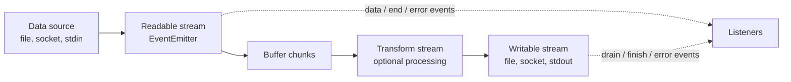
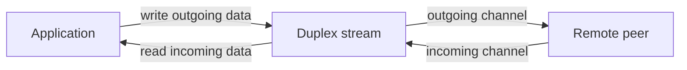
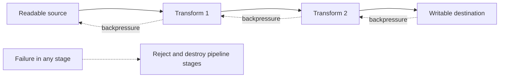

# EventEmitter, Buffers, and Streams

## Contents

1. [How the concepts fit together](#1-how-the-concepts-fit-together)
2. [`EventEmitter`](#2-eventemitter)
3. [`Buffer`](#3-buffer)
4. [Stream fundamentals](#4-stream-fundamentals)
5. [Readable streams](#5-readable-streams)
6. [Writable streams](#6-writable-streams)
7. [Duplex and Transform streams](#7-duplex-and-transform-streams)
8. [`pipeline()`, errors, and cleanup](#8-pipeline-errors-and-cleanup)
9. [Backpressure](#9-backpressure)
10. [Object mode](#10-object-mode)
11. [Creating custom streams](#11-creating-custom-streams)
12. [Performance and design guidance](#12-performance-and-design-guidance)
13. [Framing and protocol boundaries](#13-framing-and-protocol-boundaries)
14. [Diagnosing stream failures](#14-diagnosing-stream-failures)
15. [Final review checklist](#15-final-review-checklist)
16. [Iterator and serialization contracts](#16-iterator-and-serialization-contracts)

---

## 1. How the concepts fit together

`EventEmitter`, `Buffer`, and streams form much of Node.js's event-driven I/O model:

- `EventEmitter` provides named notifications and listener management.
- `Buffer` represents raw bytes efficiently.
- Streams move data incrementally and use events to report their lifecycle.



Every Node.js stream extends `EventEmitter`. Binary-mode readable streams normally produce `Buffer` chunks. Events and backpressure coordinate when those chunks should move.

### The central benefit

Suppose a program must process a 5 GB file:

```text
Whole-file API:
[ read all 5 GB into memory ] → [ process ] → [ write all output ]

Streaming API:
[ chunk ] → [ process ] → [ write ]
    [ chunk ] → [ process ] → [ write ]
        ...bounded data remains in memory...
```

Streaming usually reduces peak memory and time-to-first-result. It does not guarantee literally constant memory in every program: your transforms, queues, and consumers must also remain bounded and respect backpressure.

### Choosing the abstraction

| Need                                                       | Best starting abstraction  |
| ---------------------------------------------------------- | -------------------------- |
| Notify zero or more listeners about repeated occurrences   | `EventEmitter`             |
| Represent bytes, binary protocols, images, or encoded text | `Buffer`                   |
| Produce data incrementally                                 | `Readable`                 |
| Consume data incrementally                                 | `Writable`                 |
| Send and receive through independent channels              | `Duplex`                   |
| Convert input chunks into output chunks                    | `Transform`                |
| Connect a source, transformations, and destination safely  | `pipeline()`               |
| Return one eventual value or error                         | Promise / `async` function |

---

## 2. `EventEmitter`

`EventEmitter` implements an in-process publish/subscribe pattern. A publisher emits a named event, and every listener registered for that event is called.

```ts
import { EventEmitter } from 'node:events';

const emitter = new EventEmitter();

emitter.on('message', (text: string) => {
  console.log('Received:', text);
});

emitter.emit('message', 'Hello');
```

**What it does:** registers a listener for the `message` event and then emits that event with a string payload. `emit()` calls the listener immediately and synchronously.

**When to use it:** events fit repeated in-process notifications where the publisher should not depend on every consumer, such as lifecycle hooks or monitoring. Use a promise instead when one caller expects one eventual result.

### Core methods

| Method                                | Purpose                                   | Return or behavior                                       |
| ------------------------------------- | ----------------------------------------- | -------------------------------------------------------- |
| `on(name, listener)`                  | Register a persistent listener            | Runs on every future emission; returns the emitter       |
| `addListener(name, listener)`         | Alias of `on()`                           | Same behavior as `on()`                                  |
| `once(name, listener)`                | Register a one-use listener               | Removed before/when its first matching call occurs       |
| `emit(name, ...args)`                 | Synchronously call current listeners      | Returns `true` if the event had listeners                |
| `off(name, listener)`                 | Remove one matching listener registration | Modern alias of `removeListener()`                       |
| `removeListener(name, listener)`      | Remove one matching listener registration | Requires the same function reference                     |
| `removeAllListeners(name?)`           | Remove listeners for one or every event   | Use cautiously; may remove listeners owned by other code |
| `prependListener(name, listener)`     | Add a listener at the beginning           | Runs before normally appended listeners                  |
| `prependOnceListener(name, listener)` | Add a one-use listener at the beginning   | Combines prepend and once semantics                      |
| `eventNames()`                        | List event names with listeners           | Useful for inspection/debugging                          |
| `listenerCount(name)`                 | Count listeners for an event              | Useful for diagnostics and leak checks                   |
| `listeners(name)`                     | Return listener functions                 | For once-listeners, returns original listener functions  |
| `rawListeners(name)`                  | Return underlying listener wrappers       | Advanced inspection                                      |
| `setMaxListeners(count)`              | Change warning threshold for the emitter  | Does not impose a hard listener limit                    |
| `getMaxListeners()`                   | Read the current warning threshold        | Default is normally 10                                   |

### `on()` versus `once()`

```ts
emitter.on('data', handleEveryChunk);
emitter.once('ready', initializeOnce);
```

Use `on()` for repeated events such as data, progress, or connections. Use `once()` for one lifecycle transition or one awaited response. `once()` also reduces cleanup work because its registration removes itself after firing.

### `emit()` is synchronous

Listeners run immediately, in registration order, inside the `emit()` call:

```ts
const emitter = new EventEmitter();

emitter.on('work', () => console.log('listener 1'));
emitter.on('work', () => console.log('listener 2'));

console.log('A');
emitter.emit('work');
console.log('B');
```

Output:

```text
A
listener 1
listener 2
B
```

What this implies:

- A slow listener blocks `emit()` and the event loop.
- A thrown listener error propagates through `emit()` like an ordinary synchronous throw.
- Adding a listener after an emission does not replay an earlier event.
- Removing or adding listeners during emission has nuanced effects; avoid designs that depend on mutation mid-delivery.
- `emit()` does not collect listener return values and does not await returned promises.

If a listener must defer work, schedule or start it explicitly:

```ts
emitter.on('work', () => {
  setImmediate(() => performDeferredWork());
});
```

Deferral changes ordering and error handling, so do it for a reason rather than assuming events are asynchronous.

### The same instance must be shared

Each emitter is an independent event channel:

```ts
const first = new EventEmitter();
const second = new EventEmitter();

first.on('ready', () => console.log('ready'));
second.emit('ready'); // No listener runs.
```

To share a bus across files, export one instance:

```ts
// app-events.ts
import { EventEmitter } from 'node:events';

export const appEvents = new EventEmitter();
```

Every import of that module normally receives the cached instance:

```ts
// user-service.ts
import { appEvents } from './app-events.js';

appEvents.emit('user:created', { id: 'u-123' });
```

```ts
// audit-service.ts
import { appEvents } from './app-events.js';

appEvents.on('user:created', (user) => {
  console.log('Audit:', user.id);
});
```

Register essential listeners before code can emit the event. Import order should not be the hidden mechanism that makes the application work.

### Custom emitter classes

Extend `EventEmitter` when events are part of an object's public lifecycle:

```ts
import { EventEmitter } from 'node:events';

class Job extends EventEmitter {
  async run(): Promise<void> {
    this.emit('start');

    try {
      await performJob();
      this.emit('complete');
    } catch (error) {
      this.emit(
        'error',
        error instanceof Error ? error : new Error(String(error)),
      );
    }
  }
}

const job = new Job();
job.on('start', () => console.log('Started'));
job.once('complete', () => console.log('Finished'));
job.on('error', (error) => console.error('Failed:', error));
await job.run();
```

This historical Job example chooses **event-reported task failure**: if performJob fails and the error listener returns normally, run resolves after emitting error. A thrown complete listener is caught in the same block and reported as an error too; a thrown start listener occurs before that try and rejects run. A throwing/missing error listener can also reject. That mixed behavior is important when maintaining this exact example: await job.run alone is not evidence of job success. For a new API prefer a promise that rejects on job failure and define notification-listener failures separately, or expose a discriminated result; do not silently combine promise-success and event-failure contracts. Test each outcome and document which layer logs it.

Document event names, argument types, whether they can repeat, their order, and error behavior. Events are a public interface even though they are strings or symbols.

### Typed event names in TypeScript

Node.js type support evolves, but a small wrapper can enforce event arguments when needed:

```ts
type JobEvents = {
  start: [];
  progress: [percent: number];
  complete: [outputPath: string];
  error: [error: Error];
};

// Supported by current @types/node releases.
class TypedJob extends EventEmitter<JobEvents> {}
```

Do not add a wrapper if the project and installed Node.js types already provide the needed generic typing.

### The special `'error'` event

An emitted `'error'` event without an error listener throws and can terminate the process:

```ts
const emitter = new EventEmitter();
emitter.emit('error', new Error('No listener')); // Throws.
```

Attach an error listener before an error can be emitted:

```ts
emitter.on('error', (error) => {
  console.error('Emitter error:', error);
});
```

Important distinctions:

- Emitting `'error'` is a convention with special `EventEmitter` behavior.
- A listener throwing is an ordinary exception; it is not automatically converted into another `'error'` event.
- Catch an expected listener failure locally, or design the listener to call a promise-based service whose error is handled deliberately.
- Do not use a global `uncaughtException` handler as routine emitter error handling.

### Async listeners and rejected promises

`emit()` does not await an async listener:

```ts
emitter.on('save', async () => {
  await saveData();
});

emitter.emit('save'); // Returns before saveData() finishes.
```

A rejected async listener can become an unhandled rejection. Handle its error inside the listener:

```ts
emitter.on('save', () => {
  void saveData().catch((error) => emitter.emit('error', error));
});
```

`new EventEmitter({ captureRejections: true })` can route rejected async listeners to `'error'`, but it changes emitter semantics and still requires an error handler:

```ts
const emitter = new EventEmitter({ captureRejections: true });
emitter.on('error', handleError);
emitter.on('save', async () => saveData());
```

If an operation has one result and natural promise completion, expose a promise directly instead of building a custom event protocol around it.

### Await one event

`once()` from `node:events` converts a single future event into a promise:

```ts
import { once } from 'node:events';

const [code, signal] = await once(child, 'exit');
```

For ordinary EventEmitters, awaiting another event may reject if `'error'` is emitted first. This helper is convenient for one-shot lifecycle coordination.

### Consume repeated events as an async iterator

`on()` from `node:events` can expose repeated events to `for await...of`:

```ts
import { on } from 'node:events';

const controller = new AbortController();

for await (const [message] of on(emitter, 'message', {
  signal: controller.signal,
})) {
  console.log(message);
}
```

Provide cancellation, such as an AbortSignal, so the loop has a defined end and its listener is cleaned up. This illustrative controller must be connected to an owner timeout/shutdown action; merely constructing it does not stop the loop. Async iteration serializes the consumer body but does not stop a plain EventEmitter producing events: events.on can queue while the consumer awaits. Node24 highWaterMark/lowWaterMark can pause/resume an emitter that actually implements those methods; a plain emitter has no such backpressure. For a non-pausable source choose bounded admission/drop/disconnect policy at the producer/adapter or a real stream/queue rather than allow an unlimited event backlog. Catch expected AbortError at the owner boundary and verify listeners are removed after abort/break.

### Removing listeners correctly

You need the same function reference:

```ts
function handleMessage(message: string): void {
  console.log(message);
}

emitter.on('message', handleMessage);
emitter.off('message', handleMessage);
```

This does not remove the original anonymous listener:

```ts
emitter.on('message', (message) => console.log(message));
emitter.off('message', (message) => console.log(message)); // Different function.
```

Store the listener or use `once()` when cleanup matters.

### Listener leak warnings

Node.js normally warns when more than 10 listeners are attached to one event on one emitter. This is a diagnostic threshold, not a hard maximum.

Before raising the limit, ask:

- Is a listener added on every request, login, retry, or render?
- Is cleanup missing when a resource closes?
- Should the listener use `once()`?
- Is one long-lived listener sufficient instead of many short-lived closures?
- Does each listener retain large objects through its closure?

Raise the threshold only when the fan-out is intentional:

```ts
emitter.setMaxListeners(25);
```

### When to use events

Use `EventEmitter` when:

- An occurrence may happen repeatedly.
- Zero, one, or many subscribers may react.
- The producer should not depend on subscriber results.
- You are exposing lifecycle, progress, monitoring, or extension hooks.

Prefer a promise when:

- One operation produces one success value or one error.
- The caller needs structured error propagation.
- Steps should compose sequentially with `await`.
- Completion is more important than repeated notifications.

Prefer a direct method call when:

- The sender knows exactly which component must perform the work.
- The result is required immediately.
- Decoupling would hide important control flow.

Avoid using a global event bus for every interaction. It can make dependencies and execution order difficult to trace.

---

## 3. `Buffer`

A `Buffer` is a fixed-length sequence of bytes. Node.js uses buffers for files, network packets, cryptographic data, compression, and binary stream chunks.

`Buffer` is globally available and extends `Uint8Array`, so many typed-array operations also apply.

### Why strings are not enough

Strings represent text as Unicode. Binary data is arbitrary bytes and may not be valid text. Decoding arbitrary bytes and encoding them again can change the data.

```text
bytes + correct encoding  → text
text  + correct encoding  → bytes

arbitrary binary data ≠ safely interchangeable text
```

Use strings when meaning is textual. Keep data as bytes when it is binary or when the text encoding is not yet known.

### Creating buffers

| API                                          | Use it when                                                    | Initialization and ownership                            |
| -------------------------------------------- | -------------------------------------------------------------- | ------------------------------------------------------- |
| `Buffer.from(string, encoding?)`             | Encode existing text                                           | Creates a new buffer                                    |
| `Buffer.from(array)`                         | Create from numeric byte values                                | Values are converted to bytes                           |
| `Buffer.from(buffer)`                        | Make a copy of another buffer                                  | New independent storage                                 |
| `Buffer.from(arrayBuffer, offset?, length?)` | View an `ArrayBuffer`                                          | May share the same underlying memory                    |
| `Buffer.alloc(size, fill?, encoding?)`       | Need initialized writable bytes                                | Zero-filled by default; safe                            |
| `Buffer.allocUnsafe(size)`                   | Performance-critical allocation that will be fully overwritten | Contains old/uninitialized memory; dangerous if exposed |
| `Buffer.concat(list, totalLength?)`          | Join several buffers                                           | Allocates a combined result                             |

```ts
const zeroed = Buffer.alloc(8);
const filled = Buffer.alloc(4, 0xff);
const text = Buffer.from('Hello', 'utf8');
const bytes = Buffer.from([72, 101, 108, 108, 111]);
const copy = Buffer.from(text);
const joined = Buffer.concat([text, Buffer.from('!')]);
```

Prefer `Buffer.alloc()` unless profiling proves zero initialization is a bottleneck and every byte from `allocUnsafe()` is guaranteed to be overwritten before any read or exposure.

### Encodings

An encoding defines how text maps to bytes:

| Encoding      | Purpose                        | Notes                                                       |
| ------------- | ------------------------------ | ----------------------------------------------------------- |
| `'utf8'`      | Normal Unicode text            | Default for string conversion; variable bytes per character |
| `'utf16le'`   | UTF-16 little-endian text      | Use only when the data format requires it                   |
| `'latin1'`    | One byte mapped per character  | Not a general Unicode encoding                              |
| `'ascii'`     | 7-bit text                     | Use only for known ASCII data                               |
| `'hex'`       | Text representation of bytes   | Two hex characters represent one byte                       |
| `'base64'`    | Binary-to-text representation  | Common in transport formats; increases size                 |
| `'base64url'` | URL-safe Base64 representation | Avoids URL-sensitive alphabet/padding behavior              |

```ts
const text = Buffer.from('Hello, World!', 'utf8');

console.log(text.toString('utf8'));
console.log(text.toString('hex'));
console.log(text.toString('base64'));
```

Encoding is not encryption. Hex and Base64 make bytes printable; anyone can decode them.

### Byte length versus string length

```ts
console.log('👋'.length);                  // 2 UTF-16 code units
console.log(Buffer.byteLength('👋', 'utf8')); // 4 bytes
console.log(Buffer.from('👋').length);       // 4 bytes
```

Do not use JavaScript string length to allocate a UTF-8 payload. Use `Buffer.byteLength()`.

### Reading, writing, and filling bytes

```ts
const buffer = Buffer.alloc(4);

buffer[0] = 0x48;
buffer[1] = 0x69;
buffer.fill(0x21, 2);

console.log(buffer.toString('ascii')); // Hi!!
```

Numeric binary formats use explicit methods:

```ts
const packet = Buffer.alloc(6);
packet.writeUInt16BE(0x1234, 0);
packet.writeUInt32LE(1_000_000, 2);

console.log(packet.readUInt16BE(0));
console.log(packet.readUInt32LE(2));
```

`BE` means big-endian and `LE` means little-endian. Match the protocol or file format exactly. Methods validate offsets and numeric ranges.

Common numeric methods include:

| Method family                        | Purpose                |
| ------------------------------------ | ---------------------- |
| `readUInt*` / `writeUInt*`           | Unsigned integers      |
| `readInt*` / `writeInt*`             | Signed integers        |
| `readFloat*` / `writeFloat*`         | 32-bit floating point  |
| `readDouble*` / `writeDouble*`       | 64-bit floating point  |
| `readBigInt64*` / `writeBigInt64*`   | 64-bit signed bigint   |
| `readBigUInt64*` / `writeBigUInt64*` | 64-bit unsigned bigint |

### Search and comparison

```ts
const buffer = Buffer.from('this is a buffer');

buffer.includes('buffer'); // true
buffer.indexOf('buffer');  // 10
buffer.lastIndexOf('is');

Buffer.from('abc').equals(Buffer.from('abc')); // true
Buffer.compare(Buffer.from('a'), Buffer.from('b')); // negative number
```

Use `equals()` for byte equality. For secret authentication values, ordinary equality may leak timing information; use an appropriate constant-time comparison such as `crypto.timingSafeEqual()` on equal-length buffers.

### Copying versus shared views

```ts
const original = Buffer.from([1, 2, 3, 4]);
const copied = Buffer.from(original);
const view = original.subarray(1, 3);

copied[0] = 99;
console.log(original[0]); // 1: independent copy

view[0] = 88;
console.log(original[1]); // 88: shared underlying memory
```

`subarray()` creates a view. Node.js `Buffer.slice()` also creates a view rather than the copy some developers expect from `Array.prototype.slice()`. Use `Buffer.from(part)` to create an independent copy.

Shared views are efficient but can:

- Let distant code mutate the original bytes.
- Retain a much larger allocation while a tiny view remains referenced.
- Create bugs when a reusable input buffer is modified later.

### Partial decoding and character boundaries

UTF-8 characters may span multiple bytes. A stream chunk can end in the middle of a character. Decoding every chunk independently can produce replacement characters.

Use a stream's `encoding` option or `setEncoding('utf8')`, which handles boundary state, or use `StringDecoder` directly:

```ts
import { StringDecoder } from 'node:string_decoder';

const decoder = new StringDecoder('utf8');
let text = '';

text += decoder.write(firstChunk);
text += decoder.write(secondChunk);
text += decoder.end();
```

Likewise, lines and JSON records may cross chunk boundaries. Never assume one chunk equals one message, one line, or one complete character sequence.

### Buffer methods quick reference

| API                                                           | Purpose                                               |
| ------------------------------------------------------------- | ----------------------------------------------------- |
| `Buffer.isBuffer(value)`                                      | Check whether a value is a `Buffer`                   |
| `Buffer.byteLength(text, encoding)`                           | Count encoded bytes without creating the final buffer |
| `Buffer.isEncoding(name)`                                     | Check whether Node.js recognizes an encoding          |
| `buffer.toString(encoding, start?, end?)`                     | Decode some or all bytes                              |
| `buffer.write(text, offset?, length?, encoding?)`             | Encode text into existing storage                     |
| `buffer.copy(target, targetStart?, sourceStart?, sourceEnd?)` | Copy bytes into another buffer                        |
| `buffer.subarray(start?, end?)`                               | Create a shared-memory view                           |
| `buffer.fill(value, start?, end?, encoding?)`                 | Fill a byte range                                     |
| `buffer.includes(value)`                                      | Test whether a sequence exists                        |
| `buffer.indexOf(value)`                                       | Find the first matching sequence                      |
| `buffer.equals(other)`                                        | Compare byte equality                                 |
| `Buffer.concat(buffers)`                                      | Allocate and join chunks                              |

### Buffer safety checklist

- Know the data's encoding before converting it to text.
- Validate sizes, offsets, and lengths from untrusted binary input.
- Avoid repeated `Buffer.concat()` inside a loop; collect chunks and concatenate once.
- Avoid decoding each stream chunk independently when characters can cross boundaries.
- Treat `allocUnsafe()` as sensitive memory until every byte is overwritten.
- Know whether an API copies memory, transfers it, or returns a shared view.
- Do not use Base64 or hex as a security mechanism.

---

## 4. Stream fundamentals

A stream is an interface for producing or consuming data over time. Streams can process input before the entire dataset exists and can keep memory bounded by coordinating producer and consumer speeds.

```ts
import {
  Readable,
  Writable,
  Duplex,
  Transform,
} from 'node:stream';
```

Most application code receives streams from other APIs and does not instantiate these base classes directly.

### The four stream types

| Type        | Direction                               | Typical examples                                            |
| ----------- | --------------------------------------- | ----------------------------------------------------------- |
| `Readable`  | Data comes out                          | File read stream, incoming HTTP request, `process.stdin`    |
| `Writable`  | Data goes in                            | File write stream, outgoing HTTP response, `process.stdout` |
| `Duplex`    | Independent readable and writable sides | TCP socket, some protocol connections                       |
| `Transform` | Writable input produces readable output | Gzip, encryption, parsing, formatting                       |

Transform streams are duplex streams with a defined relationship between written input and readable output. A general duplex stream's two sides can be unrelated.

### Common streams throughout Node.js

| Domain          | Stream                                                                      |
| --------------- | --------------------------------------------------------------------------- |
| Files           | `fs.createReadStream()`, `fs.createWriteStream()`                           |
| Standard I/O    | `process.stdin`, `process.stdout`, `process.stderr`                         |
| HTTP server     | Incoming request is readable; response is writable                          |
| HTTP client     | Outgoing request is writable; incoming response is readable                 |
| TCP             | `net.Socket` is duplex                                                      |
| Compression     | `zlib.createGzip()`, `createGunzip()`, `createDeflate()`, `createInflate()` |
| Crypto          | Cipher and decipher transforms                                              |
| Child processes | `stdin` writable; `stdout` and `stderr` readable                            |

### Binary mode versus encoded text

Readable streams normally yield `Buffer` chunks:

```ts
const input = createReadStream('data.txt');
input.on('data', (chunk) => {
  console.log(Buffer.isBuffer(chunk)); // true
});
```

Request decoded text at the stream boundary:

```ts
const input = createReadStream('data.txt', { encoding: 'utf8' });
```

Or:

```ts
input.setEncoding('utf8');
```

Keep binary data as buffers. Decode text once with the correct encoding.

### Streams are EventEmitters

Readable and writable sides publish lifecycle events. Attach error handling unless another abstraction such as `pipeline()` owns it.

Important readable events:

| Event        | Meaning                                |
| ------------ | -------------------------------------- |
| `'data'`     | A chunk is delivered in flowing mode   |
| `'readable'` | Data can be pulled with `.read()`      |
| `'end'`      | No more readable data will be produced |
| `'error'`    | The readable side failed               |
| `'close'`    | The underlying resource has closed     |

Important writable events:

| Event      | Meaning                                                                                |
| ---------- | -------------------------------------------------------------------------------------- |
| `'drain'`  | Buffer pressure dropped after `.write()` returned `false`                              |
| `'finish'` | `.end()` was called and all input was processed/flushed by the writable implementation |
| `'pipe'`   | A readable was piped into this writable                                                |
| `'unpipe'` | A readable stopped piping into this writable                                           |
| `'error'`  | The writable side failed                                                               |
| `'close'`  | The underlying resource has closed                                                     |

Do not confuse:

```text
Readable completion:  'end'
Writable completion:  'finish'
Resource release:     'close'
```

`finish` does not universally mean data has reached durable physical storage; it means the stream accepted and processed its writes according to its contract.

### Stream lifecycle methods

| Method                  | Side     | Purpose                                                                 |
| ----------------------- | -------- | ----------------------------------------------------------------------- |
| `.read(size?)`          | Readable | Pull available data from the internal queue                             |
| `.pause()`              | Readable | Stop automatic flowing delivery                                         |
| `.resume()`             | Readable | Resume flowing delivery, possibly discarding data if nobody consumes it |
| `.pipe(destination)`    | Readable | Connect to a writable with backpressure support                         |
| `.unpipe(destination?)` | Readable | Disconnect piping                                                       |
| `.write(chunk)`         | Writable | Submit a chunk; returns a backpressure signal                           |
| `.end(chunk?)`          | Writable | Optionally write a final chunk and declare no more input                |
| `.cork()` / `.uncork()` | Writable | Buffer small writes for batching                                        |
| `.destroy(error?)`      | Either   | Abort and release resources; may emit `'error'` and `'close'`           |

### When to stream versus load everything

Use streams when:

- Input size is large or unknown.
- Data arrives continuously.
- Lower time-to-first-output matters.
- The destination is slower than the producer and needs backpressure.
- Data passes through a chain such as read → decompress → parse → write.

Load everything when:

- The data is known to be small relative to available memory.
- The algorithm requires random access or multiple passes.
- A whole-document parser requires complete input.
- Simpler code is more valuable and the size is strictly bounded.

Avoid universal cutoffs such as “always stream above exactly 10 MB.” The correct boundary depends on concurrency, container memory, chunk expansion, latency goals, and how many copies or parsed objects the operation creates.

---

## 5. Readable streams

Readable streams produce chunks. Modern consumers should usually use `for await...of` or `pipeline()`.

### Async iteration: recommended direct consumption

```ts
import { createReadStream } from 'node:fs';

async function countBytes(path: string): Promise<number> {
  let total = 0;
  const input = createReadStream(path);

  for await (const chunk of input) {
    total += chunk.length;
  }

  return total;
}
```

Benefits:

- Natural sequential control flow.
- Backpressure-aware consumption.
- Stream errors reject the loop and work with `try/catch`.
- The loop ends when the readable ends.

Use `break` carefully: modern async iteration normally destroys the stream when exiting early. If a stream must remain usable, confirm the specific iterator behavior and lifecycle you need.

### Flowing mode: `'data'` events

```ts
const input = createReadStream('data.txt', { encoding: 'utf8' });

input.on('data', (chunk) => {
  console.log('Chunk:', chunk);
});

input.once('end', () => {
  console.log('Finished reading');
});

input.once('error', (error) => {
  console.error('Read failed:', error);
});
```

Adding a `'data'` listener switches a readable into flowing behavior. Data is delivered as it becomes available.

### Paused mode: `'readable'` and `.read()`

```ts
const input = createReadStream('data.bin');

input.on('readable', () => {
  let chunk: Buffer | null;

  while ((chunk = input.read()) !== null) {
    console.log('Pulled', chunk.length, 'bytes');
  }
});
```

`'readable'` means data may be pulled. Continue reading until `.read()` returns `null`, which means no chunk is currently available—not necessarily that the stream ended.

### Flowing and paused states

Readable state is subtle. A stream can have no active consumption, paused/pull-based consumption, or flowing delivery.

Common transitions:

```text
add 'data' listener ──────▶ flowing
call .resume() ───────────▶ flowing
call .pipe() ─────────────▶ flowing/piped consumption
call .pause() ────────────▶ paused
use 'readable' + .read() ─▶ pull-based paused mode
```

Do not mix `'data'`, `'readable'`, `.pipe()`, and async iteration on the same stream unless you thoroughly understand the resulting state. Choose one consumption style.

### Chunks are arbitrary boundaries

This is incorrect for line-oriented data:

```ts
input.on('data', (chunk) => {
  const lines = chunk.toString('utf8').split('\n');
  // The first or last item may be only part of a line.
});
```

A chunk may contain:

- Part of one record.
- Exactly one record.
- Multiple records.
- The end of one record and the beginning of another.

Use `node:readline` for lines or retain a remainder between transforms.

### Read a file line by line

```ts
import { createReadStream } from 'node:fs';
import { createInterface } from 'node:readline';
import { finished } from 'node:stream/promises';
import type { Readable } from 'node:stream';

export async function countErrorLines(input: Readable): Promise<number> {
  // This function takes ownership; do not pass process.stdin or a shared stream.
  const lines = createInterface({ input, crlfDelay: Infinity });
  let inputFailure: unknown;
  // Attach input-error ownership before the first await. readline iteration alone
  // does not promise to forward underlying input errors.
  const inputDone = finished(input, { cleanup: true }).catch(error => {
    inputFailure = error; lines.close();
  });
  let count = 0;
  try {
    for await (const line of lines) if (line.includes('ERROR')) count += 1;
    await inputDone;
    if (inputFailure !== undefined) throw inputFailure;
    return count;
  } finally {
    lines.close();
    input.destroy();
    await inputDone; // Observe closure/error; catch above prevents a second rejection.
  }
}
// const count = await countErrorLines(createReadStream('large.log'));
```

`crlfDelay: Infinity` treats `\r\n` as one line break even when chunk timing would otherwise separate them. The function owns both interface and source, including open/read errors; closing readline alone does not necessarily close the file stream. This is a trusted-log demonstration with synchronous line work, not a hostile-input frame limiter. readline may queue lines and has no per-line byte cap here; use the bounded parser below for constrained untrusted ingestion or slow per-record work.

### `Readable.from()`

Convert an iterable or async iterable into a readable stream:

```ts
import { Readable } from 'node:stream';

const source = Readable.from(['alpha\n', 'beta\n', 'gamma\n']);
```

`Readable.from()` commonly operates in object mode for iterable values. Configure the surrounding pipeline according to the actual chunk types.

### Useful readable properties

| Property                | Meaning                                                                |
| ----------------------- | ---------------------------------------------------------------------- |
| `readable`              | Whether the stream remains readable                                    |
| `readableEnded`         | Whether `'end'` has been emitted                                       |
| `readableAborted`       | Whether it was destroyed/aborted before normal completion              |
| `readableHighWaterMark` | Buffering threshold configured for the readable side                   |
| `readableLength`        | Amount currently queued; bytes/chars or object count depending on mode |
| `destroyed`             | Whether `.destroy()` has been called                                   |

Treat these mainly as diagnostics and state guards; prefer lifecycle APIs over polling properties.

---

## 6. Writable streams

Writable streams accept chunks for a destination.

```ts
import { createWriteStream } from 'node:fs';

const output = createWriteStream('greeting.txt');

output.write('Hello, ');
output.write('World');
output.end('!\n');

output.once('finish', () => {
  console.log('All input has been processed');
});

output.once('error', (error) => {
  console.error('Write failed:', error);
});
```

### `.write()`

```ts
const canContinue = output.write(chunk);
```

The boolean does not report success or failure:

- `true` means the internal queue remains below its backpressure threshold.
- `false` means stop writing until `'drain'`.
- Errors arrive through callback/event/pipeline mechanisms, not as a `false` return.

An optional callback reports when that chunk has been handled by the writable implementation:

```ts
output.write(chunk, (error) => {
  if (error) console.error(error);
});
```

### `.end()`

Call `.end()` exactly once when no more data will be written:

```ts
output.end();
output.end(finalChunk);
```

Writing after `.end()` is a programming error. Wait for `'finish'` or use `finished()` when completion matters.

### Await writable completion

```ts
import { finished } from 'node:stream/promises';

output.end(finalChunk);
await finished(output, { cleanup: true });
```

`finished()` fulfills when the stream reaches the relevant completion and rejects on failure or premature close. It is more robust than assembling several event listeners by hand. Node24 defaults leave listeners attached to guard unexpected late errors; cleanup:true removes those installed by finished after settlement. Use it when this owner guarantees the stream will not be reused/emitting unhandled late errors. It does not close a resource or drive an unread readable to completion by itself.

### `cork()` and `_writev()`

`cork()` temporarily buffers writes so a writable implementation can batch them through `_writev()`:

```ts
output.cork();
output.write('small 1');
output.write('small 2');
process.nextTick(() => output.uncork());
```

Use this only when many small writes are a measured bottleneck. Always pair `cork()` with `uncork()`; multiple cork calls require corresponding uncork calls.

### Useful writable properties

| Property                | Meaning                                                       |
| ----------------------- | ------------------------------------------------------------- |
| `writable`              | Whether `.write()` can still be used                          |
| `writableEnded`         | Whether `.end()` has been called                              |
| `writableFinished`      | Whether `'finish'` has occurred                               |
| `writableNeedDrain`     | Whether the stream expects the producer to wait for `'drain'` |
| `writableHighWaterMark` | Configured buffering threshold                                |
| `writableLength`        | Amount currently queued                                       |
| `destroyed`             | Whether the stream has been destroyed                         |

---

## 7. Duplex and Transform streams

### Duplex streams

A duplex stream has a readable side and a writable side. The two sides operate independently.



A TCP socket is the standard example:

```ts
import { connect } from 'node:net';

const socket = connect({ host: 'example.com', port: 80 });

socket.write('GET / HTTP/1.1\r\nHost: example.com\r\n\r\n');

socket.on('data', (chunk) => {
  process.stdout.write(chunk);
});

socket.on('error', console.error);
```

Ending the writable side does not conceptually mean the readable side has already ended. Protocols may support half-open connections, though defaults and behavior depend on the stream.

### Transform streams

A transform is a duplex stream in which written input is processed into readable output:

```text
writable input → transformation → readable output
```

Common examples:

- Compression and decompression.
- Encryption and decryption.
- Text normalization.
- Parsing bytes into objects.
- Serializing objects into JSON Lines or CSV.
- Filtering or enriching records.

```ts
import { createGzip } from 'node:zlib';
import { createReadStream, createWriteStream } from 'node:fs';
import { pipeline } from 'node:stream/promises';

await pipeline(
  createReadStream('input.txt'),
  createGzip(),
  createWriteStream('input.txt.gz'),
);
```

### Duplex versus Transform

| Question                         | Duplex                     | Transform                              |
| -------------------------------- | -------------------------- | -------------------------------------- |
| Can data be written?             | Yes                        | Yes                                    |
| Can data be read?                | Yes                        | Yes                                    |
| Must output correspond to input? | No                         | Yes, according to transformation logic |
| Example                          | TCP socket                 | Gzip compressor                        |
| Typical mental model             | Two independent directions | One processing stage                   |

A transform does not have to emit one output chunk per input chunk. It can emit none, one, or many, and it may emit final buffered output during flush.

---

## 8. `pipeline()`, errors, and cleanup

Use `pipeline()` to connect stream stages in new code. It coordinates backpressure, propagates errors, and destroys connected stages when the pipeline fails.

### Promise-based `pipeline()`

```ts
import { createReadStream, createWriteStream } from 'node:fs';
import { pipeline } from 'node:stream/promises';
import { createGzip } from 'node:zlib';

async function compressFile(
  sourcePath: string,
  destinationPath: string,
): Promise<void> {
  await pipeline(
    createReadStream(sourcePath),
    createGzip(),
    createWriteStream(destinationPath),
  );
}

try {
  await compressFile('video.mkv', 'video.mkv.gz');
} catch (error) {
  console.error('Compression failed:', error);
}
```

### Pipeline shape



The first stage must be a source, intermediate stages must accept and produce compatible chunks, and the last stage must consume them.

### `pipeline()` versus `.pipe()`

```ts
source.pipe(transform).pipe(destination);
```

`.pipe()` handles normal backpressure between adjacent streams, but application code must coordinate errors and completion across the whole chain.

```ts
await pipeline(source, transform, destination);
```

`pipeline()` provides one completion boundary and central error propagation. Prefer it unless you specifically need a long-lived or dynamically reconfigured pipe graph.

### Errors can originate anywhere

Potential failure sources include:

- Source cannot open or read.
- Parser receives malformed data.
- Transform throws or invokes its callback with an error.
- Destination runs out of disk space or disconnects.
- Operation is aborted.
- A stream closes prematurely.

With `pipeline()`, catch these at one boundary:

```ts
try {
  await pipeline(source, parser, validator, destination);
} catch (error) {
  await removePartialOutput().catch((cleanupError) => {
    console.error('Cleanup also failed:', cleanupError);
  });
  throw new Error('Import pipeline failed', { cause: error });
}
```

Cleanup is still application-specific. `pipeline()` can destroy streams; it cannot know that a partially written file, incomplete database transaction, or remote upload must be rolled back.

### Abort a pipeline

```ts
const controller = new AbortController();

const work = pipeline(source, transform, destination, {
  signal: controller.signal,
});

controller.abort();
await work; // Rejects with an abort-related error.
```

Pass cancellation through all surrounding work where supported. Aborting a pipeline cannot reverse side effects already committed by a destination.

### `finished()` for a single stream

Use `finished()` when you are not constructing a full pipeline but need a reliable completion promise:

```ts
import { finished } from 'node:stream/promises';

const output = createWriteStream('result.txt');
produceData(output);
output.end();

await finished(output, { cleanup: true });
```

### Stream error rules

- An unhandled stream `'error'` event can terminate the process.
- Attach error listeners before an error can occur unless `pipeline()`/`finished()` owns the lifecycle.
- Do not both consume a pipeline promise and independently implement conflicting completion behavior on every stage.
- Preserve original causes when adding context.
- Treat partial output as potentially invalid.
- Ensure source, destination, and temporary resources close after either success or failure.

---

## 9. Backpressure

Backpressure prevents a fast producer from overwhelming a slow consumer.

```text
Fast producer ─────▶ writable internal queue ──▶ slow destination
                         │
                         └─ reaches highWaterMark
                                  ↓
                           write() returns false
                                  ↓
                       producer waits for 'drain'
```

### What `.write()` means

```ts
const readyForMore = writable.write(chunk);
```

- `true`: the queue remains below the threshold; the producer may continue.
- `false`: stop producing and wait for `'drain'` before continuing.

Ignoring `false` does not make writes fail immediately. It allows user-space buffering to grow, which can increase memory, garbage collection, and latency and may ultimately exhaust memory.

### Manual backpressure handling

```ts
import { once } from 'node:events';
import type { Writable } from 'node:stream';

async function writeChunks(
  output: Writable,
  chunks: AsyncIterable<Buffer | string>,
): Promise<void> {
  for await (const chunk of chunks) {
    if (!output.write(chunk)) {
      await once(output, 'drain');
    }
  }

  output.end();
}
```

For robust production code, also coordinate output errors and cancellation. If the writable fails while waiting, an isolated `once(output, 'drain')` may not be the entire lifecycle solution. Prefer `pipeline()` whenever the producer can be represented as a readable or iterable.

### Backpressure-aware async generators

`pipeline()` accepts iterable/async-iterable stages in modern Node.js:

```ts
async function* generateLines(): AsyncGenerator<string> {
  for (let index = 0; index < 1_000_000; index += 1) {
    yield `${index}\n`;
  }
}

await pipeline(generateLines(), createWriteStream('numbers.txt'));
```

The pipeline requests data according to downstream capacity, keeping the production flow bounded.

### `highWaterMark`

`highWaterMark` is the buffering threshold that influences backpressure. It is not necessarily a hard memory cap and does not limit the size of one chunk.

```ts
const input = createReadStream('large.bin', {
  highWaterMark: 256 * 1024,
});
```

In binary mode, thresholds are measured in bytes or byte-like units according to stream semantics. In object mode, they count objects.

Trade-off:

| Lower threshold                     | Higher threshold                         |
| ----------------------------------- | ---------------------------------------- |
| Lower per-stream buffering          | Potentially higher throughput            |
| More frequent I/O/callback activity | Fewer, larger operations                 |
| Useful under high concurrency       | Higher memory per stream                 |
| May reduce batching efficiency      | Can increase latency and memory pressure |

Do not change it based only on file size. Benchmark the whole pipeline under expected concurrency, including transform expansion and destination speed.

### Backpressure is end-to-end

A pipeline is only bounded if every custom stage honors its contract. Problems occur when a transform:

- Starts unlimited asynchronous work per chunk.
- Stores every record in an array.
- Calls its callback before it has actually finished managing the chunk.
- Writes to a second destination without respecting that destination's backpressure.
- Pushes data endlessly without respecting readable demand.

---

## 10. Object mode

Normal streams accept strings, buffers, and compatible byte-array values. Object-mode streams can pass arbitrary JavaScript values such as database rows or parsed records.

```ts
import { Readable, Transform, Writable } from 'node:stream';
import { pipeline } from 'node:stream/promises';

const source = Readable.from([
  { name: 'Alice', active: true },
  { name: 'Bob', active: false },
]);

const activeOnly = new Transform({
  objectMode: true,
  transform(record, _encoding, callback) {
    callback(null, record.active ? record : undefined);
  },
});

const sink = new Writable({
  objectMode: true,
  write(record, _encoding, callback) {
    console.log(record.name);
    callback();
  },
});

await pipeline(source, activeOnly, sink);
```

### Direction-specific modes

A transform can consume objects and output bytes, or consume bytes and output objects:

| Option                     | Effect                                       |
| -------------------------- | -------------------------------------------- |
| `objectMode: true`         | Both readable and writable sides use objects |
| `writableObjectMode: true` | Input accepts objects                        |
| `readableObjectMode: true` | Output produces objects                      |

Object-to-text serializer:

```ts
const toJsonLines = new Transform({
  writableObjectMode: true,
  transform(record, _encoding, callback) {
    try {
      const text = JSON.stringify(record);
      if (typeof text !== 'string') throw new TypeError('Record is not JSON-serializable');
      callback(null, `${text}\n`);
    } catch (error) {
      callback(error instanceof Error ? error : new Error(String(error)));
    }
  },
});
```

This stage accepts objects and emits strings/buffers, so its readable side remains normal binary/text mode.

### Pipeline compatibility

Every connection must agree on chunk type:

```text
file bytes
  → parser (bytes in, objects out)
  → validator (objects in, objects out)
  → serializer (objects in, text out)
  → file writable (text/bytes in)
```

A normal file writable cannot directly accept plain objects. Add a serialization transform before it.

### Object-mode backpressure

`highWaterMark` counts objects, not their memory size. Sixteen tiny objects and sixteen enormous objects count equally for the threshold. Avoid attaching huge payloads to records or retaining them after their stage finishes.

Use object mode for structured record pipelines. Stay in byte/string mode for simple text or binary transformations because object mode adds allocation and serialization overhead.

---

## 11. Creating custom streams

Create custom streams when an existing API cannot naturally represent the source, destination, or transformation. Prefer composition of built-in streams and async iterables before subclassing.

### Implementation hooks

| Stream type | Hook                                    | Responsibility                                        |
| ----------- | --------------------------------------- | ----------------------------------------------------- |
| `Readable`  | `_read(size)`                           | Produce data and call `push()`                        |
| `Writable`  | `_write(chunk, encoding, callback)`     | Consume one chunk, then call the callback             |
| `Writable`  | `_writev(chunks, callback)`             | Optionally batch several buffered writes              |
| `Writable`  | `_final(callback)`                      | Finish destination-specific work before `'finish'`    |
| `Duplex`    | `_read()` and `_write()`                | Implement independent output/input sides              |
| `Transform` | `_transform(chunk, encoding, callback)` | Convert one input chunk into output                   |
| `Transform` | `_flush(callback)`                      | Emit final buffered output before readable completion |
| Any stream  | `_destroy(error, callback)`             | Release resources during destruction                  |

Application code calls public methods such as `.write()`, `.end()`, `.read()`, and `.destroy()`. The stream machinery calls underscore-prefixed implementation hooks. Do not call `_write()` or `_transform()` directly.

### Custom Readable

```ts
import { Readable } from 'node:stream';

class NumberSource extends Readable {
  #current = 1;

  constructor(private readonly maximum: number) {
    super({ objectMode: true });
  }

  _read(): void {
    while (this.#current <= this.maximum) {
      const canContinue = this.push(this.#current);
      this.#current += 1;

      if (!canContinue) return;
    }

    this.push(null); // Signals end of readable data.
  }
}
```

Readable rules:

- Call `push(chunk)` to provide data.
- Call `push(null)` exactly when no more data will ever arrive.
- Stop pushing when `push()` returns `false`; `_read()` will be called again when more data is wanted.
- Do not push after the end marker.
- Clean up external resources in `_destroy()`.

For an existing iterable, `Readable.from()` is usually simpler than a custom class.

### Custom Writable

```ts
import { Writable } from 'node:stream';

class RecordSink extends Writable {
  constructor() {
    super({ objectMode: true });
  }

  _write(
    record: { id: string },
    _encoding: BufferEncoding,
    callback: (error?: Error | null) => void,
  ): void {
    database.insert(record)
      .then(() => callback())
      .catch((error: unknown) => {
        callback(error instanceof Error ? error : new Error(String(error)));
      });
  }
}
```

Writable rules:

- Call the callback exactly once.
- Call `callback()` on success and `callback(error)` on failure.
- Do not throw later from an asynchronous continuation; deliver the error through the callback.
- The next `_write()` normally waits until the current callback is called, which provides serialization.
- Implement `_final()` for a final flush, transaction commit, or closing protocol message.

### Custom Transform

```ts
import { Transform, type TransformCallback } from 'node:stream';

class UppercaseTransform extends Transform {
  constructor() {
    super({ decodeStrings: false });
  }

  _transform(
    chunk: unknown,
    _encoding: BufferEncoding,
    callback: TransformCallback,
  ): void {
    if (typeof chunk !== 'string') {
      callback(new TypeError('UppercaseTransform requires decoded strings')); return;
    }
    callback(null, chunk.toUpperCase());
  }
}
```

UppercaseTransform is a decoded-string teaching contract: set source encoding before piping; decodeStrings:false does not prevent callers writing Buffers. The explicit check rejects those Buffers through the stream callback. This is not a byte-safe case converter, and Unicode case mapping can expand text.

The callback can receive output as its second argument, or the implementation can call `this.push()` zero or more times before completing:

```ts
_transform(chunk, encoding, callback): void {
  this.push(firstOutput);
  this.push(secondOutput);
  callback();
}
```

Filter a chunk by completing without output:

```ts
callback();
```

### Stateful transform and `_flush()`

Chunk boundaries require transforms to preserve incomplete input:

```ts
class LinePrefixer extends Transform {
  #remainder = '';
  #lineNumber = 1;

  constructor() {
    super({ decodeStrings: false });
  }

  _transform(
    chunk: string,
    _encoding: BufferEncoding,
    callback: TransformCallback,
  ): void {
    const parts = (this.#remainder + chunk).split('\n');
    this.#remainder = parts.pop() ?? '';

    for (const line of parts) {
      this.push(`${this.#lineNumber}: ${line}\n`);
      this.#lineNumber += 1;
    }

    callback();
  }

  _flush(callback: TransformCallback): void {
    if (this.#remainder !== '') {
      this.push(`${this.#lineNumber}: ${this.#remainder}`);
    }
    callback();
  }
}
```

This LinePrefixer is a small trusted-string illustration of remainder/_flush behavior, not the bounded untrusted-record parser below. Ensure the source sets UTF-8 encoding and enforce that chunk contract; decodeStrings:false does not force Buffer inputs to become strings. Its split/push loop can expand one large input and has no frame bound, so do not use it as an adversarial-input production parser. Use the bounded async-generator stage below for that lesson.

### Custom Duplex

Implement both `_read()` and `_write()` when the readable and writable channels are independent. A custom duplex is appropriate for a bidirectional protocol adapter, device, or connection wrapper.

Before building one, ask whether two separate readable/writable streams or `Duplex.from()` would express the design more simply.

### `_destroy()` cleanup

```ts
_destroy(
  error: Error | null,
  callback: (error?: Error | null) => void,
): void {
  externalResource.close((closeError) => {
    callback(closeError ?? error);
  });
}
```

Cleanup must complete and invoke the callback. Preserve the original error unless cleanup produces a more relevant failure or you combine the context deliberately.

### Custom stream implementation checklist

- Validate chunk types and object shape at clear boundaries.
- Call callbacks exactly once.
- Never lose an asynchronous rejection.
- Respect the result of `push()` on custom readables.
- Do not retain every processed chunk.
- Handle partial records across chunk boundaries.
- Implement final flushing when buffered state remains.
- Release files, sockets, timers, and other handles during destruction.
- Test empty input, one chunk, split input, many chunks, backpressure, error, abort, and early consumer termination.

---

## 12. Performance and design guidance

### Choose consumption style deliberately

| Situation                                          | Preferred style                                      |
| -------------------------------------------------- | ---------------------------------------------------- |
| Directly loop through a readable                   | `for await...of`                                     |
| Connect multiple stages                            | `pipeline()` from `node:stream/promises`             |
| Integrate with an old event-driven API             | Stream events with explicit error/lifecycle handling |
| Pull exact sizes or implement a low-level protocol | `'readable'` plus `.read(size)`                      |
| Build a source from records                        | `Readable.from(iterable)`                            |

### Keep transforms non-blocking

A transform's `_transform()` runs on the main JavaScript thread. A synchronous image resize, expensive hash loop, or huge parse blocks every other callback.

Options for CPU-heavy transformations:

- Worker thread pool.
- External process such as ffmpeg through `child_process`.
- Native library with an asynchronous interface.
- Bounded chunking with deliberate yielding, when appropriate.

Streams improve data movement and memory behavior; they do not move JavaScript computation off the event loop automatically.

### Avoid accidental buffering

These patterns defeat streaming:

```ts
const chunks: Buffer[] = [];
for await (const chunk of input) chunks.push(chunk);
const entireFile = Buffer.concat(chunks);
```

Collecting everything may be correct when a whole value is truly required, but it restores whole-input memory usage. Enforce a maximum size when collecting untrusted or network input.

Other accidental buffers include:

- A transform that stores all records before producing output.
- An unlimited promise array for per-record work.
- Ignoring writable backpressure.
- Parsing a streaming format into one enormous object graph.

### Error and cleanup ownership

Choose one clear lifecycle owner:

```text
pipeline() owns stream connection, failure propagation, and destruction
application owns domain cleanup, partial artifacts, retries, and reporting
```

Avoid multiple layers all logging the same error. Add context at useful boundaries and log once where the application decides the outcome.

### Event names and payloads are contracts

- Use stable, descriptive names such as `'job:progress'` or `'connection:closed'`.
- Avoid encoding too much state into the event name.
- Prefer one structured payload over many ambiguous positional arguments for evolving public APIs.
- Document whether events are synchronous, repeatable, and ordered.
- Do not expose mutable internal objects if listeners could corrupt emitter state.

### Measure before tuning

Useful metrics include:

- End-to-end throughput and latency.
- Peak resident memory under realistic concurrency.
- `readableLength` and `writableLength` trends.
- Event-loop delay.
- Transform duration per chunk.
- Garbage-collection pressure.
- Destination latency and error rates.

A larger chunk or `highWaterMark` may improve one isolated file copy but harm a server with hundreds of concurrent streams. Optimize the deployed workload, not a single toy input.

### Security considerations

- Limit bytes and object counts accepted from untrusted sources.
- Validate binary lengths and offsets before reading fields.
- Treat decompression as potentially expanding small input into huge output.
- Sanitize filenames and keep output paths within intended directories.
- Avoid leaking `allocUnsafe()` contents.
- Use authenticated, modern cryptographic modes rather than inventing a transform-based protocol.
- Apply timeouts and cancellation to slow or abandoned network pipelines.
- Remove partial sensitive output after failure where appropriate.

---

## 13. Framing and protocol boundaries

A stream is a sequence of bytes or objects. It does not preserve application message boundaries.

One TCP chunk may contain:

- half of one message;
- exactly one message;
- several messages;
- the end of one message and the start of another.

### Newline-delimited JSON

```ts
// json-lines.ts — byte chunks in, nonnull JSON object records out
export function jsonLines({
  maxRecordBytes = 1024 * 1024,
  maxChunkBytes = 64 * 1024,
  maxRecords = 100_000,
}: { maxRecordBytes?: number; maxChunkBytes?: number; maxRecords?: number } = {}) {
  for (const limit of [maxRecordBytes, maxChunkBytes, maxRecords])
    if (!Number.isSafeInteger(limit) || limit < 1) throw new RangeError('Positive limits required');
  return async function* parse(source: AsyncIterable<Uint8Array>,
    { signal }: { signal?: AbortSignal } = {}): AsyncGenerator<Record<string, unknown>> {
    // Fixed frame storage avoids quadratic concat and retained slices of old chunks.
    const frame = Buffer.alloc(maxRecordBytes);
    const decoder = new TextDecoder('utf-8', { fatal: true, ignoreBOM: true });
    let used = 0;
    let line = 1;
    let records = 0;
    const decode = (): Record<string, unknown> | undefined => {
      let text: string;
      try { text = decoder.decode(frame.subarray(0, used)); }
      catch (error) { throw new Error(`Invalid UTF-8 on line ${line}`, { cause: error }); }
      if (!text.trim()) return undefined; // Explicit policy: ignore blank/whitespace lines.
      let value: unknown;
      try { value = JSON.parse(text); }
      catch (error) { throw new Error(`Invalid JSON on line ${line}`, { cause: error }); }
      if (value === null || typeof value !== 'object' || Array.isArray(value))
        throw new TypeError(`Expected an object record on line ${line}`);
      records += 1;
      if (records > maxRecords) throw new RangeError('Record-count limit exceeded');
      return value as Record<string, unknown>; // Proven JSON object; fields still unknown.
    };
    try {
      for await (const chunk of source) {
        signal?.throwIfAborted();
        if (!(chunk instanceof Uint8Array)) throw new TypeError('Expected byte chunks');
        if (chunk.byteLength > maxChunkBytes) throw new RangeError('Input chunk too large');
        for (const byte of chunk) {
          if (byte === 10) { // LF; JSON whitespace handling also accepts a preceding CR.
            const record = decode(); used = 0; line += 1;
            if (record !== undefined) { signal?.throwIfAborted(); yield record; }
          } else {
            if (used === maxRecordBytes) throw new RangeError(`Record too large on line ${line}`);
            frame[used++] = byte;
          }
        }
      }
      signal?.throwIfAborted();
      if (used) { const record = decode(); if (record !== undefined) yield record; }
    } finally {
      // Drop sensitive remainder even when a consumer breaks or a destination fails.
      frame.fill(0);
    }
  };
}
```

**Contract:** JSON Lines here contains nonnull objects, not every JSON value. JSON null is valid JSON, but `Readable.push(null)` is stream EOF even in object mode. The generator therefore rejects null, arrays and primitives before producing records, and yields one object at a time instead of pushing an entire chunk's fanout. A generic JSON-value protocol could wrap values (`{value:null}`) instead. The assertion at the return is limited to the checked object shape; it does not claim any domain fields are validated. Add a schema/projection stage for those.

**Bounds:** at most1MiB bytes per physical record (LF excluded, optional CR included),64KiB per input chunk and100,000 nonblank records by default. Fixed frame storage is allocated per active parser; choose smaller bounds where appropriate and budget concurrency. Each parsed object can occupy more heap than its UTF-8 bytes. Limits are configurable but the application must choose trusted operational maxima, not let a peer request unlimited allocation. Upstream/source queues and downstream object queues still contribute memory. Configure createReadStream with a compatible chunk bound; highWaterMark alone does not constrain arbitrary externally supplied chunks.

The generator suspends at each yield, so downstream demand controls how quickly it parses more records from one input chunk. UTF-8 decoding happens after a complete bounded frame has accumulated, preserving multibyte characters split across chunks; fatal decoding rejects malformed bytes instead of silently replacing them. ignoreBOM:true preserves a BOM in decoded text, so this JSON protocol rejects a BOM rather than silently stripping it. Blank lines are ignored; LF/CRLF and a final non-newline record are supported. Newlines inside JSON strings must be escaped in the JSON source.

A signal is checked while consuming/producing records; pipeline must also own/destroy a source blocked in I/O. Cancellation cannot roll back writes already committed by a destination. Synchronous parsing of a bounded frame still consumes main-thread CPU. A custom Transform alternative must hold its write callback until fanout is managed and resume readable production on demand; a for-loop that ignores push(false) is not a bounded implementation.

For arbitrary binary protocols, use a documented length prefix, delimiter with escaping, or another framing scheme and reject excessive declared sizes before allocating. StringDecoder/setEncoding are appropriate for many tolerant text streams; this strict byte-framed JSON example uses fatal TextDecoder on each complete frame.

---

## 14. Diagnosing stream failures

### Symptom: memory keeps growing

Check whether:

- a producer ignores `write()` returning `false`;
- a transform buffers whole input;
- an object-mode queue contains large objects;
- a downstream consumer is slow or stopped;
- listeners retain completed streams;
- a framing buffer has no maximum size.

Measure queue length, readable/writable buffer length, throughput, and process external memory.

### Symptom: pipeline hangs

Common causes:

- a writable never calls its callback;
- a transform never calls `_transform`'s callback;
- a source never pushes `null`;
- an error is swallowed;
- one stage remains open after cancellation;
- a custom stream owns an unresolved asynchronous operation.

Use `pipeline()` and an `AbortSignal`. Add temporary lifecycle logs for `'end'`, `'finish'`, `'close'`, and `'error'`. These events describe different sides of the lifecycle.

### Symptom: output is truncated

The program may exit before the writable finishes. Await `pipeline()` or `finished()` instead of assuming the last `write()` completed.

### Symptom: records are corrupted

Do not assume one chunk equals one message. Inspect framing and text decoding first.

### Failure-aware pipeline

```ts
import { pipeline } from 'node:stream/promises';
import { createReadStream, createWriteStream } from 'node:fs';

const controller = new AbortController();

try {
  await pipeline(
    createReadStream('input.ndjson'),
    jsonLines(),
    validateRecords(),
    serializeRecords(),
    createWriteStream('output.ndjson'),
    { signal: controller.signal },
  );
} catch (error) {
  // The pipeline has destroyed its stages. Classify and report the failure here.
  throw error;
}
```

**What it does:** connects all stages under one completion, error, cleanup, and cancellation boundary.

**When to use it:** prefer `pipeline()` for multi-stage data movement. Manual `.pipe()` chains require you to coordinate every error and cleanup path yourself.

### Diagnostic exercise

Process a large newline-delimited file with bounded memory.

Requirements:

- reject a record larger than 1 MB;
- preserve multibyte UTF-8 characters across chunks;
- report the line number for malformed JSON;
- stop the whole pipeline when output fails;
- support cancellation;
- demonstrate that a slow destination does not cause unbounded memory growth.

---

## 15. Final review checklist

You should be able to explain and demonstrate each point:

### Framing and diagnosis

- Treat stream chunks as arbitrary boundaries, not application messages.
- Preserve multibyte text across chunks.
- Bound every delimiter- or length-based frame.
- Diagnose ignored backpressure, unfinished callbacks, missing end signals, and partial output.
- Use `pipeline()` as one error, cleanup, completion, and cancellation boundary.

### EventEmitter

- `on()` registers a persistent listener; `once()` registers a one-use listener.
- `emit()` calls listeners synchronously in registration order.
- The listener must be registered on the same emitter instance before the event occurs.
- A listener added after an event does not receive that past event.
- An unhandled `'error'` event throws.
- A listener's thrown exception is not automatically converted to an `'error'` event.
- `emit()` does not await async listeners or propagate their rejections as promise results.
- `off()` needs the same listener function reference used by `on()`.
- Listener-count warnings usually indicate missing lifecycle cleanup.
- Events suit repeated fan-out notifications; promises suit one result or error.

### Buffer

- A buffer is a fixed-length byte sequence used for binary data.
- `Buffer.from()` converts existing data; `Buffer.alloc()` creates initialized storage.
- `Buffer.allocUnsafe()` can expose stale memory unless every byte is overwritten.
- UTF-8 string length and byte length can differ.
- Base64 and hex are encodings, not encryption.
- `toString()` decodes bytes using an encoding.
- Numeric reads/writes must use the correct offset, size, signedness, and endianness.
- `Buffer.from(buffer)` copies, while `subarray()` and `Buffer.slice()` share memory.
- Stream chunks may split characters, lines, and application records.
- Repeated concatenation can cause unnecessary allocations and copying.

### Streams

- A readable produces data; a writable consumes it.
- A duplex has independent readable and writable sides.
- A transform converts writable input into readable output.
- Streams extend `EventEmitter` and emit lifecycle and error events.
- Readable completion uses `'end'`; writable completion uses `'finish'`; resource closure uses `'close'`.
- Async iteration is a clean, backpressure-aware way to consume a readable.
- Avoid mixing flowing, paused, piped, and async-iterator consumption styles.
- Chunks have arbitrary boundaries.
- `.write()` returning `false` means wait for `'drain'`; it does not mean the write failed.
- `pipeline()` coordinates backpressure, failure propagation, destruction, and completion.
- Application code must still clean up partial domain artifacts after pipeline failure.
- `highWaterMark` is a threshold, not a universal memory limit.
- Object-mode thresholds count objects, regardless of each object's size.
- Connected stages must agree about whether chunks are bytes/strings or objects.
- Custom stream callbacks must be called exactly once.
- Custom readables stop pushing when `push()` returns `false` and end with `push(null)`.
- Custom transforms preserve incomplete records between chunks and flush remaining state.
- Streams do not make CPU-heavy JavaScript non-blocking.
- Open streams and underlying resources must be closed or destroyed on every lifecycle path.

### One-minute recap

`EventEmitter` provides synchronous named notifications for repeated, loosely coupled interactions. Buffers represent raw bytes and require deliberate encoding, bounds, and memory-ownership choices. Streams move buffers, strings, or objects incrementally through readable, writable, duplex, and transform interfaces. Async iteration is a strong default for directly consuming a readable, while promise-based `pipeline()` is the safest default for connecting stages. Backpressure keeps producer speed aligned with consumer capacity, and custom streams must honor it through `write()` callbacks and `push()` results. Robust stream code treats chunk boundaries as arbitrary, handles every error, cleans up partial resources, and avoids unbounded queues or synchronous CPU work.

## 16. Iterator and serialization contracts

### Iterable, iterator and delegated cleanup

An iterable supplies Symbol.iterator; the iterator has next returning `{value,done}`. A generator supplies both protocols and maintains suspended execution state. Async equivalents use Symbol.asyncIterator and promise-returning operations. A for-of/for-await break normally invokes the iterator's return method, allowing finally cleanup; manually abandoning an iterator without return can leak its owned resource. A final generator return value is not an ordinary yielded item consumed by for-of.

```ts
export function* rows(log: string[]): Generator<number, void, unknown> {
  try { yield 1; yield 2; }
  finally { log.push('closed'); }
}
export function* withHeader(log: string[]): Generator<number, void, unknown> {
  yield 0;
  yield* rows(log); // Delegates iteration and return/throw handling to the inner iterator.
}
const log: string[] = [];
for (const value of withHeader(log)) if (value === 1) break;
console.log(log); // ['closed']
```

A generator that has never reached its try block has not acquired that resource; return before the first next does not run unentered cleanup. Always acquire inside the managed iteration scope. Async pipeline stages must cooperate with the supplied AbortSignal, especially around work that can wait forever. Yielding a promise or exposing an async iterable does not make CPU work parallel. Avoid consuming one single-use iterator twice and expecting a replay; create a fresh iterable/source when replay is part of the contract.

### JSON preserves a representation, not arbitrary JavaScript state

| Source | JSON.stringify result/behavior |
|---|---|
| `{a:undefined}` | `{}`; absent and undefined lose their distinction |
| `[undefined]` | `[null]` |
| `NaN`, Infinity | `null` |
| Date | Its toJSON normally produces an ISO string (invalid Date produces null) |
| BigInt | Throws unless an explicit representation/replacer is supplied |
| Cyclic object | Throws without a separately designed graph encoding |
| Map/Set | Normally `{}` unless explicitly transformed |
| Top-level undefined/function/symbol | Returns undefined rather than JSON text |

JSON.parse does not restore Date/class instances or validate a domain schema. It can produce null/arrays/primitives; do not assume every valid JSON document is a record. JSON object property order is not a cross-system canonical signing format. Raw-byte signatures must cover the actual received bytes, not JSON.stringify(JSON.parse(body)); the separate webhook lesson owns signature/timestamp/replay policy.

```ts
export function serializeProgress(value: unknown): string {
  if (!value || typeof value !== 'object' || Array.isArray(value) ||
      !('id' in value) || typeof value.id !== 'string' ||
      value.id.length < 1 || value.id.length > 100 ||
      !('completed' in value) || typeof value.completed !== 'number' ||
      !Number.isSafeInteger(value.completed) || value.completed < 0)
    throw new TypeError('Invalid progress record');
  return JSON.stringify({ id: value.id, completed: value.completed });
}
```

This is an explicit projection from an internal/parsed value, not a general serializer. Unrelated fields (including secrets/cycles) are not visited by JSON.stringify because only validated primitive fields are copied. It rejects invalid required fields rather than coercing them; use the JSONL byte/count limits before parsing, and a separate complete API schema/authorization policy where required. For BigInt amounts choose a documented decimal string representation and validate range on restore. For instants choose a documented timestamp representation; for graphs choose IDs/references. Do not silently stringify every BigInt or drop cyclic edges and claim equivalent data.

### Failure-driven practice acceptance

Baseline: Node24.18.0. Run the JSONL stage through pipeline with a compatible bounded byte source and a slow object-mode writable (highWaterMark1). Feed split UTF-8, split CRLF, multiple records in one chunk, final record without LF, whitespace, malformed JSON with line number, invalid UTF-8, null followed by an object, arrays/primitives, excessive frame/chunk/count and empty input. Acceptance: valid objects survive exactly once; invalid input rejects the pipeline; source/destination are destroyed on failure; no push-after-EOF; parsing pauses with downstream demand rather than preproducing all records. Abort a blocked pipeline and fail the destination; verify generator/source cleanup. Observe bounded queue/pull counts and a realistic memory trend separately; a tiny fixture does not prove constant RSS.

For countErrorLines, test a missing file and an input that errors after a valid line; both must reject and release the input. On normal EOF require the expected count and resource closure. For UppercaseTransform, decoded strings succeed and Buffer input fails through the callback. Compare finished listener counts with cleanup:true on an owned stream. Exercise Job task/listener failure contracts and abort an events.on loop, checking listeners return to their initial count.

Run the delegated iterator break and explicit return cases and retain cleanup evidence. Run the serialization table, then serializeProgress with unknown/invalid/cyclic-extra/BigInt-required/secret-extra inputs and require the documented projection/errors. Learner exercises and service-scale memory/platform validation remain required even when example checks pass.

References checked2026-10-21: [Node24 streams](https://nodejs.org/download/release/v24.18.0/docs/api/stream.html), [Node24 readline](https://nodejs.org/download/release/v24.18.0/docs/api/readline.html), [Node24 events](https://nodejs.org/download/release/v24.18.0/docs/api/events.html), [ECMAScript iteration](https://tc39.es/ecma262/multipage/control-abstraction-objects.html), [JSON algorithms](https://tc39.es/ecma262/multipage/structured-data.html#sec-json-object).
