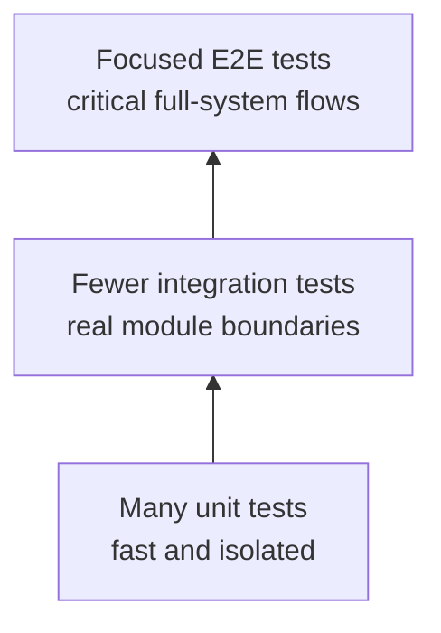
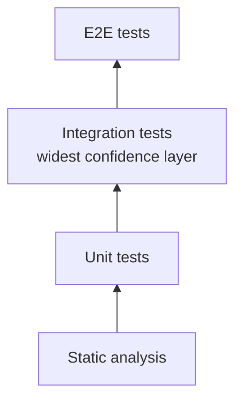
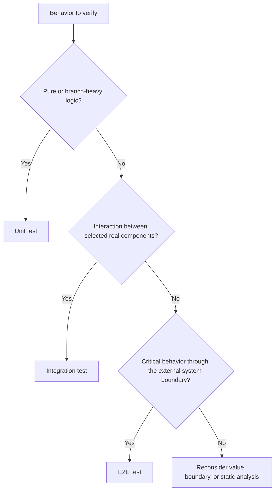
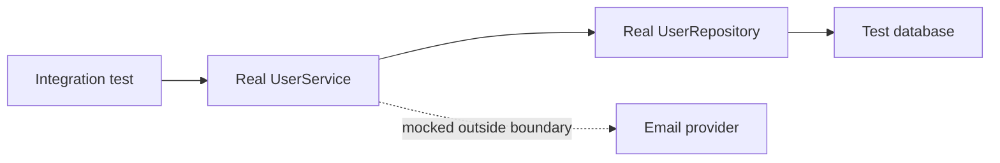

# Testing Node.js Applications

## Contents

1. [Why automated testing matters](#1-why-automated-testing-matters)
2. [Testing Pyramid and Testing Trophy](#2-testing-pyramid-and-testing-trophy)
3. [Choosing the right test boundary](#3-choosing-the-right-test-boundary)
4. [Setting up Jest](#4-setting-up-jest)
5. [Test structure and lifecycle](#5-test-structure-and-lifecycle)
6. [Jest assertions and matchers](#6-jest-assertions-and-matchers)
7. [Testing asynchronous code](#7-testing-asynchronous-code)
8. [Mocks, stubs, fakes, and spies](#8-mocks-stubs-fakes-and-spies)
9. [Writing effective unit tests](#9-writing-effective-unit-tests)
10. [Writing integration tests](#10-writing-integration-tests)
11. [Writing backend E2E and API tests](#11-writing-backend-e2e-and-api-tests)
12. [Code coverage](#12-code-coverage)
13. [Reliable test suites and common mistakes](#13-reliable-test-suites-and-common-mistakes)
14. [Running tests in continuous integration](#14-running-tests-in-continuous-integration)
15. [Contract, property, and concurrency testing](#15-contract-property-and-concurrency-testing)
16. [Diagnosing flaky and slow test suites](#16-diagnosing-flaky-and-slow-test-suites)
17. [Final review checklist](#17-final-review-checklist)

---

## 1. Why automated testing matters

An automated test executes code, observes its behavior, and fails when that behavior differs from an explicit expectation.

Tests provide:

- Fast feedback while implementing a feature.
- Regression protection when fixing or refactoring code.
- Executable examples of intended behavior.
- Confidence that modules work together.
- A repeatable quality gate for continuous integration.
- Evidence about error paths and edge cases that are hard to check manually.

Testing does not prove that software has no bugs. It samples carefully selected behaviors and reduces uncertainty.

### What makes a test valuable?

| Quality         | Meaning                                                 | Practical question                                               |
| --------------- | ------------------------------------------------------- | ---------------------------------------------------------------- |
| Focused         | Has one clear reason to fail                            | Can the failure message identify the broken behavior?            |
| Repeatable      | Produces the same result from the same controlled state | Does time, order, network, or random data change the outcome?    |
| Isolated        | Does not depend on mutations left by another test       | Can it pass when run alone and in any order?                     |
| Self-validating | Uses assertions instead of manual inspection            | Does the runner clearly report pass or fail?                     |
| Representative  | Exercises meaningful production behavior                | Would a real defect make this test fail?                         |
| Maintainable    | Avoids irrelevant implementation details                | Can the implementation change without rewriting unrelated tests? |
| Fast enough     | Fits its intended feedback loop                         | Can developers and CI run it at the expected frequency?          |

### What should be tested?

Prioritize behavior and risk:

- Business rules and calculations.
- Validation boundaries.
- Security and authorization decisions.
- Error translation and recovery behavior.
- Data persistence and transactions.
- Public API contracts.
- Critical user or service flows.
- Previously broken scenarios.
- Concurrency, retry, timeout, or cleanup logic when relevant.

Avoid tests that merely execute lines without proving a useful outcome.

### Test observable behavior

Prefer assertions about public results and effects:

```ts
expect(result).toEqual(expectedUser);
expect(repository.save).toHaveBeenCalledWith(expectedRecord);
expect(response.status).toBe(201);
```

Avoid reaching into private state or asserting incidental call sequences unless that interaction is part of the contract. Tests coupled to implementation details discourage safe refactoring.

---

## 2. Testing Pyramid and Testing Trophy

Both models help teams balance confidence, speed, realism, and maintenance cost. Neither prescribes exact percentages.

### Testing Pyramid



The pyramid emphasizes a broad base of fast unit tests, fewer integration tests, and a small set of expensive E2E tests.

### Testing Trophy



The trophy emphasizes integration tests because they often provide strong confidence without the cost and brittleness of a complete E2E environment. It also calls out static analysis explicitly.

### Comparison

| Model           | Main emphasis                               | Strength                                      | Risk when applied rigidly                                               |
| --------------- | ------------------------------------------- | --------------------------------------------- | ----------------------------------------------------------------------- |
| Testing Pyramid | Many isolated unit tests                    | Very fast, precise feedback                   | Too many mocks may prove implementation wiring instead of real behavior |
| Testing Trophy  | Many integration tests plus static analysis | Strong confidence across realistic boundaries | Slow or stateful integrations can reduce feedback quality               |

Use the models as heuristics. A parser library may need many unit/property tests. A CRUD service may benefit more from route–service–database integration tests. A payment system needs focused end-to-end coverage for critical flows.

### Test layers

| Layer           | Scope                                     | Real collaborators             | Typical speed | Best for                                                           |
| --------------- | ----------------------------------------- | ------------------------------ | ------------- | ------------------------------------------------------------------ |
| Static analysis | Source without executing behavior         | None                           | Fastest       | Types, lint rules, unreachable code, formatting, dependency checks |
| Unit            | One function, class, or cohesive unit     | Usually controlled or replaced | Very fast     | Branch-heavy logic, transformations, validation, calculations      |
| Integration     | Several real application parts            | Selected real boundaries       | Medium        | Route/controller/service/repository/database interactions          |
| E2E             | Deployed or complete application boundary | Most or all system layers      | Slowest       | Critical flows from an external client perspective                 |

### Static analysis is complementary

Static analysis includes:

- TypeScript type checking.
- ESLint and other linters.
- Formatting validation.
- Detection of unused or unreachable code.
- Dependency vulnerability and license checks.

Types can prove that a value is shaped like a number; a test can prove that the tax calculation produces the correct number. Use both.

---

## 3. Choosing the right test boundary

The test type is determined by its boundary, not its filename or tool.



### Boundary examples

| Scenario                                                                       | Likely classification        | Why                                                                               |
| ------------------------------------------------------------------------------ | ---------------------------- | --------------------------------------------------------------------------------- |
| Call `calculateDiscount()` with values                                         | Unit                         | Tests isolated business logic                                                     |
| Call a service with a mocked repository                                        | Unit                         | Dependency is replaced; focus is service decisions                                |
| Call a service with the real repository against a test database                | Integration                  | Exercises multiple real modules and persistence                                   |
| Send an in-memory HTTP request through routing, validation, and service layers | Integration or API-level E2E | Classification depends on whether the project treats the app boundary as complete |
| Call a separately running service with production-like infrastructure          | E2E                          | Exercises the system through its public boundary                                  |
| Intercept outgoing HTTP with Nock                                              | Unit or integration          | External interaction is mocked, so it is not full E2E                             |

Names matter less than agreeing on what is real, what is replaced, and which risks the test covers.

### Confidence versus cost

```text
More isolated                                    More realistic
static → unit → component integration → API integration → full E2E

Usually faster                                  Usually slower
Usually easier to diagnose                      Usually broader failures
Usually less infrastructure                     Usually more setup and cleanup
```

Choose the smallest boundary that can detect the target failure. Do not mock away the interaction you actually need to verify.

### A practical test portfolio

- Run static analysis and unit tests on every local/CI change.
- Test important module and infrastructure boundaries with integration tests.
- Cover critical external contracts with a focused E2E suite.
- Add a regression test at the lowest useful level for every fixed bug.
- Remove redundant tests that add runtime but no additional confidence.

---

## 4. Setting up Jest

Jest combines a test runner, assertion library, mocking APIs, lifecycle hooks, and coverage collection.

### JavaScript installation

```sh
npm install --save-dev jest
```

Minimal `package.json` script:

```json
{
  "scripts": {
    "test": "jest"
  }
}
```

Run it with:

```sh
npm test
```

**What it does:** installs Jest as a development-only dependency, exposes it through the standard `npm test` command, and runs every discovered test.

**When to use it:** use this minimal setup for a JavaScript project that does not already have a test runner. TypeScript, ESM, JSX, or custom source layouts may also require matching transform and discovery configuration.

### First test

```js
// sum.js
function sum(left, right) {
  return left + right;
}

module.exports = sum;
```

```js
// sum.test.js
const sum = require('./sum');

test('adds two numbers', () => {
  expect(sum(5, 2)).toBe(7);
});
```

`test()` and `it()` are aliases. Use whichever makes test names read naturally and stay consistent within the project.

### Configuration

CommonJS configuration:

```js
// jest.config.cjs
module.exports = {
  testEnvironment: 'node',
  roots: ['<rootDir>/src'],
  clearMocks: true,
};
```

TypeScript/ESM-compatible configuration shape:

```ts
// jest.config.ts
import type { Config } from 'jest';

const config: Config = {
  testEnvironment: 'node',
  roots: ['<rootDir>/src'],
  clearMocks: true,
};

export default config;
```

Important options:

| Option                | Purpose                                             | Common choice                                                             |
| --------------------- | --------------------------------------------------- | ------------------------------------------------------------------------- |
| `testEnvironment`     | Globals/runtime emulated for tests                  | `'node'` for backend code; jsdom for browser-like DOM tests               |
| `roots`               | Directories Jest searches                           | `['<rootDir>/src']` or project-specific roots                             |
| `testMatch`           | Glob patterns identifying tests                     | Defaults often find `.test` and `.spec` files                             |
| `setupFilesAfterEnv`  | Setup executed after Jest installs its test globals | Custom matchers and shared per-suite setup                                |
| `clearMocks`          | Clear call/result history before each test          | Useful default; does not reset implementations                            |
| `restoreMocks`        | Restore replaced/spied properties before each test  | Helps prevent leaked spies                                                |
| `collectCoverageFrom` | Source included in coverage, even if never imported | Include production files; exclude generated/types/entry glue deliberately |
| `coverageReporters`   | Coverage output formats                             | Text/HTML for people; LCOV or Cobertura for CI tooling                     |
| `coverageThreshold`   | Minimum accepted metrics                            | Set by project risk and quality policy                                    |

Keep the transformer, module format, and TypeScript settings aligned. A mismatch can make valid application code fail before any test runs. A TypeScript Jest config also needs the supported config loader for the selected Jest/Node versions; installing a test-source transformer alone does not configure that loader. Prefer the shown jest.config.cjs until the typed-config loader is deliberately set up. Pin a compatible Jest/transformer/TypeScript combination and record its peer constraints and lockfile rather than assuming unpinned latest packages interoperate.

### TypeScript support

One common TypeScript approach uses `ts-jest`:

```sh
npm install --save-dev jest ts-jest @types/jest
```

```js
// jest.config.cjs
module.exports = {
  preset: 'ts-jest',
  testEnvironment: 'node',
  roots: ['<rootDir>/src'],
};
```

`ts-jest` is not the only option. Projects may compile first, transform with Babel/SWC, or use Jest's ESM configuration. Follow the existing project toolchain because module format, transformer, and TypeScript settings must agree.

### Test file organization

Co-located:

```text
src/
└── pricing/
    ├── calculate-total.ts
    └── calculate-total.test.ts
```

Separate tree:

```text
src/
└── pricing/
    └── calculate-total.ts

tests/
└── pricing/
    └── calculate-total.test.ts
```

| Co-located tests                            | Separate test tree                                   |
| ------------------------------------------- | ---------------------------------------------------- |
| Easy to find beside implementation          | Clear separation of production and test files        |
| Refactors often move code and test together | Useful for cross-module integration/E2E organization |
| Requires build/publish exclusions           | Paths can drift from production structure            |

Choose one convention and apply it consistently. Keep production code independent of test-only helpers, and exclude test files from production builds or published packages where appropriate.

### Useful Jest commands

| Command                     | Purpose                                                                                       |
| --------------------------- | --------------------------------------------------------------------------------------------- |
| `jest`                      | Run the suite once                                                                            |
| `jest --watch`              | Re-run relevant tests during development                                                      |
| `jest --runInBand`          | Run serially in one worker process; useful for diagnosis or constrained integration resources |
| `jest path/to/file.test.ts` | Run a test file/pattern                                                                       |
| `jest -t "name pattern"`    | Run matching test names                                                                       |
| `jest --coverage`           | Collect coverage                                                                              |
| `jest --detectOpenHandles`  | Diagnose resources preventing exit; slower and diagnostic only                                |
| `jest --listTests`          | Show discovered test files                                                                    |

Do not commit focused tests such as `.only`. A CI check can reject them.

---

## 5. Test structure and lifecycle

### `describe()`, `test()`, and `it()`

```ts
describe('calculateShipping', () => {
  describe('when the order qualifies for free shipping', () => {
    it('returns zero', () => {
      expect(calculateShipping({ subtotal: 100 })).toBe(0);
    });
  });
});
```

Use `describe()` to group related behavior and lifecycle scope. Avoid deep nesting that makes a test's full name and setup difficult to understand.

### Write behavior-focused names

Good names describe input/context and observable outcome:

```ts
it('rejects names containing digits before calling the API', async () => {});
it('returns 409 when the email is already registered', async () => {});
it('removes the password from the public user response', () => {});
```

Weak names such as `works`, `test create`, or `error case` do not explain what failed.

### Arrange–Act–Assert

```ts
it('applies the premium discount', () => {
  // Arrange
  const order = { subtotal: 200, customerType: 'premium' };

  // Act
  const total = calculateTotal(order);

  // Assert
  expect(total).toBe(180);
});
```

Comments are optional when the sections are obvious. Keep the act phase focused; many unrelated actions usually indicate that the test covers too much.

### Lifecycle hooks

| Hook           | Runs                           | Good use                                                                 |
| -------------- | ------------------------------ | ------------------------------------------------------------------------ |
| `beforeAll()`  | Once before tests in its scope | Start expensive shared infrastructure or establish a database connection |
| `afterAll()`   | Once after tests in its scope  | Close servers, pools, containers, and shared resources                   |
| `beforeEach()` | Before every test in its scope | Create clean state, reset fakes, start a transaction                     |
| `afterEach()`  | After every test in its scope  | Restore spies, roll back state, clear timers                             |

Hooks are scoped to their containing `describe()` block and nested tests.

```ts
describe('userRepository', () => {
  beforeAll(async () => {
    await database.connect();
  });

  beforeEach(async () => {
    await database.reset();
  });

  afterAll(async () => {
    await database.close();
  });
});
```

### Always return or await hook work

```ts
beforeAll(async () => {
  await server.start();
});

afterAll(() => server.stop()); // Returning the promise is also valid.
```

This is broken because Jest cannot wait for it:

```ts
beforeAll(() => {
  server.start(); // Floating promise.
});
```

### Shared state risks

`beforeAll()` can improve speed, but mutable shared fixtures create order-dependent tests. Prefer fresh state per test or isolate changes with transactions and unique identifiers.

Use one shared server connection when startup is expensive, but reset data and mocks between tests.

### Focus, skip, and todo

| API                               | Effect                                                         |
| --------------------------------- | -------------------------------------------------------------- |
| `test.only()` / `describe.only()` | Run only focused tests; useful locally, dangerous if committed |
| `test.skip()` / `describe.skip()` | Do not run the test(s)                                         |
| `test.todo('description')`        | Record an unimplemented scenario                               |
| `test.each(table)`                | Run the same behavior over several cases                       |

Table-driven example:

```ts
test.each([
  { left: 2, right: 2, expected: 4 },
  { left: -2, right: 3, expected: 1 },
  { left: 0, right: 0, expected: 0 },
])('adds $left and $right', ({ left, right, expected }) => {
  expect(sum(left, right)).toBe(expected);
});
```

Use parameterized tests when cases share the same behavior. Do not hide substantially different scenarios in a dense data table.

---

## 6. Jest assertions and matchers

An assertion combines `expect(actual)` with a matcher describing the required outcome.

### Equality

| Matcher                   | Use                                   | Important detail                                                          |
| ------------------------- | ------------------------------------- | ------------------------------------------------------------------------- |
| `toBe(expected)`          | Primitive equality or object identity | Uses `Object.is`; not deep object equality                                |
| `toEqual(expected)`       | Recursive value equality              | Usually ignores undefined object properties and some sparse-array details |
| `toStrictEqual(expected)` | Stricter structural equality          | Checks undefined keys, sparse arrays, and object types more strictly      |

```ts
expect(2 + 2).toBe(4);
expect({ id: 1 }).toEqual({ id: 1 });
expect(new User('a')).not.toStrictEqual({ name: 'a' });
```

### Truthiness and presence

| Matcher           | Meaning                     |
| ----------------- | --------------------------- |
| `toBeTruthy()`    | Value coerces to `true`     |
| `toBeFalsy()`     | Value coerces to `false`    |
| `toBeNull()`      | Exactly `null`              |
| `toBeUndefined()` | Exactly `undefined`         |
| `toBeDefined()`   | Anything except `undefined` |

Prefer precise matchers when the exact state matters. `toBeTruthy()` can allow unintended values such as a non-empty error string.

### Numbers

```ts
expect(value).toBeGreaterThan(0);
expect(value).toBeGreaterThanOrEqual(1);
expect(value).toBeLessThan(100);
expect(value).toBeLessThanOrEqual(99);
expect(0.1 + 0.2).toBeCloseTo(0.3);
```

Use `toBeCloseTo()` for floating-point calculations instead of exact equality.

### Strings, arrays, and objects

```ts
expect(message).toMatch(/invalid email/i);
expect(tags).toContain('nodejs');
expect(users).toContainEqual({ id: 'u-1', name: 'Alice' });
expect(user).toHaveProperty('profile.email', 'a@example.com');
expect(users).toHaveLength(3);
```

### Partial and flexible matching

```ts
expect(response).toEqual(
  expect.objectContaining({
    id: expect.any(String),
    createdAt: expect.any(String),
  }),
);

expect(items).toEqual(
  expect.arrayContaining([
    expect.objectContaining({ id: 'u-1' }),
  ]),
);
```

Useful asymmetric matchers:

| Matcher                            | Use                                                     |
| ---------------------------------- | ------------------------------------------------------- |
| `expect.any(Constructor)`          | Any value created by/type-compatible with a constructor |
| `expect.anything()`                | Any value except `null` or `undefined`                  |
| `expect.objectContaining(partial)` | Object contains at least the specified fields           |
| `expect.arrayContaining(values)`   | Array contains the specified elements in any positions  |
| `expect.stringContaining(text)`    | String contains text                                    |
| `expect.stringMatching(pattern)`   | String matches text or regular expression               |

Do not make assertions so flexible that broken output passes. Assert stable contract fields and deliberately ignore unstable metadata.

### Exceptions

Synchronous throw:

```ts
expect(() => parsePort('invalid')).toThrow();
expect(() => parsePort('invalid')).toThrow('PORT must be a number');
expect(() => parsePort('invalid')).toThrow(TypeError);
```

Pass a function to `expect()`. Calling the function before `expect()` lets the exception escape the assertion:

```ts
expect(parsePort('invalid')).toThrow(); // Wrong.
```

Asynchronous rejection:

```ts
await expect(loadUser('missing')).rejects.toThrow('User not found');
```

### Mock interaction matchers

```ts
expect(sendEmail).toHaveBeenCalled();
expect(sendEmail).toHaveBeenCalledTimes(1);
expect(sendEmail).toHaveBeenCalledWith(
  'alice@example.com',
  expect.objectContaining({ template: 'welcome' }),
);
expect(sendEmail).toHaveBeenLastCalledWith(expectedRecipient, expectedMessage);
expect(sendEmail).toHaveReturnedWith(expectedResult);
```

Assert interactions only when they are meaningful behavior, such as sending a notification or persisting a record. Avoid asserting every internal call.

### Assertion counts

```ts
test('invokes both callbacks', () => {
  expect.assertions(2);
  runWithCallbacks(
    (value) => expect(value).toBe('first'),
    (value) => expect(value).toBe('second'),
  );
});
```

`expect.assertions(count)` is useful when assertions occur in callbacks or conditional branches. `expect.hasAssertions()` verifies that at least one assertion ran.

---

## 7. Testing asynchronous code

Jest must know when asynchronous work finishes. Return its promise, mark the test `async` and await it, or use the `done` callback for legacy callback APIs.

### Async/await success

```ts
test('loads the user', async () => {
  const user = await loadUser('u-1');
  expect(user).toEqual({ id: 'u-1', name: 'Alice' });
});
```

### `resolves` and `rejects`

```ts
await expect(loadUser('u-1')).resolves.toMatchObject({ id: 'u-1' });
await expect(loadUser('missing')).rejects.toThrow('User not found');
```

Always `await` or return these expectations:

```ts
test('rejects missing users', () => {
  return expect(loadUser('missing')).rejects.toThrow('User not found');
});
```

This false-positive test finishes before the rejection assertion:

```ts
test('rejects missing users', () => {
  expect(loadUser('missing')).rejects.toThrow('User not found'); // Missing return/await.
});
```

### Callback APIs

Use Jest's `done` callback only for APIs that do not expose a promise:

```ts
test('reads a value through a callback', (done) => {
  loadWithCallback((error, value) => {
    try {
      expect(error).toBeNull();
      expect(value).toBe('ready');
      done();
    } catch (assertionError) {
      done(assertionError);
    }
  });
});
```

Wrap callback assertions in `try/catch` so failures reach `done(error)`. Do not both return a promise and accept `done`; Jest treats that as conflicting completion mechanisms.

### Testing EventEmitters

Register listeners before triggering the action:

```ts
import { once } from 'node:events';

test('emits completion output', async () => {
  const completion = once(job, 'complete');

  job.start();

  await expect(completion).resolves.toEqual(['/tmp/output.txt']);
});
```

For failure paths, understand whether `events.once()` rejects on `'error'` and ensure no unhandled special error event can escape.

### Fake timers

Fake timers make timer-driven code deterministic and fast:

```ts
beforeEach(() => {
  jest.useFakeTimers();
});

afterEach(() => {
  jest.useRealTimers();
});

test('retries after one second', async () => {
  const operation = jest
    .fn()
    .mockRejectedValueOnce(new Error('temporary'))
    .mockResolvedValueOnce('ok');

  const resultPromise = retry(operation);

  await jest.advanceTimersByTimeAsync(1_000);

  await expect(resultPromise).resolves.toBe('ok');
  expect(operation).toHaveBeenCalledTimes(2);
});
```

Useful timer controls:

| API                                 | Purpose                                                  |
| ----------------------------------- | -------------------------------------------------------- |
| `jest.useFakeTimers()`              | Replace timer APIs with controllable fakes               |
| `jest.useRealTimers()`              | Restore actual timers                                    |
| `jest.advanceTimersByTime(ms)`      | Advance synchronous fake timers                          |
| `jest.advanceTimersByTimeAsync(ms)` | Advance and allow scheduled promise work to settle       |
| `jest.runAllTimers()`               | Run all scheduled timers; dangerous for recursive timers |
| `jest.runOnlyPendingTimers()`       | Run currently pending timers                             |
| `jest.setSystemTime(date)`          | Control current time with modern fake timers             |

Fake timers can affect timers used by dependencies. Keep their scope narrow and restore real timers.

### Timeouts

A longer timeout can hide a hang. First investigate missing awaits, open resources, unresolved callbacks, deadlocks, or unavailable infrastructure.

```ts
test('completes a slow integration operation', async () => {
  await operation();
}, 15_000);
```

Use extended timeouts only when the expected operation is genuinely slow and bounded.

---

## 8. Mocks, stubs, fakes, and spies

Test doubles replace or observe collaborators so a test can control inputs, failures, timing, and side effects.

### Vocabulary

| Double | Main purpose                                                    | Example                                              |
| ------ | --------------------------------------------------------------- | ---------------------------------------------------- |
| Stub   | Return controlled data                                          | Repository returns a known user                      |
| Spy    | Record calls, often while preserving or replacing a real method | Observe `mailer.send()` arguments                    |
| Mock   | Pre-programmed replacement with interaction expectations        | Mock HTTP client module                              |
| Fake   | Lightweight working implementation                              | In-memory repository implementing the real interface |

Jest's `jest.fn()` can serve several of these roles, so terminology varies. Focus on why the double exists.

### `jest.fn()`

```ts
const calculate = jest.fn((value: number) => value * 2);

calculate(4);

expect(calculate).toHaveBeenCalledWith(4);
expect(calculate).toHaveReturnedWith(8);
```

Configure results:

```ts
const fetchUser = jest
  .fn()
  .mockResolvedValue({ id: 'u-1' });

const saveUser = jest
  .fn()
  .mockRejectedValue(new Error('Database unavailable'));

const generateId = jest
  .fn()
  .mockReturnValueOnce('first')
  .mockReturnValue('later');
```

Useful methods:

| Method                        | Behavior                          |
| ----------------------------- | --------------------------------- |
| `.mockReturnValue(value)`     | Return the same synchronous value |
| `.mockReturnValueOnce(value)` | Return a value for one call       |
| `.mockResolvedValue(value)`   | Return `Promise.resolve(value)`   |
| `.mockRejectedValue(error)`   | Return `Promise.reject(error)`    |
| `.mockImplementation(fn)`     | Use custom behavior               |
| `.mockImplementationOnce(fn)` | Use custom behavior for one call  |
| `.mockName(name)`             | Improve failure output            |

### Dependency injection

Passing dependencies explicitly makes unit tests simple and avoids module-loader tricks:

```ts
type UserRepository = {
  findById(id: string): Promise<User | undefined>;
};

function createUserService(repository: UserRepository) {
  return {
    async getUser(id: string): Promise<User> {
      const user = await repository.findById(id);
      if (!user) throw new Error('User not found');
      return user;
    },
  };
}
```

```ts
test('returns the repository user', async () => {
  const repository = {
    findById: jest.fn().mockResolvedValue({ id: 'u-1', name: 'Alice' }),
  };
  const service = createUserService(repository);

  await expect(service.getUser('u-1')).resolves.toMatchObject({ name: 'Alice' });
  expect(repository.findById).toHaveBeenCalledWith('u-1');
});
```

### `jest.spyOn()`

`spyOn(object, method)` observes a method and, by default, calls the original implementation:

```ts
const sendSpy = jest.spyOn(mailer, 'send');

await service.register(input);

expect(sendSpy).toHaveBeenCalledWith(
  input.email,
  expect.objectContaining({ template: 'welcome' }),
);
```

Replace behavior when the real method is slow, destructive, or external:

```ts
jest.spyOn(httpClient, 'get').mockResolvedValue({
  data: { name: 'john', probability: 0.99 },
});
```

Restore spies after each test:

```ts
afterEach(() => {
  jest.restoreAllMocks();
});
```

Use `spyOn()` only on replaceable properties. Destructured or closed-over references may already point to the original function, and ESM bindings require module-compatible mocking strategies.

### `jest.mock()`

Auto-mock a module:

```ts
import axios from 'axios';

jest.mock('axios');

const mockedAxios = jest.mocked(axios);
mockedAxios.get.mockResolvedValue({ data: expectedResponse });
```

Factory mock:

```ts
jest.mock('./clock.js', () => ({
  now: jest.fn(() => new Date('2024-01-01T00:00:00.000Z')),
}));
```

Module mocking depends on whether the project uses CommonJS, transpiled ESM, or native ESM. Follow the repository's existing Jest setup; do not copy a CommonJS mocking pattern blindly into native ESM.

Prefer mocking the narrow dependency boundary rather than an entire large module.

### Clear, reset, and restore

| API                      | Clears call history    | Removes mock implementation        | Restores original spied property |
| ------------------------ | ---------------------: | ---------------------------------: | -------------------------------: |
| `jest.clearAllMocks()`   | Yes                    | No                                 | No                               |
| `jest.resetAllMocks()`   | Yes                    | Yes                                | No                               |
| `jest.restoreAllMocks()` | Yes for restored spies | Restores spies/replaced properties | Yes where supported              |

This distinction matters:

- Clear when each test needs fresh call counts but shared default behavior.
- Reset when mock behavior must return to an empty mock.
- Restore when a real property was replaced by `spyOn()` or supported replacement APIs.

`clearAllMocks()` alone does not restore the original `axios.get()` after a spy. Use `restoreAllMocks()` or call `mockRestore()` on the spy.

### Mocking rules

- Mock external boundaries in unit tests: HTTP, database, clock, random values, filesystem, message brokers.
- Do not mock the unit's own behavior.
- Return values that match the real collaborator's shape.
- Test both collaborator success and failure when your code handles both.
- Avoid assertions on calls that are irrelevant to the public outcome.
- Restore global and module state after each test.
- Prefer a fake when many tests need realistic stateful behavior.
- Do not let unit tests make real network calls.

### What not to mock

Usually avoid mocking:

- Simple value objects and pure functions.
- The behavior being tested.
- Every internal helper merely to achieve isolation.
- Standard language behavior.
- Real interactions that define an integration test's purpose.

Excessive mocking can make tests pass while the real components are incompatible.

---

## 9. Writing effective unit tests

A unit test exercises a small cohesive behavior under controlled conditions.

### Unit-test recipe

1. Identify the unit's public contract.
2. List meaningful partitions: valid, invalid, boundary, empty, and collaborator failure.
3. Replace slow or nondeterministic external boundaries.
4. Arrange only data relevant to the behavior.
5. Call the public function or method.
6. Assert its result, error, or meaningful side effect.
7. Restore modified global/module state.

### Pure function example

```ts
export function getPhotoPath(bucket: string, photoId: string): string {
  // This is an object-key teaching format, not an arbitrary URL/filesystem builder.
  if (!/^[a-z][a-z0-9-]{0,62}$/.test(bucket) || !/^[0-9]{1,32}$/.test(photoId))
    throw new TypeError('Expected a bucket label and a decimal photo ID');
  const encodedId = Buffer.from(photoId, 'utf8').toString('base64url');
  return `${bucket}/${encodedId}/${photoId}`;
}
```

```ts
describe('getPhotoPath', () => {
  it('includes the bucket, Base64 ID, and original ID', () => {
    expect(getPhotoPath('photo-assets', '1234567890')).toBe(
      'photo-assets/MTIzNDU2Nzg5MA/1234567890',
    );
  });
});
```

No mock is needed because the code is deterministic and has no external side effect. The explicit ID grammar rejects separators, traversal segments and arbitrary Unicode/URL syntax; base64url avoids slash/plus/padding in its encoded component. This returns an object key only: actual storage authorization, bucket policy and URL/path construction need their own boundary design. Add invalid bucket/ID and size-bound tests, not just one happy path.

### Service with an HTTP dependency

Production behavior:

```ts
export async function getPrediction(name: string): Promise<Prediction> {
  if (!/^[A-Za-z]+$/.test(name)) {
    throw new Error('Name must contain English letters only');
  }

  const response = await httpClient.get<Prediction>('/prediction', {
    params: { name },
  });

  if (response.data.probability < 0.9) {
    throw new Error('Prediction confidence is below 90%');
  }

  return response.data;
}
```

Tests to consider:

| Scenario                           | Primary assertion                                  |
| ---------------------------------- | -------------------------------------------------- |
| Valid name and confident response  | Returns the response data                          |
| Valid name                         | Calls HTTP dependency with correct path and params |
| Invalid name                       | Rejects before calling HTTP dependency             |
| Low probability                    | Rejects with the domain error                      |
| HTTP client failure                | Propagates or translates the failure as designed   |
| Boundary probability exactly `0.9` | Confirms inclusive/exclusive business rule         |

```ts
test('does not call the API for an invalid name', async () => {
  const getSpy = jest.spyOn(httpClient, 'get');

  await expect(getPrediction('alice123')).rejects.toThrow(
    'Name must contain English letters only',
  );
  expect(getSpy).not.toHaveBeenCalled();
});
```

### Test partitions, not arbitrary samples

For a rule `probability >= 0.9`, useful cases are:

```text
below boundary: 0.8999 → reject
at boundary:    0.9    → accept
above boundary: 0.9001 → accept
```

Boundary values provide more information than several unrelated “normal” values.

### Test errors deliberately

For a synchronous function:

```ts
expect(() => validate(input)).toThrow(ValidationError);
```

For an async function:

```ts
await expect(validateAsync(input)).rejects.toThrow(ValidationError);
```

Assert stable error characteristics such as class, code, or meaningful message. Avoid matching a full stack trace.

### Unit-test anti-patterns

- Calling a real network API.
- Depending on production or developer environment variables.
- Sharing mutated fixtures between tests.
- Duplicating implementation calculations in the expectation.
- Mocking every helper and then asserting every call.
- Testing a private method instead of public behavior.
- Using sleeps to wait for asynchronous work.
- Catching an expected error without asserting it.
- Writing one enormous test for many unrelated branches.

---

## 10. Writing integration tests

An integration test verifies that selected real components work together. It may test a service and repository, HTTP route and middleware, application and database, or producer and message broker.

### Define the boundary explicitly

Example boundary:



It is valid to replace dependencies outside the chosen boundary. “Integration test” does not mean every external system must be real.

Avoid uncontrolled public APIs in normal integration suites. They introduce network failures, rate limits, mutable data, credentials, cost, and nondeterministic latency. Prefer a local test service, container, recorded contract, or controlled mock server.

### Integration-test recipe

1. State which components and infrastructure are real.
2. Create isolated test configuration.
3. Start/connect shared infrastructure in `beforeAll()` when appropriate.
4. Establish fresh data in `beforeEach()` or inside each test.
5. Exercise the real integration path.
6. Assert both the returned result and important persisted/observable effects.
7. Clean up data even after failures.
8. Close every connection and server in `afterAll()`.

### Example: service and repository

```ts
describe('UserService with UserRepository', () => {
  beforeEach(async () => {
    await userRepository.deleteAll();
  });

  afterAll(async () => {
    await database.close();
  });

  it('persists a user without exposing the password', async () => {
    const created = await userService.create({
      name: 'Helen',
      email: 'helen@example.test',
      password: 'secret',
    });

    const persisted = await userRepository.findById(created.id);

    expect(created).not.toHaveProperty('password');
    expect(persisted).toMatchObject({
      id: created.id,
      email: 'helen@example.test',
    });
    expect(persisted).toBeDefined();
    if (!persisted) throw new Error('Expected persisted user');
    expect(typeof persisted.password).toBe('string');
    expect(persisted.password.length).toBeGreaterThan(0);
    expect(persisted.password).not.toBe('secret');
    // passwordHasher is the real production hashing adapter within this boundary.
    await expect(passwordHasher.verify('secret', persisted.password)).resolves.toBe(true);
    await expect(passwordHasher.verify('wrong', persisted.password)).resolves.toBe(false);
  });
});
```

A negative-only password assertion would also pass for undefined, so require persistence, a nonempty stored string and verification with the real production password-hasher adapter. Align argument order with that adapter (this example defines verify(plaintext, storedHash)); do not replace it with a mock returning true in this integration boundary. Public response projection and password storage are separate assertions. Use the actual password/passwordHash column name in the service.

Use reserved test domains such as `.test` and unique generated values to prevent collisions.

### Database isolation strategies

| Strategy                               | Strength                                            | Trade-off                                                            |
| -------------------------------------- | --------------------------------------------------- | -------------------------------------------------------------------- |
| Transaction per test with rollback     | Fast and clean when all code shares the transaction | Hard across multiple connections/processes                           |
| Truncate/reset tables before each test | Simple predictable baseline                         | Can be slow and needs foreign-key care                               |
| Unique test data plus targeted cleanup | Supports parallel execution                         | Cleanup must be reliable                                             |
| Fresh schema/database per worker       | Strong isolation                                    | More infrastructure and startup cost                                 |
| In-memory fake                         | Very fast                                           | May not reproduce real database behavior; often unit/component level |

Never point tests at production. Use explicit test credentials and fail safely when the environment is ambiguous.

### Cleanup must survive failures

If a test creates data and fails before recording its ID, an `afterAll()` list may miss it. Prefer predictable unique prefixes, per-test transactions, or database reset strategies.

```ts
afterEach(async () => {
  await userRepository.deleteByEmailDomain('example.test');
});
```

Cleanup code should be idempotent where possible.

### Parallel execution

Jest runs test files in parallel worker processes by default. Shared ports, database rows, filesystem paths, queues, and singleton infrastructure can collide.

Options:

- Give each Jest worker a unique database/schema or path.
- Generate unique entity identifiers.
- Allocate ephemeral ports (`listen(0)`) instead of hardcoding one.
- Use per-test transactions.
- Run a constrained suite serially only when isolation is impractical and documented.

### What to assert in integration tests

- Components pass data in compatible shapes.
- Configuration and serialization work.
- Database constraints and queries behave correctly.
- Transactions commit or roll back as required.
- External failures are translated correctly at the boundary.
- Side effects occur exactly where the contract requires them.
- Resources are released after completion.

Do not repeat every pure validation edge case already covered by unit tests unless the integration boundary could change its behavior.

---

## 11. Writing backend E2E and API tests

Backend E2E tests exercise the application through its public interface, usually HTTP. They cover routing, parsing, validation, authentication, application logic, persistence, error handling, and response serialization within the chosen deployment boundary.

### What to test

- HTTP method and route.
- Success status and response schema.
- Validation failures and correct 4xx status.
- Authentication and authorization.
- Conflict and not-found behavior.
- Important headers and content type.
- Persistent state or other observable side effects.
- Error response shape without internal secrets or stacks.
- Idempotency, pagination, rate limits, or retries when part of the contract.

Do not write an E2E test for every minor permutation. Focus on critical flows and use lower-level tests for combinatorial logic.

### Supertest

Supertest makes HTTP assertions against a Node.js server or app handler:

```sh
npm install --save-dev supertest @types/supertest
```

Prefer exporting the application without starting a fixed-port listener:

```ts
// app.ts
export const app = createApplication();
```

```ts
// server.ts
import { app } from './app.js';

const rawPort = process.env.PORT ?? '3000';
if (!/^[0-9]{1,5}$/.test(rawPort)) throw new Error('Invalid PORT');
const port = Number(rawPort);
if (port < 1 || port > 65535) throw new Error('PORT out of range');
app.listen(port);
```

Validate the environment boundary before passing a numeric port to listen. Modern Node accepts numeric-string ports too; the older claim that every numeric string selects a filesystem socket path was incorrect. Range/grammar validation remains useful for malformed configuration. Test fixtures may intentionally use numeric0 for an ephemeral port, separately from this production policy.

Then tests can pass `app` directly to Supertest:

```ts
import request from 'supertest';
import { app } from './app.js';

describe('POST /users', () => {
  it('creates a user', async () => {
    const response = await request(app)
      .post('/users')
      .send({
        name: 'Alice',
        email: 'alice@example.test',
        password: 'safe-test-password',
      })
      .expect('Content-Type', /json/)
      .expect(201);

    expect(response.body).toEqual(
      expect.objectContaining({
        id: expect.any(String),
        name: 'Alice',
        email: 'alice@example.test',
      }),
    );
    expect(response.body).not.toHaveProperty('password');
  });
});
```

This avoids port conflicts and usually lets Supertest manage the temporary server lifecycle.

### Validate status and body

Status alone is insufficient:

```ts
expect(response.status).toBe(200);
expect(response.body).toEqual({
  data: expect.any(Array),
  page: expect.any(Number),
  total: expect.any(Number),
});
```

Body alone is insufficient because an incorrect status changes client behavior. Assert both.

### Pagination example

```ts
const limit = 2;
const response = await request(app)
  .get('/users')
  .query({ limit, page: 1 })
  .expect(200);

expect(response.body.data).toHaveLength(limit);
expect(response.body).toEqual(
  expect.objectContaining({
    page: 1,
    limit,
    data: expect.any(Array),
  }),
);
```

Prefer `.query()` over manual query-string interpolation because it handles encoding.

### Error example

```ts
const response = await request(app)
  .post('/users')
  .send({ email: 'not-an-email' })
  .expect(400);

expect(response.body).toEqual({
  code: 'VALIDATION_ERROR',
  errors: expect.arrayContaining([
    expect.objectContaining({ field: 'email' }),
  ]),
});
```

Check that internal stack traces, database messages, and secrets are not exposed.

### Authentication

```ts
await request(app)
  .get('/profile')
  .expect(401);

await request(app)
  .get('/profile')
  .set('Authorization', `Bearer ${token}`)
  .expect(200);
```

Test unauthenticated, authenticated, and authenticated-but-forbidden cases when roles matter.

### Supertest versus Nock

| Tool      | Purpose                                                                | Test boundary                                          |
| --------- | ---------------------------------------------------------------------- | ------------------------------------------------------ |
| Supertest | Send requests to an HTTP server/app and inspect responses              | API integration or backend E2E                         |
| Nock      | Intercept outbound Node.js HTTP calls and provide controlled responses | Unit/integration isolation of external HTTP dependency |

Nock is not a substitute for an E2E client when the goal is to test a real external interaction. It is useful when the external provider lies outside the intended test boundary.

### Avoid testing public APIs directly

Direct tests against an unrelated public service are useful only as deliberate external contract/monitoring tests. They are poor default CI tests because they can fail due to:

- Internet or DNS availability.
- Provider rate limits and outages.
- Unannounced response changes.
- Mutable data.
- Authentication and cost.
- Geographic or time-dependent behavior.

For normal application E2E tests, run your own application against controlled test infrastructure.

### E2E lifecycle

```ts
beforeAll(async () => {
  await database.migrate();
});

beforeEach(async () => {
  await database.reset();
  await seedRequiredData();
});

afterAll(async () => {
  await database.close();
});
```

Close database pools, servers, sockets, message consumers, workers, and timers so Jest terminates cleanly.

---

## 12. Code coverage

Coverage reports which instrumented code executed during tests. It helps locate untested areas but does not measure assertion quality or correctness.

### Coverage metrics

| Metric     | Meaning                    | Example of what remains uncovered           |
| ---------- | -------------------------- | ------------------------------------------- |
| Statements | Executable statements run  | An assignment or call never executed        |
| Branches   | Decision outcomes run      | `if` true path tested but false path missed |
| Functions  | Declared functions invoked | Error handler never called                  |
| Lines      | Source lines executed      | A line in an untested block                 |

Branch coverage is often the most revealing metric for validation and error handling.

### Collect coverage

```sh
jest --coverage
```

Typical local script:

```json
{
  "scripts": {
    "test": "jest",
    "test:coverage": "jest --coverage"
  }
}
```

Use a coverage command locally when investigating gaps and in CI when enforcing a documented threshold.

### Include unimported source files

Without `collectCoverageFrom`, a source file that no test imports may be absent from the report rather than shown as 0%.

```js
// jest.config.cjs
module.exports = {
  collectCoverageFrom: [
    'src/**/*.{js,ts}',
    '!src/**/*.d.ts',
  ],
};
```

Exclude files only for a documented reason. Blanket exclusions make the percentage look better without improving confidence.

### Coverage reporters

| Reporter                | Use                                                           |
| ----------------------- | ------------------------------------------------------------- |
| `text`                  | Detailed terminal table                                       |
| `text-summary`          | Compact terminal totals                                       |
| `html`                  | Browsable annotated source report                             |
| `lcov`                  | Common integration with coverage services                     |
| `json` / `json-summary` | Machine-readable tooling                                      |
| `cobertura`             | XML format accepted by many CI and reporting systems          |

Example configuration:

```js
module.exports = {
  collectCoverageFrom: ['src/**/*.{js,ts}'],
  coverageReporters: ['text', 'html', 'cobertura'],
};
```

### Coverage thresholds

The numbers below are illustrative configuration syntax, not recommended universal targets. Select/justify thresholds from risk, existing baseline and assertion quality; do not copy them as a readiness score.

```js
module.exports = {
  coverageThreshold: {
    global: {
      branches: 80,
      functions: 85,
      lines: 85,
      statements: 85,
    },
  },
};
```

Jest exits unsuccessfully when configured thresholds are missed, making them suitable for CI quality gates.

Thresholds can also target paths or files:

```js
module.exports = {
  coverageThreshold: {
    global: {
      lines: 80,
    },
    './src/security/': {
      branches: 95,
      lines: 95,
    },
  },
};
```

Set thresholds according to risk and raise them deliberately. A uniform 100% target may encourage meaningless assertions, exclusions, or tests coupled to implementation details.

### Reading a coverage report

When coverage is low:

1. Open the HTML report or inspect uncovered line numbers.
2. Identify the behavior represented by each uncovered branch.
3. Decide whether it is valuable, unreachable, defensive, or obsolete.
4. Add a behavior-focused test when the path matters.
5. Remove dead code rather than testing it artificially.
6. Document rare justified exclusions narrowly.

### Coverage misconceptions

| Misconception                                   | Reality                                                                             |
| ----------------------------------------------- | ----------------------------------------------------------------------------------- |
| 100% coverage means no bugs                     | Executed code can still have weak or incorrect assertions                           |
| Low coverage always means poor tests            | A percentage lacks context, although critical uncovered paths remain risky          |
| Every line deserves a test                      | Generated, declarative, or unreachable defensive code may need another treatment    |
| Snapshots automatically provide strong coverage | They execute code but may obscure whether important semantics are asserted          |
| More tests always improve confidence            | Redundant or brittle tests can increase maintenance without detecting more failures |

Use coverage as a map, not a goal by itself.

---

## 13. Reliable test suites and common mistakes

### Determinism

Control unstable inputs:

| Source of nondeterminism | Control strategy                                                        |
| ------------------------ | ----------------------------------------------------------------------- |
| Current time             | Inject a clock or use fake timers/system time                           |
| Randomness               | Inject a generator or use a known seed/value                            |
| Network                  | Controlled local service, mock server, fake, or explicit contract suite |
| Database state           | Reset, transaction rollback, or unique isolated schema                  |
| Filesystem               | Unique temporary directory and cleanup                                  |
| Environment variables    | Save, set, and restore per test                                         |
| Locale/time zone         | Set explicit environment or format with explicit locale/time zone       |
| Test order               | Fresh fixtures; no dependence on prior tests                            |

### Environment variables

```ts
const originalPort = process.env.PORT;

afterEach(() => {
  if (originalPort === undefined) delete process.env.PORT;
  else process.env.PORT = originalPort;
});

test('reads the configured port', () => {
  process.env.PORT = '8080';
  expect(readPort()).toBe(8080);
});
```

If modules read environment variables during import, use dependency injection or carefully reset the module registry before re-importing. Prefer explicit configuration objects over hidden module-load state.

### Temporary files

Use a unique temporary directory per test or suite. Remove it in `finally`/cleanup even when assertions fail. Never let tests depend on developer files or write into production paths.

### Open handles

Jest may hang after tests finish if resources remain open:

- HTTP/TCP servers.
- Database pools.
- Timers and intervals.
- File watchers.
- Child processes or worker threads.
- Message queue consumers.
- Sockets and keep-alive agents.

Close resources in `afterAll()` or `afterEach()`. Use `--detectOpenHandles` for diagnosis, not as the permanent fix.

### Avoid sleeps

This is slow and flaky:

```ts
await new Promise((resolve) => setTimeout(resolve, 1_000));
expect(job.completed).toBe(true);
```

Prefer a completion signal:

```ts
await once(job, 'complete');
```

Or control time with fake timers.

### Snapshot tests

Snapshots can be useful for stable serialized structures, but review them like code.

Good snapshot candidates:

- Small, stable formatter output.
- Intentional compiler/serializer output.
- Structured error or AST output where the entire shape matters.

Poor candidates:

- Huge API responses.
- Data containing timestamps or random IDs.
- Output where only two fields matter.
- Snapshots routinely updated without inspecting changes.

Prefer explicit matchers when they communicate intent more clearly.

### Common failure patterns

| Symptom                                  | Likely cause                                               | Fix                                             |
| ---------------------------------------- | ---------------------------------------------------------- | ----------------------------------------------- |
| Test passes despite a rejected operation | Missing `await` or `return`                                | Await/return the promise assertion              |
| Tests pass alone but fail together       | Shared state or leaked mock                                | Reset state and restore spies per test          |
| Suite never exits                        | Open server, pool, timer, worker, or socket                | Close it in lifecycle cleanup                   |
| Integration tests intermittently fail    | Shared identifiers, network dependency, or race            | Isolate data and control dependencies           |
| Mock call count grows across tests       | History not cleared                                        | Use `clearMocks` or `jest.clearAllMocks()`      |
| Real method stays mocked                 | Spy was cleared but not restored                           | Use `jest.restoreAllMocks()`                    |
| Timer test hangs                         | Fake timers not advanced or promise ordering misunderstood | Advance appropriate timers and await microtasks |
| E2E tests collide on a port              | Fixed port with parallel workers                           | Pass app to Supertest or use an ephemeral port  |
| Coverage omits an entire file            | File was never imported and not in `collectCoverageFrom`   | Configure source collection explicitly          |
| Test breaks after safe refactor          | Assertions target implementation details                   | Assert public behavior and meaningful effects   |

### Test review checklist

- Can the test fail for the intended defect?
- Is the name precise about behavior?
- Is there one clear act?
- Are assertions strong but not coupled to irrelevant details?
- Are all promises awaited or returned?
- Is external state controlled?
- Will the test pass alone, in random order, and under parallel execution?
- Are spies, timers, environment changes, files, and database records restored?
- Is the tested boundary appropriate?
- Does this test add confidence not already provided elsewhere?

---

## 14. Running tests in continuous integration

Continuous integration (CI) runs the same automated checks in a clean environment for every proposed change. This detects missing files, undeclared dependencies, environment assumptions, and order-dependent tests that may be hidden on a developer's machine.

### Typical validation sequence

```sh
npm run build
npm run test
# Module4 only, or when the actual project defines this required stage:
npm run coverage
```

**What it does:** builds the application, runs its behavioral tests, and then generates a coverage report. Because the commands are separate, a failed stage is easy to identify.

**When to use it:** run the same sequence before merging a change and in a CI pipeline. Not every project needs a separate coverage command, but build and test failures must always produce a non-zero exit code.

Example scripts:

```json
{
  "scripts": {
    "test": "jest",
    "coverage": "jest --coverage --coverageReporters=cobertura --coverageDirectory=."
  }
}
```

**Autocode Module4 acceptance:** use `jest --coverage --coverageReporters=cobertura --coverageDirectory=.` unless that task template explicitly says otherwise. The root output location is part of the supplied contract; a generic text/HTML reporter example must not replace it. Other modules require build and test, not an invented mandatory coverage stage. Preserve the template build/test configuration and normal test script `jest`.

Autocode replaces src/tests with predefined tests. Never edit/add fixtures/helpers there, import it from production, or rely on local test edits. All implementations must pass the submitted production-code requirements against hidden tests. The organization examples in this lesson are for a separate practice repository, not permission to modify Autocode's test directory. Close every owned handle and finish each stage within the five-minute limit. In this notes repository, only docs:build exists as the relevant project validation; no application build/test/coverage result is implied.

### CI reliability rules

- Declare every runtime and development dependency needed by the checks.
- Keep production code independent of test fixtures and test-runner globals.
- Match public exports, error behavior, asynchronous completion, and documented edge cases.
- Close databases, servers, timers, child processes, workers, sockets, and other handles.
- Ensure every validation command reports failures and terminates.
- Control time, randomness, network access, and external state so results are repeatable.

Each isolated npm job needs its own clean locked install or a deliberately restored compatible dependency environment. A cache is an optional speed optimization; built output needed downstream must be transferred as a named artifact, not assumed to exist after a prior job. See the [complete GitLab job-isolation example](../senior_growth/CD_CI/Do_you_run_tests_within_CICD.md#3-example-ci-pipeline-with-tests).

CI should validate the same behavior developers can run locally. If a check only works in one environment, find and remove the hidden dependency instead of weakening the test.

---

## 15. Contract, property, and concurrency testing

### Contract tests

A contract describes behavior at a boundary. Examples include an HTTP response shape, a message schema, or a repository interface.

```ts
type UserRepositoryFactory = () => Promise<UserRepository>;

export function userRepositoryContract(createRepository: UserRepositoryFactory) {
  describe('UserRepository contract', () => {
    test('returns a saved user by id', async () => {
      const repository = await createRepository();
      const saved = await repository.save({ email: 'alice@example.test' });

      await expect(repository.findById(saved.id)).resolves.toEqual(saved);
    });
  });
}
```

**What it does:** defines behavior that every repository implementation must satisfy.

**When to use it:** run the same contract against an in-memory fake and real database adapter. This prevents a convenient fake from drifting away from production behavior.

Consumer-driven contracts can also verify service-to-service expectations. They do not replace provider integration and end-to-end testing.

### Property-based testing

Example-based tests check selected cases. Property-based tests generate many inputs and check an invariant.

Useful properties include:

- encoding then decoding returns the original value;
- sorting is ordered and preserves all input elements;
- normalization is idempotent;
- totals never become negative under valid operations;
- pagination never returns more than its limit.

Use a property-testing library when the input space is large and invariants are clearer than a list of examples. Keep generated failures reproducible by recording the seed and minimized counterexample.

### Concurrency tests

Concurrency bugs often disappear in sequential tests.

```ts
const attempts = await Promise.allSettled([
  service.reserve('item-1', 8),
  service.reserve('item-1', 8),
]);

expect(attempts.filter((result) => result.status === 'fulfilled')).toHaveLength(1);
expect(await repository.available('item-1')).toBeGreaterThanOrEqual(0);
```

**What it does:** launches two competing operations and asserts the invariant rather than one exact completion order.

**When to use it:** test uniqueness, inventory, balances, idempotency, optimistic locking, and other shared-state rules against the real persistence boundary.

One successful run does not prove the absence of races. Repeat targeted tests, vary scheduling, and rely on database constraints or atomic operations for correctness.

---

## 16. Diagnosing flaky and slow test suites

A flaky test has more than one outcome without a relevant code change. Treat flakiness as a defect, not as harmless noise.

### Isolation method

Run the failure in several ways:

1. Alone.
2. With its containing file.
3. With the complete suite.
4. Repeated many times.
5. Serially and in parallel.
6. With randomized order if tooling permits.

The pattern narrows the cause.

| Pattern | Likely cause |
| --- | --- |
| Fails only with suite | Shared state or leaked mock/resource |
| Fails only in parallel | Port, database, file, or identifier collision |
| Fails near time boundary | Real clock, timezone, or timer race |
| Fails on CI only | Missing file/config, case sensitivity, resource constraint |
| Hangs after passing assertions | Open handle or unfinished asynchronous work |
| Random incorrect value | Unseeded randomness or order dependence |

### Avoid sleep-based synchronization

```ts
await new Promise((resolve) => setTimeout(resolve, 500));
```

This waits for time, not for the required state. It is both slow and unreliable.

Prefer:

- awaiting the returned promise;
- listening for a completion event;
- fake timers for owned timers;
- polling a state with a bounded deadline when the system is eventually consistent;
- a test hook that exposes deterministic completion.

### Test-suite performance

Measure before deleting coverage or adding workers.

Look for:

- repeated application/database startup;
- unnecessary fixture creation;
- expensive setup in `beforeEach` that could be immutable `beforeAll` state;
- tests that accidentally call real networks;
- too many broad E2E scenarios;
- worker count larger than available database/infrastructure capacity.

Fast tests are valuable because developers run them more often. Reliability and confidence remain more important than raw speed.

### Mutation testing

Mutation tools change production expressions and check whether tests fail. Surviving mutations can reveal weak assertions.

Use mutation testing selectively on critical pure logic. It is computationally expensive and is not a replacement for thoughtful risk analysis.

### Diagnostic exercise

Take a deliberately flaky API suite and fix it without adding sleeps.

Include these defects:

- fixed port collisions;
- shared database records;
- a spy that is not restored;
- dependence on the current timezone;
- an unclosed server;
- a missing `await` on a rejected promise.

Document the evidence that identified each cause.

---

## 17. Final review checklist

You should be able to explain and demonstrate each item:

### Advanced confidence

- Reuse contract tests across compatible implementations.
- Describe when a property expresses behavior better than selected examples.
- Test shared-state invariants under concurrent operations.
- Diagnose order, parallelism, time, environment, and open-handle flakiness.
- Replace sleeps with deterministic completion signals.
- Use mutation testing selectively to assess assertion strength.

### Strategy

- The Testing Pyramid emphasizes unit tests; the Testing Trophy emphasizes integration tests and static analysis.
- Both are heuristics, not fixed test ratios.
- Unit tests isolate small behaviors; integration tests connect selected real components; E2E tests use the external system boundary.
- The smallest test boundary that detects the target failure usually gives the best feedback.
- Static analysis complements runtime tests.

### Jest

- `test()` and `it()` define tests; `describe()` groups behavior and hook scope.
- `beforeAll()`/`afterAll()` run once per scope; `beforeEach()`/`afterEach()` surround each test.
- Every asynchronous test and hook must return or await its work.
- `toBe()` checks primitive equality/object identity; `toEqual()` checks structural values.
- Synchronous exceptions use `expect(() => action()).toThrow()`.
- Promise failures use `await expect(action()).rejects.toThrow()`.
- Parameterized tests reduce duplication when cases share one behavior.

### Test doubles

- `jest.fn()` creates a controllable, inspectable function.
- `jest.spyOn()` observes a real object method and calls it by default until mocked.
- `jest.mock()` replaces a module according to the project's module system.
- `clearAllMocks()` clears history, `resetAllMocks()` also removes implementations, and `restoreAllMocks()` restores supported replaced properties/spies.
- Unit tests replace external boundaries but should not mock the behavior under test.
- Over-mocking can let incompatible real components pass independently.

### Test levels

- Unit tests cover happy paths, errors, boundaries, and collaborator outcomes deterministically.
- Integration tests explicitly define which components are real.
- Integration infrastructure and data must be isolated and cleaned up.
- Supertest can test a Node.js app without binding a fixed public port.
- API tests assert status, body contract, headers, authorization, and important side effects.
- Nock mocks outbound HTTP; it is not itself an E2E runner.
- Uncontrolled public services should not be a normal CI dependency.

### Coverage and reliability

- Coverage measures execution, not correctness or assertion quality.
- Statement, branch, function, and line coverage answer different questions.
- `collectCoverageFrom` ensures never-imported source appears in reports.
- Coverage thresholds can fail CI but should reflect meaningful risk.
- Coverage reporters serve different consumers: text/HTML for people and LCOV/Cobertura for tooling.
- Tests must control time, randomness, environment, files, network, database state, and identifiers when those affect results.
- Open handles must be closed so Jest terminates.
- Sleeps should be replaced with completion signals or fake timers.
- Tests must pass alone, together, in different orders, and under expected parallelism.

### One-minute recap

A strong Node.js test suite uses static checks for immediate feedback, unit tests for focused logic, integration tests for meaningful component boundaries, and E2E tests for critical external flows. Jest supplies test grouping, lifecycle hooks, matchers, mocks, asynchronous assertions, fake timers, and coverage. Good tests assert observable contracts, control nondeterministic inputs, isolate mutable state, await every asynchronous operation, and clean up every resource. Mocks make unit tests fast and deterministic, but real integrations are necessary to detect wiring and infrastructure problems. Coverage identifies unexecuted code; it cannot tell whether assertions are meaningful. A reliable CI pipeline repeats the build and test process in a clean environment and reports failures clearly.

## Worked review: acceptance-to-evidence mapping

A review should follow a concrete contract through production code and the test boundary. For a hypothetical “register user” change, the acceptance matrix can be small and explicit:

| Requirement | Risk | Evidence to require | Common false positive |
|---|---|---|---|
| REG-1 valid input returns201/public DTO | Shape/status compatibility | API integration asserts both status and exact allowed public fields | Only asserting201 |
| REG-2 password stored as a verifiable hash | Secret leakage/broken login | Real hasher+repository integration requires persisted nonempty value, correct/wrong password verification, no public password/hash | undefined is not equal to plaintext |
| REG-3 duplicate email conflicts | Concurrent integrity | Real database unique constraint plus concurrent request outcomes and final row count | Sequential fake repository only |
| REG-4 malformed input does not persist | Input boundary | Invalid API request,400 schema, no repository side effect | Mocking validation itself |
| REG-5 checks terminate and fail correctly | False CI success/hanging submission | Clean locked install, build/test and Module4 coverage root artifact; no open handles | Locally edited predefined tests or ignored exit status |

Review the actual diff: confirm the changed route reaches the validation/service/repository/DTO path in that order, the hasher argument contract matches the implementation, and failures are translated once. A missing await on hasher verification is a defect because the assertion can outlive the test. A spy returning true cannot demonstrate a real password encoding. An untested transaction/unique constraint needs a real adapter test, not a larger unit mock.

A concise review finding should name the trigger, observed consequence and smallest repair. Example: “When persistence returns an object without password, the negative-only assertion still passes, so registration can appear correct while login is impossible. Assert a persisted nonempty encoded value and verify correct/wrong passwords with the production hasher.” Link the exact changed line and acceptance ID in a real PR; do not invent repository line numbers for this hypothetical case.

Retain a reviewer evidence record: scope/version, changed behavior, matrix rows covered, exact checks/results, unrun checks and their reason, known trade-offs and the remaining learner practice. Reject accidental snapshots/exclusions that merely hide the defect. A qualified result can state that pure checks pass while the real DB boundary remains unverified; do not label the whole feature ready from that partial evidence.

**Practice acceptance:** implement the registration change in a separate practice project, map every requirement to at least one meaningful test, deliberately remove the stored hash and observe REG-2 fail, then remove the unique constraint and observe the concurrency protection fail. Restore the implementation and run the real applicable Autocode commands without altering src/tests. Record a short review with one genuine finding and its corrected verification. Writing this matrix does not complete learner practice.

Official references checked2026-10-21: [Jest30.5 CLI](https://jestjs.io/docs/cli), [Jest configuration/coverage](https://jestjs.io/docs/configuration), [asynchronous tests](https://jestjs.io/docs/asynchronous). Supplied project AGENTS instructions govern Autocode scripts/test restrictions even where a generic tutorial differs.
