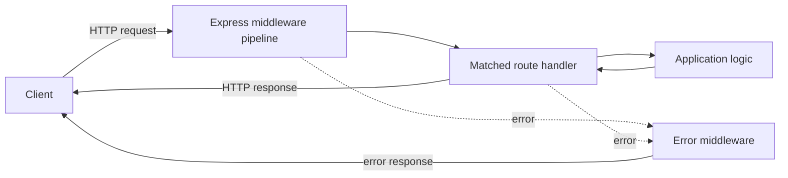
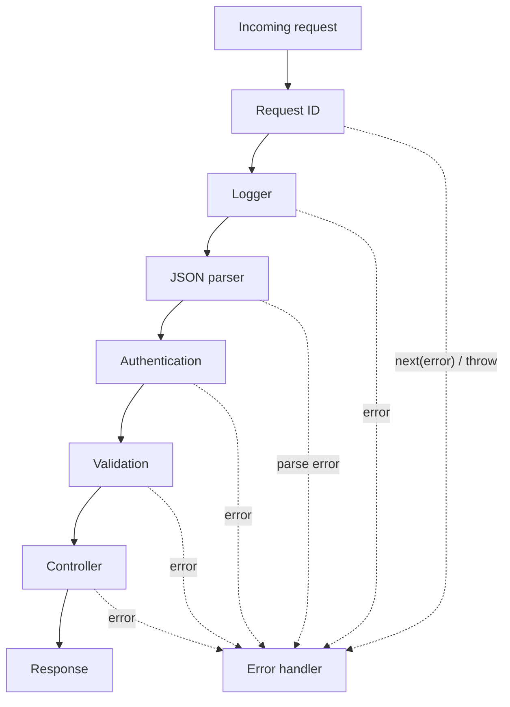
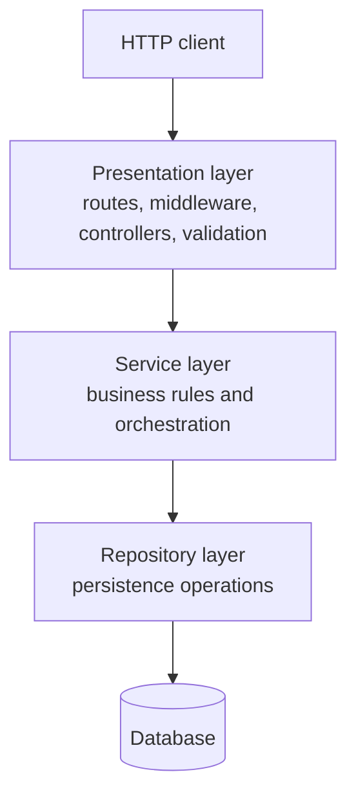

# Express and Layered Architecture

## Contents

1. [Why use a web framework?](#_1-why-use-a-web-framework)
2. [Choosing a Node.js framework](#_2-choosing-a-node-js-framework)
3. [Express setup and application lifecycle](#_3-express-setup-and-application-lifecycle)
4. [Requests, responses, and routing](#_4-requests-responses-and-routing)
5. [Routers and route organization](#_5-routers-and-route-organization)
6. [Middleware](#_6-middleware)
7. [Error handling](#_7-error-handling)
8. [Three-layer architecture](#_8-three-layer-architecture)
9. [Input validation](#_9-input-validation)
10. [Feature-based project structure](#_10-feature-based-project-structure)
11. [Complete Products API](#_11-complete-products-api)
12. [Testing and production readiness](#_12-testing-and-production-readiness)
13. [Transaction and consistency boundaries](#_13-transaction-and-consistency-boundaries)
14. [Idempotency and request context](#_14-idempotency-and-request-context)
15. [Architecture failure modes](#_15-architecture-failure-modes)
16. [Final review checklist](#_16-final-review-checklist)

---

## 1. Why use a web framework?

Node's built-in `node:http` module provides the low-level primitives needed to create a server. It does not provide application-level conventions for routing, parsing bodies, composing cross-cutting behavior, or formatting responses.

Without a framework, every application must repeatedly solve the same problems:

- inspect `req.method` and `req.url` manually;
- match dynamic paths and extract parameters;
- buffer request-body chunks and parse their content;
- set response headers and serialize JSON;
- compose logging, authentication, validation, and error handling;
- organize a growing collection of endpoints.

Express supplies these reusable mechanics while leaving application architecture largely up to the developer.



### Raw Node.js versus Express

| Concern | Raw `node:http` | Express |
| --- | --- | --- |
| Routing | Check method and URL manually | `app.get()`, `app.post()`, `Router` |
| Path parameters | Parse manually or use regex | `req.params` |
| Query string | Construct and inspect `URL` | `req.query` |
| JSON body | Read and buffer a stream | `express.json()` |
| JSON response | Set headers and stringify | `res.json()` |
| Middleware | Build composition yourself | Ordered `app.use()` pipeline |
| Error flow | Design manually | Four-argument error middleware |

Minimal Express equivalent:

```ts
import express from 'express';

const app = express();

app.use(express.json());

app.get('/users/:id', (req, res) => {
  res.json({ id: req.params.id });
});

app.post('/users', (req, res) => {
  res.status(201).json(req.body);
});

app.listen(3000, () => {
  console.log('Server is listening on port 3000');
});
```

A framework removes transport boilerplate. It does **not** decide business rules, data models, security policy, or maintainable dependency boundaries for you.

---

## 2. Choosing a Node.js framework

The right choice depends on application size, team experience, deployment environment, performance constraints, and how much structure the team wants the framework to enforce.

| Framework | Useful fit | Main trade-off |
| --- | --- | --- |
| Express | General-purpose APIs with flexible architecture | Minimal conventions mean the team must create its own structure |
| NestJS | Large TypeScript applications and multi-team projects | More concepts, decorators, and framework-specific patterns |
| Fastify | High-throughput APIs and schema-driven services | Smaller ecosystem than Express and different plugin conventions |
| Hono | Edge, serverless, and multi-runtime applications | Different ecosystem and deployment assumptions |
| Koa | Lean, async-first middleware applications | Very small core requires more choices and integration work |
| Sails.js | Existing MVC and real-time applications | Less common for new projects |
| LoopBack | Existing model-driven CRUD APIs | Primarily relevant to established LoopBack codebases |

### Quick decision guide

```text
No HTTP endpoints needed?                 → no web framework
Edge/serverless or multiple runtimes?     → consider Hono
Raw throughput is the main constraint?    → consider Fastify
Large app with enforced conventions?      → consider NestJS
Lean async-first core?                    → consider Koa
General-purpose API and full control?      → Express
```

### Why learn Express?

- Its routing, middleware, and error-flow concepts are fundamental to Node.js web development.
- NestJS uses Express by default unless configured with its Fastify adapter.
- Its small API makes the HTTP lifecycle visible rather than hiding it behind many abstractions.
- It has a broad ecosystem and a large amount of existing production code.

### Framework costs

- **Dependency risk:** vulnerabilities and breaking releases become application concerns.
- **Learning cost:** conventions and lifecycle behavior must be understood.
- **Abstraction overhead:** the framework sits between application code and raw HTTP.
- **Constraints:** opinionated frameworks can conflict with unusual requirements.
- **Unnecessary weight:** a small script or single-purpose function may not benefit from one.

Choose based on measured needs, not popularity alone.

---

## 3. Express setup and application lifecycle

### Install Express and TypeScript support

```bash
npm install express
npm install --save-dev typescript @types/express tsx
```

**What it does:** installs Express as a runtime dependency and TypeScript types/tooling as development dependencies. `tsx` runs TypeScript directly during development; production normally executes compiled JavaScript.

**When to use it:** use this setup when starting a TypeScript Express application from scratch. In an existing application, keep its current compiler and runner unless there is a deliberate migration plan.

```json
{
  "scripts": {
    "dev": "tsx watch src/server.ts",
    "build": "tsc",
    "start": "node dist/server.js"
  }
}
```

### Separate application construction from listening

Keeping `app` separate from `server.listen()` makes integration testing easier. Tests can import the application without opening a real network port.

```ts
// src/app.ts
import express from 'express';

export const app = express();

app.use(express.json({ limit: '100kb' }));

app.get('/health', (_req, res) => {
  res.json({ status: 'ok' });
});
```

```ts
// src/server.ts — introductory shape only; use the bounded startup/shutdown owner in module10.
import { app } from './app.js';

const rawPort = process.env.PORT ?? '3000';
if (!/^[0-9]{1,5}$/.test(rawPort)) throw new Error('Invalid PORT');
const port = Number(rawPort);
if (port < 1 || port > 65535) throw new Error('PORT out of range');
const server = app.listen(port, () => {
  console.log(`Server is listening on port ${port}`);
});

function shutdown(signal: string): void {
  console.log(`${signal} received; closing server`);
  server.close((error) => {
    if (error) {
      console.error(error);
      process.exitCode = 1;
    }
  });
}

process.on('SIGTERM', () => shutdown('SIGTERM'));
process.on('SIGINT', () => shutdown('SIGINT'));
```

### Application configuration order

Express processes middleware and routes in registration order.

```ts
app.use(requestId);
app.use(logger);
app.use(express.json({ limit: '100kb' }));
app.use('/api/products', productsRouter);
app.use(notFoundHandler);
app.use(errorHandler);
```

The typical order is:

1. request context and logging;
2. security and CORS middleware;
3. body parsers;
4. mounted feature routers;
5. not-found handler;
6. final error handler.

If a parser is registered after a route, that route will not receive the parsed body. If an error handler is registered before the code that fails, it cannot receive that later error.

---

## 4. Requests, responses, and routing

Each handler receives a `Request` and `Response`. Regular middleware also receives `next`, which transfers control to the next matching function.

### Request data sources

Given this request:

```http
PATCH /products/p-42?notify=true HTTP/1.1
Host: api.example.test
Authorization: Bearer token
Content-Type: application/json

{"price":29.99}
```

| Express property | Value or purpose |
| --- | --- |
| `req.method` | `PATCH` |
| `req.path` | `/products/p-42` |
| `req.params.id` | `p-42`, when route is `/products/:id` |
| `req.query.notify` | query input, commonly a string but must be validated |
| `req.get('authorization')` | header value |
| `req.body` | parsed body after matching body-parser middleware |
| `req.ip` | client address according to Express/proxy configuration |

All external values are untrusted, even when TypeScript declares an expected type. TypeScript does not validate runtime input.

### Response helpers

```ts
app.get('/examples/:id', (req, res) => {
  res.status(200).json({ id: req.params.id });
});
```

Common methods:

| Method | Purpose |
| --- | --- |
| `res.status(code)` | Set the HTTP status and continue chaining |
| `res.json(value)` | Serialize JSON and set the content type |
| `res.send(value)` | Send text, bytes, HTML, or another supported body |
| `res.sendStatus(code)` | Set a status and send its standard text description |
| `res.set(name, value)` | Set a response header |
| `res.location(url)` | Set the `Location` header |
| `res.end()` | End without a response body |

Send exactly one response. After sending an early response, return from the function so later code does not try to send again.

```ts
if (!authorized) {
  res.status(401).json({ error: 'Unauthorized' });
  return;
}

res.json({ secret: 'allowed' });
```

### Route methods

```ts
app.get('/products', listProducts);
app.get('/products/:id', getProduct);
app.post('/products', createProduct);
app.put('/products/:id', replaceProduct);
app.patch('/products/:id', updateProduct);
app.delete('/products/:id', deleteProduct);
```

Prefer resource nouns in URLs and let the HTTP method express the action.

```text
Good:  POST /products
Good:  DELETE /products/p-42
Avoid: POST /createProduct
Avoid: GET  /deleteProduct?id=p-42
```

### Route parameters

```ts
import type { Request, Response } from 'express';

type ProductParams = { id: string };

function getProduct(req: Request<ProductParams>, res: Response): void {
  res.json({ id: req.params.id });
}

app.get('/products/:id', getProduct);
```

Path parameters are appropriate for required resource identity. A parameter captured from a URL is still a string until validated or transformed.

### Query parameters

Queries are useful for optional filtering, sorting, searching, and pagination.

```http
GET /products?category=books&limit=20&sort=price
```

Do not rely on a TypeScript assertion such as `req.query.limit as string`. Parse and validate it before use.

### Request bodies

```ts
app.use(express.json({ limit: '100kb' }));
app.use(express.urlencoded({ extended: false, limit: '20kb' }));
```

- `express.json()` parses matching JSON requests.
- `express.urlencoded()` parses form-style URL-encoded bodies.
- `express.static()` serves files from a directory.
- Multipart file uploads need dedicated middleware such as Multer and strict limits.

Body parsing should be registered before routes that use `req.body`. A size limit protects memory and reduces denial-of-service risk.

### Status codes for CRUD APIs

| Situation | Typical status |
| --- | ---: |
| Successful retrieval or update | `200 OK` |
| Resource created | `201 Created` |
| Successful deletion with no body | `204 No Content` |
| Malformed syntax or invalid transport input | `400 Bad Request` |
| Missing or invalid authentication | `401 Unauthorized` |
| Authenticated but not permitted | `403 Forbidden` |
| Resource not found | `404 Not Found` |
| State conflict or duplicate unique value | `409 Conflict` |
| Well-formed input that violates semantic rules | `422 Unprocessable Content` |
| Unexpected server failure | `500 Internal Server Error` |

An API may consistently choose `400` or `422` for schema validation. The important part is a documented, stable error contract.

---

## 5. Routers and route organization

An Express `Router` is a modular middleware and routing unit. Define paths relative to the mount point.

```ts
// products.routes.ts
import { Router } from 'express';
import * as controller from './products.controller.js';

export const productsRouter = Router();

productsRouter.get('/', controller.list);
productsRouter.get('/:id', controller.getById);
productsRouter.post('/', controller.create);
productsRouter.patch('/:id', controller.update);
productsRouter.delete('/:id', controller.remove);
```

```ts
// app.ts
app.use('/api/products', productsRouter);
```

The resulting paths are:

```text
GET    /api/products
GET    /api/products/:id
POST   /api/products
PATCH  /api/products/:id
DELETE /api/products/:id
```

### Router-scoped middleware

```ts
productsRouter.use(requireAuthentication);
productsRouter.post('/', requireRole('admin'), validateCreateProduct, controller.create);
```

This middleware affects only requests that enter the products router and only routes registered after it.

### Parent parameters

Nested routers do not receive parent route parameters by default. Use `mergeParams` when needed.

```ts
const reviewsRouter = Router({ mergeParams: true });

// Mounted at /products/:productId/reviews
reviewsRouter.get('/', (req, res) => {
  res.json({ productId: req.params.productId });
});
```

Use nesting only when the resource relationship is meaningful. Deeply nested URLs and routers become hard to maintain.

---

## 6. Middleware

Middleware forms an ordered pipeline. A middleware function can:

- read or modify `req` and `res`;
- perform work such as logging or authentication;
- call `next()` to continue;
- send a response and stop the pipeline;
- call `next(error)` or throw to enter error handling.

```ts
import type { NextFunction, Request, Response } from 'express';

function middleware(req: Request, res: Response, next: NextFunction): void {
  // Work before later middleware.
  next();
  // Code here runs after downstream synchronous work returns.
}
```

### Pipeline flow



### Logger middleware

Use the response's `finish` event to log the final status and duration.

```ts
function logger(req: Request, res: Response, next: NextFunction): void {
  const startedAt = performance.now();

  res.once('finish', () => {
    const durationMs = performance.now() - startedAt;
    const route = typeof req.route?.path === 'string' ? req.route.path : 'unmatched';
    console.log({ method: req.method, route, status: res.statusCode, durationMs });
  });

  next();
}
```

Avoid logging passwords, authorization tokens, cookies, or sensitive request bodies. originalUrl/path/query values can also contain secrets or user identifiers; log an application-owned normalized route template, not a full incoming URL. The small logger uses req.route.path after routing and an unmatched fallback; mounted routers need a safe configured feature prefix for unambiguous metrics. Completion-only logs omit aborted requests; a production logger should classify close-before-finish once without duplicate logging.

### Authentication middleware

```ts
// Nonfunctional scaffold: fail closed until a real credential/session verifier is wired.
function requireAuthentication(_req: Request, res: Response, _next: NextFunction): void {
  res.status(503).json({ error: {
    code: 'AUTH_NOT_CONFIGURED', message: 'Authentication service unavailable'
  } });
}
```

Do not replace verification with a Bearer-prefix check: that would accept arbitrary text as authenticated. This scaffold deliberately never calls next and cannot protect a usable private endpoint until replaced by the session/token verifier in the authentication lesson. The complete Products API below is an unauthenticated architecture lab, not a private production API.


Authentication establishes identity. Authorization checks whether that identity may perform an action. They are separate decisions.

### Middleware completion rules

Every path through regular middleware must do exactly one of these:

1. call `next()`;
2. send/end the response;
3. forward or throw an error.

If none happens, the request hangs. Do not call `next()` after sending a response unless intentionally entering a carefully designed post-response flow.

### Built-in and third-party middleware

| Middleware | Purpose |
| --- | --- |
| `express.json()` | Parse JSON request bodies |
| `express.urlencoded()` | Parse URL-encoded form bodies |
| `express.static()` | Serve static assets |
| `helmet` | Set defensive HTTP headers |
| `cors` | Apply an explicit CORS policy |
| `morgan` or `pino-http` | HTTP request logging |
| `compression` | Compress suitable responses |
| `multer` | Parse multipart uploads |

Every package adds behavior and risk. Configure it deliberately and keep it updated.

---

## 7. Error handling

Centralized error handling keeps controllers focused and gives clients a consistent response format.

### Error middleware signature

Error middleware has four parameters. Keep all four so Express recognizes it.

```ts
import type { ErrorRequestHandler } from 'express';

export const errorHandler: ErrorRequestHandler = (error, req, res, next) => {
  console.error({code: 'UNEXPECTED_FAILURE'});
  res.status(500).json({
    error: {
      code: 'INTERNAL_ERROR',
      message: 'An unexpected error occurred',
    },
  });
};
```

Register it after routes and the not-found handler.

### Express 5 versus Express 4 async errors

Express 5 automatically calls `next(rejection)` when an `async` handler throws or returns a rejected promise.

```ts
app.get('/products/:id', async (req, res) => {
  const product = await productService.getById(req.params.id);
  res.json(product);
});
```

In Express 4, use an explicit wrapper or `try/catch` with `next(error)`:

```ts
const asyncHandler =
  (handler: (req: Request, res: Response, next: NextFunction) => Promise<void>) =>
  (req: Request, res: Response, next: NextFunction): void => {
    void handler(req, res, next).catch(next);
  };
```

Check the installed major version before choosing a pattern. Do not assume TypeScript types change runtime behavior.

### Typed application errors

Services should express domain/application failures without importing Express or choosing HTTP status codes.

```ts
export class NotFoundError extends Error {
  constructor(public readonly resource: string, public readonly identifier: string) {
    super(`${resource} not found`);
    this.name = 'NotFoundError';
  }
}

export class ConflictError extends Error {
  constructor(message: string) {
    super(message);
    this.name = 'ConflictError';
  }
}
```

The presentation layer maps them to HTTP. Classify known parser errors before the generic500 path; do not map every SyntaxError/TypeError to a client error.

```ts
export function classifyParserError(error: unknown): {
  status: number; code: string; message: string;
} | null {
  const known = {
    'entity.parse.failed': { status: 400, code: 'MALFORMED_JSON', message: 'Malformed JSON' },
    'entity.too.large': { status: 413, code: 'BODY_TOO_LARGE', message: 'Request body too large' },
    'charset.unsupported': { status: 415, code: 'UNSUPPORTED_CHARSET', message: 'Unsupported charset' },
    'encoding.unsupported': { status: 415, code: 'UNSUPPORTED_ENCODING', message: 'Unsupported content encoding' },
    'request.aborted': { status: 400, code: 'REQUEST_ABORTED', message: 'Request body aborted' },
    'request.size.invalid': { status: 400, code: 'INVALID_BODY_SIZE', message: 'Invalid request body size' },
  };
  if (!error || typeof error !== 'object' || !('type' in error) ||
      typeof error.type !== 'string' || !Object.hasOwn(known, error.type)) return null;
  const result = known[error.type as keyof typeof known];
  return 'status' in error && error.status === result.status ? result : null;
}
```

```ts
export const errorHandler: ErrorRequestHandler = (error, req, res, next) => {
  if (res.headersSent) {
    next(error);
    return;
  }

  const parserFailure = classifyParserError(error);
  if (parserFailure) {
    const { status, code, message } = parserFailure;
    res.status(status).json({ error: { code, message } });
    return;
  }

  if (error instanceof NotFoundError) {
    res.status(404).json({
      error: { code: 'NOT_FOUND', message: error.message },
    });
    return;
  }

  if (error instanceof ConflictError) {
    res.status(409).json({
      error: { code: 'CONFLICT', message: error.message },
    });
    return;
  }

  console.error({ method: req.method, route: typeof req.route?.path === 'string' ? req.route.path : 'unmatched', code: 'UNEXPECTED_FAILURE' });
  res.status(500).json({
    error: { code: 'INTERNAL_ERROR', message: 'An unexpected error occurred' },
  });
};
```

Do not expose stack traces, SQL messages, file paths, secrets, or internal dependency details to clients. Parser errors may carry a body property containing credentials: return the safe classification above and do not dump that raw error into normal logs. The first minimal500 handler illustrates only the required Express signature; the typed handler is the complete lab policy. headersSent errors must pass to next(error) so Express can close an already-started response safely. Wrong JSON Content-Type can cause express.json to skip parsing; explicitly enforce the endpoint media contract when it requires415 rather than expect a parser exception for every mismatch.

### 404 handler

A missing route is not automatically an exception. Add terminal middleware after all routes.

```ts
app.use((req, res) => {
  res.status(404).json({
    error: {
      code: 'ROUTE_NOT_FOUND',
      message: 'Route not found',
    },
  });
});
```

### Stable error shape

```json
{
  "error": {
    "code": "VALIDATION_ERROR",
    "message": "Request validation failed",
    "details": [
      { "path": "price", "message": "Price must be greater than zero" }
    ]
  }
}
```

Machine-readable codes let clients react without parsing human-readable prose.

---

## 8. Three-layer architecture

Architecture is the design of responsibilities and dependencies, not merely a folder layout. Its practical goal is to keep likely changes local.



### Layer responsibilities

| Layer | Knows about | Must not contain |
| --- | --- | --- |
| Presentation | Express, HTTP, headers, status codes, transport validation | SQL queries or core business workflows |
| Service | Use cases, business rules, domain errors, orchestration | `req`, `res`, HTTP status codes, database-driver details |
| Repository | Storage models, queries, persistence mapping | HTTP concepts or business workflow decisions |

### Presentation layer

The controller translates HTTP input into a service call and translates the result into an HTTP response.

```ts
export async function createProduct(req: Request, res: Response): Promise<void> {
  const product = await productService.create(req.body);
  res.status(201).location(`/api/products/${product.id}`).json(product);
}
```

Controllers should be thin. A controller that performs pricing rules, queries a database, sends notifications, and formats a response is taking on too many responsibilities.

### Service layer

The service implements application use cases and business invariants.

```ts
export async function create(input: CreateProductInput): Promise<Product> {
  const existing = await productRepository.findBySku(input.sku);
  if (existing) {
    throw new ConflictError(`SKU ${input.sku} already exists`);
  }

  return productRepository.create({
    ...input,
    name: input.name.trim(),
  });
}
```

Uniqueness is a business rule and should also be enforced by a database constraint to prevent race conditions.

### Repository layer

The repository encapsulates persistence and returns application-facing data.

```ts
export interface ProductRepository {
  findAll(): Promise<Product[]>;
  findById(id: string): Promise<Product | null>;
  findBySku(sku: string): Promise<Product | null>;
  create(input: NewProduct): Promise<Product>;
  update(id: string, patch: ProductPatch): Promise<Product | null>;
  delete(id: string): Promise<boolean>;
}
```

The interface makes the dependency explicit. It can be backed by PostgreSQL, MongoDB, an in-memory fake, or another implementation without changing HTTP code.

### Dependency rule

Dependencies flow downward:

```text
route/controller → service → repository → database
```

They must not flow upward:

```text
repository ✗ imports controller
service    ✗ imports Express Request/Response
repository ✗ chooses HTTP status codes
```

The service may depend on repository abstractions supplied at composition time. This strengthens isolation and makes tests simple.

```ts
export function createProductService(repository: ProductRepository) {
  return {
    async getById(id: string): Promise<Product> {
      const product = await repository.findById(id);
      if (!product) throw new NotFoundError('Product', id);
      return product;
    },
  };
}
```

### What changes stay local?

| Requirement change | Primary layer affected |
| --- | --- |
| Express → Fastify | Presentation |
| PostgreSQL → MongoDB | Repository |
| Change a discount rule | Service |
| Change validation error JSON | Presentation |
| Add database index or query optimization | Repository |
| Add another delivery protocol | New presentation adapter reusing services |

### Business validation versus transport validation

Presentation validation checks whether input has the expected shape:

- required fields exist;
- `price` is a finite positive number;
- `sku` has an allowed format;
- unknown properties are rejected or removed.

Service/domain validation enforces business state and rules:

- SKU must be unique;
- discontinued products cannot be ordered;
- a discount cannot exceed the permitted amount;
- inventory cannot be reduced below zero.

Some defense-in-depth checks may exist in both places, but the domain rule must not depend solely on an HTTP validator.

---

## 9. Input validation

TypeScript checks code during development. Requests arrive at runtime from untrusted clients, so they require runtime validation.

Validate every external boundary:

- JSON or form bodies;
- route parameters;
- query parameters;
- relevant headers and cookies;
- configuration and environment variables;
- third-party API responses when their shape matters.

Validation reduces accidental corruption and many injection opportunities, but it is not a complete security solution. Parameterized queries, output encoding, authorization, size limits, and safe file handling are still required.

### Parse, validate, normalize, and sanitize

These terms are related but distinct:

| Operation | Example |
| --- | --- |
| Parse | Convert `"20"` into number `20` |
| Validate | Ensure price is finite and greater than zero |
| Normalize | Trim a name or lowercase an email address |
| Sanitize/escape | Make data safe for a specific output or query context |

Do not mutate arbitrary strings in the hope of making them universally safe. Use context-specific protections such as parameterized SQL and HTML output encoding.

### Zod example

```ts
import { z } from 'zod';

export const createProductSchema = z
  .object({
    name: z.string().trim().min(2).max(100),
    sku: z.string().trim().regex(/^[A-Z0-9-]{3,30}$/),
    price: z.number().finite().positive(),
    stock: z.number().int().nonnegative().default(0),
    description: z.string().trim().max(1000).optional(),
  })
  .strict();

export type CreateProductInput = z.infer<typeof createProductSchema>;
```

Reusable middleware should retain the parsed value, because it may include defaults, coercions, stripped fields, or normalization.

```ts
import type { NextFunction, Request, Response } from 'express';
import type { ZodType } from 'zod';

export function validateBody<T>(schema: ZodType<T>) {
  return (req: Request, res: Response, next: NextFunction): void => {
    const result = schema.safeParse(req.body);

    if (!result.success) {
      res.status(400).json({
        error: {
          code: 'VALIDATION_ERROR',
          message: 'Request body is invalid',
          details: result.error.issues.map((issue) => ({
            path: issue.path.join('.'),
            message: issue.message,
          })),
        },
      });
      return;
    }

    res.locals.validatedBody = result.data;
    next();
  };
}
```

Storing validated data separately prevents later code from accidentally treating the original untrusted body as trusted.

### Joi example

```ts
import Joi from 'joi';

export const createProductSchema = Joi.object({
  name: Joi.string().trim().min(2).max(100).required(),
  sku: Joi.string().trim().pattern(/^[A-Z0-9-]{3,30}$/).required(),
  price: Joi.number().positive().required(),
  stock: Joi.number().integer().min(0).default(0),
  description: Joi.string().trim().max(1000),
});

const { error, value } = createProductSchema.validate(input, {
  abortEarly: false,
  allowUnknown: false,
});
```

### Joi versus Zod

| Concern | Joi | Zod |
| --- | --- | --- |
| TypeScript type inference | Usually needs separate types or helpers | `z.infer` derives types from schemas |
| Ecosystem maturity | Long-established | TypeScript-first and widely adopted |
| API style | Fluent schema methods | Composable TypeScript-oriented schemas |
| Strong fit | JavaScript or existing Joi systems | Modern TypeScript applications |

Choose one consistent validation approach per project. Exact bundle-size comparisons age quickly and depend on build configuration, so measure when size is important.

### Validate body, params, and query together

```ts
const requestSchema = z.object({
  params: z.object({ id: z.string().uuid() }),
  query: z.object({ notify: z.enum(['true', 'false']).optional() }),
  body: updateProductSchema,
});
```

Do not forget that pagination limits and sort fields can also cause resource abuse or unsafe dynamic queries. Use allowlists and upper bounds.

### Unknown fields

Pick and document one policy:

- **reject** unknown fields for strict contracts;
- **strip** them and use only validated output;
- **preserve** them only when the feature intentionally supports extension data.

Never mass-assign an unvalidated request body into a database update. A client could otherwise set fields such as `role`, `ownerId`, `costPrice`, or `isPublished`.

---

## 10. Feature-based project structure

Organizing only by technical layer creates large global folders:

```text
src/
├── controllers/
├── services/
├── repositories/
└── routes/
```

As the application grows, one feature becomes scattered across the entire tree. Organizing by feature keeps related code together while preserving layer boundaries inside each feature.

```text
src/
├── app.ts
├── server.ts
├── shared/
│   ├── errors/
│   ├── middleware/
│   └── validation/
├── products/
│   ├── products.types.ts
│   ├── products.schema.ts
│   ├── products.repository.ts
│   ├── products.service.ts
│   ├── products.controller.ts
│   └── products.routes.ts
└── users/
    ├── users.types.ts
    ├── users.schema.ts
    ├── users.repository.ts
    ├── users.service.ts
    ├── users.controller.ts
    └── users.routes.ts
```

Benefits:

- all code for a feature is easy to locate;
- feature ownership and deletion are clearer;
- imports expose cross-feature coupling;
- folders grow horizontally by capability instead of turning global layer folders into dumping grounds.

Do not create abstractions solely to satisfy a diagram. Small features can use fewer files while still keeping transport, business, and persistence responsibilities separate.

---

## 11. Complete Products API

The following example shows how the pieces cooperate. It uses an in-memory repository to keep attention on architecture. A database-backed implementation can replace it behind the same interface.

### API contract

| Method and path | Purpose | Success |
| --- | --- | ---: |
| `GET /api/products` | List products | `200` |
| `GET /api/products/:id` | Retrieve one product | `200` |
| `POST /api/products` | Create a product | `201` |
| `PATCH /api/products/:id` | Partially update a product | `200` |
| `DELETE /api/products/:id` | Delete a product | `204` |

### Domain types

```ts
// products.types.ts
export interface Product {
  id: string;
  name: string;
  sku: string;
  price: number;
  stock: number;
  description?: string;
}

export type NewProduct = Omit<Product, 'id'>;
export type ProductPatch = Partial<Omit<Product, 'id' | 'sku'>>;
```

For real money, avoid floating-point ambiguity. Store integer minor units such as cents or use a suitable decimal type.

### Schemas

```ts
// products.schema.ts — Zod4, defaults belong only to creation
import { z } from 'zod';
export const productIdSchema = z.string().uuid();
const editableFields = {
  name: z.string().trim().min(2).max(100),
  price: z.number().finite().positive(),
  stock: z.number().int().nonnegative(),
  description: z.string().trim().max(1000).optional(),
};
export const createProductSchema = z.object({
  ...editableFields,
  sku: z.string().trim().regex(/^[A-Z0-9-]{3,30}$/),
  stock: editableFields.stock.default(0),
}).strict().transform(({ description, ...required }) =>
  description === undefined ? required : { ...required, description });

export const updateProductSchema = z.object(editableFields).partial().strict()
  .refine(patch => Object.keys(patch).length > 0 &&
    Object.values(patch).every(value => value !== undefined), {
    error: 'At least one defined editable field is required',
  }).transform(({ name, price, stock, description }) => ({
    ...(name !== undefined ? { name } : {}),
    ...(price !== undefined ? { price } : {}),
    ...(stock !== undefined ? { stock } : {}),
    ...(description !== undefined ? { description } : {}),
  }));
export type CreateProductInput = z.infer<typeof createProductSchema>;
export type UpdateProductInput = z.infer<typeof updateProductSchema>;
```

Zod4 applies defaults even inside optional fields, so partial() of a creation schema containing stock.default(0) can synthesize stock during an unrelated PATCH. Build PATCH from fields without creation defaults. Reject empty/explicit-undefined patches, keep omitted fields absent, preserve explicit stock:0 and reject unknown/immutable id/sku. The transforms project only defined primitive fields, aligning exact optionality with the domain types. Null is not a deletion operation here; define a separate explicit nullable/reset contract if needed. Creation alone defaults stock to0. Test both parsed output keys and the persisted unchanged stock after a name-only update.


### Repository

```ts
// products.repository.ts
import { randomUUID } from 'node:crypto';
import { ConflictError } from '../shared/errors/app-errors.js';
import type { NewProduct, Product, ProductPatch } from './products.types.js';

export interface ProductRepository {
  findAll(): Promise<Product[]>;
  findById(id: string): Promise<Product | null>;
  findBySku(sku: string): Promise<Product | null>;
  create(input: NewProduct): Promise<Product>;
  update(id: string, patch: ProductPatch): Promise<Product | null>;
  delete(id: string): Promise<boolean>;
}

export class InMemoryProductRepository implements ProductRepository {
  private readonly products = new Map<string, Product>();

  async findAll(): Promise<Product[]> {
    return [...this.products.values()].map((product) => ({ ...product }));
  }

  async findById(id: string): Promise<Product | null> {
    const product = this.products.get(id);
    return product ? { ...product } : null;
  }

  async findBySku(sku: string): Promise<Product | null> {
    const product = [...this.products.values()].find((item) => item.sku === sku);
    return product ? { ...product } : null;
  }

  async create(input: NewProduct): Promise<Product> {
    // No await between duplicate check and insertion: atomic within this JS isolate.
    if ([...this.products.values()].some(product => product.sku === input.sku))
      throw new ConflictError('SKU already exists');
    const product: Product = { id: randomUUID(), name: input.name, sku: input.sku,
      price: input.price, stock: input.stock,
      ...(input.description !== undefined ? { description: input.description } : {}) };
    this.products.set(product.id, product);
    return { ...product };
  }

  async update(id: string, patch: ProductPatch): Promise<Product | null> {
    const current = this.products.get(id);
    if (!current) return null;

    const updated = { ...current, ...patch };
    this.products.set(id, updated);
    return { ...updated };
  }

  async delete(id: string): Promise<boolean> {
    return this.products.delete(id);
  }
}
```

Cloning returned objects prevents callers from accidentally changing repository state without calling update. This model contains only primitive fields, so a shallow copy is sufficient; nested mutable data would need an ownership policy. The service lookup is a friendly early conflict check, not race prevention: create itself checks and inserts without an await. Two concurrent service calls therefore cannot insert the same SKU in this single-process fake. A real database must enforce a unique constraint/index and translate its violation; this in-memory critical section is not cross-process synchronization.

### Service

```ts
// products.service.ts
import { ConflictError, NotFoundError } from '../shared/errors/app-errors.js';
import type { ProductRepository } from './products.repository.js';
import type { CreateProductInput, UpdateProductInput } from './products.schema.js';
import type { Product } from './products.types.js';

export function createProductService(repository: ProductRepository) {
  return {
    list(): Promise<Product[]> {
      return repository.findAll();
    },

    async getById(id: string): Promise<Product> {
      const product = await repository.findById(id);
      if (!product) throw new NotFoundError('Product', id);
      return product;
    },

    async create(input: CreateProductInput): Promise<Product> {
      const duplicate = await repository.findBySku(input.sku);
      if (duplicate) throw new ConflictError(`SKU ${input.sku} already exists`);
      return repository.create(input);
    },

    async update(id: string, patch: UpdateProductInput): Promise<Product> {
      const product = await repository.update(id, patch);
      if (!product) throw new NotFoundError('Product', id);
      return product;
    },

    async remove(id: string): Promise<void> {
      const deleted = await repository.delete(id);
      if (!deleted) throw new NotFoundError('Product', id);
    },
  };
}
```

### Validation middleware

```ts
// shared/validation/validate.ts
import type { NextFunction, Request, Response } from 'express';
import type { ZodType } from 'zod';

type RequestTarget = 'body' | 'params' | 'query';

export function validate(target: RequestTarget, schema: ZodType) {
  return (req: Request, res: Response, next: NextFunction): void => {
    const result = schema.safeParse(req[target]);

    if (!result.success) {
      res.status(400).json({
        error: {
          code: 'VALIDATION_ERROR',
          message: `Request ${target} is invalid`,
          details: result.error.issues.map((issue) => ({
            path: issue.path.join('.'),
            message: issue.message,
          })),
        },
      });
      return;
    }

    res.locals[target] = result.data;
    next();
  };
}
```

### Controller factory

```ts
// products.controller.ts
import type { RequestHandler } from 'express';
import type { createProductService } from './products.service.js';

type ProductService = ReturnType<typeof createProductService>;

export function createProductController(service: ProductService) {
  const list: RequestHandler = async (_req, res) => {
    res.json(await service.list());
  };

  const getById: RequestHandler = async (_req, res) => {
    res.json(await service.getById(res.locals.params.id));
  };

  const create: RequestHandler = async (_req, res) => {
    const product = await service.create(res.locals.body);
    res.status(201).location(`/api/products/${product.id}`).json(product);
  };

  const update: RequestHandler = async (_req, res) => {
    const product = await service.update(res.locals.params.id, res.locals.body);
    res.json(product);
  };

  const remove: RequestHandler = async (_req, res) => {
    await service.remove(res.locals.params.id);
    res.status(204).end();
  };

  return { list, getById, create, update, remove };
}
```

### Router composition

```ts
// products.routes.ts
import { Router } from 'express';
import { z } from 'zod';
import { validate } from '../shared/validation/validate.js';
import { createProductController } from './products.controller.js';
import { createProductSchema, productIdSchema, updateProductSchema } from './products.schema.js';
import type { createProductService } from './products.service.js';

export function createProductsRouter(service: ReturnType<typeof createProductService>): Router {
  const router = Router();
  const controller = createProductController(service);
  const paramsSchema = z.object({ id: productIdSchema });

  router.get('/', controller.list);
  router.get('/:id', validate('params', paramsSchema), controller.getById);
  router.post('/', validate('body', createProductSchema), controller.create);
  router.patch(
    '/:id',
    validate('params', paramsSchema),
    validate('body', updateProductSchema),
    controller.update,
  );
  router.delete('/:id', validate('params', paramsSchema), controller.remove);

  return router;
}
```

### Composition root

Construct concrete dependencies in one place.

```ts
// app.ts
import express from 'express';
import { errorHandler } from './shared/middleware/error-handler.js';
import { InMemoryProductRepository } from './products/products.repository.js';
import { createProductService } from './products/products.service.js';
import { createProductsRouter } from './products/products.routes.js';

export const app = express();

const repository = new InMemoryProductRepository();
const service = createProductService(repository);

app.disable('x-powered-by');
app.use(express.json({ limit: '100kb' }));
app.use('/api/products', createProductsRouter(service));

app.use((req, res) => {
  res.status(404).json({
    error: { code: 'ROUTE_NOT_FOUND', message: 'Route not found' },
  });
});

app.use(errorHandler);
```

This is dependency injection without requiring a dependency-injection framework. Construction is centralized, dependencies are visible, and tests can supply fakes.

---

## 12. Testing and production readiness

### Test each boundary at the right level

| Target | Test style | Replace or fake |
| --- | --- | --- |
| Zod/Joi schema | Unit | Nothing |
| Service business rules | Unit | Repository interface |
| Repository queries | Integration | Real disposable test database |
| Express routes and middleware | API/integration with Supertest | External systems as appropriate |
| Full deployed workflow | E2E | As little as practical |

Service test example:

```ts
it('rejects a duplicate SKU', async () => {
  const repository: ProductRepository = {
    findBySku: jest.fn().mockResolvedValue({ id: '1', sku: 'BOOK-1' }),
    // Supply the remaining interface methods for the test fake.
  } as ProductRepository;

  const service = createProductService(repository);

  await expect(
    service.create({ name: 'Book', sku: 'BOOK-1', price: 10, stock: 1 }),
  ).rejects.toBeInstanceOf(ConflictError);
});
```

API test shape:

```ts
import request from 'supertest';
import { app } from '../app.js';

it('returns 400 for an invalid product', async () => {
  const response = await request(app)
    .post('/api/products')
    .send({ name: '', sku: '!', price: -1 });

  expect(response.status).toBe(400);
  expect(response.body.error.code).toBe('VALIDATION_ERROR');
});
```

### Production checklist

- Apply strict request-body and upload limits.
- Configure authentication and authorization independently.
- Use parameterized database queries or a correctly configured query builder/ORM.
- Add timeouts and cancellation for outbound calls.
- Use structured logs with request/correlation IDs.
- Redact secrets and personal data from logs.
- Configure CORS with an explicit allowlist when browser cross-origin access is needed.
- Add defensive headers, usually through carefully configured `helmet`.
- Set `trust proxy` correctly only when deployed behind a trusted proxy.
- Rate-limit sensitive or expensive endpoints.
- Expose liveness/readiness endpoints appropriate to the deployment platform.
- Shut down HTTP and database resources gracefully.
- Monitor latency, error rate, saturation, and dependency health.
- Keep Express and middleware dependencies updated.

### Common mistakes

| Mistake | Result | Better approach |
| --- | --- | --- |
| Business logic inside route handlers | Hard-to-test, coupled code | Move use cases into services |
| Database queries in controllers | Transport depends on storage details | Use repositories |
| `req`/`res` inside services | Framework coupling | Pass plain validated values |
| Treating TypeScript as runtime validation | Malformed data reaches logic | Validate at the boundary |
| Calling neither `next()` nor a response | Hanging request | Complete every middleware path |
| Calling `next()` after sending | Double responses or surprising work | Return after sending |
| Returning stack traces | Information disclosure | Log internally, return a safe message |
| No body-size limit | Memory/resource abuse | Configure parser limits |
| Trusting client-controlled update fields | Mass-assignment vulnerabilities | Allowlist through a strict schema |
| Assuming every Express version handles async errors equally | Lost errors on Express 4 | Check the major version and wrap if needed |
| One global folder per technical layer | Features become scattered | Organize by feature, then layer |
| Mocking Express internals heavily | Brittle tests | Use Supertest at the HTTP boundary |

---

## 13. Transaction and consistency boundaries

A service method often coordinates several repository operations. If those operations protect one invariant, they usually need one transaction boundary.

```ts
interface UnitOfWork {
  run<T>(work: (repositories: Repositories) => Promise<T>): Promise<T>;
}

async function placeOrder(input: PlaceOrderInput) {
  return unitOfWork.run(async ({ orders, inventory }) => {
    const reserved = await inventory.reserve(input.productId, input.quantity);
    if (!reserved) throw new ConflictError('Insufficient inventory');

    return orders.create(input);
  });
}
```

**What it does:** makes inventory reservation and order creation participate in one persistence transaction.

**When to use it:** use a transaction when partial success would violate a business invariant and the operations share a transactional store.

The service owns the business transaction because it knows which steps form one use case. A controller does not know persistence rules. A repository should not secretly start an unrelated transaction for each call.

### External calls cannot join a database transaction

Holding a database transaction open while calling a payment or email service creates long locks and still cannot make both systems atomic.

Common alternatives:

- commit database state and an outbox event together;
- process the event asynchronously;
- make the consumer idempotent;
- use compensating actions when later work fails;
- expose a pending state until the workflow completes.

This is a workflow design problem, not something an ORM transaction can solve alone.

### Error translation

Translate errors at the boundary that understands them:

```text
database unique violation
→ repository/application conflict
→ HTTP 409 response
```

Do not leak driver messages to clients. Preserve the original error as a cause for logs and diagnosis.

---

## 14. Idempotency and request context

### Idempotent use cases

Clients retry when responses are lost. A server must decide whether repetition is safe.

```ts
import { createHash } from 'node:crypto';
type IdempotencyClaim<T> =
  | { kind: 'claimed' }
  | { kind: 'existing'; fingerprint: string; state: 'processing' }
  | { kind: 'existing'; fingerprint: string; state: 'completed'; response: T };
type IdempotencyScope = { actorId: string; operation: string; key: string };
interface IdempotencyRepository<T> {
  claim(input: IdempotencyScope & { fingerprint: string }): Promise<IdempotencyClaim<T>>;
  complete(input: IdempotencyScope & { fingerprint: string; response: T }): Promise<void>;
}
function orderFingerprint(input: { productId: string; quantity: number }): string {
  // Input is already schema-validated/normalized. Fixed keys + version define this format.
  return createHash('sha256').update(JSON.stringify({ version: 1,
    productId: input.productId, quantity: input.quantity })).digest('hex');
}
async function createOrder(command: CreateOrderCommand) {
  const scope = { actorId: command.actorId, operation: 'create-order', key: command.key };
  const fingerprint = orderFingerprint(command.input);
  return unitOfWork.run(async ({ idempotency, orders }) => {
    // claim is one atomic repository operation under a UNIQUE scoped key, not find-then-record.
    const claim = await idempotency.claim({ ...scope, fingerprint });
    if (claim.kind === 'existing') {
      if (claim.fingerprint !== fingerprint) throw new ConflictError('Key reused with different input');
      if (claim.state !== 'completed') throw new ConflictError('Request is still in progress');
      return claim.response;
    }
    const order = await orders.create(command.input);
    const response = toOrderResponse(order);
    await idempotency.complete({ ...scope, fingerprint, response });
    return response;
  });
}
```

The repository claim result is a discriminated union with separate processing/completed variants, so only a completed claim exposes a replay response. This prevents accidentally replaying a processing record and keeps persistence coordination out of HTTP status types. actorId comes from verified request context, not a client-selected body field. Keys are scoped by actor+operation (and tenant where applicable), bounded/validated, and fingerprints are derived server-side from normalized operation input rather than accepted as client authority.

An implementation on a transactional relational store can claim with an INSERT protected by a composite primary/unique key:

```sql
-- Inside the SAME transaction as the business order and completed response write.
INSERT INTO idempotency (actor_id, operation, request_key, fingerprint, state)
VALUES ($1, $2, $3, $4, 'processing')
ON CONFLICT (actor_id, operation, request_key) DO NOTHING
RETURNING request_key;
-- If no row returned: read the existing scoped record in this transaction,
-- compare fingerprint BEFORE replay, and apply the existing/busy policy.
-- If claimed: create order, UPDATE this record to completed with response, COMMIT.
```

The claim adapter must implement the documented transaction/isolation behavior, not merely expose this method name. On PostgreSQL concurrent unique-key inserts coordinate with the conflicting transaction; after a conflict use a fresh READ COMMITTED statement/appropriate locking to read its committed result. If retention cleanup can remove the row between conflict and read, retry the entire transaction under a bounded policy or coordinate cleanup; never interpret a missing read as permission to duplicate the business write. A rollback must remove both claim and business changes. A permanently committed processing state requires explicit lease/recovery semantics; the simple same-transaction design commits only completed results.

Check fingerprint before any replay. A unique key alone cannot distinguish equivalent retries from a reused key carrying another product/quantity. Keep response retention at least through the supported retry window; after expiry, the API must define whether it can accept a new operation. External payment/email calls do not join this transaction: use the outbox/idempotent-provider workflow. This is a repository contract and SQL implementation outline, not an executed database adapter; actual database claim/concurrency/crash tests belong to the persistence/distributed-systems labs.

### Request context

Request-scoped data may include:

- authenticated actor;
- tenant identifier;
- request/trace ID;
- deadline or abort signal;
- locale when business behavior needs it.

Pass business-relevant context explicitly:

```ts
await productService.update({
  actor: req.user,
  productId: req.params.id,
  patch: req.body,
  signal: requestAbortSignal(req),
});
```

Here, `requestAbortSignal()` represents middleware or an adapter that creates an `AbortSignal` from the request lifecycle. Express does not add a signal property automatically.

Use asynchronous context storage for observability metadata when passing it everywhere would add noise. Do not hide core business dependencies or authorization inputs in ambient global state.

### Cancellation

When a client disconnects, continuing expensive optional work may waste resources. Propagate an `AbortSignal` to outbound calls and cancellable operations.

Do not cancel a committed business workflow merely because the HTTP client disappeared. Decide whether work is request-bound or durable before connecting its lifecycle to the socket.

---

## 15. Architecture failure modes

### Thin layers with no purpose

A controller that calls a service that calls a repository one-to-one may be acceptable, but layers should own decisions:

- controller: HTTP translation;
- service/use case: business workflow and policy;
- repository: persistence mapping and queries.

Do not create files solely to satisfy a diagram.

### God service

Symptoms:

- many unrelated dependencies;
- dozens of methods;
- transactions spanning unrelated features;
- every change touches one class;
- tests require huge mock graphs.

Split by use case or cohesive domain capability. Keep orchestration close to the invariant it protects.

### Leaky abstractions

Examples:

- controllers build ORM filters;
- services return Express `Response` objects;
- repositories choose HTTP status codes;
- domain code reads `process.env`;
- persistence entities are serialized directly.

Leaks make changes spread across layers and make isolated tests less meaningful.

### Authorization only in routes

Jobs, message consumers, scripts, and internal calls can bypass route middleware. Pass the actor/security context into the use case. Enforce critical ownership and tenant rules at the service or query boundary.

### Partial success

Ask for every multi-step use case:

1. Which steps can be atomic?
2. Which side effects happen outside the database?
3. What happens if the process crashes between steps?
4. Can the operation be retried?
5. How is incomplete work discovered and repaired?

### Diagnostic exercise

Design an order endpoint that reserves stock, records an order, and requests payment.

Explain:

- the database transaction boundary;
- why the payment call is outside that transaction;
- how an outbox event is recorded;
- how duplicate requests are handled;
- where authorization is checked;
- what happens after a crash at every step;
- which failures return immediately and which become asynchronous states.

---

## 16. Final review checklist

### Use-case reliability

- [ ] Put a transaction around repository operations that share one invariant.
- [ ] Keep slow external calls outside database transactions.
- [ ] Explain the outbox pattern and idempotent consumers.
- [ ] Store an idempotency result atomically with the business change.
- [ ] Pass actor, tenant, deadline, and cancellation context deliberately.
- [ ] Enforce critical authorization outside route middleware as well.
- [ ] Analyze partial success and crash points in a multi-step workflow.

### Express fundamentals

- [ ] Explain what Express adds on top of `node:http`.
- [ ] Create an application and keep `app` separate from `listen()`.
- [ ] Read path parameters, queries, headers, and parsed request bodies.
- [ ] Use appropriate response helpers and status codes.
- [ ] Define resource-oriented routes and modular routers.

### Middleware and errors

- [ ] Explain why middleware order matters.
- [ ] Ensure every middleware path continues, responds, or errors.
- [ ] Distinguish application-, router-, and route-level middleware.
- [ ] Register 404 and error handlers after routes.
- [ ] Explain Express 5 and Express 4 async-error behavior.
- [ ] Return a consistent safe error representation.

### Architecture

- [ ] Keep HTTP logic in routes/controllers.
- [ ] Keep business rules and orchestration in services.
- [ ] Keep persistence details in repositories.
- [ ] Enforce downward dependency flow.
- [ ] Use interfaces or injected dependencies where substitution helps.
- [ ] Organize code by feature while preserving layer responsibilities.

### Validation and security

- [ ] Validate runtime input even when TypeScript types exist.
- [ ] Validate body, params, query, and relevant headers.
- [ ] Use parsed/validated output rather than the original input.
- [ ] Reject or strip unknown fields deliberately.
- [ ] Separate transport validation from business rules.
- [ ] Use parameterized queries, size limits, authorization, and safe output handling.

### One-minute recap

Express turns Node's low-level HTTP primitives into an ordered routing and middleware pipeline. Routes identify the transport operation, validation converts untrusted input into trusted application input, controllers translate HTTP to use-case calls, services enforce business rules, and repositories isolate persistence. Dependencies flow from presentation to service to repository—never upward. Central error middleware maps typed failures to stable HTTP responses, while feature-based folders keep related code together as the application grows.


## Correction labs: contracts that the complete API must satisfy

Baselines checked2026-10-21: Express5.3.0, Zod4.6.7 (defaults inside optional fields), Node24.18.0; the complete extracted Products API also typechecked with TypeScript5.9.3 strict/exact-optional/indexed-access checks. Keep the actual installed package versions/lockfile with results. The scratch validation environment is separate from this notes repository and does not change Autocode templates or src/tests.

**PATCH acceptance:** creation without stock yields0; name-only PATCH output has no stock key and preserves existing stock; explicit stock0 updates correctly; empty/unknown/id/sku/undefined/null-field patches reject according to the stated schema. Normalized parsed output, not raw req.body, reaches the service. Validate returned object keys as well as values.

**Uniqueness acceptance:** launch two service.create calls with the same normalized SKU through one real in-memory repository; require one success, one ConflictError, one stored row. Delete then recreate works. Prove that mutating a returned Product does not mutate stored primitives. Repeat the contract against the real database adapter with its unique constraint; the in-memory no-await section is not a distributed lock.

**Transport acceptance:** malformed JSON→400, oversized entity→413, unsupported charset/encoding→415, schema error→the declared400 policy, and unexpected programmer TypeError→500. Do not expose parser body/stack in responses/logs. Assert headersSent forwards to next once. The fail-closed auth scaffold cannot pass private requests; install and test a real verifier separately. Check safe route logs with a sensitive query and unmatched route; no raw query may be recorded. Exercise startup invalid-port/error/partial-cleanup and bounded shutdown in the lifecycle lesson; this introductory server snippet does not implement all of those yet.

**Idempotency acceptance:** the same scoped key+same normalized input replays only a completed response; different input conflicts; an atomic concurrent claim allows at most one business insertion; rollback/crash-before-commit creates neither partial business state nor a visible completed response. Record actual persistence isolation/retention behavior and replay authorization. A port/fake test cannot establish durable atomicity. Learner implementation and real DB/Express deployment evidence remain required.

Official references: [Zod4 optional defaults](https://zod.dev/v4/changelog#defaults-applied-within-optional-fields), [Express5 errors](https://expressjs.com/en/guide/error-handling/), [body-parser error types](https://expressjs.com/en/resources/middleware/body-parser/#errors), [PostgreSQL INSERT conflict handling](https://www.postgresql.org/docs/current/sql-insert.html).


## Storage rows, domain states and public DTOs

An interface name does not establish a boundary. Returning an ORM entity directly lets a later internal field addition leak into JSON even if a controller's TypeScript return annotation names fewer fields. Structural typing is not runtime field removal. Keep a repository mapper, a domain contract and a deliberately projected response when they differ; avoid three identical types only for ceremony.

This focused catalog projection extends the Products API concepts without changing that introductory CRUD contract. Its price is positive integer minor units, not the CRUD sketch's floating-point price. A storage row has snake_case fields and a driver Date; the domain has immutable primitive values and a publication discriminant; the response excludes tenant/internal supplier fields. Draft and published states cannot simultaneously omit/require the publication time.

```ts
// catalog-contracts.ts
import { z } from 'zod';
const columns = {
  id: z.string().uuid(), tenant_id: z.string().uuid(), name: z.string().trim().min(2).max(100),
  price_cents: z.number().int().positive().max(Number.MAX_SAFE_INTEGER),
};
const rowSchema = z.discriminatedUnion('state', [
  z.object({ ...columns, state: z.literal('draft'), published_at: z.null() }),
  z.object({ ...columns, state: z.literal('published'), published_at: z.date() }),
]);
type ProductBase = Readonly<{ id: string; tenantId: string; name: string; priceCents: number }>;
export type CatalogProduct = ProductBase & (
  | Readonly<{ state: 'draft' }>
  | Readonly<{ state: 'published'; publishedAt: string }>
);
export type PublishedProduct = Extract<CatalogProduct, { state: 'published' }>;
export type PublicProductDto = Readonly<{
  id: string; name: string; priceCents: number; state: 'published'; publishedAt: string;
}>;
export type CatalogOutcome =
  | { kind: 'found'; product: PublishedProduct }
  | { kind: 'not_found' }
  | { kind: 'not_published' };
export function fromCatalogRow(input: unknown): CatalogProduct {
  const row = rowSchema.parse(input); // Driver output is validated; extra columns are stripped.
  const base = { id: row.id, tenantId: row.tenant_id, name: row.name, priceCents: row.price_cents };
  return row.state === 'draft' ? { ...base, state: 'draft' }
    : { ...base, state: 'published', publishedAt: row.published_at.toISOString() };
}
export function findVisibleProduct(product: CatalogProduct | null, trustedTenantId: string): CatalogOutcome {
  if (product === null || product.tenantId !== trustedTenantId) return { kind: 'not_found' };
  return product.state === 'draft' ? { kind: 'not_published' } : { kind: 'found', product };
}
export function toPublicProduct(product: PublishedProduct): PublicProductDto {
  return { id: product.id, name: product.name, priceCents: product.priceCents,
    state: 'published', publishedAt: product.publishedAt };
}
function unreachable(value: never): never { throw new Error('Unhandled catalog outcome'); }
export function presentCatalog(outcome: CatalogOutcome):
  { status: 200; body: PublicProductDto } | { status: 404; body: { code: 'NOT_FOUND' } } {
  switch (outcome.kind) {
    case 'found': return { status: 200, body: toPublicProduct(outcome.product) };
    case 'not_found':
    case 'not_published': return { status: 404, body: { code: 'NOT_FOUND' } };
    default: return unreachable(outcome);
  }
}
```

Only the presentation adapter knows status200/404; domain outcomes have no Express/driver types. Mapping draft and absent to the same public404 avoids exposing unpublished existence through this response. A separate authorized editorial endpoint can expose draft details using its own DTO/policy. A new outcome must be handled exhaustively instead of silently falling through. Unexpected database failures remain failures, not not_found; the repository must not catch an outage and return null.

The mapper intentionally strips extra storage columns and then explicitly projects each layer. A future supplier_cost_cents/internal_note/driver helper is never spread into the public response. This is a defense against accidental serialization, not an authorization mechanism. Derive trustedTenantId from verified context; filter by tenant/visibility in the actual repository query as well, before pagination/aggregation. More detailed ownership/permission rules belong to the use case. Do not trust a body tenantId or this pure helper as proof that a caller may view the catalog.

Readonly constrains TypeScript assignments, not all JavaScript mutation. Values here are primitives, so they do not share a mutable Date/ORM relation across layers; freeze/copy deeper structures if the actual ownership contract requires it. The ISO string follows JavaScript Date millisecond precision and UTC formatting; a microsecond-sensitive cursor needs the dedicated database timestamp contract rather than this projection. Validate API JSON separately: z.date expects a real driver Date, not an arbitrary timestamp string from a request. A storage adapter must match the configured driver conversions.

**Acceptance drill:** strict-typecheck draft/published/outcome narrowing and reject missing publication data or a draft passed to the published DTO mapper. At runtime reject invalid dates, mismatched state/date, unsafe/fractional/negative money and malformed identity. Feed a row/variable containing supplier cost, internal note, tenant and driver metadata; assert the exact public JSON keys contain none of them. Mutate the original Date after mapping and verify the domain ISO string stays unchanged. Assert draft/wrong-tenant/absent all present as404, published as200 and no other status leaks into domain types. Add an outcome and observe a never diagnostic. Then repeat through the real repository/controller with tenant-scoped queries and a simulated database outage. The pure mapping checks do not establish server authorization, transactional storage or learner practice.

Validated baseline TypeScript5.9.3 strict/exactOptionalPropertyTypes/noUncheckedIndexedAccess, Zod4.6.7 and Node24.18.0. Official references checked2026-10-22: [TypeScript discriminated unions](https://www.typescriptlang.org/docs/handbook/2/narrowing.html#discriminated-unions), [Zod object/discriminated-union parsing](https://zod.dev/api#discriminated-unions), [Express JSON response](https://expressjs.com/en/api/). This is a standalone extension lab; preserve Autocode build/test configuration and src/tests restrictions.


## Lifecycle and error evidence reconciliation

The introductory `app.listen` snippet above demonstrates separation of app construction and listening; it is not the production startup owner. Use [module10 startup/listenReady](./module-10-production-ready-applications.md#_5-startup-and-application-lifecycle) and [coordinated shutdown](./module-10-production-ready-applications.md#_9-graceful-shutdown) instead of growing a second inconsistent implementation. Startup must reject both synchronous invalid bind arguments and asynchronous `error` events, and release every resource already handed over. A connection factory owns partially created resources until it returns successfully. Closing a listener is not the same as awaiting jobs, draining active requests or closing a database.

| Requirement | Retained/rechecked evidence | Limit |
|---|---|---|
| Known body-parser status mapping | B43 complete extracted Express API checks;2026-10-25 exact current classifier strict-compiled and actual Express malformed400/size413/charset415/encoding415 rechecked | Does not make arbitrary SyntaxError/TypeError a client error; wrong media type may skip the parser |
| Unexpected application failure | Current actual Express async TypeError returns safe500 without the synthetic private detail | Client projection is separate from an internal redacted diagnostics policy |
| Startup listener failure | Exact current `listenReady` strict-compiles; actual occupied loopback bind rejects EADDRINUSE and the handed-over resource closes; invalid port rejects synchronously | Database close in this new focused test is an explicit owned port, not a new real-driver run |
| Listener lifetime | Startup helper removes only its own error/listening listeners on failure | Node's existing `setupConnectionsTracking` listener is preserved; zero total listeners is the wrong assertion |
| Complete shutdown | Retained B48 real Node slow-response drain/new-connection denial, duplicate-promise ownership, jobs-before-DB ordering, failure matrix and child deadline exit1 | Not re-executed in this batch; no hosted load-balancer/production rollout evidence |
| Probe/driver boundary | Retained B48 isolated PostgreSQL timeout/slot-release/recovery and B165 actual container database-stall/readiness/liveness/shutdown | Not proof every dependency cancels when an HTTP deadline fires |

The current chapter was reread completely (1726 source lines before these edits) before reconciling the overlapping review finding. Existing substantive parser and lifecycle material supplies the shared requirement; a missing copy in one introductory snippet is not absence across the corpus. Raw error-object logging in the two small error-handler sketches was replaced by a fixed diagnostic code: parser/driver/program errors can carry bodies, credentials or private paths. A production diagnostics adapter can preserve reviewed cause categories and correlation under a declared redaction policy; do not silently dump the original exception.

**Practice acceptance:** build a service using the primary composition owner, inject invalid configuration, occupied-port failure, dependency acquisition failure and a later partial-startup failure. Assert owned cleanup and a nonzero outcome without leaking configuration. Test parser statuses and headersSent delegation, then reproduce the shared shutdown failure/drain/deadline cases in disposable processes. Record exactly which dependencies are real. No `src/tests` changes or remote push are permitted; independent learner practice remains required.
