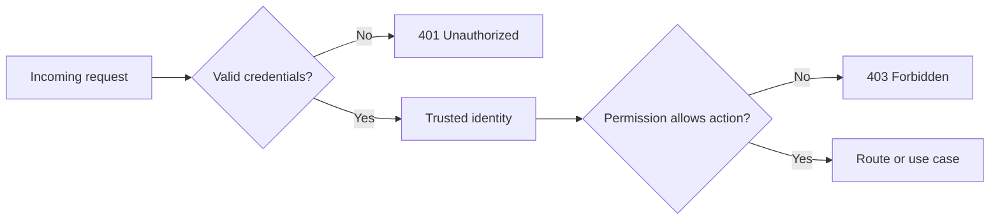
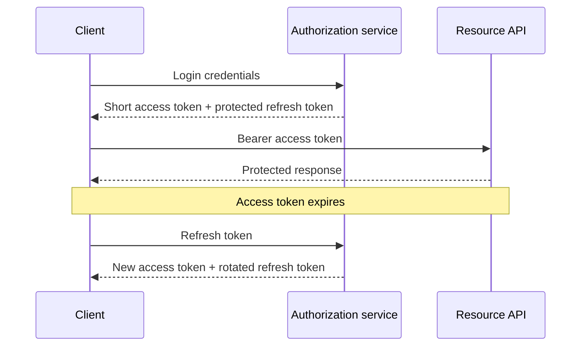
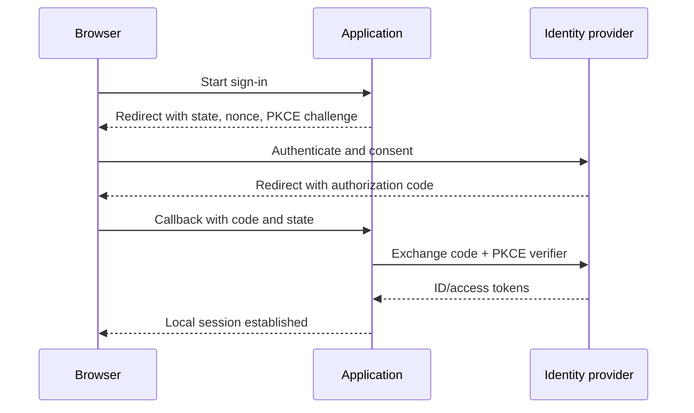

# Authentication and Authorization

## Contents

- [Complete runnable example: app.ts](#complete-runnable-example-app-ts)

1. [Authentication and authorization](#_1-authentication-and-authorization)
2. [Choosing an authentication approach](#_2-choosing-an-authentication-approach)
3. [JSON Web Tokens](#_3-json-web-tokens)
4. [Access and refresh token lifecycle](#_4-access-and-refresh-token-lifecycle)
5. [Password storage](#_5-password-storage)
6. [Registration, login, and refresh](#_6-registration-login-and-refresh)
7. [Authentication middleware](#_7-authentication-middleware)
8. [Authorization with roles and attributes](#_8-authorization-with-roles-and-attributes)
9. [Composing protected routes](#_9-composing-protected-routes)
10. [OAuth 2.0, OpenID Connect, and Passport](#_10-oauth-2-0-openid-connect-and-passport)
11. [API keys and service authentication](#_11-api-keys-and-service-authentication)
12. [Browser token storage, cookies, CSRF, and XSS](#_12-browser-token-storage-cookies-csrf-and-xss)
13. [Testing authentication and authorization](#_13-testing-authentication-and-authorization)
14. [Common mistakes and production guidance](#_14-common-mistakes-and-production-guidance)
15. [Application attack surface and supply-chain security](#_15-application-attack-surface-and-supply-chain-security)
- [Graduated practice: identity and access](#graduated-practice-identity-and-access)
16. [Final review checklist](#_16-final-review-checklist)

---

## Authentication and authorization {#_1-authentication-and-authorization}

Authentication and authorization solve different problems:

- **Authentication (authn):** who is making the request?
- **Authorization (authz):** may that identity perform this action on this resource?

They must happen in that order. Permission rules cannot be evaluated safely until the caller's identity is established.



### HTTP status codes

| Status | Meaning in access control | Typical examples |
| --- | --- | --- |
| `400 Bad Request` | Request syntax or input is invalid | Malformed JSON, invalid email shape |
| `401 Unauthorized` | Authentication is absent or unusable | Missing, expired, malformed, or invalid token; incorrect login credentials |
| `403 Forbidden` | Identity is known but permission is insufficient | Wrong role, missing scope, not allowed to perform the action |
| `404 Not Found` | Resource is absent, or deliberately concealed | Unknown resource; sometimes used instead of `403` to prevent resource discovery |
| `409 Conflict` | Request conflicts with current state | Email already registered |

Despite its name, HTTP `401 Unauthorized` represents an authentication failure. A bearer-token API should normally include a `WWW-Authenticate: Bearer` response header with `401`.

### Identity, roles, permissions, and ownership

```text
Identity:    user-42
Role:        editor
Permissions: article:read, article:create, article:update
Relationship: owns article-17
```

A role is a convenient grouping of permissions, not the permission itself. Real decisions often combine:

- identity or tenant;
- roles and explicit permissions;
- token scopes;
- resource ownership;
- resource state;
- time, network, or other environmental attributes.

Use **least privilege**: grant only the capabilities needed for the current operation.

---

## Choosing an authentication approach {#_2-choosing-an-authentication-approach}

### Server-side sessions

After login, the server stores session state and gives the client an opaque session identifier, commonly in a cookie.

```text
login → server creates session → browser receives session cookie
request + cookie → server loads session → identity
```

**What it does:** keeps identity and revocation state on the server while the browser carries only an identifier.

**When to use it:** sessions are a strong default for browser applications, especially when immediate logout/revocation and secure `HttpOnly` cookies are desirable.

**Trade-offs:** every application instance must reach the shared session store; cookie-based authentication also needs CSRF protection.

### Worked browser session: login, CSRF and logout

A browser session is an opaque identifier in a cookie plus a server-side record. The cookie does not contain the password, account record or permission list. The runnable application uses `express-session` with `connect-pg-simple` and the same PostgreSQL database as the application. The migration creates `textbook_sessions`; no request creates schema. Two explicitly owned pools serve the ORM and session/SQL work, so count both in the connection budget.

Read the [complete `app.ts` workbench reference](../workbench/node-js/backend/session-app.md). It is imported directly from `examples/node-textbook/src/app.ts` in the repository, so the workbench listing stays aligned with the runnable source.

| Step | Browser sends | Server does | Observable result |
| --- | --- | --- | --- |
| Bootstrap | `GET /csrf` | Creates an anonymous session and a random synchronizer token | Cookie plus JSON `csrfToken` |
| Register | Credentials, cookie, trusted Origin and `X-CSRF-Token` | Validates fields, hashes once with Argon2id, inserts account | 201 with public account fields |
| Login | Credentials and anonymous CSRF token | Verifies password, regenerates session ID, stores account ID and credential version, saves session | Different cookie and a new CSRF token |
| Mutate | Session cookie, exact trusted Origin and current CSRF token | Authenticates then scopes the write to the caller's account ID | 201/200/204 for allowed work |
| Logout | Same CSRF protections | Destroys the server-side record, clears the cookie using matching options | 204; replayed old cookie gets 401 |

**Why regenerate?** If an attacker already knows an anonymous session ID, keeping it after login would associate that known identifier with the victim's identity. Regeneration replaces it. Saving before sending the login response ensures the next request can find the new record. Changing identity also rotates the CSRF token, so clients replace their old token.

**Why both Origin and a token?** A synchronizer token is random state tied to the server session and supplied explicitly in a custom header. Another site cannot read `/csrf` through the same-origin policy; the application does not enable cross-origin reads. Exact Origin validation adds a separate check on unsafe methods. The local JSON client must send both. GET/HEAD handlers do not change business state. XSS executing in this application's own origin can still obtain a token and act as the user; sessions/CSRF do not cure XSS.

The sample cookie is HttpOnly, host-only, SameSite=Lax, path `/`, and has an eight-hour maximum age. A server-side establishment timestamp enforces the same absolute lifetime even when the store touches the row. There is no rolling lifetime. Secure cookies require HTTPS; the loopback HTTP tutorial explicitly uses `secure: false`. A hosted HTTPS adaptation must enable Secure, validate its actual proxy topology, and use a shared secret/store across replicas. The example does not trust forwarded IP/protocol headers.

Expired store rows need bounded cleanup, for example a scheduled `DELETE` of small batches selected by the expiry index. Expiration still prevents session loading before physical deletion. The sample disables the store's timer so pool ownership and process termination remain visible. Add an explicit cleanup job in Module 10's independent exercise.

[Related practice](../practice/node-js/module-09-authentication-authorization.md).

### Worked password recovery: one credential, one successful use

Recovery is another authentication boundary. `src/security.ts` implements the state transitions; `/password/reset-request` and `/password/reset` provide the validated HTTP boundary.

1. Accept a normalized email. Always return 202 with the same message for known and unknown accounts, including a delivery failure. Rate-limit this endpoint; identical response text does not guarantee identical timing.
2. Generate 32 random bytes and encode a URL-safe token. Store only SHA-256(token), account ID, a fifteen-minute expiry and `used=false`. SHA-256 is suitable for this high-entropy lookup credential; it remains unsuitable for human passwords.
3. Invalidate older reset credentials for the account under its row lock. Commit before contacting the delivery system. Pass the raw credential only to a trusted delivery adapter, never return it to the requesting browser or put it in a log.
4. At completion validate token shape and password policy, compute the new Argon2id hash, then begin a transaction. Lock the account and conditionally consume a token only when it is unused and unexpired according to database time.
5. Update the hash and increment `credential_version`, consume other reset credentials, revoke refresh families and delete the account's session records in the same transaction. Commit once. A second concurrent completion fails.
6. Require a fresh login. Do not automatically log in from a recovery request. The browser clears its old cookie.

The session carries a credential version that protected requests compare to the account. This also rejects a stale login/session that raced password reset. Revocation affects subsequent authentication checks; it cannot undo a request already authorized and in flight. Highly sensitive operations may require a fresh version check inside their business transaction.

**Local delivery:** the runnable server writes a reset credential to a private `.local-inbox` file, simulating a mailbox on your own computer; it sends no email. Read it only to finish the local exercise and delete it afterward. The test suite injects an in-memory delivery recorder. A hosted implementation needs a reviewed mail provider/queue, short retention, fixed trusted reset origin, and a page that avoids token leakage through referrers, analytics or third-party scripts.

Delivery is outside the database transaction. If delivery fails, requesting another token is safe; this small sample does not implement durable mail retry/outbox delivery.

[Related practice](../practice/node-js/module-09-authentication-authorization.md).


### Signed access tokens

A signed token carries claims that a resource server can verify without loading a session for every request.

```text
login → issuer signs token → client stores token
request + token → API verifies signature and claims → identity
```

**What it does:** allows multiple services to validate a portable credential using shared symmetric key material or a public key.

**When to use it:** tokens are useful for APIs, mobile clients, service boundaries, and federated systems where independent verification matters.

**Trade-offs:** a bearer token can be replayed by whoever steals it. Self-contained tokens are difficult to revoke before expiry unless the system adds server-side state.

### OAuth 2.0 and OpenID Connect

OAuth delegates access authorization to an authorization server. OpenID Connect (OIDC) adds a standardized identity layer for login.

**When to use it:** use OIDC for “Sign in with …”, enterprise single sign-on, and systems that should not directly manage the user's provider password.

### API keys

An API key is a long, random credential identifying an application or integration.

**When to use it:** use keys for controlled service-to-service integrations, webhook senders, and developer APIs. They are usually a poor fit for human login, delegated permissions, or short-lived sessions.

### Comparison

| Approach | State location | Revocation | Common use |
| --- | --- | --- | --- |
| Session | Server-side session store | Immediate by deleting session | Browser applications |
| Signed access token | Mostly in token | Usually expiry or denylist/version check | APIs and distributed services |
| OAuth 2.0 + OIDC | Identity/authorization provider | Provider and application policies | Federation and social/enterprise login |
| API key | Server-side key record | Disable or rotate key | Machine integrations |

No method is automatically “more scalable” or “more secure.” Choose based on clients, revocation requirements, trust boundaries, and operational complexity.

---

## JSON Web Tokens {#_3-json-web-tokens}

A JSON Web Token (JWT) is a compact representation of claims. A commonly used signed JWT has three Base64URL-encoded parts:

```text
base64url(header).base64url(payload).base64url(signature)
```

### Header

```json
{
  "alg": "HS256",
  "typ": "JWT"
}
```

The header describes token metadata, including the signing algorithm. Verification code must allowlist the expected algorithm; it must not blindly trust an attacker-controlled `alg` value.

### Payload and claims

```json
{
  "sub": "user-42",
  "role": "editor",
  "iss": "https://auth.example.test",
  "aud": "products-api",
  "iat": 1792476000,
  "exp": 1792476900
}
```

Useful registered claims include:

| Claim | Meaning | Verification rule |
| --- | --- | --- |
| `sub` | Subject or principal identifier | Use a stable, non-secret identifier |
| `iss` | Issuer | Must equal the trusted issuer |
| `aud` | Intended audience | Must include this API |
| `iat` | Issued-at time | Useful for auditing and token-age policies |
| `exp` | Expiration time | Reject after expiry |
| `nbf` | Not valid before | Reject before this time |
| `jti` | Token identifier | Can support replay detection or denylisting |

Custom claims such as `role`, `permissions`, or `tenantId` should have a small, documented schema.

### JWT payloads are readable

Base64URL is encoding, not encryption. Anyone holding the token can decode its header and payload.

Never place passwords, password hashes, private personal data, secrets, or unnecessary database fields in a JWT. Signing protects integrity; it does not provide confidentiality.

### Signature models

| Model | Example | Signing | Verification | Useful when |
| --- | --- | --- | --- | --- |
| Symmetric | HS256 | Shared secret | Same shared secret | One trusted service or tightly controlled services issue and verify |
| Asymmetric | RS256/ES256 | Private key | Public key | One issuer signs and many services verify without gaining signing authority |

With a symmetric key, every verifier can also mint tokens. Asymmetric signing separates issuance authority from verification authority.

### Signing a token

```ts
import jwt from 'jsonwebtoken';

interface AccessClaims {
  sub: string;
  role: 'user' | 'editor' | 'admin';
}

function issueAccessToken(claims: AccessClaims, secret: string): string {
  return jwt.sign({ sub: claims.sub, role: claims.role, token_use: 'access' }, secret, {
    algorithm: 'HS256',
    issuer: 'https://auth.example.test',
    audience: 'products-api',
    expiresIn: '15m',
  });
}
```

**What it does:** creates a short-lived token bound to a known issuer, audience, and algorithm. The library adds timestamps such as `iat` and calculates `exp` from `expiresIn`.

**When to use it:** issue an access token only after successfully authenticating a user or exchanging a valid refresh credential. Pass an explicit, validated secret or private key from application configuration.

### Verifying a token

```ts
// access-token.ts — Node 24, jsonwebtoken 9.0.3, synchronous HS256 verification
import jwt from 'jsonwebtoken';
export class InvalidCredential extends Error {}
export interface VerifiedAccess {
  sub: string;
  role: 'user' | 'editor' | 'admin';
  token_use: 'access';
  iat: number;
  exp: number;
}
export function verifyAccessToken(
  token: string, secret: string, nowSeconds = Math.floor(Date.now() / 1000),
): VerifiedAccess {
  // Validate the actual high-entropy key at startup; never accept a request-supplied key.
  if (Buffer.byteLength(secret, 'utf8') < 32) throw new Error('Invalid signing configuration');
  let payload: string | jwt.JwtPayload;
  try {
    payload = jwt.verify(token, secret, {
      algorithms: ['HS256'], issuer: 'https://auth.example.test', audience: 'products-api',
      clockTimestamp: nowSeconds, clockTolerance: 5,
    });
  } catch (error) {
    if (error instanceof jwt.JsonWebTokenError || error instanceof jwt.NotBeforeError) {
      throw new InvalidCredential('Invalid access credential');
    }
    throw error; // Programming/key-provider failures are operational errors.
  }
  if (typeof payload === 'string' ||
      typeof payload.sub !== 'string' || !/^[A-Za-z0-9_-]{1,128}$/.test(payload.sub) ||
      !['user', 'editor', 'admin'].includes(payload.role) || payload.token_use !== 'access' ||
      !Number.isSafeInteger(payload.iat) || !Number.isSafeInteger(payload.exp) ||
      payload.iat! < 0 || payload.iat! > nowSeconds + 5 ||
      payload.exp! <= payload.iat! || payload.exp! - payload.iat! > 900) {
    throw new InvalidCredential('Unexpected access claims');
  }
  return { sub: payload.sub, role: payload.role, token_use: 'access',
    iat: payload.iat!, exp: payload.exp! };
}
```

**What it does:** verifies signature/algorithm/issuer/audience and present time claims, then explicitly requires the application schema: bounded subject, allowlisted role, access-token purpose, integer iat/exp and a positive lifetime of at most 900 seconds. jsonwebtoken checks exp when present; it does not require exp automatically. This API requires it. Five seconds of clock tolerance is a deliberate bounded skew policy, not an expiry bypass. Use synchronized server clocks; test boundaries with the injected clock.

The issuer projects trusted fields rather than signing arbitrary caller properties. Other APIs may choose different subject/lifetime policies. A typed return cannot replace these runtime checks.

**When to use it:** run verification at every trust boundary where a bearer token becomes an authenticated identity. Decoding a token without verification is never sufficient.

### Key management

- Load keys from validated environment/secrets configuration.
- Use high-entropy generated secrets, not memorable text.
- Keep access-token and refresh-token keys separate.
- Rotate keys deliberately; a `kid` header can help select among active public keys.
- Never log keys or complete tokens.
- Prefer a dedicated identity provider when key lifecycle and federation become complex.

---

## Access and refresh token lifecycle {#_4-access-and-refresh-token-lifecycle}

### Access tokens

Access tokens are short-lived credentials sent to resource APIs. Short lifetime limits the replay window after theft.

### Refresh tokens

Refresh tokens are longer-lived credentials used only at the authorization server's refresh endpoint. They must not be sent to ordinary resource routes.

| Property | Access token | Refresh token |
| --- | --- | --- |
| Purpose | Authorize API operations | Obtain a new access token |
| Typical lifetime | Minutes | Hours, days, or weeks according to risk |
| Exposure | Sent to resource APIs | Sent only to refresh/token endpoint |
| Stored state | May be self-contained | Usually tracked or otherwise replay-protected |
| Response to theft | Wait for expiry or revoke by policy | Revoke token family/session and require login |

### Lifecycle



### Rotation and replay detection

A robust refresh flow stores a hash of the current refresh token or a session/token-family record. On successful refresh:

1. For signed refresh tokens, verify signature and intended type; for opaque random refresh tokens, hash and look up the credential under the server-side session policy. Both designs need expiry, ownership and replay protection.
2. Confirm its server-side session is active.
3. Invalidate the presented token.
4. Issue and record a replacement refresh token.
5. If an already-used token appears again, revoke the whole token family because replay may indicate theft.

This means a secure refresh-token design is not necessarily stateless. Server-side state enables logout, revocation, rotation, device/session management, and replay detection.

### Worked refresh rotation with a real database

This is a separate API-client exercise, not part of the browser session login. The complete implementation is `issueRefresh`/`rotateRefresh` in the runnable application's `src/security.ts`; its schema is in `src/migrate.ts`. Read the implementation in `examples/node-textbook/src/security.ts` at the repository root.

A family row stores `id`, `account_id`, absolute `expires_at` and `revoked`. A token row stores a SHA-256 `hash`, `family_id` and `used`. Keep consumed hashes for the family's validity period so replay can be recognized. Do not extend the family's seven-day absolute deadline during rotation. Expired families and their token history need a deliberate retention/cleanup policy.

For every rotation, acquire one `pg` client and execute all statements on it:

1. Hash and look up the opaque credential to identify its account/family. Unknown random tokens cannot choose an arbitrary family to revoke.
2. Lock the account, then its family. Password reset uses the same account→family ordering.
3. Recheck family revocation/expiry under the lock.
4. Execute `UPDATE textbook_refresh_tokens SET used=true WHERE hash=$1 AND used=false RETURNING hash`.
5. With one returned row, insert the replacement's hash and commit. With no returned row, mark the family revoked and **commit that revocation**, then report 401 outside the transaction.

Throwing the replay error inside a callback that automatically rolls back would undo revocation. The implementation returns a decision from its transaction and throws only after commit.

| Concurrent event | Database outcome | Client outcome |
| --- | --- | --- |
| A and B present the same unused token | A consumes it; B waits on the lock | A receives one replacement |
| B obtains the lock after A commits | B sees a consumed token and commits family revocation | B gets 401 |
| A presents its replacement afterward | The family is revoked | A also gets 401 and must log in |

This chooses strict replay handling: a benign retry after losing the successful response also revokes the family. Serialize refresh requests in the client and require login after an ambiguous failure. A grace/retry-cache design is possible but needs its own bounded replay analysis; do not silently accept an old token twice. Rotation provides replay detection, not proof that the first presenter was legitimate.

[Related practice](../practice/node-js/module-09-authentication-authorization.md).

### When refresh tokens are unnecessary

Do not add refresh tokens automatically. A short-lived internal process, command-line tool, or application where reauthentication is acceptable may be simpler and safer with only an access token.

### Revocation strategies

- Short access-token lifetime.
- Server-side session or refresh-token records.
- A user-level `tokenVersion` checked during authentication.
- Denylisting particular `jti` values until expiry.
- Key rotation for broad emergency invalidation.

Each strategy trades database/cache reads, operational complexity, and revocation speed.

---

## Password storage {#_5-password-storage}

Passwords must be hashed with a password-specific, adaptive algorithm. They must not be stored as plaintext, reversibly encrypted, or hashed with a fast general-purpose function such as raw MD5, SHA-1, or SHA-256.

### Preferred algorithms

- **Argon2id:** preferred for new systems when available; it is memory-hard and tunable.
- **scrypt:** a strong memory-hard alternative.
- **bcrypt:** widely supported and acceptable for existing/course systems, but has a 72-byte input limit in common implementations.
- **PBKDF2:** often used where specific compliance constraints apply.

The algorithm name is only the beginning. Benchmark cost parameters on production-like hardware and revisit them as hardware changes.

### Salt and pepper

- A **salt** is unique random data stored with each hash. Modern password libraries generate and encode it automatically.
- A **pepper** is an optional application-wide secret kept outside the password database. It adds defense in depth but introduces rotation and availability concerns.

Salts prevent identical passwords from producing identical stored values and defeat reusable precomputed tables. They do not make weak passwords strong.

### Hash and verify with Argon2id

```ts
import argon2 from 'argon2';

export function hashPassword(password: string): Promise<string> {
  return argon2.hash(password, { type: argon2.argon2id });
}

export function verifyPassword(
  storedHash: string,
  candidate: string,
): Promise<boolean> {
  return argon2.verify(storedHash, candidate);
}
```

**What it does:** creates a salted, adaptive password hash during registration and later verifies a candidate without recovering the original password.

**When to use it:** prefer Argon2id for a new password-based authentication system when the deployment supports it. Tune memory/time settings after measuring login capacity and denial-of-service risk.

### bcrypt alternative

```ts
import bcrypt from 'bcrypt';

const workFactor = 12;

const storedHash = await bcrypt.hash(password, workFactor);
const matches = await bcrypt.compare(candidatePassword, storedHash);
```

**What it does:** lets bcrypt generate a salt, store parameters inside the encoded hash, and verify the candidate using those stored parameters.

**When to use it:** use bcrypt when compatibility or an existing system requires it. Enforce an appropriate byte-length policy, benchmark the work factor, and plan gradual rehashing when stronger parameters or algorithms become available.

### Operational rules

- Hash in exactly one layer; accidental double hashing makes valid passwords fail.
- Never return or log the hash.
- Rate-limit login and registration because password hashing intentionally consumes resources.
- Use one generic login failure such as “Invalid email or password” to reduce account enumeration.
- Consider performing a dummy password verification when the account is absent to reduce timing differences.
- Upgrade old hashes after a successful login when parameters no longer meet policy.
- Password resets require single-use, short-lived, securely generated reset tokens.

---

## Registration, login, and refresh {#_6-registration-login-and-refresh}

Keep transport, business rules, persistence, and cryptography separated:

```text
route → validation → controller → authentication service → repository
                                      ├── password hasher
                                      └── token service
```

### Validate public input

```ts
import { z } from 'zod';

export const registerSchema = z.object({
  email: z.string().trim().toLowerCase().email(),
  password: z.string().min(12).max(128),
});

export const loginSchema = z.object({
  email: z.string().trim().toLowerCase().email(),
  password: z.string().min(1).max(128),
});
```

**What it does:** validates and normalizes credentials before they enter business logic, while limiting unreasonably large password inputs.

**When to use it:** validate every public authentication endpoint. A schema checks input shape; database constraints and service rules still enforce uniqueness and other invariants.

Do not let public registration choose privileged fields such as `role`, `isAdmin`, or an unrestricted paid plan. Assign safe defaults on the server and use a separate authorized process for privilege changes.

### Registration flow

```ts
interface RegisterInput {
  email: string;
  password: string;
}

async function register(input: RegisterInput) {
  const existing = await users.findByEmail(input.email);
  if (existing) throw new ConflictError('Account already exists');

  const passwordHash = await passwords.hash(input.password);

  try {
    const user = await users.create({
      email: input.email,
      passwordHash,
      role: 'user',
    });

    return {
      user: toPublicUser(user),
      accessToken: tokens.issueAccess(user),
    };
  } catch (error) {
    if (isUniqueEmailViolation(error)) {
      throw new ConflictError('Account already exists');
    }
    throw error;
  }
}
```

**What it does:** rejects known duplicates, hashes the password once, assigns a non-privileged role, persists the account, and returns a sanitized representation plus a token.

**When to use it:** use this service flow behind a validated registration route. The database uniqueness constraint is essential because two concurrent requests can both pass the preliminary lookup.

### Login flow

```ts
async function login(email: string, candidatePassword: string) {
  const user = await users.findByEmail(email);
  const matches = user
    ? await passwords.verify(user.passwordHash, candidatePassword)
    : await passwords.verify(dummyPasswordHash, candidatePassword);

  if (!user || !matches) {
    throw new AuthenticationError('Invalid email or password');
  }

  if (user.status !== 'active') {
    throw new AuthenticationError('Invalid email or password');
  }

  return tokens.issueSession(user);
}
```

**What it does:** verifies credentials without revealing whether an account exists, checks account state, and delegates token/session creation to one component.

**When to use it:** use this pattern for password login. Add rate limits, security-event logging, and optional MFA according to risk.

### Refresh flow

```ts
async function refresh(presentedToken: string) {
  const claims = tokens.verifyRefresh(presentedToken);
  const session = await sessions.findActive(claims.sessionId);

  if (!session || !session.matches(presentedToken)) {
    await sessions.revokeFamily(claims.familyId);
    throw new AuthenticationError('Invalid refresh token');
  }

  const user = await users.findActiveById(claims.sub);
  if (!user) throw new AuthenticationError('Invalid refresh token');

  return sessions.rotate(session, user);
}
```

**What it does:** validates the refresh credential, checks server-side session state, rejects replay, confirms the account is active, and rotates the token.

**When to use it:** use rotation for long-running clients that need silent renewal and revocation. Execute the state transition atomically so concurrent refresh attempts cannot both succeed unnoticed.

### Response safety

Return a dedicated public shape:

```ts
function toPublicUser(user: User) {
  return {
    id: user.id,
    email: user.email,
    role: user.role,
  };
}
```

Never serialize the persistence entity directly if it contains a password hash, reset token, MFA secret, internal flags, or audit data.

---

## Authentication middleware {#_7-authentication-middleware}

Authentication middleware should:

1. Extract one supported credential format.
2. Verify signature and standard claims.
3. Validate application claims.
4. Optionally check current user/session state.
5. Attach a small trusted principal to the request.
6. Return `401` for unusable credentials; forward operational dependency failures to the central error handler (normally safe503/500), without granting access.

### Principal type

```ts
export interface Principal {
  id: string;
  role: 'user' | 'editor' | 'admin';
  tenantId?: string;
}

declare global {
  namespace Express {
    interface Request {
      user?: Principal;
    }
  }
}
```

**What it does:** extends Express's request type with an optional authenticated principal.

**When to use it:** use declaration merging when middleware intentionally adds shared request state. Keep it optional because public routes and earlier middleware run before authentication.

### Bearer extraction

```ts
function extractBearer(header: string | undefined): string | undefined {
  if (!header) return undefined;

  if (header.length > 8192) return undefined;
  const match = /^Bearer +([A-Za-z0-9._~+\/-]+=*)$/i.exec(header);
  return match?.[1];
}
```

**What it does:** accepts a case-insensitive authentication scheme and one or more ASCII spaces followed by the RFC6750 bearer-token grammar. Token bytes/case remain unchanged. Tabs, commas, extra parts and oversized headers are rejected by this deliberately strict API policy. Header normalization/duplicate-header rejection also belongs at the HTTP server/proxy boundary; do not lowercase the complete header.

**When to use it:** keep parsing separate from verification so it can be unit-tested and reused.

### Middleware factory

```ts
// authenticate.ts — Principal/extractBearer from the preceding snippets
import type { NextFunction, Request, Response } from 'express';
import { InvalidCredential } from './access-token.js';
export function createAuthenticate(dependencies: {
  verify: (token: string) => Principal;
  isActive: (principal: Principal) => Promise<boolean>;
}) {
  return async (req: Request, res: Response, next: NextFunction) => {
    const reject = (missing = false) => {
      res.setHeader('WWW-Authenticate', missing ? 'Bearer' : 'Bearer error="invalid_token"');
      return res.status(401).json({ message: missing ? 'Authentication required' : 'Invalid or expired token' });
    };
    const token = extractBearer(req.headers.authorization);
    if (!token) return reject(true);
    let principal: Principal;
    try {
      principal = dependencies.verify(token);
    } catch (error) {
      if (error instanceof InvalidCredential) return reject();
      return next(error);
    }
    let active: boolean;
    try {
      active = await dependencies.isActive(principal);
    } catch (error) {
      return next(error); // Database/cache outage is not evidence of an invalid token.
    }
    if (!active) return reject();
    req.user = principal;
    return next(); // Outside the credential-verification catch.
  };
}
```

**What it does:** centralizes extraction, cryptographic verification, account/session status, trusted request context, and consistent failure handling.

**When to use it:** apply it before every route that requires a caller identity. Inject dependencies so verification and account-state behavior can be tested without module-wide mocks.

Wire the verifier explicitly: `verify: token => { const c = verifyAccessToken(token, secret); return { id: c.sub, role: c.role }; }`. Do not pass an unvalidated decoded object or a refresh token as Principal. `isActive` must return false for a known disabled/absent principal and reject for infrastructure failure. Apply bounded database deadlines and centralized safe error translation; keep raw tokens out of logs. Tests must distinguish false from rejection. Checking current role/tenant membership requires loading and projecting that authoritative state, not merely returning true for an existing user.

### Database lookup or no lookup?

| Choice | Advantage | Cost/risk |
| --- | --- | --- |
| Verify token only | Fast and independently scalable | Deleted, disabled, or changed accounts remain represented until token expiry |
| Verify and load user/session | Immediate status and permission changes | Database/cache request on each API call |
| Short token plus cached version/status | Bounded staleness with fewer database reads | More infrastructure and invalidation logic |

Choose deliberately. A database lookup is not mandatory for every JWT design, and skipping it is not automatically safe.

---

## Authorization with roles and attributes {#_8-authorization-with-roles-and-attributes}

Authentication creates a trusted principal. Authorization evaluates that principal against the requested action and resource.

### Role-based access control

```ts
type Role = 'user' | 'editor' | 'admin';

export function requireRole(...allowed: Role[]) {
  return (req: Request, res: Response, next: NextFunction) => {
    if (!req.user) {
      return res.status(401).json({ message: 'Authentication required' });
    }

    if (!allowed.includes(req.user.role)) {
      return res.status(403).json({ message: 'Forbidden' });
    }

    return next();
  };
}
```

**What it does:** creates configured middleware that permits only principals with one of the listed roles.

**When to use it:** RBAC fits stable, coarse-grained rules such as administration or moderation. Prefer named permissions when roles become overloaded or inconsistent across features.

### Permission-based policy

```ts
const rolePermissions = {
  user: ['product:read'],
  editor: ['product:read', 'product:create', 'product:update'],
  admin: ['product:read', 'product:create', 'product:update', 'product:delete'],
} as const;
```

Checking `product:delete` expresses intent more clearly than scattering `role === 'admin'` throughout the codebase.

### Ownership and attribute-based access control

Instead of loading a resource and then comparing ownership, scope the database query by both resource and owner:

```ts
// owned-product.ts — primary PostgreSQL/MikroORM path
import type { EntityManager } from '@mikro-orm/postgresql';
interface OwnedActor { id: string; tenantId: string }
interface ProductNamePatch { name: string } // Already validated/nonempty/length-limited.
interface ProductView { id: string; name: string }
export async function updateOwnedProduct(
  em: EntityManager, actor: OwnedActor, productId: string, patch: ProductNamePatch,
): Promise<ProductView | undefined> {
  const rows = await em.execute<ProductView[]>(
    `UPDATE products SET name = ?, updated_at = statement_timestamp()
     WHERE id = ? AND owner_id = ? AND tenant_id = ?
     RETURNING id, name`,
    [patch.name, productId, actor.id, actor.tenantId],
  );
  return rows[0]; // Map no row to the same404, without revealing another tenant's row.
}
```

**What it does:** checks resource, owner and tenant in the same UPDATE that changes it; values are bound, identifiers are fixed. The products table must declare owner_id/tenant_id (non-null foreign keys in the tenant model), in addition to the scalar columns in the PostgreSQL lesson. An earlier scoped read alone does not authorize a later unscoped update: ownership can change between those operations. Ignore caller-supplied owner/tenant fields; derive actor from verified current membership.

A single-statement conditional write prevents that gap, subject to the selected PostgreSQL isolation/locking policy. This raw SQL bypasses the ORM identity map; return the projected row and avoid retaining stale managed Product instances in the same request.

**When to use it:** prefer query-level tenant/ownership scoping for object-level authorization. It reduces information leakage and avoids a separate “load, check, then act” gap.

### Authorization belongs in more than middleware

Route middleware is useful for coarse HTTP checks, but critical business authorization must survive other entry points such as jobs, message consumers, GraphQL resolvers, and internal calls.

```ts
await productService.update({
  actor: req.user,
  productId: req.params.id,
  patch: req.body,
});
```

Pass the actor/security context into the use case and enforce invariants there or in a dedicated policy component. Do not trust a controller to remember every rule.

### Multi-tenant safety

For tenant-aware applications:

- derive `tenantId` from the verified principal, not request input;
- include `tenantId` in every relevant read and write filter;
- enforce database constraints where possible;
- test cross-tenant identifiers deliberately;
- prevent administrators of one tenant from becoming global administrators accidentally.

---

## Composing protected routes {#_9-composing-protected-routes}

Express middleware runs from left to right:

```ts
router.put(
  '/products/:id',
  authenticate,
  requirePermission('product:update'),
  validate(updateProductSchema),
  productController.update,
);
```

**What it does:** establishes identity, checks coarse permission, validates untrusted input, and only then invokes the controller.

**When to use it:** make security requirements visible at the route boundary. The service should still enforce resource-specific rules such as ownership or tenant isolation.

Order matters:

1. Request context and security logging.
2. Authentication.
3. Cheap coarse authorization.
4. Input validation.
5. Resource-level authorization and business logic.
6. Central error translation.

Avoid loading sensitive resources before authentication. Avoid expensive database checks when a cheap permission check can reject the request first.

---

## OAuth 2.0, OpenID Connect, and Passport {#_10-oauth-2-0-openid-connect-and-passport}

### OAuth is not itself a login protocol

- **OAuth 2.0** delegates access to protected resources.
- **OpenID Connect** adds authentication and an ID token describing the authenticated subject.

Use OIDC—not an ad hoc interpretation of an OAuth access token—when the goal is user login.

### Authorization Code flow with PKCE



Security requirements include:

- exact registered redirect URI matching;
- TLS;
- unpredictable, transaction-bound `state`;
- PKCE for public clients and generally for authorization-code clients;
- OIDC `nonce` validation where applicable;
- issuer, audience, signature, and expiration validation;
- minimal scopes;
- no implicit flow for new designs;
- safe account linking.

For a concrete maintained-client setup, one-use browser-bound transactions, PKCE/nonce validation and a signed CSRF alternative, continue with the [OIDC and CSRF lab](./oidc-and-csrf-lab.md). Its integration checklist reuses the primary session design above.

### Stable external identity

Store the provider identity using a pair such as:

```text
(issuer, subject) = (https://accounts.example.test, 248289761001)
```

Do not use email alone as the permanent provider identity. Email may change, may not be verified, and may collide across issuers.

### Passport strategy shape

```ts
import passport from 'passport';
import { Strategy as OidcStrategy } from 'passport-openidconnect';

passport.use(new OidcStrategy(
  {
    issuer: config.oidcIssuer,
    authorizationURL: config.authorizationUrl,
    tokenURL: config.tokenUrl,
    userInfoURL: config.userInfoUrl,
    clientID: config.clientId,
    clientSecret: config.clientSecret,
    callbackURL: config.callbackUrl,
    scope: ['openid', 'email', 'profile'],
  },
  async (issuer, profile, done) => {
    try {
      const user = await identities.findOrCreate({ issuer, subject: profile.id });
      done(null, user);
    } catch (error) {
      done(error as Error);
    }
  },
));
```

**What it does:** delegates protocol handling to a Passport OIDC strategy and maps the provider's stable identity to a local user.

**When to use it:** Passport is useful when an Express application benefits from its middleware ecosystem. For high-assurance systems, prefer a well-maintained OIDC client and provider discovery over manually assembling endpoint URLs.

This Passport sketch does not demonstrate transaction-bound PKCE, nonce, state or signature checks and is not the complete login implementation. Use the maintained-client lab linked above for those explicit checks; do not credit a security checklist as executed evidence.

Never assume a library makes the integration secure by itself. Validate provider metadata, callback configuration, account-linking rules, and token claims.

---

## API keys and service authentication {#_11-api-keys-and-service-authentication}

Generate keys from cryptographically secure random bytes:

```ts
import { randomBytes, createHash } from 'node:crypto';

const apiKey = randomBytes(32).toString('base64url');
const storedDigest = createHash('sha256').update(apiKey).digest('hex');
```

**What it does:** creates a high-entropy credential to show once to the client and a deterministic digest to store for later lookup.

**When to use it:** use this model for machine clients where the server must identify a key efficiently. Because random API keys already have high entropy, a fast hash is suitable for hiding the stored raw key; human passwords require slow password hashing instead.

Production key records should include:

- non-secret key identifier or prefix;
- digest, never the full key;
- owner/application identity;
- allowed scopes;
- creation, last-used, and expiration timestamps;
- enabled/revoked state;
- rotation support.

Always send keys over TLS, avoid query strings, redact them from logs, and rate-limit failures. For stronger service identity, consider mutual TLS or signed client assertions.

---

## Browser token storage, cookies, CSRF, and XSS {#_12-browser-token-storage-cookies-csrf-and-xss}

There is no universally safe browser storage location; the threats differ.

### JavaScript-accessible storage

`localStorage`, `sessionStorage`, and ordinary JavaScript variables can be read by injected script running in the same origin. A successful XSS attack may steal or use tokens.

### HttpOnly cookies

An `HttpOnly` cookie cannot be read by JavaScript, which reduces direct token theft through XSS. The browser sends it automatically, so state-changing requests need CSRF defenses.

```ts
res.cookie('session', opaqueSessionId, {
  httpOnly: true,
  secure: true,
  sameSite: 'lax',
  path: '/',
});
```

**What it does:** creates a cookie unavailable to JavaScript and restricted to HTTPS, with a SameSite policy that blocks many cross-site requests.

**When to use it:** secure cookies are a strong browser-session default. Choose `SameSite`, domain, path, and lifetime according to the actual cross-site flow, and add CSRF tokens where SameSite alone is insufficient.

### CSRF defenses

- `SameSite` cookies.
- Synchronizer or double-submit CSRF tokens.
- Origin/Referer validation for suitable requests.
- Reauthentication for high-risk actions.
- Never use state-changing `GET` routes.

### XSS defenses

- Context-aware output encoding.
- Safe templating and DOM APIs.
- Content Security Policy.
- Dependency hygiene.
- Avoid rendering unsanitized HTML.
- Keep sensitive tokens out of logs, URLs, and error messages.

Cookies do not eliminate XSS: malicious script may still make authenticated requests from the victim's browser even if it cannot read the cookie.

---

## Testing authentication and authorization {#_13-testing-authentication-and-authorization}

Security tests should prove both allowed and denied behavior.

### Unit tests

Test pure or injected components:

- bearer-header parsing;
- claim-schema validation;
- role/permission policy decisions;
- ownership rules;
- token expiry using a controlled clock;
- generic login failure behavior;
- refresh-token rotation and replay detection.

### Integration/API example

```ts
describe('requireRole', () => {
  test.each([
    ['admin', 200],
    ['user', 403],
  ] as const)('role %s produces %i', async (role, expectedStatus) => {
    const response = await request(app)
      .delete('/products/p-1')
      .set('Authorization', `Bearer ${issueTestToken({ sub: 'u-1', role })}`);

    expect(response.status).toBe(expectedStatus);
  });
});
```

**What it does:** exercises the same protected operation with an allowed and denied role.

**When to use it:** parameterized tests make authorization matrices explicit. Use test-only keys and token helpers; never reuse production credentials.

The request(app) example above is an API integration test, not an isolated middleware unit test: it exercises routing and token middleware together. For unit tests call the injected middleware with explicit request/response/next ports.

### Integration/API tests

Cover at least:

- registration stores a hash, never the plaintext;
- duplicate registration returns `409` even under concurrency;
- correct and incorrect credentials;
- missing, malformed, expired, wrong-audience, wrong-issuer, and wrong-signature tokens;
- disabled or deleted accounts;
- permission denial with `403`;
- cross-user and cross-tenant resource access;
- refresh success, rotation, expiry, revocation, and reuse;
- logout/revocation behavior;
- responses never expose hashes, tokens, or secrets;
- throttling behavior where practical.

Do not make tests depend on real external identity providers. Test your callback boundary with controlled provider responses, then keep a small separate smoke test for the real integration if needed.

---

## Common mistakes and production guidance {#_14-common-mistakes-and-production-guidance}

| Mistake | Consequence | Better approach |
| --- | --- | --- |
| Treating authentication as authorization | Any logged-in user can perform privileged actions | Evaluate permissions for every protected action |
| Returning `403` for an invalid bearer token | Blurs authentication and authorization semantics | Return `401`; reserve `403` for insufficient permission |
| Calling `jwt.decode()` without verification | Attacker-controlled claims become trusted | Verify signature and claims first |
| Verifying only the signature | Token for another issuer/API may be accepted | Validate algorithm, issuer, audience, time, and claim schema |
| Putting secrets in a JWT | Token holder can read them | Include only minimal non-secret claims |
| Long-lived access tokens | Large replay window | Use short expiry and a deliberate renewal design |
| Stateless refresh tokens with no rotation | Stolen token can mint sessions until expiry | Track, rotate, hash, and revoke refresh tokens |
| Letting signup choose `admin` | Direct privilege escalation | Assign safe roles server-side |
| Storing plaintext or fast password hashes | Database breach exposes credentials quickly | Use Argon2id, scrypt, bcrypt, or policy-approved PBKDF2 |
| Revealing “email not found” | Account enumeration | Return one generic credential failure |
| Serializing persistence entities | Password hashes/internal fields may leak | Map to an explicit public response |
| Relying only on route middleware | Internal entry points may bypass policy | Enforce critical authorization in the use case/policy layer |
| Loading by ID before checking tenant/owner | Object-level authorization bugs | Scope the query by resource and caller attributes |
| Logging full headers or tokens | Credentials enter logs and observability systems | Redact authorization, cookies, and sensitive fields |
| No login rate limit | Credential stuffing and hash-based resource exhaustion | Rate-limit by account and network signals; monitor abuse |
| Home-grown OAuth flow | Redirect, state, PKCE, and validation mistakes | Use a maintained standards-compliant client/library |

### Security logging

Record security-relevant events without credentials:

- login success/failure with safe identifiers;
- lockout, throttling, MFA, and password-reset events;
- token refresh, replay detection, logout, and revocation;
- authorization denial;
- role, permission, or account-status changes;
- key rotation and configuration failures.

Do not log passwords, complete bearer tokens, cookies, reset tokens, client secrets, or password hashes.

### Layered controls

Authentication is only one control. A production service also needs:

- TLS everywhere credentials travel;
- secure configuration and key rotation;
- rate limits and abuse detection;
- input validation and output encoding;
- dependency updates;
- audit logging and alerting;
- secure password recovery and MFA where risk demands it;
- backups and incident-response procedures;
- authorization review whenever new routes or roles are introduced.

---

## Application attack surface and supply-chain security {#_15-application-attack-surface-and-supply-chain-security}

Authentication protects identity. Authorization protects permissions. Neither makes unsafe application behavior safe.

Every place where untrusted data chooses a command, path, URL, property, query, template, or dependency behavior is another attack surface. Validate both the shape of the input and what the application is allowed to do with it.

### Mass assignment

Mass assignment happens when an API copies an entire request object into a model or update query.

```ts
// Unsafe: the caller may include role, ownerId, balance, or internal status.
await users.update(userId, req.body);
```

Use an input schema and construct the permitted change explicitly:

```ts
import { z } from 'zod';

const updateProfileSchema = z.object({
  displayName: z.string().trim().min(1).max(80).optional(),
  locale: z.enum(['en', 'de', 'hu']).optional(),
}).strict();

const input = updateProfileSchema.parse(req.body);

await users.updateProfile(req.user.id, {
  displayName: input.displayName,
  locale: input.locale,
});
```

**What it does:** rejects unknown fields and maps only public, user-editable properties.

**When to use it:** use an allowlist for every create and update boundary. Administrative fields need a separate use case and separate authorization rule.

Validation alone is not authorization. A syntactically valid `ownerId` is still unsafe if the caller may not choose ownership.

### Path traversal

An attacker may try names such as `../../secrets.env` to escape an intended directory.

```ts
import path from 'node:path';

const uploadRoot = path.resolve('/srv/app/uploads');

function resolveInsideUploadRoot(untrustedName: string): string {
  const candidate = path.resolve(uploadRoot, untrustedName);
  const relative = path.relative(uploadRoot, candidate);

  if (
    relative === '' ||
    relative.startsWith(`..${path.sep}`) ||
    relative === '..' ||
    path.isAbsolute(relative)
  ) {
    throw new Error('Invalid file path');
  }

  return candidate;
}
```

**What it does:** resolves the final path, calculates its relationship to the allowed root, and rejects paths that escape it.

**When to use it:** use containment checks when a caller influences a filesystem location. A stronger design generates server-side storage names and stores the original display name as metadata.

Do not rely only on removing `../`. Encodings, platform separators, absolute paths, and symbolic links can defeat simple string replacement. If attackers can create symbolic links inside the root, additional filesystem controls are required. This is a lexical check, not a filesystem sandbox: resolving a name and opening it later can race replacement. The `path` APIs in [Module 2](./module-02-standard-library.md) normalize names; they do not resolve this authority boundary.

Prefer opaque server-generated names under a trusted immutable root, or a separately reviewed no-follow/open-relative storage adapter. Do not present `startsWith(root)` or this relative-path check as protection against attacker-controlled symlinks.

### Command injection

Never build a shell command from request text:

```ts
// Unsafe: shell syntax inside fileName can execute another command.
exec(`convert ${fileName} output.png`);
```

Prefer a library API. If a subprocess is required, invoke the executable directly with a fixed argument structure:

```ts
import { spawn } from 'node:child_process';

const child = spawn('/usr/bin/convert', [safeInputPath, safeOutputPath], {
  shell: false,
  stdio: ['ignore', 'pipe', 'pipe'],
});
```

**What it does:** passes arguments without asking a shell to interpret metacharacters.

**When to use it:** use direct process invocation only after validating paths, formats, size, and resource limits. `shell: false` reduces shell injection risk, but the called program may still interpret dangerous flags or file formats.

### Prototype pollution

JavaScript object keys such as `__proto__`, `constructor`, and `prototype` can be dangerous when untrusted objects are recursively merged or used as dictionaries.

```ts
// Avoid recursively merging arbitrary request objects into configuration.
const settings = deepMerge(defaultSettings, req.body);
```

Safer controls include:

- schema validation with unknown keys rejected;
- explicit field mapping;
- maintained libraries that defend against dangerous keys;
- `Map` for untrusted dictionary keys;
- `Object.create(null)` when a plain prototype-free record is appropriate;
- dependency updates for parsers and merge utilities.

Do not write a generic deep-merge helper for hostile input unless its security rules are thoroughly understood and tested.

### Server-side request forgery

Server-side request forgery (SSRF) occurs when untrusted input makes the server request an unintended destination.

Examples include:

- URL preview endpoints;
- webhook testers;
- image importers;
- PDF generators that fetch remote assets;
- redirect-following HTTP clients.

An attacker may target loopback addresses, private networks, cloud metadata services, or privileged internal APIs.

Controls include:

- prefer named integrations over arbitrary URLs;
- allowlist schemes, hosts, and ports;
- resolve DNS and reject private, loopback, link-local, and otherwise forbidden addresses;
- repeat validation after redirects and account for DNS rebinding;
- use outbound network policy as a second layer;
- set connect, response, size, and redirect limits;
- never forward caller credentials to a new host.

A string check such as `url.startsWith('https://example.com')` is not a safe URL policy. Parse the URL and compare normalized components.

### Unsafe file uploads

Treat uploads as hostile bytes, even when the browser reports a familiar MIME type.

Define:

- maximum request and file size;
- allowed count and formats;
- content inspection based on bytes, not only filename or header;
- server-generated storage names;
- storage outside executable/static application directories;
- malware scanning where the threat model requires it;
- image/document re-encoding for supported formats;
- authorization for upload, download, and deletion;
- retention and cleanup for abandoned files.

Parsing complex media can be dangerous. Isolate high-risk processors, patch them, enforce CPU and memory limits, and do not pass user filenames to a shell.

Use the [bounded UTF-8 upload/storage lab and explicit threat model](./safe-text-uploads.md) for a worked pending/ready flow, current owner-scoped downloads, private opaque files and adversarial checks. Its base contract accepts bounded UTF-8 text; the separately labeled multipart variant handles a single bounded text file. Neither implements arbitrary PDF/image processing.

### Regular-expression denial of service

A regular expression with catastrophic backtracking can consume the event loop on a carefully constructed input.

```ts
// Patterns with nested ambiguous repetition deserve careful review.
const risky = /^(a+)+$/;
```

Controls include:

- keep input lengths small and explicit;
- prefer simple parsing or linear-time validators;
- review nested quantifiers and ambiguous alternatives;
- test hostile near-match inputs;
- use a safe-regex approach or engine when regular expressions are user-influenced;
- never accept an arbitrary regular expression for execution on unbounded data.

A request timeout may not interrupt synchronous regular-expression execution. Prevent the blocking work rather than relying on the timer.

### Open redirects

Login and callback routes sometimes accept `returnTo` or `redirect` parameters. Redirecting to any supplied URL lets attackers use a trusted domain as a phishing entrance and may leak authorization data.

Prefer a small set of named destinations:

```ts
const destinations = {
  account: '/account',
  orders: '/orders',
} as const;

function redirectPath(name: keyof typeof destinations): string {
  return destinations[name];
}
```

If relative paths are accepted, parse and validate them carefully. Reject scheme-relative values such as `//evil.example` and never send tokens in redirect query strings.

### Sensitive data in artifacts

Secrets can escape through more than source files:

- build logs and test snapshots;
- source maps;
- container image layers;
- generated bundles;
- exception reports and traces;
- shell history;
- copied production data;
- package-manager configuration files.

Build artifacts should contain public configuration only. Browser bundles and source maps are available to the browser even if a filename looks obscure.

Rotate a credential after exposure. Removing it from the latest commit does not invalidate copies in Git history, caches, logs, or downloaded artifacts.

### Dependency and supply-chain security

Every dependency adds code, maintainers, transitive packages, and release processes to the trust boundary.

Use several layers:

- minimize direct dependencies;
- review the package name, publisher, ownership history, maintenance, and repository;
- watch for typosquatting and unexpected install instructions;
- commit the lockfile and use reproducible clean installs in automation;
- review lockfile changes with the code change;
- scan dependencies and container images for known vulnerabilities;
- patch according to exploitability and exposure, not only a raw severity number;
- remove abandoned or unnecessary packages;
- restrict registry and publishing permissions;
- use multi-factor authentication and short-lived publishing credentials;
- produce a software bill of materials when deployment or compliance needs it.

Package lifecycle scripts run code during installation. In higher-risk review or build stages, consider disabling scripts and enabling only the packages that genuinely need them. Test this policy because some legitimate packages require build steps.

An audit command is evidence, not a complete security decision. A report may contain unreachable development vulnerabilities, while an unreported malicious package can still be dangerous. Combine automated scanning with dependency review, runtime isolation, and rapid update capability.

### Security review by data flow

For each endpoint or message consumer, trace:

```text
untrusted source
  → parser and size limit
  → schema validation
  → authentication
  → authorization
  → business invariant
  → database/filesystem/network/subprocess sink
  → public response and logs
```

At every arrow, ask what the input can select and which resources it can consume. This catches vulnerabilities that are missed by reviewing authentication code alone.

---

## Graduated practice: identity and access

[Exercises and learner checklist](../practice/node-js/module-09-authentication-authorization.md).

## Final review checklist {#_16-final-review-checklist}

[Exercises and learner checklist](../practice/node-js/module-09-authentication-authorization.md).

### One-minute recap

Authentication converts a credential into a trusted identity; authorization decides whether that identity may perform a specific action. Sessions keep revocable state on the server, while signed access tokens enable independent verification but require careful claim validation and short lifetimes. Refresh tokens improve long-running sessions only when they are protected, rotated, and revocable. Passwords need adaptive password hashing—not fast checksums—and credential endpoints need validation, generic failures, and rate limits.

Express middleware can establish identity and reject coarse permission failures, but critical ownership and tenant rules belong in the use-case or data boundary as well. OAuth 2.0 delegates access; OpenID Connect standardizes authentication. Security also follows untrusted data into filesystem, network, subprocess, parsing, redirect, and object-merging behavior. Dependencies and build artifacts are part of the trust boundary. Every design must account for credential theft, replay, revocation, browser threats, unsafe sinks, key management, testing, and observability.

### Further reading

- [OWASP Password Storage Cheat Sheet](https://cheatsheetseries.owasp.org/cheatsheets/Password_Storage_Cheat_Sheet.html)
- [RFC 6750: OAuth 2.0 Bearer Token Usage](https://www.rfc-editor.org/rfc/rfc6750.html)
- [RFC 9700: OAuth 2.0 Security Best Current Practice](https://www.rfc-editor.org/rfc/rfc9700.html)
- [OpenID Foundation: How OpenID Connect Works](https://openid.net/developers/how-connect-works/)
- [OWASP Node.js Security Cheat Sheet](https://cheatsheetseries.owasp.org/cheatsheets/Nodejs_Security_Cheat_Sheet.html)
- [OWASP Server Side Request Forgery Prevention Cheat Sheet](https://cheatsheetseries.owasp.org/cheatsheets/Server_Side_Request_Forgery_Prevention_Cheat_Sheet.html)
- [npm documentation: securing your code](https://docs.npmjs.com/securing-your-code)


## Complete runnable example: app.ts

[This reference collection now lives in the Node.js workbench](../workbench/node-js/backend/session-app.md).
