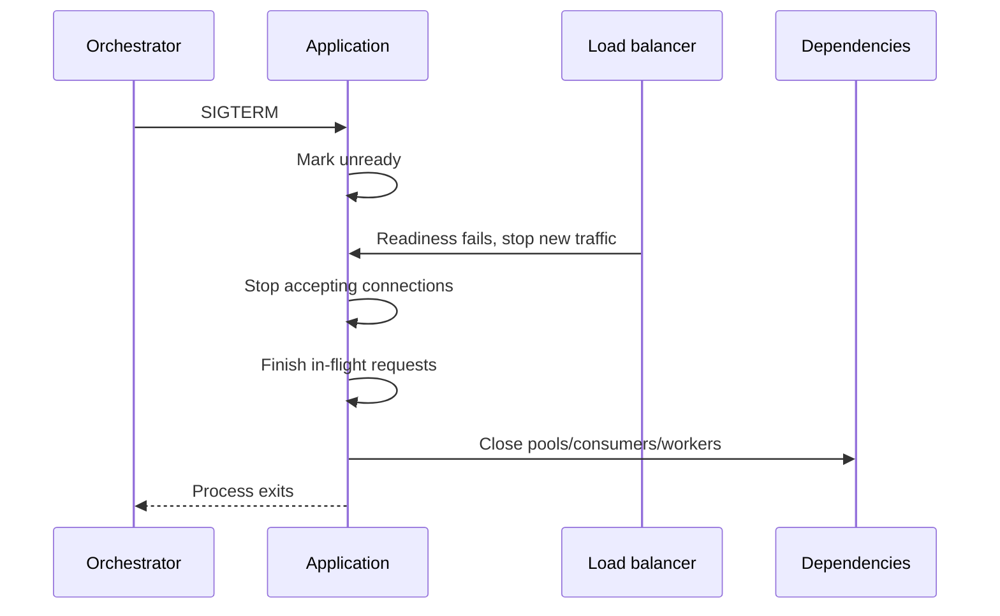

# Production-Ready Node.js Applications

## Contents

1. [Production readiness mental model](#_1-production-readiness-mental-model)
2. [Where Node.js applications run](#_2-where-node-js-applications-run)
3. [The Twelve-Factor App](#_3-the-twelve-factor-app)
4. [Configuration management](#_4-configuration-management)
5. [Startup and application lifecycle](#_5-startup-and-application-lifecycle)
6. [Structured logging](#_6-structured-logging)
7. [Request logging and correlation IDs](#_7-request-logging-and-correlation-ids)
8. [Health, readiness, and startup checks](#_8-health-readiness-and-startup-checks)
9. [Graceful shutdown](#_9-graceful-shutdown)
10. [Application and process-level errors](#_10-application-and-process-level-errors)
11. [Security headers and TLS](#_11-security-headers-and-tls)
12. [CORS](#_12-cors)
13. [Rate limiting, proxies, and overload](#_13-rate-limiting-proxies-and-overload)
14. [Observability and production testing](#_14-observability-and-production-testing)
- [Graduated practice: logging and lifecycle](#graduated-practice-logging-and-lifecycle)
15. [Final review checklist](#_15-final-review-checklist)

---

## Production readiness mental model {#_1-production-readiness-mental-model}

A useful production lifecycle is:

```mermaid
flowchart LR
    B[Build artifact] --> S[Start]
    S --> C[Validate configuration]
    C --> D[Connect dependencies]
    D --> R[Ready for traffic]
    R --> O[Serve and observe]
    O --> T[Termination requested]
    T --> N[Become unready]
    N --> F[Finish in-flight work]
    F --> X[Close resources and exit]
```



Production readiness covers several related qualities:

| Quality | Question |
| --- | --- |
| Configurability | Can one build run safely in multiple environments? |
| Observability | Can people understand behavior without attaching a debugger? |
| Reliability | Does the process handle expected failures and lifecycle events? |
| Security | Are trust boundaries protected and sensitive information contained? |
| Scalability | Can multiple equivalent instances run concurrently? |
| Operability | Can infrastructure start, probe, drain, stop, and replace an instance? |

### Failure is expected

Production systems regularly experience:

- invalid configuration;
- slow or unavailable databases;
- malformed and hostile requests;
- network timeouts;
- deployments and scaling events;
- exhausted pools or queues;
- uncaught programming errors;
- process and machine termination.

The goal is not to pretend these events can be eliminated. The goal is to detect them, limit their impact, recover predictably, and preserve enough evidence to diagnose them.

### The process is not the availability strategy

A Node.js process should shut down when it cannot continue safely. A supervisor, container platform, or serverless platform is responsible for replacement and restart. An application should not implement an uncontrolled self-restart loop.

---

## Where Node.js applications run {#_2-where-node-js-applications-run}

### Single server or virtual machine

One or more Node.js processes run directly on a host. A service manager such as systemd or a process manager can start the app after reboot and restart it after failure.

**Use it when:** the system is small, infrastructure is simple, and one host's availability or a planned active/passive design is acceptable.

**Operational concerns:** host patching, runtime installation, process supervision, log collection, TLS termination, backups, and single-host failure.

### Multiple instances behind a load balancer

```text
clients → load balancer → instance A
                      ├→ instance B
                      └→ instance C
```

A load balancer routes traffic only to ready instances. Horizontal scaling assumes instances are interchangeable.

Keep durable state outside process memory:

- sessions in a shared session store;
- files in object storage;
- jobs in a durable queue;
- application data in a database;
- distributed coordination in a suitable external system.

In-memory caches are still useful, but correctness must not depend on every instance having identical cache contents.

### Containers and orchestrators

A container image packages the application artifact, production dependencies, and runtime assumptions. An orchestrator schedules replicas, replaces failed containers, distributes configuration, and coordinates rollout.

Containers do not automatically provide:

- secure images;
- correct health checks;
- graceful shutdown;
- resource limits;
- safe secrets;
- observability;
- data durability.

Those remain application and platform design responsibilities.

### Serverless and function platforms

The platform creates execution environments on demand and manages much of the infrastructure lifecycle.

**Useful for:** event handlers, bursty APIs, scheduled tasks, and independently deployable functions.

**Design consequences:** cold starts, execution limits, platform-specific concurrency, ephemeral local storage, connection reuse between warm invocations, and asynchronous event retry semantics.

Do not start a permanent listener inside a function handler unless the platform explicitly expects that model.

### Select by workload

| Need | Likely starting point |
| --- | --- |
| Simple continuously running API | Managed container or small supervised service |
| Horizontal scaling and rollout control | Containers behind a load balancer/orchestrator |
| Bursty event-driven handler | Serverless function |
| Persistent sockets or long background processing | Long-running service/container |
| Strict infrastructure control | VM/server or managed container platform |

---

## The Twelve-Factor App {#_3-the-twelve-factor-app}

The Twelve-Factor App is a deployment-oriented methodology for applications that should be portable and easy to operate.

| # | Factor | Practical interpretation for Node.js |
| --- | --- | --- |
| I | Codebase | One version-controlled codebase produces many environment deployments |
| II | Dependencies | Declare dependencies and lock resolved versions; do not depend on undeclared host packages |
| III | Config | Keep environment-varying values outside code |
| IV | Backing services | Address databases, caches, queues, and external APIs through replaceable configuration |
| V | Build, release, run | Build once; combine artifact with config for a release; run that immutable artifact |
| VI | Processes | Run stateless, disposable processes; persist durable state externally |
| VII | Port binding | Export the service through an explicitly configured port |
| VIII | Concurrency | Scale by running additional process types or instances |
| IX | Disposability | Start promptly and stop gracefully |
| X | Dev/prod parity | Minimize differences in runtimes, dependencies, and backing-service behavior |
| XI | Logs | Emit event streams; let the platform route and retain them |
| XII | Admin processes | Run migrations and maintenance as explicit one-off commands |

### Build once, configure at runtime

```text
source → build → immutable artifact
                         ├─ development config
                         ├─ staging config
                         └─ production config
```

Rebuilding for every environment increases drift. Prefer one tested artifact promoted through environments, with configuration supplied at runtime.

### Stateless does not mean “no state exists”

It means request correctness does not depend on the memory or local filesystem of one particular instance. Durable state belongs in external systems designed to preserve and coordinate it.

### What Twelve-Factor does not solve

It is not a complete security, reliability, or observability standard. It does not replace:

- threat modeling;
- health/readiness design;
- metrics and tracing;
- backups and disaster recovery;
- capacity planning;
- dependency timeouts and resilience;
- incident response.

Use the factors as architectural guidance, not as proof that a system is production-ready.

---

## Configuration management {#_4-configuration-management}

Configuration is everything that legitimately varies between deployments:

- ports and public URLs;
- database/cache/queue addresses;
- credentials and signing keys;
- timeouts, pool sizes, and log levels;
- feature switches;
- provider identifiers.

### Read from `process.env`

```ts
const portText = process.env.PORT;
const port = portText === undefined ? 3000 : Number(portText);

if (!Number.isInteger(port) || port < 1 || port > 65_535) {
  throw new Error('PORT must be an integer between 1 and 65535');
}
```

**What it does:** converts a string environment value into a number and rejects invalid ports before startup continues.

**When to use it:** all environment values are strings or `undefined`, so explicitly parse and validate every non-string type. Avoid truthiness conversions such as `Boolean(process.env.DEBUG)`, where `'false'` becomes `true`.

### Validate the complete configuration once

```ts
import { z } from 'zod';

const EnvironmentSchema = z.object({
  NODE_ENV: z.enum(['development', 'test', 'production']),
  PORT: z.coerce.number().int().min(1).max(65_535).default(3000),
  LOG_LEVEL: z.enum(['error', 'warn', 'info', 'http', 'debug']).default('info'),
  DATABASE_URL: z.string().url(),
  SHUTDOWN_TIMEOUT_MS: z.coerce.number().int().min(1).max(2_147_483_647).default(20_000),
  TRUST_PROXY: z.enum(['true', 'false']).default('false'),
});

const parsed = EnvironmentSchema.safeParse(process.env);

if (!parsed.success) {
  console.error('Invalid application configuration', parsed.error.flatten().fieldErrors);
  process.exitCode = 1;
  throw new Error('Configuration validation failed');
}

export const config = {
  environment: parsed.data.NODE_ENV,
  port: parsed.data.PORT,
  logLevel: parsed.data.LOG_LEVEL,
  databaseUrl: parsed.data.DATABASE_URL,
  shutdownTimeoutMs: parsed.data.SHUTDOWN_TIMEOUT_MS,
  trustProxy: parsed.data.TRUST_PROXY === 'true',
} as const;
```

**What it does:** validates the entire environment at startup and exports a typed application-facing configuration object.

**When to use it:** use one configuration boundary before creating pools or opening the HTTP port. Downstream modules should consume validated config instead of repeatedly reading `process.env`.

Do not print secret values when reporting validation errors. Field names and validation messages are usually sufficient.

### `.env` files

For local development, Node.js can load a file at startup:

```bash
node --env-file=.env dist/server.js
```

Or an application can use a loader such as `dotenv` before importing modules that need configuration.

**What it does:** populates `process.env` from a local key-value file.

**When to use it:** `.env` files are convenient for local development and isolated tests. Production platforms should normally inject configuration and secrets directly rather than bake `.env` files into artifacts or images.

An `.env.example` may document required keys with empty or obviously fake values. Never commit real credentials.

### Configuration principles

- Fail before listening when required configuration is invalid.
- Keep defaults only for values with a genuinely safe default.
- Do not default secrets, production database URLs, or trust decisions.
- Keep secrets out of source, images, test snapshots, logs, and client bundles.
- Rotate credentials and keys without rebuilding application code.
- Treat feature flags as configuration with owners and removal dates, not permanent branches.
- Keep environment names coarse; prefer independent variables over giant `if production` blocks.

---

## Startup and application lifecycle {#_5-startup-and-application-lifecycle}

Separate application construction from process startup:

```ts
// app.ts
import express from 'express';

export function createApp(dependencies: Dependencies) {
  const app = express();
  app.use(express.json({ limit: '100kb' }));
  app.use(createRoutes(dependencies));
  app.use(errorHandler);
  return app;
}
```

```ts
// server.ts — composition shape; imported adapters own the listed contracts
import { createServer } from 'node:http';
async function start(): Promise<void> {
  const config = loadConfig();
  const logger = createLogger(config);
  const database = await connectDatabase(config.databaseUrl);
  let server: ReturnType<typeof createServer> | undefined;
  try {
    const app = createApp({ config, logger, database });
    server = createServer(app);
    // Runtime owner is present before listen; it acts only after successful startup.
    let running = false;
    server.on('error', error => {
      if (running) void initiateFatalShutdown(error);
    });
    await listenReady(server, config.port, '0.0.0.0');
    installShutdownHandlers({ server, database, logger, config }); // Adapter to section9 contract.
    running = true;
    logger.info('server.started', { port: config.port });
  } catch (startupError) {
    const failures: unknown[] = [startupError];
    if (server?.listening) {
      try { await closeServer(server); } catch (error) { failures.push(error); }
    }
    try { await database.close(); } catch (error) { failures.push(error); }
    throw new AggregateError(failures, 'Application startup failed');
  }
}
void start().catch(() => {
  // Report through a safe diagnostic adapter, not raw configuration/driver text.
  console.error('Application startup failed');
  process.exitCode = 1;
});
```

**What it does:** validates and initializes dependencies before accepting traffic, while keeping the Express app importable without binding a port.

**When to use it:** use this composition-root pattern for long-running services. It makes dependency ownership, startup failure, integration testing, and cleanup explicit.

<<< ../workbench/node-js/runtime/operations/listen-ready.ts

A listen callback is not an error callback. EADDRINUSE arrives through the server error event after listen returns. The helper owns startup listeners until one outcome and removes them; a separate runtime error owner remains for the running server. connectDatabase must close its partially-created pool if connection itself rejects. The composition-root catch owns resources only after that factory successfully hands them over.

Apply a startup deadline and real driver connect/query limits too; a caught rejection does not bound a never-settling operation. The abbreviated composition snippet needs the real readiness/jobs/config adapter from section9, not an unrelated second shutdown implementation.

### Startup ordering

1. Load and validate configuration.
2. Initialize logging/telemetry.
3. Connect required backing services.
4. Build the application and routes.
5. Start listening.
6. Mark the instance ready.

Starting the listener before critical dependencies are usable creates a window where traffic reaches an unready process.

### Migrations

Run schema migrations as a separate release/admin process rather than from every application replica at startup. Automatic concurrent migration by multiple instances can race, extend startup unpredictably, and mix deployment control with request serving.

Design migrations for rolling deployment compatibility:

- expand schema before new code depends on it;
- deploy compatible code;
- backfill data separately when needed;
- remove obsolete fields only after old code is gone.

---

## Structured logging {#_6-structured-logging}

A production log is an event record intended for machines and people. Structured logs encode stable fields instead of hiding context inside prose.

```json
{
  "timestamp": "2026-10-20T12:00:00.000Z",
  "level": "info",
  "message": "request.completed",
  "requestId": "01J...",
  "method": "GET",
  "route": "/products/:id",
  "statusCode": 200,
  "durationMs": 18.4
}
```

### Log levels

| Level | Use |
| --- | --- |
| `error` | Operation or component failed and requires attention |
| `warn` | Unexpected or degraded condition that was handled |
| `info` | Important lifecycle and business events |
| `http` | Request completion events if the logger defines this level |
| `debug` | Detailed diagnostic context disabled by default in production |

Do not log every normal internal function call. High-volume noise raises cost and hides important events.

### Winston logger

```ts
import winston from 'winston';

export function createLogger(config: { logLevel: string }) {
  return winston.createLogger({
    level: config.logLevel,
    format: winston.format.combine(
      winston.format.timestamp(),
      winston.format.errors({ stack: true }),
      winston.format.json(),
    ),
    transports: [new winston.transports.Console()],
  });
}
```

**What it does:** emits timestamped JSON records to the process output stream and preserves stack traces when an `Error` object is logged.

**When to use it:** console JSON is a strong default in containers and managed platforms, where infrastructure collects, stores, indexes, and rotates output. Direct file transports require rotation, disk monitoring, and multi-instance collection.

Pino is another common choice with an emphasis on low overhead. The important properties are stable structure, levels, redaction, context, and integration with the operating environment—not the brand of logger.

### Project nested errors explicitly

Winston/logform errors({ stack: true }) handles an Error as the log record or its message; it does not recursively serialize arbitrary metadata.error. Raw Error fields are often non-enumerable, so JSON can lose them. Conversely, blindly copying enumerable driver fields can leak SQL, tokens or request bodies. Select the diagnostic contract deliberately.

<<< ../workbench/node-js/runtime/operations/safe-errors.ts

```ts
try {
  await inventory.reserve(productId);
} catch (cause) {
  const error = new DiagnosticError('INVENTORY_REJECTED', cause);
  logger.error('inventory.reserve_failed', { error: serializeError(error) });
  throw error;
}
```

**What it does:** records bounded application-owned stack frames and stable code/message, recursively projects at most three owned causes, and replaces untrusted strings/objects/driver Errors with a fixed safe category. Unknown driver details are deliberately absent. This is a small allowlist, not a generic secret-removal algorithm. Add reviewed domain codes as needed; never choose them from request text. Do not mistake a preserved cause category for the complete original driver error.

**When to use it:** log at the layer owning recovery/error translation; avoid duplicate logs at every layer. If restricted diagnostics require raw driver detail, use a separately reviewed adapter/sink and retention/access policy. Stack frames reveal application paths and source positions: keep this server log sink access-controlled; build paths must not contain credentials or personal data. Public responses never include these frames. The WeakMap snapshot prevents later error.message/stack/custom-field mutation from changing the logged projection. A schema/logger boundary remains necessary to prevent unrelated callers from logging raw fields.

### Never log secrets

Redact or omit:

- passwords and password hashes;
- bearer and refresh tokens;
- cookies and session identifiers;
- API keys, database credentials, and private keys;
- authorization headers;
- reset/MFA codes;
- unnecessary personal or payment data.

Prefer allowlisting fields over attempting to blacklist every sensitive field. Apply logger-level redaction as a second defense.

### Audit logs are distinct

Operational logs diagnose software. Audit logs record security- or business-significant actions such as permission changes or financial approvals. Audit events often need stronger integrity, retention, access-control, and privacy guarantees.

Use the [retention and enforced deletion lab](./retention-and-deletion.md) to define actual expiry/access/deletion rules for data, projected logs, sessions and temporary uploads. It includes bounded PostgreSQL cleanup, local-file retry behavior and explicit derivative/backup limits; naming retention alone is insufficient.

---

## Request logging and correlation IDs {#_7-request-logging-and-correlation-ids}

### Request completion middleware

```ts
import { performance } from 'node:perf_hooks';
import type { NextFunction, Request, Response } from 'express';

export function requestLogger(req: Request, res: Response, next: NextFunction) {
  const startedAt = performance.now();
  let completed = false;

  res.once('finish', () => {
    completed = true;
    logger.info('request.completed', {
      requestId: res.locals.requestId,
      method: req.method,
      route: typeof req.route?.path === 'string' ? req.route.path : 'unmatched',
      statusCode: res.statusCode,
      durationMs: performance.now() - startedAt,
    });
  });

  res.once('close', () => {
    if (!completed) {
      logger.warn('request.aborted', {
        requestId: res.locals.requestId,
        method: req.method,
        route: typeof req.route?.path === 'string' ? req.route.path : 'unmatched',
        durationMs: performance.now() - startedAt,
      });
    }
  });

  next();
}
```

**What it does:** records successful response completion and distinguishes a connection that closes before the response finishes.

**When to use it:** register it before routes. Avoid raw URLs when query strings may contain secrets or high-cardinality identifiers; prefer a normalized route template where available.

### Correlation IDs

A request ID connects events produced by one request. Do not trust arbitrary inbound IDs without limits: validate length and format, and decide which proxies are allowed to supply them.

```ts
import { randomUUID } from 'node:crypto';

function chooseRequestId(value: string | undefined): string {
  return value && /^[A-Za-z0-9._-]{1,100}$/.test(value)
    ? value
    : randomUUID();
}
```

**What it does:** accepts a bounded safe identifier or generates a new UUID.

**When to use it:** accept upstream correlation only from a trusted gateway or treat it as untrusted metadata. A request ID helps search logs; it is not authentication or a security token.

### AsyncLocalStorage

```ts
import { AsyncLocalStorage } from 'node:async_hooks';

interface RequestContext {
  requestId: string;
}

export const requestContext = new AsyncLocalStorage<RequestContext>();

export function contextMiddleware(
  req: Request,
  res: Response,
  next: NextFunction,
) {
  const requestId = chooseRequestId(req.get('x-request-id'));
  res.locals.requestId = requestId;
  res.setHeader('x-request-id', requestId);

  requestContext.run({ requestId }, next);
}

export function currentRequestId(): string | undefined {
  return requestContext.getStore()?.requestId;
}
```

**What it does:** keeps request context available across promises and callbacks created inside the request without passing the ID through every function signature.

**When to use it:** use `AsyncLocalStorage` for logging/tracing context, not as a hidden container for arbitrary business dependencies. Some unusual callback libraries may require explicit context binding or propagation tests.

### Correlation versus distributed tracing

A request ID groups local logs. Distributed tracing models a request across services with trace and span identifiers, parent-child relationships, durations, and attributes. Adopt OpenTelemetry or platform tracing when cross-service latency and causality matter.

---

## Health, readiness, and startup checks {#_8-health-readiness-and-startup-checks}

Health endpoints are machine-facing signals with operational consequences. A bad probe can create a restart loop or remove every replica during a shared dependency failure.

### Three different questions

| Probe | Question | Typical failure action |
| --- | --- | --- |
| Startup | Has initialization completed yet? | Delay other probes; restart only after startup budget is exhausted |
| Liveness | Is this process making progress, or must it be replaced? | Restart the instance |
| Readiness | Should this instance receive traffic now? | Remove it from load balancing without necessarily restarting |

### Liveness

```ts
router.get('/health/live', (_req, res) => {
  res.status(200).json({ status: 'alive' });
});
```

**What it does:** proves the event loop and HTTP stack can serve a small request.

**When to use it:** liveness should be shallow and should not normally fail merely because a shared database is temporarily unavailable. Restarting every healthy application process will not repair the database and may amplify the outage.

### Readiness state

```ts
class Readiness {
  #acceptingTraffic = false;

  markReady() {
    this.#acceptingTraffic = true;
  }

  markUnready() {
    this.#acceptingTraffic = false;
  }

  get acceptingTraffic() {
    return this.#acceptingTraffic;
  }
}
```

Readiness starts false, becomes true only after initialization, and becomes false before shutdown begins.

### Dependency check with a deadline

```ts
// readiness-probe.ts — one underlying operation, even when a driver ignores deadlines
export function createReadinessProbe(ping: () => Promise<void>, timeoutMs = 500) {
  if (!Number.isInteger(timeoutMs) || timeoutMs < 1 || timeoutMs > 2_147_483_647)
    throw new RangeError('Invalid probe budget');
  let inFlight: Promise<boolean> | undefined;
  return function check(): Promise<boolean> {
    if (inFlight) return inFlight;
    let timer: NodeJS.Timeout;
    const observed = Promise.resolve().then(ping).then(() => true, () => false);
    const deadline = new Promise<boolean>(resolve => {
      timer = setTimeout(() => resolve(false), timeoutMs);
    });
    inFlight = Promise.race([observed, deadline]);
    // Do not release the slot when only the caller's deadline fires.
    void observed.then(() => { clearTimeout(timer); inFlight = undefined; });
    return inFlight;
  };
}
const checkDatabase = createReadinessProbe(() => database.ping(), 500);
router.get('/health/ready', async (_req, res) => {
  const ready = readiness.acceptingTraffic && await checkDatabase();
  // Shutdown may have begun while the dependency check was pending.
  return res.status(ready && readiness.acceptingTraffic ? 200 : 503)
    .json({ status: ready && readiness.acceptingTraffic ? 'ready' : 'not_ready' });
});
```

**What it does:** bounds the HTTP wait and shares one underlying operation across concurrent probes. A deadline does not cancel database work. The slot stays occupied until that work settles; a permanently stuck driver therefore keeps readiness false without spawning more pings. This is bounded concurrency and fail-closed behavior, not proof of cancellation. Configure actual connection/acquisition/server-query timeouts in the ping adapter so work also has a finite lifetime.

**When to use it:** include only dependencies required for nearly every request. Optional or feature-specific downstream services should usually have separate metrics rather than control whole-instance readiness.

Where possible, use an actual lightweight operation such as `SELECT 1`, not only a driver's cached “connected” flag.

For the primary PostgreSQL/MikroORM 7.2 path, pass reviewed pg pool options via driverOptions, for example connectionTimeoutMillis:300, statement_timeout:400 and query_timeout:600 (milliseconds), with a bounded pool. Run a real SELECT1 through the same owned pool. PostgreSQL statement_timeout bounds server statement execution; pg query_timeout bounds client query waiting and must not be described as cancelling arbitrary server work. Acquisition/connect has its own budget.

Tune these values for deployment latency and reserve pool capacity; never expose the raw error on the endpoint. Some adapters implement cancellation/connection destruction; verify their actual driver contract rather than attach an unused AbortSignal. A separate tiny health pool avoids starving application work but does not establish the main pool's health. Do not start replacement pings after timeout while an older one still owns a connection.

The [executed container/Compose lab](./container-deployment-lab.md) applies this contract to actual image/startup/readiness/shutdown configuration and a bounded PostgreSQL client owner. Its database-stall test distinguishes HTTP timeout from connection destruction and verifies persistence/replacement. It is a disposable counter fixture, not a production Task Board deployment.

### Probe safety

- Keep handlers fast and bounded by timeouts.
- Do not expose credentials, hostnames, stack traces, or raw dependency errors.
- Avoid authentication if infrastructure cannot provide it, but expose the endpoints only where necessary.
- Do not perform expensive repairs inside the probe.
- Monitor probe failures and duration.
- Configure thresholds to tolerate brief noise without hiding sustained failure.
- Make shutdown set readiness false before draining requests.

---

## Graceful shutdown {#_9-graceful-shutdown}

Graceful shutdown coordinates the process with its traffic manager and resource owners.



### Signals

| Signal | Meaning | Catchable? |
| --- | --- | --- |
| `SIGTERM` | Cooperative termination from platform/process manager | Yes |
| `SIGINT` | Interactive interruption, commonly Ctrl+C | Yes |
| `SIGKILL` | Immediate forced termination | No |

The application deadline must be shorter than the platform's termination grace period.

### Promise wrapper for server close

The complete close helper is included with the coordinated shutdown implementation below. It clears its idle-connection sweep after closure or a synchronous failure.

Modern supported Node.js releases close idle keep-alive connections as part of `server.close()`. The owned sweep additionally handles connections observed becoming idle after drain begins; it is cleared on callback or synchronous failure and never calls closeAllConnections during normal draining. The real Node 24 fixture required this to finish an active-then-idle keep-alive response within its short budget. Upgraded protocols such as WebSockets and arbitrary custom sockets still need explicit ownership and cleanup.

### Coordinated shutdown

<<< ../workbench/node-js/runtime/operations/shutdown.ts

**What it does:** prevents duplicate shutdown, removes the instance from readiness, stops new HTTP work, waits for active requests, closes owned resources, and enforces a final deadline.

**When to use it:** every long-running service needs an ownership list for pools, consumers, schedulers, telemetry exporters, workers, sockets, and timers that must stop.

The jobs adapter stops intake synchronously, then drain settles only after all owned work has stopped using the database. A rejected drain must still mean its workers have stopped; if they cannot stop, keep the drain pending for the final deadline rather than falsely claim release. Cover schedulers, retries, detached promises and upgraded sockets in the ownership inventory. The small example's final forced exit is process-wide; test it only in a child process.

Do not inject process.exit into an ordinary test runner. Validate timeoutMs at startup (positive finite integer shorter than platform grace). Readiness/logger adapters are trusted synchronous nonthrowing operations. Failures are counted and produce a nonzero exit without logging raw error objects; add reviewed diagnostic codes when needed. Cleanup does not report completed when any attempt failed.

### Important subtleties

- Allow time for readiness failure to propagate through the load balancer before expecting traffic to stop.
- Stop consuming new queue jobs before waiting for active jobs.
- Reject new long-running work once draining begins.
- HTTP/2 sessions, WebSockets, server-sent events, and upgraded sockets require protocol-aware draining.
- A completed HTTP response does not guarantee detached background work has finished.
- Prefer natural process exit after handles close; use forced termination only as a bounded last resort.
- Log shutdown phases so timeout failures are diagnosable.

### Test shutdown

[Exercises and learner checklist](../practice/node-js/module-10-production-ready-applications.md).

## Application and process-level errors {#_10-application-and-process-level-errors}

### Global Express error handler

```ts
import type { ErrorRequestHandler } from 'express';

export const errorHandler: ErrorRequestHandler = (error, req, res, next) => {
  if (res.headersSent) {
    return next(error);
  }

  const appError = classifyError(error);

  logger[appError.statusCode >= 500 ? 'error' : 'warn']('request.failed', {
    error: serializeError(error),
    requestId: res.locals.requestId,
    method: req.method,
    route: typeof req.route?.path === 'string' ? req.route.path : 'unmatched',
    statusCode: appError.statusCode,
  });

  res.status(appError.statusCode).json({
    error: {
      code: appError.publicCode,
      message: appError.publicMessage,
      requestId: res.locals.requestId,
    },
  });
};
```

**What it does:** preserves Express's behavior after headers are committed, classifies known errors, projects diagnostics through serializeError, and returns a stable public response without stack traces. Unknown errors retain a safe category; use an explicit reviewed adapter when a known driver needs additional safe evidence.

**When to use it:** register the handler after all routes. Do not infer a meaningful error status from `res.statusCode`; map error classes explicitly.

### Operational and programmer errors

- **Operational errors** are expected failures such as invalid input, missing records, timeouts, and dependency rejection. Handle and translate them.
- **Programmer errors** indicate broken assumptions, such as accessing an impossible state. Continuing may be unsafe.

The boundary is contextual. A connection timeout is expected at the HTTP-client level, but failing every dependency request may make the instance unready.

### Process-level failures

```ts
import { writeSync } from 'node:fs';

type FatalCode = 'UNHANDLED_REJECTION' | 'UNCAUGHT_EXCEPTION';
function writeFatal(code: FatalCode): void {
  // Do not accept a raw exception, message, stack or cause at this boundary.
  try { writeSync(2, `${JSON.stringify({ level: 'fatal', code })}\n`); }
  catch { /* The last-resort sink may itself be unavailable. */ }
}

process.once('unhandledRejection', () => {
  writeFatal('UNHANDLED_REJECTION');
  process.exitCode = 1;
  void initiateFatalShutdown('unhandledRejection'); // Shared, bounded lifecycle owner.
});

// Install once in the executable composition root, never in a reusable library.
process.setUncaughtExceptionCaptureCallback(() => {
  writeFatal('UNCAUGHT_EXCEPTION');
  process.exit(1); // State is unknown: no normal request handling or async cleanup.
});
```

**What it does:** an unhandled rejection starts bounded fatal shutdown with a nonzero exit status. An uncaught exception records only a fixed category and immediately terminates. The synchronous sink accepts no arbitrary error content.

**Why replace the default uncaught reporter here?** Node's default reporter prints the error message/stack. `uncaughtExceptionMonitor` observes an exception but does not suppress that output, so an otherwise safe logger would still leak a credential embedded in an error message. This executable deliberately installs a capture callback to own reporting and exit. Coordinate this process-wide choice with crash-reporting integrations; a second capture callback cannot be installed concurrently. The callback must never resume service. An external supervisor performs replacement.

A stable category alone provides limited diagnosis. At an earlier, controlled operation boundary, capture a reviewed diagnostic code and bounded application-owned frames using the serializer in section 6; never fall back to raw exception text at process level. The runnable application uses the same fixed-code fatal boundary and tests it with a secret sentinel. Fatal events can lose output when stderr itself is unavailable; termination remains mandatory.

### Exit codes

- `0`: intentional successful termination.
- non-zero: startup failure, fatal runtime failure, or shutdown deadline exceeded.

Set `process.exitCode` when cleanup can complete naturally. `process.exit()` can truncate buffered logs and pending operations.

---

## Security headers and TLS {#_11-security-headers-and-tls}

### TLS

Credentials and private data must travel over TLS. In many deployments, a load balancer or reverse proxy terminates TLS and forwards traffic over a protected internal network.

The application still needs to know which proxy is trusted before using forwarded protocol or client-IP headers.

```ts
if (config.trustProxy) {
  app.set('trust proxy', 1);
}
```

**What it does:** tells Express to trust one proxy hop when deriving values such as client IP and protocol.

**When to use it:** configure the exact deployment topology. Blindly trusting all forwarded headers lets direct clients spoof security-relevant values.

### Helmet

```ts
import helmet from 'helmet';

app.disable('x-powered-by');
app.use(helmet());
```

**What it does:** removes an unnecessary framework-identification header and applies a collection of browser security response headers.

**When to use it:** Helmet is a useful baseline for Express. Review its effective headers for the application. A pure JSON API may have different Content Security Policy needs from a server-rendered website.

Security headers are defense in depth. They do not replace input validation, authorization, output encoding, safe cookies, or dependency updates.

Continue with the [worked nonce/hash CSP and report-handler lab](./browser-csp.md) for a per-response HTML policy, bounded projected reports, deployment/third-party decisions and explicit native-browser acceptance. Header presence alone does not demonstrate CSP enforcement.

### Request boundaries

Set limits wherever untrusted data enters:

```ts
app.use(express.json({ limit: '100kb', strict: true }));
app.use(express.urlencoded({ extended: false, limit: '20kb' }));
```

Also bound:

- headers and URL length;
- upload size and file count;
- decompressed size;
- query complexity and pagination size;
- database and outbound HTTP duration;
- concurrent jobs and queued work.

An input can be syntactically valid and still consume unreasonable CPU, memory, connections, or storage.

---

## CORS {#_12-cors}

Cross-Origin Resource Sharing tells browsers which origins may read responses from a different origin. It is not authentication, authorization, a firewall, or protection against non-browser clients.

### Explicit allowlist

```ts
import cors, { type CorsOptions } from 'cors';

const allowedOrigins = new Set([
  'https://app.example.test',
  'https://admin.example.test',
]);

const corsOptions: CorsOptions = {
  origin(origin, callback) {
    if (origin === undefined || allowedOrigins.has(origin)) {
      callback(null, true);
    } else {
      callback(new Error('Origin is not allowed'));
    }
  },
  methods: ['GET', 'POST', 'PUT', 'PATCH', 'DELETE'],
  credentials: true,
  maxAge: 600,
};

app.use(cors(corsOptions));
```

**What it does:** permits credentialed browser access from exact trusted origins and allows requests without an `Origin` header for non-browser clients or same-origin cases.

**When to use it:** use a dynamic allowlist when a browser frontend and API have different origins. Decide deliberately whether origin-less clients should be accepted.

### Important rules

- An origin is scheme + hostname + port.
- If credentials are allowed, the response cannot use wildcard `*` as the allowed origin.
- A wildcard can be appropriate for a genuinely public, non-credentialed API.
- CORS does not stop curl, scripts, compromised clients, or server-to-server calls.
- Preflight caching changes how quickly policy updates reach browsers.
- Keep CORS errors generic and log rejected origins safely.
- CSRF protection is still required when browsers automatically attach authentication cookies.

---

## Rate limiting, proxies, and overload {#_13-rate-limiting-proxies-and-overload}

Rate limiting protects fairness and reduces abuse, but it cannot stop every denial-of-service attack. Upstream gateways/CDNs and infrastructure limits should absorb large attacks before traffic consumes application resources.

### Express limiter

```ts
import { rateLimit } from 'express-rate-limit';

const globalLimiter = rateLimit({
  windowMs: 60_000,
  limit: 300,
  standardHeaders: true,
  legacyHeaders: false,
});

const loginLimiter = rateLimit({
  windowMs: 15 * 60_000,
  limit: 10,
  standardHeaders: true,
  legacyHeaders: false,
  message: { message: 'Too many attempts; try again later' },
});

app.use(globalLimiter);
router.post('/login', loginLimiter, loginHandler);
```

**What it does:** provides a broad request budget and a stricter budget for password guessing.

**When to use it:** tune limits using real traffic, endpoint cost, and abuse patterns. A default in-memory store is per-process and resets on restart; horizontally scaled applications need a suitable shared store or upstream limiter.

### Choosing a key

Possible identities include:

- trusted client IP;
- authenticated user or API-key ID;
- tenant;
- endpoint plus account identifier;
- combinations of network and account signals.

IP-only limiting can punish many users behind NAT and can be bypassed by distributed attackers. Account-only limiting may let an attacker lock out a victim. Combine controls according to the threat.

### Proxy trust

Express may derive `req.ip` from `X-Forwarded-For` when `trust proxy` is enabled. Configure only the number or addresses of known proxies; otherwise an attacker can spoof the value and bypass IP-based controls.

### Overload protection

Rate limits are only one layer. Also use:

- server and proxy request timeouts;
- body/header size limits;
- bounded queues;
- database pool limits;
- outbound dependency deadlines;
- circuit breaking or load shedding where appropriate;
- concurrency caps on CPU- or memory-intensive operations;
- pagination and query-complexity limits.

Rejecting work early with `429` or `503` is often safer than accepting more work than the process can finish.

---

## Observability and production testing {#_14-observability-and-production-testing}

### Logs, metrics, and traces

| Signal | Best at answering |
| --- | --- |
| Logs | What discrete event occurred, with diagnostic context? |
| Metrics | Is behavior changing across time or instances? |
| Traces | Where did one request spend time across components/services? |

They complement each other. Logs alone are poor at fleet-wide rates and percentiles; metrics alone usually lack per-request detail.

### Useful service metrics

- request rate by normalized route and method;
- error rate by status class and stable error code;
- latency histograms and high percentiles;
- active requests and open connections;
- event-loop delay;
- heap, RSS, and external/Buffer memory;
- CPU utilization;
- database pool use and query duration;
- outbound dependency duration/failure;
- queue depth, age, and processing failures;
- readiness state and shutdown duration.

Avoid high-cardinality metric labels such as user IDs, raw URLs, request IDs, or error messages.

### Service-level thinking

Define what users care about before alerts:

- availability of successful valid requests;
- latency of important operations;
- correctness/durability of accepted work;
- freshness of asynchronous processing.

Alert on sustained user impact or exhaustion trends, not every individual error.

### Production-readiness test matrix

| Area | Verification |
| --- | --- |
| Config | Missing/invalid required values fail before listening; secrets are not printed |
| Startup | Dependency failure rejects startup and returns a failing exit code |
| Logging | JSON parses; stack/cause retained; secret fields redacted |
| Request context | Concurrent requests retain distinct correlation IDs |
| Liveness | Remains cheap and independent of ordinary shared dependency outages |
| Readiness | Fails quickly on critical dependency failure and during shutdown |
| Shutdown | Stops new work, completes in-flight work, closes resources, honors deadline |
| Errors | Known failures have stable public codes; unexpected errors hide internals |
| CORS | Allowed, denied, preflight, credentialed, and origin-less cases behave intentionally |
| Rate limiting | Threshold and reset behavior work; multi-instance storage matches deployment |
| Proxy | Client IP/protocol are correct and cannot be spoofed around the trusted proxy |
| Security | Headers present; body limits enforced; sensitive fields absent from logs/responses |

### Load and failure testing

Test more than the happy path:

- sustained expected load and short bursts;
- slow clients and aborted responses;
- dependency latency and timeouts;
- database pool saturation;
- process termination during active requests/jobs;
- rolling deployment with mixed application versions;
- log/telemetry destination failure;
- exhausted disk or memory budgets in a safe test environment.

Measure latency distributions, resource saturation, and recovery—not only total requests per second.

---

## Graduated practice: logging and lifecycle

[Exercises and learner checklist](../practice/node-js/module-10-production-ready-applications.md).

## Final review checklist {#_15-final-review-checklist}

[Exercises and learner checklist](../practice/node-js/module-10-production-ready-applications.md).

### One-minute recap

A production Node.js service starts by validating configuration and connecting critical dependencies before it accepts traffic. It emits structured, redacted events and propagates correlation or trace context so behavior can be reconstructed. Separate startup, liveness, and readiness checks let infrastructure make the correct decision without creating restart cascades. On termination, the service becomes unready, stops accepting work, finishes bounded in-flight operations, closes every owned resource, and exits before the platform deadline.

Stable error contracts hide internal details while logs preserve diagnostic evidence. TLS, reviewed security headers, precise proxy trust, deliberate CORS, distributed rate limiting, and resource bounds form a baseline—not a substitute for application authorization and threat modeling. Logs, metrics, traces, load tests, and failure tests show whether these controls work under real conditions.

Module 11 continues from these operational signals into systematic performance diagnosis. Module 12 continues from retries and dependency failure into queues, idempotent consumers, outbox workflows, caches, circuit breakers, and distributed consistency.

### Further reading

- [The Twelve-Factor App](https://12factor.net/)
- [Node.js environment variables and `.env` files](https://nodejs.org/api/environment_variables.html)
- [Node.js `AsyncLocalStorage`](https://nodejs.org/api/async_context.html)
- [Node.js HTTP server lifecycle](https://nodejs.org/api/http.html)
- [Node.js process events](https://nodejs.org/api/process.html)
- [Kubernetes startup, liveness, and readiness probes](https://kubernetes.io/docs/concepts/workloads/pods/probes/)
- [Express production security practices](https://expressjs.com/en/advanced/best-practice-security.html)
