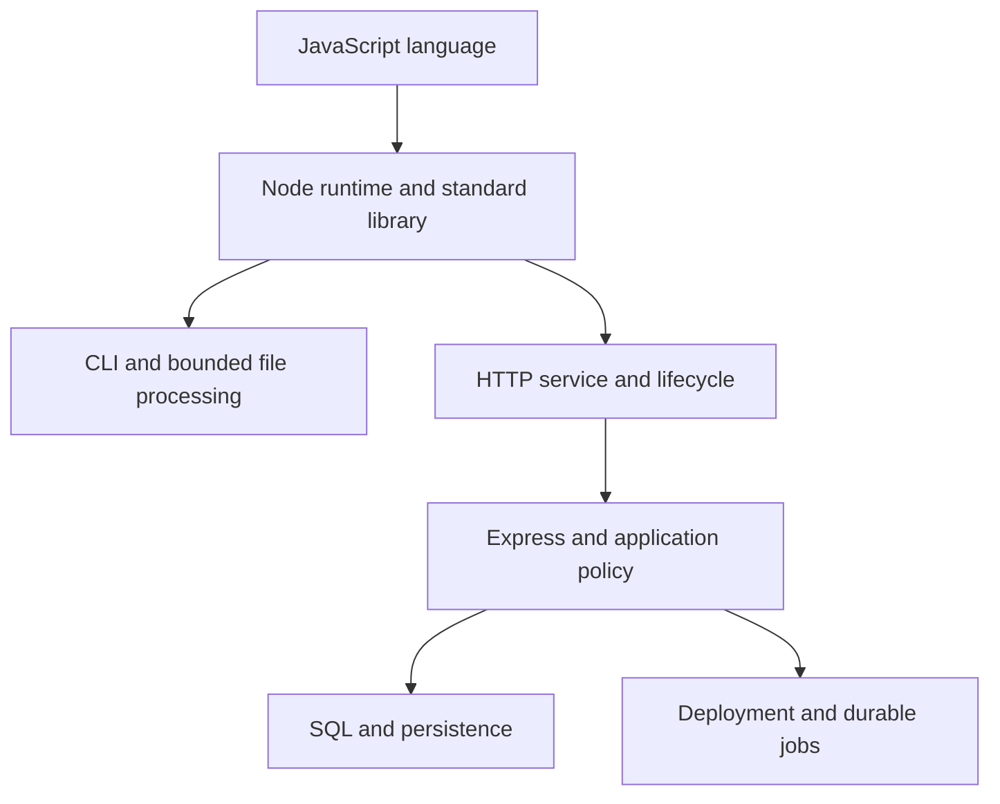

# Node.js prerequisites and topic boundaries

Node.js supplies a host for JavaScript. Language behavior such as closures, promises and object identity is shared with browser JavaScript; filesystem authority, process ownership and libuv scheduling are host-specific.

## Shared language references

| Need | Existing explanation | Boundary to remember |
|---|---|---|
| Bindings, call stack and captured lifetime | [JavaScript execution](../senior_growth/General_ES6/Explain_JavaScript_Code_Execution_177e8106c24d80a0817df62da9bac253.md) | Stack/heap diagrams are conceptual; GC timing is not resource cleanup |
| Promise adoption, derived chains and combinators | [Promises](../senior_growth/General_ES6/What_is_a_Promise_177e8106c24d80b3989df334146152f6.md) | Neither a promise nor `Promise.all` grants cancellation or concurrency limits |
| Sequential dependencies and complete operation lifetimes | [Async/await](../senior_growth/General_ES6/Understanding_async_await_in_JavaScript_177e8106c24d806fb457f53520e2c087.md) | Await does not move synchronous work off-thread |
| Tasks, microtasks and host differences | [Task/microtask reference](../senior_growth/General_ES6/What_are_the_tasks_microtasks_177e8106c24d804f94a8c0f84060cdf2.md) | Use Module 1 for Node phases, nextTick and CJS/ESM context |
| Legacy callback interoperation | [Callback workflow](../senior_growth/Other/What_is_the_callback_hell_How_can_you_avoid_it.md) | An adapter needs error, settlement and lifetime ownership |
| Public module surface and notification buses | [Modules](../senior_growth/Other/What_is_module_How_to_build_communication_between_modules.md) | A custom awaited bus has different semantics from synchronous EventEmitter |
| Interactive exploration | [REPL](../senior_growth/General_ES6/Explain_Read_Eval_Print_Loop_in_NodeJS_177e8106c24d803babd4caa58acdfd5b.md) | REPL scope and `.clear` differ from file evaluation; history/effects can persist |

These are shared references, not additional compulsory projects. Their browser examples and exercises belong to their broader JavaScript topic. The [Node practice map](../practice/node-js/index.md) identifies the runtime-specific work.

## Keep the ownership boundaries visible

HTTP and streams can be learned without a framework. Express adds middleware/routing conventions; it does not provide application authorization. Database transactions and query plans belong to persistence, although their clients must still obey Node cancellation and resource ownership. Deployment controls process replacement and traffic; it does not make unowned timers, unfinished writes or in-memory jobs durable.

Worker threads execute JavaScript in separate isolates in one process. Browser Web Workers are a different host API; libuv's native worker pool is a third mechanism. Neither a thread nor `async` is a filesystem, network or authorization sandbox.

## Essential depth and extensions

The core target is to explain runtime behavior and independently implement/debug a small bounded CLI/HTTP program. Readiness, shutdown and diagnostics complete that program's lifecycle. Add the authenticated PostgreSQL service when backend integration is the goal; add deployment and durable jobs when persistence/recovery needs justify them.

A complete worker-pool framework, multiple databases, a learned agent, a general-purpose file parser and cloud/cluster administration are outside the core completion gate. Their existing introductory/continuation material stays available without becoming a prerequisite to learn Node.js.
