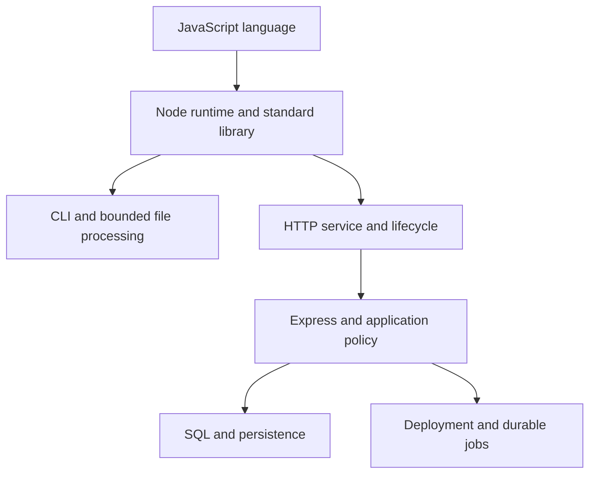

# Node.js prerequisites and topic boundaries

Node provides an environment for running JavaScript. Closures, promises and object identity follow the same language rules as in a browser. **The available APIs and permissions depend on the environment.** Node adds filesystem access, processes and scheduling through libuv; browser JavaScript has different host APIs.

## Shared language references

| Need | Existing explanation | Boundary to remember |
|---|---|---|
| Bindings, call stack and captured lifetime | [JavaScript execution](../senior_growth/General_ES6/Explain_JavaScript_Code_Execution_177e8106c24d80a0817df62da9bac253.md) | Stack/heap diagrams are conceptual; GC timing is not resource cleanup |
| Promise adoption, derived chains and combinators | [Promises](../senior_growth/General_ES6/What_is_a_Promise_177e8106c24d80b3989df334146152f6.md) | Neither a promise nor `Promise.all` grants cancellation or concurrency limits |
| Sequential dependencies and complete operation lifetimes | [Async/await](../senior_growth/General_ES6/Understanding_async_await_in_JavaScript_177e8106c24d806fb457f53520e2c087.md) | Await does not move synchronous work off-thread |
| Tasks, microtasks and host differences | [Task/microtask reference](../senior_growth/General_ES6/What_are_the_tasks_microtasks_177e8106c24d804f94a8c0f84060cdf2.md) | Use Module 1 for Node phases, nextTick and CJS/ESM context |
| Legacy callback interoperation | [Callback workflow](../senior_growth/Other/What_is_the_callback_hell_How_can_you_avoid_it.md) | An adapter needs error, settlement and lifetime ownership |
| Public module surface and notification buses | [Modules](../senior_growth/Other/What_is_module_How_to_build_communication_between_modules.md) | A custom awaited bus has different semantics from synchronous EventEmitter |
| Interactive exploration | [REPL](../senior_growth/General_ES6/Explain_Read_Eval_Print_Loop_in_NodeJS_177e8106c24d803babd4caa58acdfd5b.md) | REPL scope and `.clear` differ from file evaluation; history/effects can persist |

These are shared references, not additional compulsory projects. Their browser examples and exercises belong to their broader JavaScript topic. The [Node practice map](../practice/node-js/index.md) identifies the runtime-specific work.

## Keep the ownership boundaries visible

You can learn HTTP and streams without a framework. Express adds routing and middleware, but your application still checks permissions. Database lessons explain transactions and query plans; their Node clients must also handle cancellation and close connections. Deployment controls traffic and process replacement. **It does not make unfinished writes or in-memory jobs survive a restart**, or clean up timers your code forgot to close.

Worker threads run JavaScript in separate execution environments inside one process. Browser Web Workers use a different API. libuv's native worker pool is a third mechanism used by selected Node operations. **Neither `async` nor a thread creates a security sandbox.** File, network and application permissions still need explicit controls.

## Essential depth and extensions

First, learn to explain runtime behavior and independently build and debug a small CLI or HTTP program with clear limits on input, time and work. Add readiness checks, diagnostics and clean shutdown. Continue to an authenticated PostgreSQL service when you need backend integration. Add deployment and durable jobs when the work must survive restarts and support recovery.

You do not need a complete worker-pool framework, several databases, a learned agent, a general-purpose file parser or cloud/cluster administration to complete the core runtime course. Those introductory and follow-on lessons remain available when you need them.
