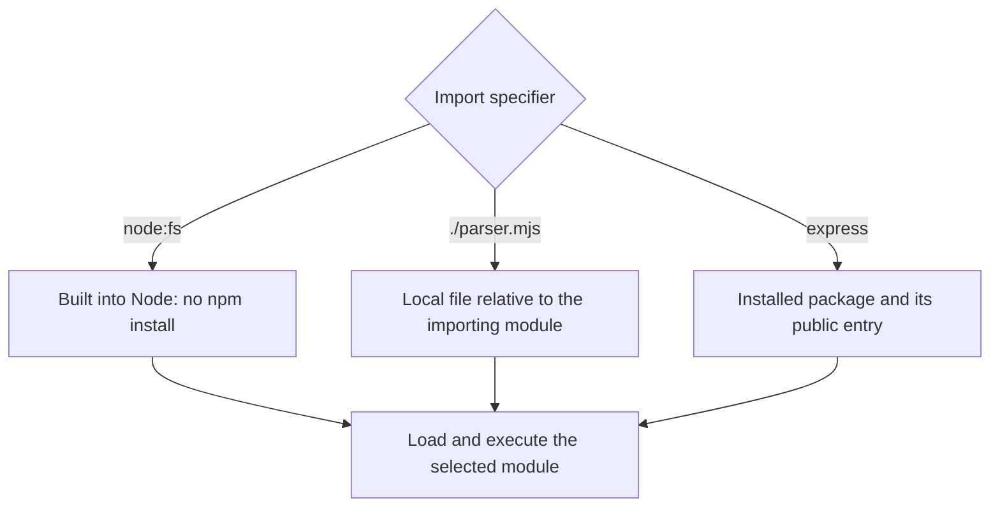
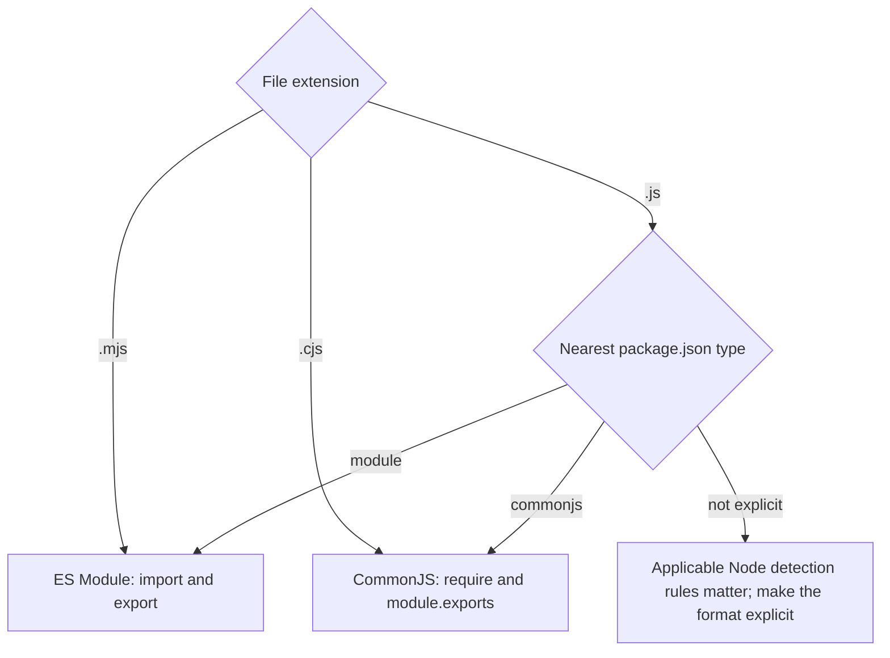
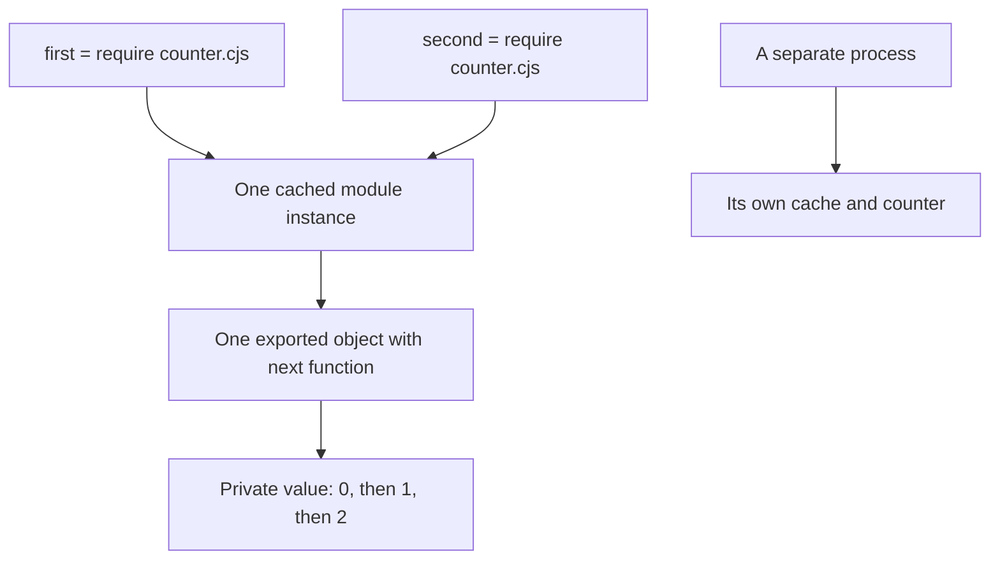
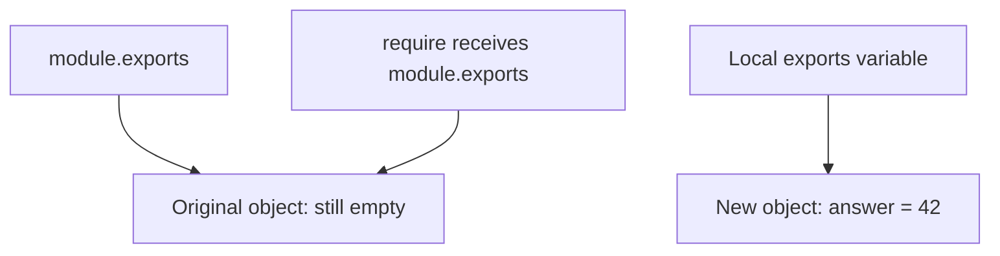
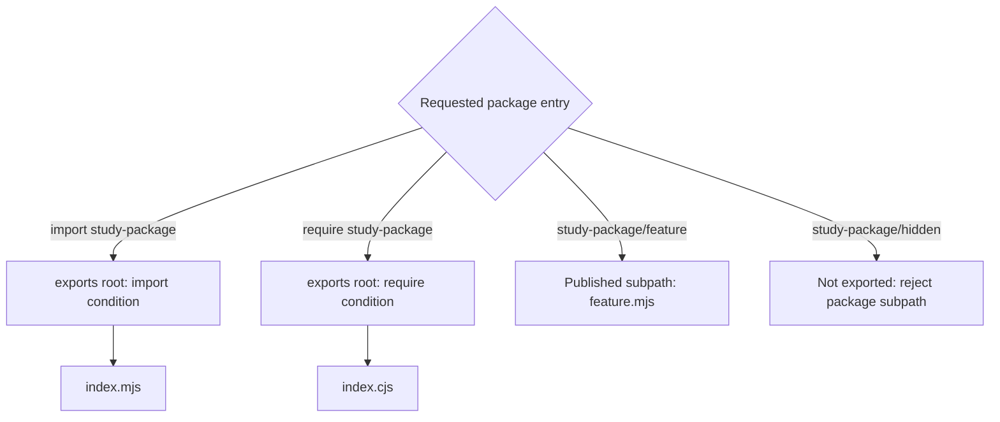
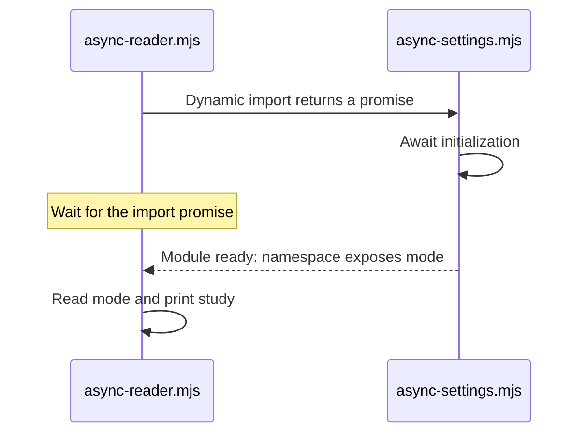
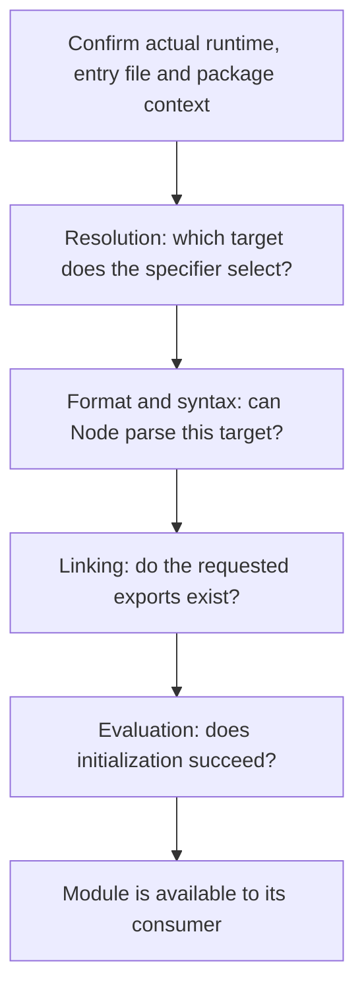
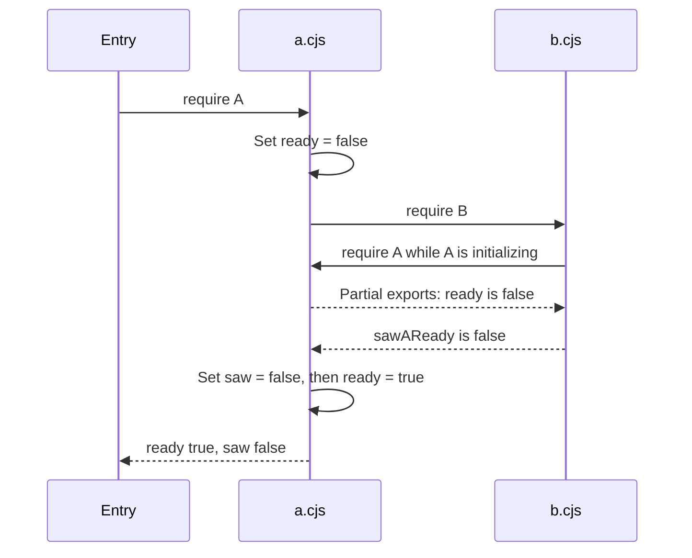

# Modules

Examples target Node 24.18.0. Keep the shown .mjs/.cjs extensions and package.json boundaries: a different module type or transpiler can change the result. All fixture packages below are local teaching files, not registry downloads. Code questions precede their answers.

<span class="notes-section-label">**First pass:**</span> study questions 1–3 and the `exports` assignment distinction in question 4. Run the two-file ESM example before comparing CommonJS. Package conditions, loader bridges, asynchronous module initialization, diagnostic resolvers and cycles in questions 4–8 are second-pass material.

The expandable deeper explanations preserve the additional examples. Common mistakes, examiner follow-ups and key takeaways stay visible outside them. **You can return to them after you can explain and change the starter example.** Career labels describe the eventual assessment target, not what you must master on your first reading.

<!-- tech-check: t03-q01; level: 1 -->

### What is built in, what is a package, and what does an import specifier select?

*Study depth: Foundational*

Level Up: L1 — Junior\
Tech Check level: ⭐

Source mapping: [R003](./requirements.md#r003), [R107](./requirements.md#r107).


<div class="notes-core-answer">

<p class="notes-core-answer__title">Core answer</p>

**Built-in modules come with Node**, such as `node:fs` and `node:http`. Third-party packages are installed separately, usually into `node_modules`. The `node:` prefix makes it clear that you want a built-in module.

An import specifier is the name or path written in an import, such as `'express'` or `'./helper.mjs'`. **A relative import starts from the file doing the importing**, not the directory where you ran the command. Node uses its module-loading rules to find and run the selected code. Finding a file does not guarantee that running it will succeed or that it has permission to access a resource. CommonJS and ES Modules use partly different loading rules.

</div>

<span class="notes-section-label">**Classify the import first**</span>

These arrows show where lookup starts. A successful lookup is followed by loading and execution, which can still fail.




:::: details Deeper explanation and additional examples

<span class="notes-section-label">**Detailed explanation**</span>

An import specifier is the string in import/require. `node:path` names Node's path API. `./parser.mjs` names a local module relative to the importing file. A bare name such as express asks the package resolver for a dependency's public entry. The package manager normally prepares dependencies/lockfiles; importing is not an instruction to install something automatically.

Use an explicit built-in name rather than installing a similarly named registry package. Some built-ins also support unprefixed names, but node: communicates intent and some APIs require it. Native capability and application utility are different: path joins names, it does not authenticate a filesystem user.

A package can wrap the same capabilities while adding a separate maintainer/dependency trust boundary.

<span class="notes-section-label">**Example**</span>

Save as `builtin-check.mjs`:

```js
import {isBuiltin} from 'node:module';
console.log(isBuiltin('node:fs'));
console.log(isBuiltin('./parser.mjs'));
console.log(isBuiltin('express'));
```

The output is true, false, false. isBuiltin answers a classification question; it does not prove a non-builtin exists, is installed, is safe or can load under the current conditions. No express installation is required to classify its name. A typo should lead to diagnosis of the declared dependency, not an automatic install of whatever name an assistant suggested.

For file paths, `./parser.mjs` in `/app/lib/use.mjs` refers to `/app/lib/parser.mjs` even if the process was launched from another directory. Conversely process.cwd-relative filesystem input belongs to the launch context. Do not fix a module-relative import failure by globally changing cwd in a concurrent service.

::::

<span class="notes-section-label">**Common mistakes**</span>

- Assuming every import name is an npm package, or every installed package is trusted host code.
- Importing arbitrary request/model-selected paths as a plugin system without an allowlist and authority decision.
- Treating isBuiltin/resolve success as proof that execution/permissions will succeed.

<span class="notes-section-label">**Examiner follow-ups**</span>

1. <span class="notes-section-label">**Do built-ins need package.json dependencies?**</span> No registry install is needed for them; the Node runtime version still determines API availability.
2. <span class="notes-section-label">**What if the name contains a slash?**</span> It can identify a scoped package/subpath or local path depending on its syntax. Package exports and relative-specifier rules decide what is exposed.
3. <span class="notes-section-label">**Why use one import convention consistently?**</span> Explicit node: names and file extensions reduce ambiguity when reading failures or migrating between toolchains; they are not a security policy by themselves.

::: tip Key takeaway
Classify the specifier first: built-in capability, local module and external package have different resolution and trust contracts.
:::


---

<!-- tech-check: t03-q02; level: 1 -->

### How do CommonJS and ES Modules differ, and how do you choose the file's mode?

*Study depth: Intermediate*

Level Up: L1 — Junior\
Tech Check level: ⭐

Source mapping: [R004](./requirements.md#r004), [R108](./requirements.md#r108).


<div class="notes-core-answer">

<p class="notes-core-answer__title">Core answer</p>

Node supports two module systems. **CommonJS uses `require()` and `module.exports`; ES Modules use `import` and `export`.** CommonJS normally loads dependencies synchronously. ESM connects imports to exports before running module code and can use top-level `await` during initialization.

**Use `.cjs` for CommonJS and `.mjs` for ESM.** For `.js`, Node considers the nearest `package.json` and its `type`, as well as applicable syntax-detection rules. Make the intended format explicit.

For your first program, choose ESM and use the `.mjs` examples below. The deeper explanation covers how the two systems can work together.

</div>

<span class="notes-section-label">**Choose an explicit module format**</span>

This is a guide for ordinary files. Explicit extensions avoid depending on ambiguous-input detection.




<span class="notes-section-label">**Start here — one working example**</span>

Save these two files in the same folder.

`greeting.mjs`:

```js
export function greet(name) {
  return `Hello, ${name}!`;
}
```

`main.mjs`:

```js
import { greet } from './greeting.mjs';

console.log(greet('Alice'));
```

Run `node main.mjs`. It prints `Hello, Alice!`. `export` makes the function available to another file; `import` brings it into this one. The `./` means the same folder as the importing file. Include the `.mjs` extension. Learn this ESM pattern first, then compare it with CommonJS below.


:::: details Deeper explanation and additional examples

<span class="notes-section-label">**Detailed explanation**</span>

CommonJS evaluates a function-wrapped module when required and returns its exported value. ESM creates module bindings during linking, then evaluates the dependency graph. A named ESM import is a binding, not permission to assign a value to the exporting module's variable. Neither system makes a top-level file operation safe to run at import time.

For a package with `"type":"module"`, ordinary .js files in that package scope are ESM; `"type":"commonjs"` explicitly selects CommonJS. .mjs/.cjs are explicit exceptions. Current Node can detect syntax in some ambiguous inputs, but relying on fallback/detection makes migrations confusing.

Prefer a deliberate package type and known emitted extensions; a compiler's source import syntax does not alone determine the runtime output mode. --input-type configures string/stdin input, not a fix for every file-mode problem.

<span class="notes-section-label">**Example — equivalent small exports**</span>

`value.cjs`:

```js
module.exports = {answer: 42};
```

`read-cjs.cjs`:

```js
const value = require('./value.cjs');
console.log(value.answer);
```

`value.mjs`:

```js
export const answer = 42;
```

`read-esm.mjs`:

```js
import {answer} from './value.mjs';
import legacy from './value.cjs';
console.log(answer, legacy.answer);
```

The CommonJS entry prints `42`. The ES module entry prints `42 42` on one line because it logs both the named ESM export and the CommonJS export’s `answer` property. The default import of a CJS module reliably represents its module.exports interop value; named CJS exports rely on Node's analysis and should not be assumed for every dynamically constructed export. Do not copy a destructured require into a named ESM import without checking the package's declared interface.

In Node 24.18, `require('./value.mjs')` can obtain this synchronous module's namespace. A graph containing top-level await cannot finish synchronously and is a different case, examined in Q06. Cross-version/package-tooling support must be checked instead of applying a historical blanket rule. Keep the primary application mode coherent and place deliberate bridges at narrow boundaries.

::::

<span class="notes-section-label">**Common mistakes**</span>

- Treating .js as universally CommonJS or universally ESM regardless of package/runtime context.
- Using require/module.exports inside an ordinary .mjs module without an explicit bridge.
- Assuming every CJS property is available as a static ESM named export.
- Replacing one import spelling while ignoring emitted files, package exports and runtime support.

<span class="notes-section-label">**Examiner follow-ups**</span>

1. <span class="notes-section-label">**Can import be conditional?**</span> Static import declarations are top-level declarations. Dynamic import(...) is an expression returning a promise and can be conditionally invoked; it has different failure timing.
2. <span class="notes-section-label">**Does ESM mean all imported work runs in parallel?**</span> No. Dependency linking/evaluation and explicit async work have their own ordering; CPU execution is not automatically offloaded.
3. <span class="notes-section-label">**What should a mixed repository do first?**</span> Inspect nearest package.json/type, actual extensions, package exports and the executed build artifact; then choose a small intentional interop boundary.

::: tip Key takeaway
Module mode is a runtime/package contract, and CJS/ESM interop must be checked against the actual graph and Node version.
:::


---

<!-- tech-check: t03-q03; level: 1 -->

### Are top-level variables global, and what does the module cache share?

*Study depth: Intermediate*

Level Up: L1 — Junior\
Tech Check level: ⭐

Source mapping: [R005](./requirements.md#r005), [R025](./requirements.md#r025).


<span class="notes-section-label">**Code question — attempt first**</span>

Create these two CommonJS files and predict the output of `node cache-reader.cjs`.

`counter.cjs`:

```js
let value = 0;
module.exports = {next: () => ++value};
```

`cache-reader.cjs`:

```js
const first = require('./counter.cjs');
const second = require('./counter.cjs');
console.log(first === second);
console.log(first.next(), second.next());
```

<div class="notes-core-answer">

<p class="notes-core-answer__title">Core answer</p>

**Variables declared at the top of a module belong to that module.** They do not automatically become global variables or properties of `globalThis`. This applies to both CommonJS and ESM.

Node normally caches a CommonJS module after loading it. **Code that requires the same resolved file shares its exported values**, including mutable objects. Separate processes have separate caches, and separate installed copies of a package can have separate state. Be careful with module-level user data: two requests may use the same module, so one user's data could become visible to another.

</div>

<span class="notes-section-label">**Picture the cached instance**</span>

Within one process, both requires of the same resolved CommonJS file reach one exported object and one private counter.




:::: details Deeper explanation and additional examples

<span class="notes-section-label">**Detailed explanation**</span>

The first line is `true`. The second line is `1 2`. Both requires resolve to the same cached module instance. Its private value variable is not a global property, but both exported closures reach the same value. Private scope therefore does not mean “fresh state for each request.” A module-level currentUser or unbounded Map can leak data/state between otherwise independent requests in a long-lived server.

CommonJS wrapper facilities such as require, module, exports, __filename and __dirname belong to that module context; they are not a universal browser-style global API. Ordinary ESM does not supply those CJS locals. On this baseline import.meta.url/filename/dirname describe the ESM file context.

Host globals such as process/Buffer and globalThis are a different category; Node having some web-compatible globals does not supply a page DOM.

In CommonJS, resolution/caching is normally based on the resolved file. Different installed copies or resolved identities can produce different instances. ESM maintains its own URL-based module identity/cache; query/fragment differences can produce distinct module loads. Neither cache is a distributed state store.

A forked process has another heap/cache, and server replicas will not share an ordinary module Map.

For ESM, importing an exported mutable binding observes updates to that binding. Destructuring a primitive from a CommonJS export object takes the value at that point, not an automatic live connection to later replacements. Prefer small explicit interfaces rather than rely on interop details for a state synchronization protocol.

Q08 examines cycles/initialization and why cache manipulation is not ordinary business recovery.

<span class="notes-section-label">**Example — explicit ownership alternative**</span>

Instead of exporting one shared counter, export a factory:

```js
export function createCounter() {
  let value = 0;
  return {next: () => ++value};
}
```

A composition owner chooses whether to construct one counter per application, job or test. A real per-user repository still needs authenticated scope and durable storage when required. Factories provide explicit instance lifetime, not authorization or cross-process consistency.

Conversely an app-owned reusable immutable configuration or connection-pool owner can intentionally be shared; “all module state is bad” is another overgeneralization.

::::

<span class="notes-section-label">**Common mistakes**</span>

- Assuming top-level means browser-window/global state in every runtime.
- Storing the current request's principal in a singleton module variable.
- Assuming imports across two processes share a Map or that two package copies share one pool.
- Cache-busting every request with a new URL and accumulating module instances.

<span class="notes-section-label">**Examiner follow-ups**</span>

1. <span class="notes-section-label">**Can globalThis make a value process-wide?**</span> It can expose it to code in that global context, but gives no request isolation, persistence or safe concurrency protocol. Avoid it for private request state.
2. <span class="notes-section-label">**Why do tests sometimes pass alone and fail together?**</span> Shared module/cache state may survive between cases. Prefer owned instances and isolated resources rather than depending on test order.
3. <span class="notes-section-label">**Can different import specifiers refer to the same module?**</span> They can after resolution; apparently similar specifiers can also resolve differently. Inspect actual identity before assuming sharing or duplication.

::: tip Key takeaway
Module-private variables can still be shared through a cached instance; define the owner and lifetime of mutable state explicitly.
:::


---

<!-- tech-check: t03-q04; level: 1 -->

### What is the CommonJS module object, and why does assigning exports sometimes do nothing?

*Study depth: Intermediate*

Level Up: L3 — Senior\
Tech Check level: ⭐

Source mapping: [R027](./requirements.md#r027).


<span class="notes-section-label">**Code question — attempt first**</span>

`broken.cjs` contains `exports = {answer: 42}`. A separate file logs `require('./broken.cjs').answer`. What happens, and what is the smallest correction?

<div class="notes-core-answer">

<p class="notes-core-answer__title">Core answer</p>

In CommonJS, `module` describes the current module. **`module.exports` is the value other files receive from `require()`.** At first, `exports` points to that same object, so `exports.name = value` adds an exported property.

**`exports = value` only changes the local variable.** It does not replace what other files receive. To replace the exported value, assign `module.exports = value`.

The built-in `node:module` module is a different thing: it provides tools such as `createRequire()` and `isBuiltin()`. Ordinary application modules do not need a custom loader.

</div>

<span class="notes-section-label">**See why reassigning exports fails**</span>

The arrows show the references after `exports = { answer: 42 }`. Only module.exports determines what require returns.




:::: details Deeper explanation and additional examples

<span class="notes-section-label">**Detailed explanation**</span>

The broken example logs undefined. It leaves the original exported object in place. Either `exports.answer = 42` mutates that original object, or `module.exports = {answer: 42}` replaces the exported value. If you replace module.exports, the old exports alias does not automatically rebind. Treat this as ordinary object/reference behavior, not a mysterious asynchronous race.

Useful CommonJS metadata includes module.filename, loaded and paths. loaded is false while that module's initial evaluation is in progress; the search-path metadata is diagnostic, not an application access-control list. require.main === module can identify a CommonJS entry, but is not the universal entry test for all ESM/interoperability contexts.

ESM has import.meta metadata; do not invent a global module object there.

<span class="notes-section-label">**Example — deliberate CJS bridge from ESM**</span>

Save `legacy-settings.cjs`:

```js
module.exports = {mode: 'study'};
```

Save `bridge.mjs` alongside it:

```js
import {createRequire, isBuiltin} from 'node:module';
const require = createRequire(import.meta.url);
const settings = require('./legacy-settings.cjs');
console.log(settings.mode, isBuiltin('node:path'));
```

It prints study true. createRequire creates a require function anchored to an explicit module URL/path, rather than borrowing whichever entry's search context happens to be available. A normal ESM default import of this CJS object would also work; use the bridge only when a require-based integration actually needs it.

It does not bypass package exports, missing dependencies or the synchronous-loading limitation of an async ESM graph.

The broader node:module API includes built-in-name metadata and version-sensitive customization/compile-cache facilities. These target tooling or measured startup needs, not a replacement for ordinary import/export or runtime permissions. Verify support before adopting hooks and do not use deprecated require.extensions as a general modern compiler pipeline.

Module compile caching concerns compiled code/startup work, not a database/query cache or permission policy.

::::

<span class="notes-section-label">**Common mistakes**</span>

- Reassigning exports and assuming module.exports changed too.
- Importing node:module and expecting its object to be the current module.exports.
- Treating module.paths or a loader hook as a security sandbox.
- Changing global loader behavior to patch a simple wrong file path or package type.

<span class="notes-section-label">**Examiner follow-ups**</span>

1. <span class="notes-section-label">**Can module.exports be a function?**</span> Yes; require returns that exported value. Consumers must match the documented public API rather than assume every dependency exports an object.
2. <span class="notes-section-label">**Why might a late module.exports replacement surprise a caller?**</span> A caller may already hold the previous object/value. Design explicit asynchronous initialization instead of replacing the API later behind consumers' backs.
3. <span class="notes-section-label">**Does createRequire install a missing package?**</span> No. It uses require resolution/loading from its anchor; dependency installation remains a package-management action.

::: tip Key takeaway
exports is an initial alias, module.exports is the public value, and node:module is a separate documented tooling API.
:::

<span id="batch-b04-progress"></span>


---

<!-- tech-check: t03-q05; level: 1 -->

### How do main, exports, imports and package conditions select an entry point?

*Study depth: Intermediate*

Level Up: L3 — Senior\
Tech Check level: ⭐

Source mapping: [R026](./requirements.md#r026), [R108](./requirements.md#r108).


<div class="notes-core-answer">

<p class="notes-core-answer__title">Core answer</p>

In `package.json`, `main` gives the traditional starting file for a package. **`exports` takes priority over `main`** in Node's supported package resolution. It lists the package entry points other code may import. A file can exist inside a package and still be unavailable through a package subpath if it is not exported.

Conditional exports can choose **different files for `import` and `require`**, which may create separate copies of package state. The `imports` field defines private shortcuts beginning with `#` for use inside that package. These fields control module lookup; they do not install packages, check TypeScript types or prevent all direct filesystem access.

</div>

<span class="notes-section-label">**Follow the fixture package entries**</span>

This diagram describes the package.json example below. Its exports mapping selects the entry instead of main.




:::: details Deeper explanation and additional examples

<span class="notes-section-label">**Detailed explanation**</span>

Consider a local fixture directory containing `node_modules/study-package/package.json` plus the files shown below. This simulates an installed package without downloading or publishing anything. Put the consumer entry files in the fixture directory, not inside an unrelated package.

<span class="notes-section-label">**Example — study-package/package.json**</span>

```json
{
  "name": "study-package",
  "type": "module",
  "main": "./legacy.cjs",
  "exports": {
    ".": {"import": "./index.mjs", "require": "./index.cjs"},
    "./feature": "./feature.mjs"
  }
}
```

`study-package/index.mjs`:

```js
export const mode = 'esm';
```

`study-package/index.cjs`:

```js
module.exports = {mode: 'cjs'};
```

`study-package/feature.mjs`:

```js
export const feature = 'bounded';
```

`package-reader.mjs` in the consumer directory:

```js
import {mode} from 'study-package';
import {feature} from 'study-package/feature';
console.log(mode, feature);
```

It prints esm bounded; a .cjs consumer requiring study-package receives mode cjs. main is not the selected root here because exports provides the root contract. If a hidden.mjs file exists but no export maps ./hidden, `import('study-package/hidden')` rejects with ERR_PACKAGE_PATH_NOT_EXPORTED.

This is public-interface encapsulation, not a barrier against a caller already able to open arbitrary absolute filesystem paths.

Conditions are selected by the loader/environment, not by inspecting a request's desired role. Conditional export key order can matter when more than one condition matches; place broad fallback conditions intentionally. Separate CJS/ESM files can instantiate separate caches/singletons.

A library promising shared state needs an intentional shared implementation/bridge and tests across both entry paths, rather than duplicating state by accident.

An application can separately declare a private alias in its own package.json:

```json
{"type":"module","imports":{"#message":"./message.mjs"}}
```

If message.mjs exports a label, an ESM file in that application can import it from #message. The # mapping is scoped to that package; a bare string alias configured only in a bundler/tsconfig is not automatically a Node runtime alias. Compiler declarations/types and package-manager dependency records have other purposes and do not override the actual emitted import target.

::::

<span class="notes-section-label">**Common mistakes**</span>

- Reaching into a dependency's internal path and treating a blocked subpath as an absent installation.
- Assuming main is always consulted despite an applicable exports contract.
- Shipping separate entry files with accidentally divergent singleton/session state.
- Assuming TypeScript's successful alias resolution makes direct node execution resolve the same alias.

<span class="notes-section-label">**Examiner follow-ups**</span>

1. <span class="notes-section-label">**Can exports remove a formerly reachable deep import?**</span> Yes; that can break consumers even if the file remains. Public API/version migration matters, not just file existence.
2. <span class="notes-section-label">**Is a # alias a global registry name?**</span> No. It is an internal mapping in the containing package's imports field, with its own scope/conditions.
3. <span class="notes-section-label">**How would you investigate import working but require failing?**</span> Inspect selected conditions/targets, their existence/module mode and whether the selected graph requires asynchronous evaluation; do not assume both operations select the same file.

::: tip Key takeaway
Package metadata selects public runtime entry contracts, and the same package name can resolve differently under different loading conditions.
:::


---

<!-- tech-check: t03-q06; level: 1 -->

### What are dynamic import and top-level await, and what might “Global Async” mean?

*Study depth: Advanced*

Level Up: L4 — Lead\
Tech Check level: ⭐

Source mapping: [R068](./requirements.md#r068).


<span class="notes-section-label">**Code question — attempt first**</span>

Create `async-settings.mjs` with the following export. Can an ordinary Node 24.18 CommonJS require synchronously obtain it? What should an async consumer do?

```js
export const mode = await Promise.resolve('study');
```

<div class="notes-core-answer">

<p class="notes-core-answer__title">Core answer</p>

**There is no Node API named “Global Async.”** Here, that phrase is interpreted as loading or initializing modules asynchronously; its exact meaning in the source is unclear.

**`import(...)` loads a module and returns a promise** for an object exposing its exports. You can call it conditionally from either CommonJS or ESM. Top-level `await` lets an ES module wait for asynchronous setup before modules depending on it continue.

A synchronous `require()` cannot load a module dependency chain containing top-level `await`; Node 24 reports `ERR_REQUIRE_ASYNC_MODULE`. Keep startup work limited in time, handle setup failures and close anything already opened if setup fails.

</div>

<span class="notes-section-label">**Wait for module readiness**</span>

In the example, the importing code can use mode only after async-settings.mjs finishes its top-level await.




:::: details Deeper explanation and additional examples

<span class="notes-section-label">**Detailed explanation**</span>

Static imports declare dependencies for linking before ordinary module body execution. Dynamic import is an expression whose promise can reject because resolution/linking/evaluation failed. Await its result at an owned boundary; failing to observe it can become an unhandled rejection.

A successful promise yields the namespace object, not automatically a default-exported function. Check the declared export and validate any runtime data returned by a plugin.

Top-level await is not equivalent to marking every function async, nor does it create a global scheduler/thread. It delays the importing graph's readiness. That can simplify one intentional startup dependency, but hidden network/database work in imports makes startup, testing and recovery harder to control.

A promise that never settles or a dependency cycle can leave initialization incomplete. Bound the actual external operation and expose a clear startup failure instead of listening while configuration is unknown.

<span class="notes-section-label">**Example — async-reader.mjs**</span>

```js
try {
  const settings = await import('./async-settings.mjs');
  console.log(settings.mode);
} catch {
  console.error('Configuration unavailable');
  process.exitCode = 1;
}
```

It prints study after the dependency completes. A CommonJS file can also use import inside an async function and handle its promise. In contrast, this diagnostic CJS fixture prints ERR_REQUIRE_ASYNC_MODULE:

```js
try {
  require('./async-settings.mjs');
} catch (error) {
  console.log(error.code);
}
```

That is a graph constraint, not proof that every .mjs file rejects require. Q02's synchronous ESM example succeeds on this Node version. Earlier Node versions/toolchains may differ; inspect actual runtime support and the dependency graph rather than replace imports blindly.

Repeated import of the same resolved ESM identity normally reuses its evaluated module; it does not automatically rerun initialization on every call. Adding random query strings to force reload creates distinct identities and can retain resources/state.

Dynamic plugin selection must use an application allowlist; a user/model choosing an arbitrary specifier gains code-execution authority, not merely a data lookup.

::::

<span class="notes-section-label">**Common mistakes**</span>

- Inventing global.async or a fictional Global Async core module to fit an unclear requirement.
- Calling import without awaiting/observing rejection and reporting success before initialization.
- Treating an unresolved initialization as a completed application configuration.
- Repeating top-level connection creation across several entry identities and assuming module caching deduplicates everything.

<span class="notes-section-label">**Examiner follow-ups**</span>

1. <span class="notes-section-label">**Does Promise.resolve make this graph synchronous for require?**</span> No. The graph contains top-level await; a quick fulfilled value does not change that syntax/evaluation contract.
2. <span class="notes-section-label">**Should every service initialize its pool during import?**</span> Not necessarily. An explicit async factory/composition root can validate config, acquire resources, roll back partial startup and expose a clear close owner.
3. <span class="notes-section-label">**Does import failure undo prior effects?**</span> No. Dependencies may already have run. Files, sockets or remote effects are not rolled back by a rejected module evaluation.

::: tip Key takeaway
Async module evaluation changes graph readiness; handle it with explicit startup ownership rather than an invented global async mechanism.
:::


---

<!-- tech-check: t03-q07; level: 1 -->

### How do you diagnose module-loading failures systematically?

*Study depth: Intermediate*

Level Up: L4 — Lead\
Tech Check level: ⭐

Source mapping: [R026](./requirements.md#r026), [R116](./requirements.md#r116).


<div class="notes-core-answer">

<p class="notes-core-answer__title">Core answer</p>

First check which Node version and file are actually running. Is Node executing your source or a built file? Check the nearest `package.json`, the module format and the import that fails.

**Separate “Node cannot find the module” from “Node found it, but running it failed.”** A failure can happen while finding a file, choosing its format, connecting imports to exports or executing its code. Read the exact missing name and the file importing it: the missing package may be a dependency of your dependency.

**Finding a path or passing a syntax check does not prove the program runs.** Make a small example that reproduces the error, then fix the relevant path, metadata, version or export. Avoid installing unrelated packages or weakening checks just to hide the error.

</div>

<span class="notes-section-label">**Locate the failing stage**</span>

This is a simplified diagnostic checklist. Stop at the failing stage instead of treating every failure as a missing installation.




:::: details Deeper explanation and additional examples

<span class="notes-section-label">**Detailed explanation**</span>

A useful investigation narrows the failing stage:

| Symptom | Question to ask | Typical corrective direction |
|---|---|---|
| MODULE_NOT_FOUND / ERR_MODULE_NOT_FOUND | Which name/path is missing, and which module requested it? | Correct file/case/extension/dependency/lock or transitive installation |
| require is not defined / unexpected module syntax | Which mode does the actual emitted file have? | Reconcile extension, nearest package type and compiler output |
| ERR_PACKAGE_PATH_NOT_EXPORTED | Does the package deliberately hide this subpath? | Use the public entry or migrate the dependency contract |
| ERR_REQUIRE_ASYNC_MODULE | Does the selected graph contain top-level await? | Use an async boundary or choose an intentionally synchronous integration |
| Linking error for a missing export | Does the target actually declare that export/interop? | Match the package API rather than cast around it |
| Error thrown while evaluating a module | Has the correct target loaded but failed during initialization? | Diagnose configuration/effects; installing another similarly named package is unrelated |

These are diagnostic examples, not an exhaustive stable error taxonomy for every Node/toolchain release. A top-level catch must preserve enough safe context for local diagnosis without exposing host paths, secrets or raw stack traces to public HTTP callers.

<span class="notes-section-label">**Example — two resolvers, two conditions**</span>

Inside Q05's fixture application, save `resolve-entry.mjs`:

```js
import {createRequire} from 'node:module';
const require = createRequire(import.meta.url);
console.log(require.resolve('study-package'));
console.log(import.meta.resolve('study-package'));
```

The first identifies the CJS condition's index.cjs path; the second returns the ESM condition's index.mjs file URL. A URL is not an OS path string; use URL-aware APIs/conversion rather than hand-removing file://. import.meta.resolve is synchronous on this baseline but does not guarantee the target's complete graph will evaluate successfully, and some file URL resolutions do not check target existence. require.resolve resolves without ordinary module evaluation; it still follows its own conditional contract.

ESM relative imports normally need their explicit file extension. A bundler accepting ./value does not mean Node will probe every extension identically. Directory imports, filename case and package boundaries are common deployment mismatches.

Test the real emitted artifact on the deployment platform. --check may accept a file whose import is missing, because syntax checking is not a dependency/load test.

JSON is another mode-specific boundary: on this baseline an ESM JSON import uses an import attribute:

```js
import settings from './settings.json' with {type: 'json'};
console.log(settings.mode);
```

Create settings.json containing `{"mode":"study"}`. The attribute supplies the import type contract; it does not validate your application's settings schema. Old assertion syntax or a transpiler accepting it is not a guarantee of runtime compatibility.

::::

<span class="notes-section-label">**Common mistakes**</span>

- Installing a package whose name was merely mistyped in a relative import.
- Checking the source tree while running stale build output with different extensions/metadata.
- Treating a resolved path or green --check result as proof of successful linking/evaluation.
- Patching global NODE_PATH/loader hooks when the application's public import/path is wrong; ESM and CJS do not consume every legacy mechanism identically.

<span class="notes-section-label">**Examiner follow-ups**</span>

1. <span class="notes-section-label">**Why can a package be present but still fail?**</span> Its selected export may be missing/incompatible, a nested dependency may be absent, or initialization may throw. Existence is only one stage.
2. <span class="notes-section-label">**Why does deployment fail only on Linux?**</span> Check actual filesystem case, emitted paths, native binaries/architecture and package contents. A case-insensitive local filesystem can conceal a filename mismatch.
3. <span class="notes-section-label">**How do you make the report useful?**</span> Retain exact version/mode/entry, minimal files/metadata, observed error stage and safe reproduction/check results. Do not dump the whole environment or blindly publish private paths.

::: tip Key takeaway
Diagnose the stage and selected target before changing dependencies or runtime configuration.
:::


---

<!-- tech-check: t03-q08; level: 1 -->

### What happens in circular dependencies, and why is clearing a cache not a resource reset?

*Study depth: Advanced*

Level Up: L4 — Lead\
Tech Check level: ⭐

Source mapping: [R026](./requirements.md#r026), [R116](./requirements.md#r116).


<span class="notes-section-label">**Code question — attempt first**</span>

CommonJS `a.cjs`:

```js
exports.ready = false;
const b = require('./b.cjs');
exports.saw = b.sawAReady;
exports.ready = true;
```

CommonJS `b.cjs`:

```js
exports.sawAReady = require('./a.cjs').ready;
```

What does a separate entry print for `JSON.stringify(require('./a.cjs'))`? Would replacing the files with ESM always produce the same partial-object behavior?

<div class="notes-core-answer">

<p class="notes-core-answer__title">Core answer</p>

A circular dependency happens when modules depend on each other, directly or indirectly. **CommonJS may return exports before the module has finished initializing**, so some values may still be missing. ESM uses live connections to exported variables, but reading a `let` or `const` export before it is initialized can throw a `ReferenceError`.

Prefer removing the cycle or putting shared setup in a separate place. **Reloading a module does not clean up its previous resources.** Deleting a CommonJS cache entry or changing an import URL does not close old database pools or timers, remove permissions or update references held by other code. Close resources explicitly.

</div>

<span class="notes-section-label">**Trace the CommonJS cycle**</span>

This follows the a.cjs entry shown above. B reads a value before A finishes, so saw records false even though ready later becomes true.




:::: details Deeper explanation and additional examples

<span class="notes-section-label">**Detailed explanation**</span>

The CJS entry prints `{"ready":true,"saw":false}`. Loading a sets ready=false, then loads b. b requires the still-evaluating a and reads that initial property. b records false, a resumes and finally sets ready=true. saw is an observed primitive value, not a live formula. Reversing the entry/order or replacing exports can change what a cycle exposes, which is why the exact reproduction matters.

Now create these ESM files. The static dependency graph can link, but evaluating b reads a before a's const initialization:

<span class="notes-section-label">**Example — a.mjs**</span>

```js
import {b} from './b.mjs';
export const a = 'A';
console.log(b);
```

<span class="notes-section-label">**Example — b.mjs**</span>

```js
import {a} from './a.mjs';
export const b = a + 'B';
```

Running a.mjs fails with a ReferenceError about access before initialization on the stated runtime. This is not a missing-file or missing-export problem. Some cycles using deferred functions may work, but adding arbitrary timers to “wait until imports finish” hides the design problem and supplies no reliable initialization contract.

<span class="notes-section-label">**Corrected implementation — remove the cycle**</span>

`shared.mjs`:

```js
export const a = 'A';
```

`b-fixed.mjs`:

```js
import {a} from './shared.mjs';
export const b = a + 'B';
```

`a-fixed.mjs`:

```js
export {a} from './shared.mjs';
import {b} from './b-fixed.mjs';
console.log(b);
```

This prints AB. The shared dependency has no reverse import, making evaluation requirements clearer. For services with mutual business needs, define a narrower port or construct the modules through one composition root instead of moving every implementation into a giant shared file. Break the specific ownership cycle, not the whole modular structure.

A failed or repeated import does not transact external effects. If module initialization opens a socket and then throws, the loader cannot infer how to close it. Deleting require.cache can create a new instance while callers retain the old one and its resources. ESM has no interchangeable public require.cache deletion API.

Hot reloading needs an explicit supported lifecycle and bounded replacement/cleanup policy; do not cache-bust normal requests to refresh a database result.

::::

<span class="notes-section-label">**Common mistakes**</span>

- Assuming every circular dependency is immediately rejected, or every cycle safely exposes a complete API.
- Reading an uninitialized binding and diagnosing it as a missing dependency.
- Clearing a module cache to “reset a connection” without closing the owned connection.
- Making a process-global singleton the authority for current per-user permissions or cross-replica state.

<span class="notes-section-label">**Examiner follow-ups**</span>

1. <span class="notes-section-label">**Can a factory help?**</span> Yes. It can defer resource acquisition until an explicit composition owner supplies dependencies and can close partial startup on failure; it does not eliminate a badly designed mutual contract automatically.
2. <span class="notes-section-label">**Does reimporting revalidate an old user's permissions?**</span> No. Current authorization belongs at each protected operation/source boundary, not in a module cache identity.
3. <span class="notes-section-label">**How would you test an import-time leak?**</span> Use an owned isolated fixture, force failure after acquisition, inspect its remaining resources/exit behavior and require a real close/disposal path. A fresh exported object is not proof the old resources stopped.

::: tip Key takeaway
Module evaluation order and caching affect state visibility; explicit dependency and resource ownership prevent initialization bugs and leaks.
:::

## Revision {#group3-revision}

Built-ins, relative modules and packages are different specifier classes. Explicit extensions/type metadata determine runtime mode. Scope is private but cached instances can share state; exports is an initial CommonJS alias, not a magic replacement mechanism. Package entries/conditions and loading stages determine the actual target.

Dynamic import/top-level await require an async readiness boundary; cycles can expose partial CJS values or uninitialized ESM bindings. Resource cleanup and permission checks remain application responsibilities.

<span class="notes-section-label">**What you should be able to explain or implement**</span>

- [ ] Classify built-in/local/package imports and explain their resolution anchors.
- [ ] Run explicit CJS/ESM examples and explain version-dependent interop limits.
- [ ] Predict cached identity, private scope, shared state and the exports reassignment bug.
- [ ] Use createRequire and diagnostic resolvers without confusing them with execution/installation.
- [ ] Explain main/exports/#imports, public subpaths and conditional-state duplication.
- [ ] Handle dynamic import/top-level await success/failure and identify the “Global Async” ambiguity.
- [ ] Diagnose syntax/mode/resolution/link/evaluation failures from a real emitted artifact.
- [ ] Reproduce and repair an initialization cycle; explain why cache reset is not disposal.

<span class="notes-section-label">**Recall, compare and apply**</span>

Try each question without opening its answer. Explain the reason, not just the term; then expand **Show answer** to check. Diagram questions link back to the visual so you can trace its parts and arrows.

<!-- revision-covers: t03-q01 -->

<span class="notes-section-label">**1. Choose — An import uses node:fs, another ./helper.mjs, and a third express. Which needs package installation, and where is the relative path anchored?**</span>

::: details Show answer

node:fs is built into the selected Node runtime. ./helper.mjs is resolved relative to the importing module. express is a package dependency that must already be available under the package-loading rules; importing it does not install it.

[Revisit the explanation and examples](#t03-q01).

:::


---

<!-- revision-covers: t03-q02 -->

<span class="notes-section-label">**2. Compare — Why can identical JavaScript text behave differently in .cjs, .mjs and .js files? What would you inspect before changing import syntax?**</span>

::: details Show answer

The extension and nearest package metadata select the runtime module contract, not merely how the source looks. Use .cjs for CommonJS and .mjs for ESM; for .js inspect the nearest package.json type and applicable Node rules. Check the actual emitted file, selected package entry and Node version before rewriting imports, because synchronous interop also depends on the dependency graph.

[Revisit the explanation and examples](#t03-q02).

:::


---

<!-- revision-covers: t03-q03 -->

<span class="notes-section-label">**3. Scenario — Two requests import one cached module that stores currentUser. Why can private module scope still leak request state?**</span>

::: details Show answer

Both callers can reach the same cached instance. Keep current identity in request/job context and pass it explicitly; private lexical scope does not create one instance per request.

[Revisit the explanation and examples](#t03-q03).

:::


---

<!-- revision-covers: t03-q04 -->

<span class="notes-section-label">**4. Predict and explain diagram — A CommonJS file runs exports = {answer: 42}. Why does require still receive the old object in the [exports diagram](#t03-q04), and which assignment replaces the exported value?**</span>

::: details Show answer

exports began as an alias for module.exports, but reassigning the local variable only points that alias elsewhere. **require receives module.exports**, which still points to the original object. Use module.exports = {answer: 42} to replace the value, or exports.answer = 42 to change a property of the original object.

[Revisit the explanation and examples](#t03-q04).

:::


---

<!-- revision-covers: t03-q05 -->

<span class="notes-section-label">**5. Scenario — A package file exists but a deep import returns ERR_PACKAGE_PATH_NOT_EXPORTED. What should you inspect?**</span>

::: details Show answer

The package's public exports mapping and selected conditions; use the supported entry or a deliberate API migration. File existence is not a published subpath contract.

[Revisit the explanation and examples](#t03-q05).

:::


---

<!-- revision-covers: t03-q05 -->

<span class="notes-section-label">**6. Compare — How do main, exports and package-local imports differ, and why can import and require of one package create different state?**</span>

::: details Show answer

**`exports` takes priority over `main`** in supported Node package resolution. Conditions can select different entries; `imports` defines package-local `#` shortcuts. Conditional entries can select separately evaluated CJS and ESM files, so shared state must be designed and tested rather than assumed from the package name.

[Revisit the explanation and examples](#t03-q05).

:::


---

<!-- revision-covers: t03-q06 -->

<span class="notes-section-label">**7. Scenario — A .mjs dependency contains top-level await of an already-resolved promise. Can a synchronous require simply ignore the await?**</span>

::: details Show answer

No. The graph is asynchronous under the loading contract. Use an async import boundary; distinguish it from an eligible synchronous ESM graph on a supported runtime.

[Revisit the explanation and examples](#t03-q06).

:::


---

<!-- revision-covers: t03-q07 -->

<span class="notes-section-label">**8. Scenario — Syntax checking succeeds but running the file fails to import a missing relative module. Were the checks contradictory?**</span>

::: details Show answer

No. Syntax validation and dependency resolution/evaluation are different checks. Test the executed artifact and actual graph.

[Revisit the explanation and examples](#t03-q07).

:::


---

<!-- revision-covers: t03-q08 -->

<span class="notes-section-label">**9. Scenario — Removing require.cache makes an exported pool look new, but the process still has two live pools. Why?**</span>

::: details Show answer

Existing callers/resources retain their old instance. Dispose through an explicit resource owner; cache identity replacement does not close a connection.

[Revisit the explanation and examples](#t03-q08).

:::


---

<!-- revision-covers: t03-q08 -->

<span class="notes-section-label">**10. Explain diagram — Trace ready=false and sawAReady through the [CommonJS cycle](#t03-q08). Why is the final ready true while saw remains false, and what differs for an early ESM const read?**</span>

::: details Show answer

B reads A while A is still initializing and records the primitive false. A later sets ready=true, but that does not turn the earlier observed value into a live formula. CommonJS can expose partial exports in a cycle; an ESM let/const binding read before initialization can instead throw. Remove the dependency/initialization cycle or introduce explicit composition, rather than relying on timers or cache clearing.

[Revisit the explanation and examples](#t03-q08).

:::


Official references checked 2026-11-04: Node 24.18 [CommonJS](https://nodejs.org/download/release/v24.18.0/docs/api/modules.html), [ES Modules](https://nodejs.org/download/release/v24.18.0/docs/api/esm.html), [package metadata](https://nodejs.org/download/release/v24.18.0/docs/api/packages.html), [node:module](https://nodejs.org/download/release/v24.18.0/docs/api/module.html). Loader/tooling features change; these answers deliberately identify their baseline rather than assume every installed version has identical interop.

<span id="batch-b05-progress"></span>
