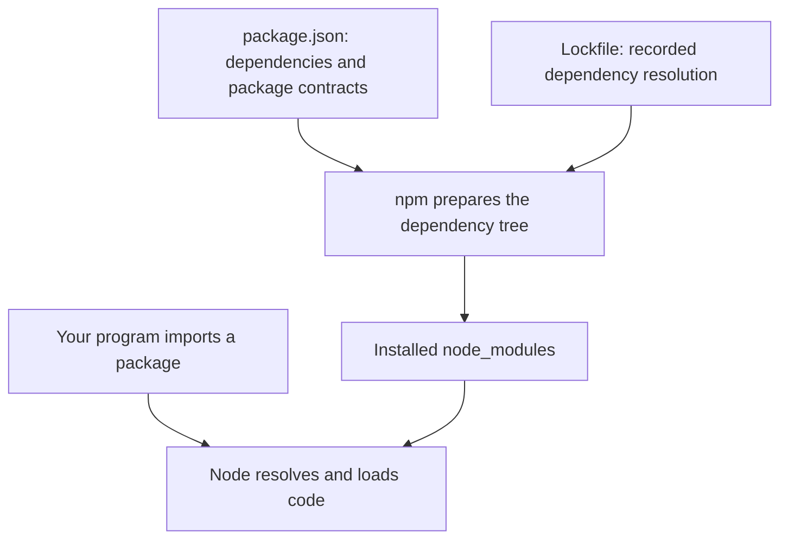
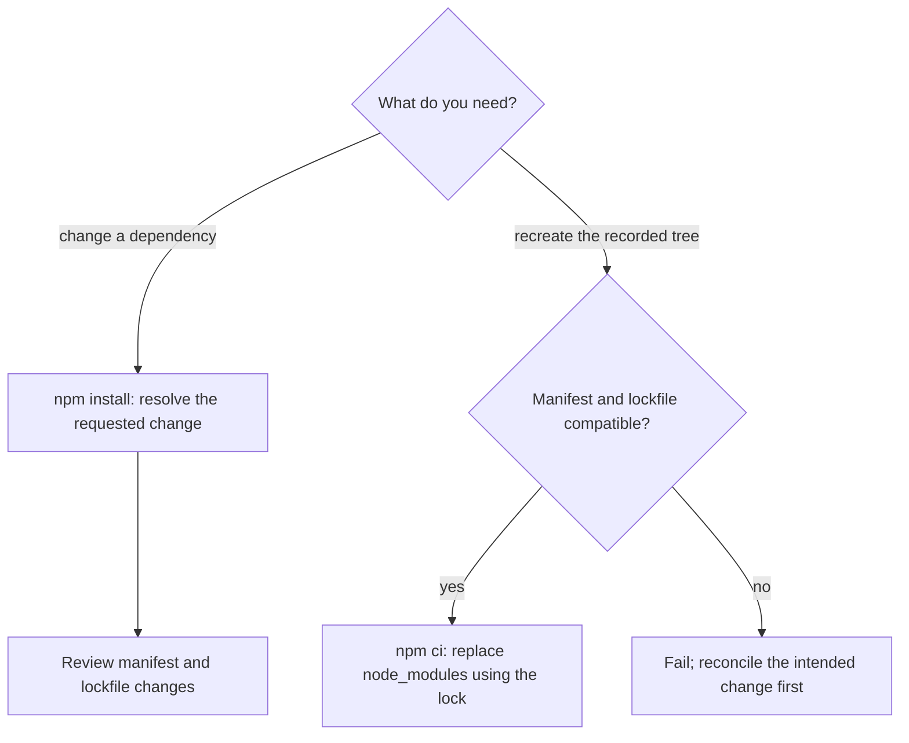
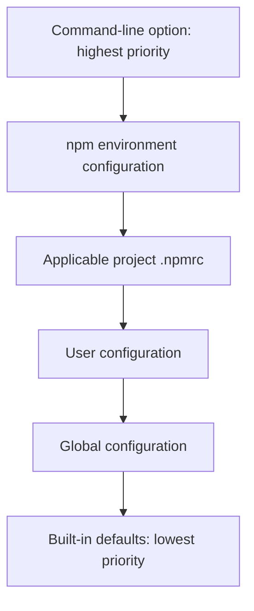
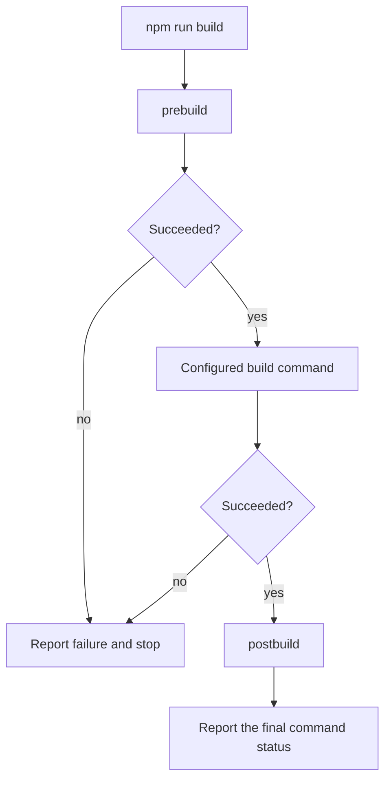
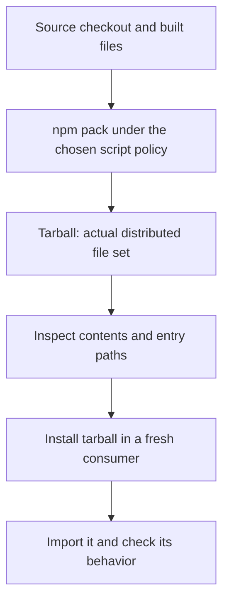
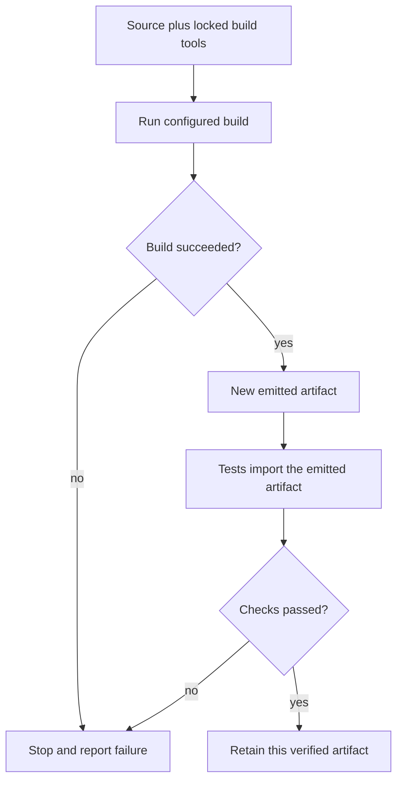
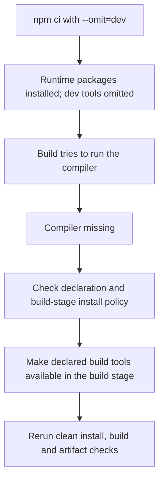

# Package management


<span class="notes-section-label">**First pass:**</span> learn what `package.json` and the lockfile do, `npm install` versus `npm ci`, and how to run a script (questions 1, 2 and 4). Then read the stable-version examples in question 5. Configuration precedence, packaging, build artifacts and dependency investigations can wait until you have a working package. The local tarball lab is optional.

The expandable deeper explanations preserve the additional examples. Common mistakes, examiner follow-ups and key takeaways stay visible outside them. **You can return to them after you can explain and change the starter example.** Career labels describe the eventual assessment target, not what you must master on your first reading.

<!-- tech-check: t04-q01; level: 1 -->

### What is package.json responsible for, and how do installation and runtime loading differ?

*Study depth: Foundational*

Level Up: L1 — Junior\
Tech Check level: ⭐

Source mapping: [R007](./requirements.md#r007), [R151](./requirements.md#r151).


<div class="notes-core-answer">

<p class="notes-core-answer__title">Core answer</p>

`package.json` describes a package: its name, version, module format, entry points, dependencies and scripts. **The package manager installs dependencies; Node loads them when the program runs.** These are separate steps. The package manager uses dependency declarations and a lockfile to decide what to install.

The file does not run the entire application or prove that a dependency is safe. Source files, built output, installed packages and the lockfile each have different jobs. **`"private": true` prevents accidental npm publication**, but does not make your files confidential or restrict filesystem access.

</div>

<span class="notes-section-label">**Separate declarations, installation and execution**</span>

Each box has a different job. Importing a package uses the installed code; it does not ask npm to install it.




:::: details Deeper explanation and additional examples

<span class="notes-section-label">**Detailed explanation**</span>

A useful small application layout is package.json plus its committed lockfile, application source, an authorized checks directory and a generated build directory when required. node_modules contains installed dependencies; it is not normally the hand-maintained source of truth.

A package intended for other consumers also needs a deliberately defined public interface and packaged file set. Group 3 explains main/exports/imports/type resolution; those runtime fields differ from a dependency's allowed version range.

<span class="notes-section-label">**Example**</span>

This isolated application's package.json is deliberately small:

```json
{
  "name": "node-tech-check-fixture",
  "version": "1.0.0",
  "private": true,
  "type": "module",
  "engines": {"node": ">=24 <25"},
  "scripts": {
    "check": "node --check app.mjs",
    "inspect-args": "node args.mjs"
  }
}
```

name/version identify this package; they do not identify every transitive dependency or a deployed image. type governs this package's ordinary .js module context; explicit .mjs/.cjs still identify their modes. scripts are named commands, not built-in implementations of build or test. engines documents compatibility; enforcement depends on the installer/configuration, so verify the runtime in CI rather than assume a declaration forces every deployment to use it.

A packageManager field can communicate tool/version intent, but its enforcement/provisioning depends on the actual toolchain; do not assume every Node install bundles a particular launcher.

A dependency used by the running service belongs in dependencies. Tools needed to develop/check/build typically belong in devDependencies. A published plugin may declare peerDependencies to express a compatible host it must integrate with; modern npm can install peers, so “peers are always manual” is outdated. optionalDependencies permits an installation failure/absence under its contract; code must handle the absence if using it.

A critical database driver is not optional simply to make installation appear successful.

The lockfile records the resolved dependency graph and package identities/integrities according to its format. It is separate from application source and from the supported public API. Keep the correct manager's lockfile with the project; switching package managers needs an intentional migration, not several competing lockfiles generated by accident.

::::

<span class="notes-section-label">**Common mistakes**</span>

- Treating package.json as JSON with comments/trailing commas or executable JavaScript.
- Assuming an engines field or private:true enforces all runtime/security policy.
- Importing a missing dependency and expecting Node to install it automatically.
- Putting a runtime dependency only in devDependencies, then omitting it from production installation.

<span class="notes-section-label">**Examiner follow-ups**</span>

1. <span class="notes-section-label">**Is a built-in module a dependency to install?**</span> No. Import node:fs directly and require a compatible runtime; a registry package with a similar name is different code.
2. <span class="notes-section-label">**Why not commit node_modules instead of the lockfile?**</span> A prepared tree is platform/toolchain-sensitive and can contain generated or unwanted files. A reviewed manifest/lock plus controlled installation describes how to recreate it; retained release artifacts serve another purpose.
3. <span class="notes-section-label">**Does an existing package.json prove the project has a build command?**</span> No. Inspect its scripts and actual files before running or claiming npm run build succeeds.

::: tip Key takeaway
The manifest declares contracts, the manager prepares dependencies, and the runtime loads code; they are connected but distinct stages.
:::


---

<!-- tech-check: t04-q02; level: 1 -->

### How do install, ci and dependency categories affect reproducibility?

*Study depth: Intermediate*

Level Up: L2 — Software Engineer\
Tech Check level: ⭐

Source mapping: [R114](./requirements.md#r114).


<div class="notes-core-answer">

<p class="notes-core-answer__title">Core answer</p>

`npm install` installs the requested dependencies and may change `package.json` or the lockfile. **`npm ci` installs from an existing, compatible lockfile without rewriting it.** It fails if the dependency declarations and lockfile disagree. It also removes the existing `node_modules` directory before installing.

Commit and review the lockfile, and keep relevant install settings consistent between local work and CI. Runtime dependencies belong in `dependencies`; development tools usually belong in `devDependencies`. **A build may need development tools even if the finished application does not.** Matching the lockfile helps repeat an installation, but Node versions, platforms, scripts and environment settings can still affect the result.

</div>

<span class="notes-section-label">**Compare changing and recreating the tree**</span>

Use install for an intentional dependency change. Use ci to recreate a compatible recorded tree.




<span class="notes-section-label">**Start here — one working example**</span>

Use a separate learning folder for this exercise:

```sh
mkdir npm-learning
cd npm-learning
npm init -y
npm install --save-exact express@5.2.1
npm ci
```

`npm init -y` creates a default `package.json`. `npm install` adds Express and creates a lockfile recording the installed dependency versions. The later `npm ci` removes `node_modules` and recreates it using that lockfile. It does not choose newer versions. Use `npm install` when intentionally changing dependencies and `npm ci` to reproduce the recorded installation.

Keep both `package.json` and `package-lock.json`. You will use Express in the framework lesson; you do not need to understand its API yet. The optional local-package lab below teaches packaging separately.


:::: details Deeper explanation and additional examples

<span class="notes-section-label">**Detailed explanation**</span>

A dependency tree contains direct packages plus their transitive dependencies. Pinning one direct version does not freeze every descendant unless the resolved graph is retained. Conversely a lockfile does not guarantee all packages are trustworthy or all install/build effects are deterministic.

Native components and lifecycle scripts can depend on the host and external inputs. Review lockfile changes as code changes.

| Operation | Main purpose | Important boundary |
|---|---|---|
| npm install | Create/update an installation from declared/requested dependencies | Can intentionally change manifest/lock; inspect the diff |
| npm ci | Recreate the locked project tree | Requires a suitable lock; removes existing node_modules, so use the intended project |
| npm install --save-dev | Declare a development tool | Does not make its runtime imports available after --omit=dev |
| npm ci --omit=dev | Install the runtime category tree | Build first with required tools in an appropriate build stage; omitted packages can still be represented in the lock |
| npm uninstall NAME | Remove a declared dependency and reconcile installation metadata | Verify source/scripts no longer require it |

<span class="notes-section-label">**Example — local dependency with no registry**</span>

Create an owned `study-math` directory with this package.json:

```json
{
  "name": "study-math",
  "version": "1.2.3",
  "type": "module",
  "exports": "./index.mjs",
  "files": ["index.mjs"]
}
```

Its index.mjs contains:

```js
export function add(a, b) { return a + b; }
```

In that package run `npm pack --ignore-scripts` to create a local tarball. In a separate disposable application directory, install that actual tarball with `npm install --offline --ignore-scripts --no-audit --no-fund ../study-math/study-math-1.2.3.tgz`, adapting the owned path. Keep the resulting application lockfile. An app.mjs can import add from study-math and print add(2, 3), giving 5.

Running npm ci with the same no-script/offline test policy should recreate the tree. This does not demonstrate a remote registry, native build or production supply-chain review.

For registry dependencies, select a reviewed package/version and use the declared registry/auth policy; do not substitute a made-up package name from generated code. --offline forbids fetching unavailable data and will fail if required artifacts are absent. A local tarball fixture is useful precisely because it avoids relying on a registry cache secretly being populated.

If the lock was created with tree-affecting options such as legacy peer handling or install links, ci needs compatible settings. Do not “fix” a CI mismatch by deleting the lock or weakening peer checks without understanding the graph.

Root-project install/prepare scripts can also run under an install policy; --ignore-scripts is an explicit fixture policy, not a universal recommendation to disable legitimate reviewed build steps.

::::

<span class="notes-section-label">**Common mistakes**</span>

- Calling ci an automatic upgrade command, or running it against a user's tree without noting the node_modules replacement.
- Keeping a compiler only as a dev tool, omitting dev packages, then trying to compile in that same minimal runtime stage.
- Treating a direct exact version as a complete transitive/platform/script freeze.
- Automatically running audit fix --force to make a report green; that can introduce unrelated or incompatible changes.

<span class="notes-section-label">**Examiner follow-ups**</span>

1. <span class="notes-section-label">**Can two platforms install different optional/native components from one lock?**</span> Yes. Reproducibility must name the supported platform/toolchain and artifact boundary, not merely compare one filename.
2. <span class="notes-section-label">**What if ci rejects a changed manifest?**</span> Reconcile the intentional dependency change in a development fixture, regenerate/review the lock and rerun the clean install. Do not silently rewrite the contract during deployment.
3. <span class="notes-section-label">**Does ignore-scripts make every dependency safe?**</span> No. Imported runtime code still executes, and disabling required native/setup steps can break functionality. It removes one execution stage under a deliberate policy.

::: tip Key takeaway
A locked clean installation is one reproducibility boundary; runtime, configuration, scripts and tested artifacts still need ownership.
:::


---

<!-- tech-check: t04-q03; level: 1 -->

### Which npm commands and configuration sources should you inspect when installation differs between environments?

*Study depth: Intermediate*

Level Up: L2 — Software Engineer\
Tech Check level: ⭐

Source mapping: [R006](./requirements.md#r006), [R029](./requirements.md#r029).


<div class="notes-core-answer">

<p class="notes-core-answer__title">Core answer</p>

Check the Node and npm versions, the project or workspace directory, and the exact command that failed. npm reads settings from flags, environment variables and project, user and global configuration files. **The project's `.npmrc` may show only part of the configuration.** Inspect the relevant settings without printing tokens or passwords.

Use `npm ls` to inspect installed packages and `npm explain` to learn why a package is present. **Find the kind of failure before changing settings**: package lookup, login, networking/TLS, incompatible peer dependencies or an install script can each fail for different reasons. Do not solve an authentication error by exposing tokens or switching blindly to another registry.

</div>

<span class="notes-section-label">**Read configuration priority**</span>

For ordinary overlapping settings, read from the top: the highest applicable supplied value wins. Command and workspace scope still matter.




:::: details Deeper explanation and additional examples

<span class="notes-section-label">**Detailed explanation**</span>

For ordinary overlapping npm settings, command-line configuration has higher priority than environment configuration, which overrides configuration-file defaults. Project, user, global and built-in configuration have their own scopes/applicability. Global/workspace commands can change which project settings apply. Be explicit about working directory and command mode before comparing machines.

| Read/diagnostic command | What it answers | What it does not prove |
|---|---|---|
| node --version; npm --version | Which runtime/CLI was selected | Same OS/native/script behavior as another host |
| npm ls --depth=0 | Installed direct graph view/problems | Complete compatibility or successful runtime use |
| npm explain PACKAGE | Why a package is in the tree | That it is needed/safe or the only installed version |
| npm config get registry | Selected default registry | That a scoped package uses it or auth is valid |
| npm config get omit | Relevant category omission setting | That every required artifact/tool exists |
| npm outdated | Versions relative to configured registry/ranges | A safe automatic upgrade plan; it may need network access |

--omit=dev, --ignore-scripts, --offline and --save-exact affect different policies: on-disk categories, lifecycle execution, network availability and recorded direct-version requests. Do not treat them as synonyms for production/security/reproducibility. --dry-run can preview some changes but is not a universal side-effect sandbox. Read each command's actual contract.

<span class="notes-section-label">**Example**</span>

In an owned local fixture, .npmrc can contain this nonsecret default:

```ini
save-exact=true
```

Compare `npm config get save-exact`, an invocation with `npm_config_save_exact=false` in its process environment, and an invocation also supplying `--save-exact=true`. Under the baseline, the values are true, false, true. This tests a harmless scalar setting without printing the effective credential configuration.

Use explicit temporary --userconfig/--globalconfig paths when isolating a test; do not modify the real user's configuration or repurpose HOME.

A scope-specific registry such as @company:registry affects that scope; the default registry setting alone does not describe every package lookup. Authentication values should be scoped to the intended registry host/path, supplied through the approved secret mechanism, and excluded from repository/log output.

A TLS error deserves certificate/proxy/time/host diagnosis, not blanket strict-ssl=false. Corporate proxies and private registries are environment decisions; do not copy another account's credentials to make an install succeed.

::::

<span class="notes-section-label">**Common mistakes**</span>

- Printing npm config list or environment dumps into public logs without reviewing secret exposure.
- Comparing commands from different package/workspace directories as though they had identical configuration.
- Changing global registry/TLS settings to solve one project's local typo or stale lock.
- Running a network-dependent diagnostic and reporting an offline cache failure as package incompatibility.

<span class="notes-section-label">**Examiner follow-ups**</span>

1. <span class="notes-section-label">**Why can a package install locally but be absent in CI?**</span> Check declared category, effective omit/peer/script settings, lock, platform and actual selected workspace before assuming a registry outage.
2. <span class="notes-section-label">**Can a project .npmrc contain a token?**</span> It may be technically expressible, but a real credential must follow the secret-management policy; do not commit or print it. Nonsecret config and credential material have different retention rules.
3. <span class="notes-section-label">**How would you report the problem safely?**</span> Retain versions, sanitized package/registry identity, relevant nonsecret option values and the actual failure stage/code. Exclude tokens, complete private configuration and raw credential-bearing URLs.

::: tip Key takeaway
Diagnose the effective command/configuration and failure stage; a single visible .npmrc or an installation error is not the whole environment contract.
:::


---

<!-- tech-check: t04-q04; level: 1 -->

### How do npm scripts, argument forwarding and lifecycle hooks work?

*Study depth: Intermediate*

Level Up: L1 — Junior\
Tech Check level: ⭐

Source mapping: [R023](./requirements.md#r023), [R030](./requirements.md#r030).


<span class="notes-section-label">**Code question — attempt first**</span>

An application defines `"inspect-args":"node args.mjs"`. What does `npm run inspect-args -- --mode test` pass to args.mjs? Does the name build automatically compile TypeScript?

<div class="notes-core-answer">

<p class="notes-core-answer__title">Core answer</p>

An npm script is a named command in `package.json`, run with `npm run NAME`. npm makes locally installed command-line tools available to that command and runs it through a shell. Use `--` to pass following arguments to the selected script.

**A script named `build` does only what its configured command says.** npm does not supply a compiler just because you use that name. **Hooks can run extra commands before or after the main command**, including during installation. Check those too. A script must report failures correctly and wait for its work to finish; otherwise it can appear successful even when a child command failed.

</div>

<span class="notes-section-label">**Follow a script and its hooks**</span>

This assumes the hooks exist and normal script execution is enabled. A failing stage stops the sequence; postbuild is not guaranteed cleanup.




:::: details Deeper explanation and additional examples

<span class="notes-section-label">**Detailed explanation**</span>

For the fixture's inspect-args command, this args.mjs prints the script arguments:

```js
console.log(JSON.stringify(process.argv.slice(2)));
```

`npm run inspect-args -- --mode test` gives `["--mode","test"]` from the script. npm may print its own script banner unless an output policy such as --silent is selected. That banner is distinct from the program's output; a machine parser needs a deliberate invocation contract. Runtime flags for node belong in the script's node invocation, not arbitrarily after the entry file.

npm scripts can find project-local executables from node_modules/.bin. This is why a locally installed compiler can be invoked by its command name inside a script without relying on an unrelated globally installed version. The CLI still uses a shell: embedded quoting, environment assignment and operators may differ between POSIX shells and Windows.

Prefer small Node scripts for portable complex logic rather than a large shell expression assembled from user values.

For a named task, applicable pre/task/post hooks are part of its lifecycle. A pretest failure prevents the main test; a main failure should prevent a successful completion/post-success path. post hooks are not a reliable finally block for restoring resources after failure.

Install/prepare lifecycle behavior can differ between a registry package, local source and pack/build workflows, so verify the actual operation. --ignore-scripts suppresses applicable lifecycle execution under its documented rules, but does not turn explicitly running npm test/npm run into a no-code operation; specifically test the hooks versus explicitly selected script behavior on your npm version.

A deliberately broken wrapper that starts an asynchronous child and exits 0 before awaiting it can conceal failure. Similarly `command || true` can convert failure to success.

::::

<span class="notes-section-label">**Common mistakes**</span>

- Assuming a build script exists, or that its name implies a particular bundler/compiler.
- Relying on a global binary that differs from the reviewed local/locked toolchain.
- Treating posttest as guaranteed cleanup after a failed test.
- Assuming ignore-scripts means an explicitly requested script cannot run code.

<span class="notes-section-label">**Examiner follow-ups**</span>

1. <span class="notes-section-label">**What should a pretest do if setup fails?**</span> Return a nonzero status promptly and close owned resources. Printing an error while exiting 0 does not communicate failure.
2. <span class="notes-section-label">**Are arguments automatically forwarded to every pre/post hook?**</span> Do not assume that. npm's selected-script argument forwarding and hook environment are separate documented contracts.
3. <span class="notes-section-label">**Why keep a portable task in a .mjs file?**</span> It can validate inputs, await work and handle cleanup without depending on shell-specific syntax. It is still executable code requiring scope/review.

::: tip Key takeaway
Scripts orchestrate explicit commands and hooks; inspect what runs, how arguments arrive and how failure/cleanup propagate.
:::

<span id="batch-b06-progress"></span>


---

<!-- tech-check: t04-q05; level: 1 -->

### What do SemVer ranges allow, especially before 1.0 and for prereleases?

*Study depth: Intermediate*

Level Up: L4 — Lead\
Tech Check level: ⭐

Source mapping: [R069](./requirements.md#r069).


<span class="notes-section-label">**Code-reading question — attempt first**</span>

A manifest requests ^1.2.3 and its lock resolves 1.2.3. The registry later offers 1.2.9 and 2.0.0. Must npm ci upgrade it? Does ^0.2.3 admit 0.3.0? Does ^1.2.3 normally admit 1.3.0-beta.1?

<div class="notes-core-answer">

<p class="notes-core-answer__title">Core answer</p>

Semantic Versioning uses `major.minor.patch`. For a stable public API, a major change indicates incompatibility, a minor change adds compatible functionality and a patch fixes a compatible bug. **A version range allows several versions; a lockfile records a specific installation.** `npm ci` uses that recorded installation rather than upgrading to the newest allowed version.

Caret (`^`) and tilde (`~`) ranges allow different sets of updates. **Caret ranges are more restrictive before version 1.0**, and prerelease versions have special matching rules. A version number expresses the maintainer's compatibility promise; it does not prove the code is correct or secure.

</div>


:::: details Deeper explanation and additional examples

<span class="notes-section-label">**Detailed explanation**</span>

For a stable public API, incompatible changes call for a major increment, compatible functionality for minor and compatible fixes for patch. Pre-1.0 development has weaker stability expectations; npm's range grammar still has concrete matching rules.

Declare which interface matters: removing an exported function, changing error/status semantics or dropping supported runtime behavior can affect consumers even if the implementation change looks small.

The classroom examples below use npm's node-semver range conventions:

| Request | Relevant stable-version interval |
|---|---|
| 1.2.3 | The specified semantic version; a range alone does not authenticate artifact bytes |
| ~1.2.3 | At least 1.2.3 and below 1.3.0 |
| ^1.2.3 | At least 1.2.3 and below 2.0.0 |
| ^0.2.3 | At least 0.2.3 and below 0.3.0 |
| ^0.0.3 | At least 0.0.3 and below 0.0.4 |
| 1.2.x | Stable versions in the 1.2 line under the range's normal prerelease policy |

Thus the answers are: ci retains the locked 1.2.3 under its compatible contract; ^0.2.3 excludes 0.3.0; ^1.2.3 normally excludes 1.3.0-beta.1. An intentional update can select a newer allowed version and produce a reviewed lock diff. It is not the same operation as recreating yesterday's installation.

Prerelease identifiers such as beta/rc affect ordering and default range eligibility. Explicitly opting into a prerelease on one version tuple is not a blanket opt-in to prereleases of every future tuple. In the baseline range library, ^1.2.3-beta.1 admits 1.2.3-beta.2 but not 1.2.4-beta.1 under default matching.

Do not implement these rules with naive string comparison: rc.10 and rc.2 have numeric-segment semantics. Build metadata such as +build.7 does not increase semantic precedence; source/archive/image identity still needs a separate retained hash/provenance record.

<span class="notes-section-label">**Example — an upgrade decision**</span>

If 1.2.9 fixes a relevant defect and remains inside the declared range, intentionally update/review the locked graph, run your emitted/runtime/contract tests, then promote the tested artifact. A passing version-range check does not test your integration.

If the fix only exists in 2.x, evaluate migration scope and compatibility rather than widen every dependency with a force option. Do not assume a patch release is incapable of regressions or a major change is necessarily unacceptable.

::::

<span class="notes-section-label">**Common mistakes**</span>

- Assuming caret always permits the next minor, including 0.x without checking its bound.
- Treating “latest” as a SemVer range or as necessarily the safest compatible deployment.
- Believing ci automatically patches every dependency or that an exact direct version freezes all transitive/platform behavior.
- Comparing version strings lexicographically or using a successful range match as an application compatibility test.

<span class="notes-section-label">**Examiner follow-ups**</span>

1. <span class="notes-section-label">**Why can npm outdated show a newer release while ci is correct?**</span> They answer different questions: registry/range currency versus recreation of the reviewed lock.
2. <span class="notes-section-label">**Can a public API break without a function rename?**</span> Yes. Changed validation, errors, side effects, supported platform or response behavior can violate consumers' contracts.
3. <span class="notes-section-label">**What should accompany a dependency update?**</span> Reviewed manifest/lock/artifact changes, relevant tests, security/compatibility rationale and a recovery/rollback plan appropriate to the change.

::: tip Key takeaway
A version range, a resolved lock and a verified application artifact are three different compatibility/evidence boundaries.
:::


---

<!-- tech-check: t04-q06; level: 1 -->

### What does a registry provide, and how do you inspect the package that will actually ship?

*Study depth: Intermediate*

Level Up: L4 — Lead\
Tech Check level: ⭐

Source mapping: [R069](./requirements.md#r069).


<div class="notes-core-answer">

<p class="notes-core-answer__title">Core answer</p>

A registry stores package information and downloadable package files. Public and private registries may require different access settings and credentials. A scope groups package names, a version identifies a release, and a tarball is its downloadable archive.

**A tag such as `latest` can point to a different version later.** A lockfile can record an exact download and an integrity value used to check its bytes. **Inspect what the package actually contains**, because its files can differ from the source repository. Exclude secrets before publishing. An integrity check confirms that the downloaded bytes match the expected bytes; it does not prove the code is trustworthy.

</div>

<span class="notes-section-label">**Inspect the artifact consumers receive**</span>

This is a local packaging check. It does not publish anything or prove the package is trustworthy.




:::: details Deeper explanation and additional examples

<span class="notes-section-label">**Detailed explanation**</span>

The npm public registry is one service; organizations may use private registries/proxies for approved scopes. Metadata can describe versions, dependency ranges, distribution tags and tarball location/integrity. A private scope/name does not by itself establish who may read/publish or which host receives credentials.

Verify the configured route and access policy instead of assuming every @company package is automatically private.

A moved dist-tag does not silently rewrite an existing reviewed lock. Installing a tag from fresh metadata and recreating a retained version can therefore select different artifacts. A registry/package/cache outage, authentication rejection and a dependency compatibility error are different failure stages.

Keep credential-bearing URLs and tokens out of copied logs. Provenance/signatures can add origin/build evidence under their actual verification scheme; they are not a full code audit or guarantee of safe runtime behavior.

<span class="notes-section-label">**Example — inspect the local artifact**</span>

In Q02's owned study-math package, place a synthetic unshipped note outside the files allowlist. Run `npm pack --ignore-scripts --json` locally and inspect the listed file paths and the resulting archive. The fixture's index.mjs and package.json must be present, while an unlisted private fixture file must be absent.

README/license/metadata and ignore rules have documented special handling, so inspect the actual file list rather than guessing solely from one ignore pattern.

Install that tarball into a fresh owned consumer and execute the import. This catches missing emitted files, a wrong exports path or a development-tree-only dependency that source tests might miss. It does not publish anything. npm pack has its own applicable lifecycle contract; ignore-scripts is deliberate here.

A real package with a required reviewed prepare/build step needs that step run/verified before pack; do not suppress it and ship an empty artifact.

A files allowlist and .npmignore reduce accidental inclusion, but neither replaces secret review. Do not place a real key in an example just to test exclusion. Removing a secret in a later archive/image/revision cannot revoke copies already exposed. Keep publication separate from local packaging: this project does not authorize publishing the fixture or pushing any remote branch/tag.

::::

<span class="notes-section-label">**Common mistakes**</span>

- Assuming the Git tree is exactly what package consumers receive.
- Treating an integrity checksum as proof the package author or code is trustworthy.
- Sending a registry token to an arbitrary overridden host or disabling TLS verification after an error.
- Using a mutable tag as the complete identity of a deployed build.

<span class="notes-section-label">**Examiner follow-ups**</span>

1. <span class="notes-section-label">**Why test the tarball in a fresh consumer?**</span> Local relative files, undeclared dependencies and build leftovers can conceal packaging errors in the author's checkout.
2. <span class="notes-section-label">**Is npm audit a complete malicious-package detector?**</span> No. It reports known vulnerability information under its service/coverage; dependency provenance, review, permissions and runtime exposure remain relevant.
3. <span class="notes-section-label">**Should a registry outage trigger automatic use of another public package?**</span> No. Preserve the approved identity/lock and follow the cache/mirror/recovery policy; a look-alike replacement changes the trust boundary.

::: tip Key takeaway
Inspect and test the distributed artifact under its approved registry/identity contract; names, tags and checksums do not establish complete trust.
:::


---

<!-- tech-check: t04-q07; level: 1 -->

### In what sense can a package manager be a build tool, and how do you verify the emitted artifact?

*Study depth: Intermediate*

Level Up: L2 — Software Engineer\
Tech Check level: ⭐

Source mapping: [R028](./requirements.md#r028).


<div class="notes-core-answer">

<p class="notes-core-answer__title">Core answer</p>

You can use npm scripts to run a compiler, bundler, tests and other build steps. npm makes local tools available, but **the configured tools do the actual building**. Define which files go in, which files should come out, what order the steps run in and how failures are reported.

**Check the built files that will actually be deployed or used next.** Tests against source code can pass while the built output is missing, outdated or wrong. In larger projects, configure build dependencies and cache keys explicitly; a script name alone does not tell npm which changes require rebuilding.

</div>

<span class="notes-section-label">**Verify the output of the build**</span>

Tests must consume the artifact produced by this build. A failed build must not fall through to testing an older output.




:::: details Deeper explanation and additional examples

<span class="notes-section-label">**Detailed explanation**</span>

Use a new owned build fixture with this package.json.

<span class="notes-section-label">**Example — package.json**</span>

```json
{
  "name": "build-study",
  "version": "1.0.0",
  "private": true,
  "type": "module",
  "scripts": {
    "build": "node build.mjs",
    "test": "node --test checks/add.test.mjs",
    "verify": "node verify.mjs"
  }
}
```

`src/add.mjs`:

```js
export function add(a, b) { return a + b; }
```

`build.mjs`:

```js
import {mkdir, copyFile} from 'node:fs/promises';
try {
  await mkdir('dist', {recursive: true});
  await copyFile('src/add.mjs', 'dist/add.mjs');
} catch {
  console.error('Build failed');
  process.exitCode = 1;
}
```

This copies plain JavaScript; it is deliberately not a TypeScript compiler/minifier/bundler. The point is a concrete output contract. A real compiler needs its own locked dependency, target/module settings and source/runtime compatibility checks.

`checks/add.test.mjs`:

```js
import test from 'node:test';
import assert from 'node:assert/strict';
import {add} from '../dist/add.mjs';
test('emitted addition preserves the contract', () => {
  assert.equal(add(2, 3), 5);
  assert.equal(add(-2, 2), 0);
});
```

`verify.mjs`:

```js
import {spawnSync} from 'node:child_process';
for (const args of [['build.mjs'], ['--test', 'checks/add.test.mjs']]) {
  const result = spawnSync(process.execPath, args, {stdio: 'inherit', timeout: 10_000});
  if (result.error || result.status !== 0) {
    process.exitCode = 1;
    break;
  }
}
```

Run npm run verify. This short CLI deliberately waits synchronously for each stage, uses the selected executable and stops on failed launch, nonzero/signal termination or timeout. It avoids letting a background build race the test. It is not a general distributed task scheduler/process-tree supervisor.

Build failure must prevent consuming an older apparently green artifact; a real build should also define cleanup/staging so unrelated obsolete files cannot survive by accident.

The test imports dist/add.mjs, not a copied implementation or src/add.mjs. Change the source to subtract and rerun verification: the build may succeed but the emitted-artifact test must fail. Delete the output and run only the test to expose its prerequisite.

For a release, retain source/lock/tool/runtime identity plus the built artifact hash, and promote that same artifact rather than rebuild under different conditions in every stage.

::::

<span class="notes-section-label">**Common mistakes**</span>

- Calling npm a compiler simply because a build script invokes one.
- Caching build outputs without source/lock/tool/config/platform inputs in the key.
- Passing source tests while publishing no dist directory or an exports path pointing to an unbuilt file.
- Running build/test independently without preserving order/status or transferring the actual artifact between CI jobs.

<span class="notes-section-label">**Examiner follow-ups**</span>

1. <span class="notes-section-label">**Can npm scripts replace every task runner?**</span> Small explicit sequences often suffice. Large graphs/parallel caches can justify other tooling, but only when dependency, resource and correctness needs justify the additional mechanism.
2. <span class="notes-section-label">**Why can a clean CI job fail after a local pass?**</span> Local installed tools/output may hide missing declarations or prerequisites. Recreate the intended environment and test emitted artifact identity.
3. <span class="notes-section-label">**Does a successful package install prove a build happened?**</span> No. Read the actual lifecycle/script contract and confirm the expected output; script policy may suppress a required step.

::: tip Key takeaway
Use package scripts to orchestrate explicit stages and verify the exact emitted artifact, not an assumed build hidden behind a command name.
:::


---

<!-- tech-check: t04-q08; level: 1 -->

### How do you debug a dependency failure without hiding it through a forced upgrade or configuration reset?

*Study depth: Advanced*

Level Up: L2 — Software Engineer\
Tech Check level: ⭐

Source mapping: [R029](./requirements.md#r029), [R116](./requirements.md#r116).


<span class="notes-section-label">**Scenario — attempt first**</span>

A release job runs ci with --omit=dev, then build. It fails because the compiler is missing. Someone proposes deleting the lockfile, globally installing the latest compiler and adding a force option. Another engineer sees a newer allowed patch in outdated and says the successful locked install is broken because it retained the previous patch. Which assumptions are wrong?

<div class="notes-core-answer">

<p class="notes-core-answer__title">Core answer</p>

First identify where the failure happens: choosing package versions, downloading them, checking compatibility, running install/build scripts or loading code at runtime. Check the actual environment, configuration, `package.json`, lockfile and built files before changing them.

**Fix the cause instead of deleting the lockfile or forcing an upgrade.** For example, if `--omit=dev` removed the compiler, make the build tools available during the build stage. A newer version being available does not mean the locked installation is wrong. **Change one thing at a time and rerun the failing check**, including a clean install, build or runtime check as appropriate. Keep enough of the original error to confirm what the change fixed.

</div>

<span class="notes-section-label">**Diagnose the missing-compiler scenario**</span>

This follows the scenario above. The failure is in build-tool availability, so changing package versions would obscure the cause.




:::: details Deeper explanation and additional examples

<span class="notes-section-label">**Detailed explanation**</span>

The build stage may need development tools; the final runtime stage can then install/copy only what it needs. Globally installing an unreviewed compiler changes toolchain identity and can conceal the declaration bug. Deleting the lock destroys evidence of the prior graph.

Force options can accept a new/conflicting graph rather than prove the old requirement was satisfied. Diagnose before changing policy.

A useful sequence is: confirm entry directory/runtime/manager; read the exact failed operation; inspect direct/transitive category/ranges and selected registry/peer/script settings; compare manifest/lock; reproduce with owned config/cache; then inspect emitted and packaged artifacts.

Do not dump credentials or clear every global cache to obtain a superficially fresh run. A local tarball or private proxy may have a stale/different artifact identity; a lock integrity error deserves a provenance/cache investigation, not an automatic disable-integrity workaround.

<span class="notes-section-label">**Example — controlled contrast**</span>

Retain a successful local tarball installation and lock from Q02. Re-run ci and verify the lock bytes stay unchanged. Then deliberately change the application's dependency declaration to a separately packed incompatible local version without updating the lock; the clean install must not be credited as the previously verified graph.

Record the actual failure/status and restore the fixture's manifest before continuing. This owned experiment must not run against a user's real node_modules or private registry configuration.

Separately inject Q07's subtracting implementation. A green install and build with a failing emitted-artifact test is an application behavior failure, not proof of registry corruption. These cases require different corrections. Keep exact versions/config/artifact identities with check results so a later reviewer can tell which candidate actually passed.

::::

<span class="notes-section-label">**Common mistakes**</span>

- Making several upgrades/config resets simultaneously and losing the original failure trigger.
- Disabling peer/TLS/script/integrity controls because they made a failure visible.
- Reporting a successful installation as full application, security or production compatibility validation.
- Reusing earlier passing test output after changing the lock/compiler/emitted files.

<span class="notes-section-label">**Examiner follow-ups**</span>

1. <span class="notes-section-label">**When is a lock update appropriate?**</span> When a deliberate dependency change is justified, resolved under the intended settings and reviewed/tested. It is not a silent deployment-time repair.
2. <span class="notes-section-label">**What should a check limitation say?**</span> Name the untested boundary: local tarball rather than real registry/auth, no native build, no platform matrix, or no load/security review. Do not turn missing evidence into failure or success automatically.
3. <span class="notes-section-label">**How do npm, pnpm and Yarn fit this reasoning?**</span> They offer different graph/layout/lock/config/workspace mechanisms. Keep one reviewed primary tool/version and adapt commands intentionally; switching tools is a migration, not a universal fix for any dependency error.

::: tip Key takeaway
Preserve the failing contract, identify its stage and verify one scoped correction against the actual installation and emitted artifact.
:::

## Revision {#group-4-revision}

A manifest declares identity/contracts and dependency intent; a lock records a resolution. Installation, runtime loading, script orchestration, artifact packaging and publication are separate operations. Effective configuration and lifecycle scripts affect behavior.

SemVer ranges communicate allowed versions but do not prove quality; registries/tags/integrities identify different boundaries. Reproduce failures safely and promote the verified artifact rather than a guessed latest toolchain.

<span class="notes-section-label">**What you should be able to explain or implement**</span>

- [ ] Read manifest/runtime/category/script fields and distinguish them from loader/lock contracts.
- [ ] Recreate a reviewed local dependency installation with an appropriate lock and script policy.
- [ ] Diagnose CLI/config precedence without exposing real credentials.
- [ ] Show argument forwarding, pre/main/post behavior and failure propagation.
- [ ] Interpret stable/zero-major/prerelease ranges and distinguish update from ci.
- [ ] Inspect/test a packed artifact in an owned consumer without publishing it.
- [ ] Build/test an emitted module, catch a deliberate behavior defect and preserve candidate identity.
- [ ] Explain installation/build/runtime failure stages without unreviewed global resets or forced upgrades.

<span class="notes-section-label">**Recall, compare and apply**</span>

Try each question without opening its answer. Explain the reason, not just the term; then expand **Show answer** to check. Diagram questions link back to the visual so you can trace its parts and arrows.

<!-- revision-covers: t04-q01 -->

<span class="notes-section-label">**1. Scenario — A private application declares its database driver only under devDependencies. What happens after a runtime-only installation?**</span>

::: details Show answer

The running app can lose a required dependency. Correct the category and reviewed lock/build/runtime design; private:true does not supply missing runtime code.

[Revisit the explanation and examples](#t04-q01).

:::


---

<!-- revision-covers: t04-q01 -->

<span class="notes-section-label">**2. Compare — Which jobs belong to package.json, the lockfile, installed node_modules and the Node loader? What does private:true actually prevent?**</span>

::: details Show answer

**`package.json` declares contracts; npm installs dependencies; Node loads code.** `"private": true` prevents accidental npm publication, not access to files. The lock records a resolved dependency graph and node_modules is the prepared installation; neither is the source code or proof of runtime compatibility.

[Revisit the explanation and examples](#t04-q01).

:::


---

<!-- revision-covers: t04-q02 -->

<span class="notes-section-label">**3. Scenario — ci retains a locked patch while outdated reports a newer allowed one. Which command should decide the deliberate update?**</span>

::: details Show answer

Use an intentional supported update/install workflow in a development fixture, then review/test the changed graph. ci recreates the locked contract rather than silently upgrading it.

[Revisit the explanation and examples](#t04-q02).

:::


---

<!-- revision-covers: t04-q02 -->

<span class="notes-section-label">**4. Diagnose — The manifest changes but its lockfile does not. Should npm ci silently repair the mismatch, and what happens to an existing node_modules tree?**</span>

::: details Show answer

No: ci requires compatible manifest/lock metadata and does not rewrite the lock as a deployment-time repair. It removes the existing node_modules tree before reproducing the locked installation. Reconcile the intentional dependency change with the development install workflow, review it and rerun the clean check under consistent settings.

[Revisit the explanation and examples](#t04-q02).

:::


---

<!-- revision-covers: t04-q03 -->

<span class="notes-section-label">**5. Diagnose — Two machines use the same project .npmrc but install differently. Which other configuration and failure evidence should you compare without exposing credentials?**</span>

::: details Show answer

**Flags, environment and configuration files all affect npm.** Inspect the effective nonsecret settings and failure stage before changing them.

[Revisit the explanation and examples](#t04-q03).

:::


---

<!-- revision-covers: t04-q04 -->

<span class="notes-section-label">**6. Scenario — A lifecycle post hook removes a temporary database, but the main script failed first. Can cleanup be assumed?**</span>

::: details Show answer

No. A post hook is not a universal finally. Cleanup needs an explicit owner/error path and bounded termination.

[Revisit the explanation and examples](#t04-q04).

:::


---

<!-- revision-covers: t04-q04 -->

<span class="notes-section-label">**7. Predict — A script named inspect-args runs node args.mjs. What does npm run inspect-args -- --mode test deliver to process.argv.slice(2), and does a script named build imply a compiler?**</span>

::: details Show answer

The script receives ["--mode", "test"]. The separator forwards those arguments to the configured script; the script name does not supply a compiler or task implementation. Read its actual command and applicable hooks, preserve failure status and await required work.

[Revisit the explanation and examples](#t04-q04).

:::


---

<!-- revision-covers: t04-q05 -->

<span class="notes-section-label">**8. Scenario — A manifest permits ^0.2.3. Is 0.3.0 compatible under that range's normal rule?**</span>

::: details Show answer

No. Its stable upper bound is below 0.3.0; pre-1.0 range details are not the same as caret on 1.x.

[Revisit the explanation and examples](#t04-q05).

:::


---

<!-- revision-covers: t04-q05 -->

<span class="notes-section-label">**9. Compare — For stable versions, compare ~1.2.3, ^1.2.3 and ^0.2.3. Does ^1.2.3 normally admit 1.3.0-beta.1?**</span>

::: details Show answer

The stable intervals are at least 1.2.3 and below 1.3.0 for the tilde range, below 2.0.0 for ^1.2.3, and at least 0.2.3 but below 0.3.0 for ^0.2.3. The ordinary ^1.2.3 rule does not admit that prerelease. A range match is not an integration or security test, and ci retains the reviewed compatible lock rather than automatically choosing a newer allowed release.

[Revisit the explanation and examples](#t04-q05).

:::


---

<!-- revision-covers: t04-q06 -->

<span class="notes-section-label">**10. Scenario — A package works from its source checkout but fails when imported from the tarball. What should you inspect?**</span>

::: details Show answer

The actual file list, exports/main targets, built outputs, dependencies and selected runtime conditions. Fresh-consumer tests expose author-checkout assumptions.

[Revisit the explanation and examples](#t04-q06).

:::


---

<!-- revision-covers: t04-q06 -->

<span class="notes-section-label">**11. Compare — How do a registry tag, retained package version and integrity value provide different evidence? Does a matching checksum prove trustworthy code?**</span>

::: details Show answer

**Inspect the tarball consumers actually receive.** Tags can move; integrity checks verify expected bytes, not whether the code is trustworthy. A moved tag does not rewrite an existing lock; validate the intended package identity and test the packed artifact in a fresh consumer.

[Revisit the explanation and examples](#t04-q06).

:::


---

<!-- revision-covers: t04-q07 -->

<span class="notes-section-label">**12. Diagnose — Source tests pass, but a fresh consumer cannot import the packaged dist entry. What should the build verification actually consume and check?**</span>

::: details Show answer

**npm orchestrates tools; the configured tools build the output.** Check the emitted artifact that will run, including missing or stale files.

[Revisit the explanation and examples](#t04-q07).

:::


---

<!-- revision-covers: t04-q08 -->

<span class="notes-section-label">**13. Choose — A CI compiler is missing after npm ci --omit=dev. Why are deleting the lockfile and globally installing the latest compiler poor first fixes?**</span>

::: details Show answer

The build stage omitted development tools it needs. Make the declared build tools available in that stage, then run the clean install, build and emitted-artifact checks again. Changing the lock or global compiler at the same time changes the evidence without addressing the original category/stage mistake.

[Revisit the explanation and examples](#t04-q08).

:::


Official sources checked 2026-11-04: npm 11 [package metadata](https://docs.npmjs.com/cli/v11/configuring-npm/package-json/), [ci](https://docs.npmjs.com/cli/v11/commands/npm-ci/), [scripts](https://docs.npmjs.com/cli/v11/using-npm/scripts/), [configuration](https://docs.npmjs.com/cli/v11/using-npm/config/), [registry](https://docs.npmjs.com/cli/v11/using-npm/registry/), [pack](https://docs.npmjs.com/cli/v11/commands/npm-pack/), [SemVer specification](https://semver.org/), [npm range implementation](https://github.com/npm/node-semver).

<span id="batch-b07-progress"></span>
