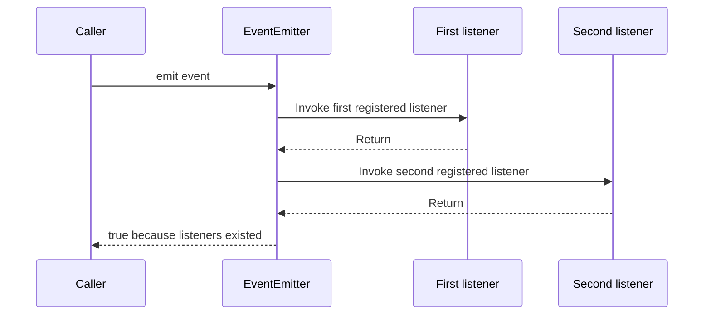
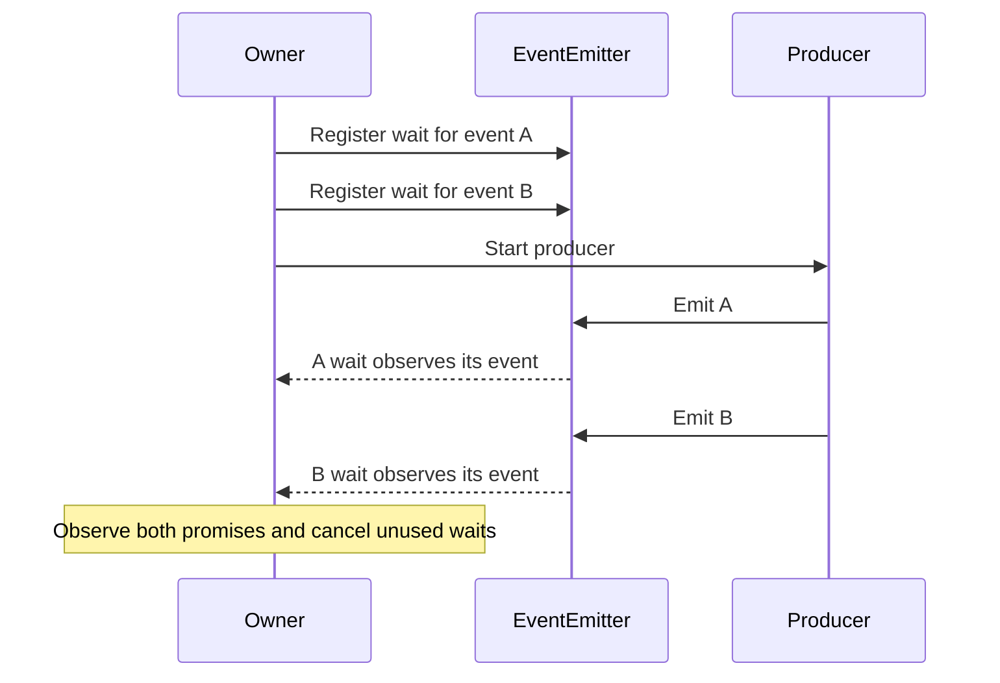
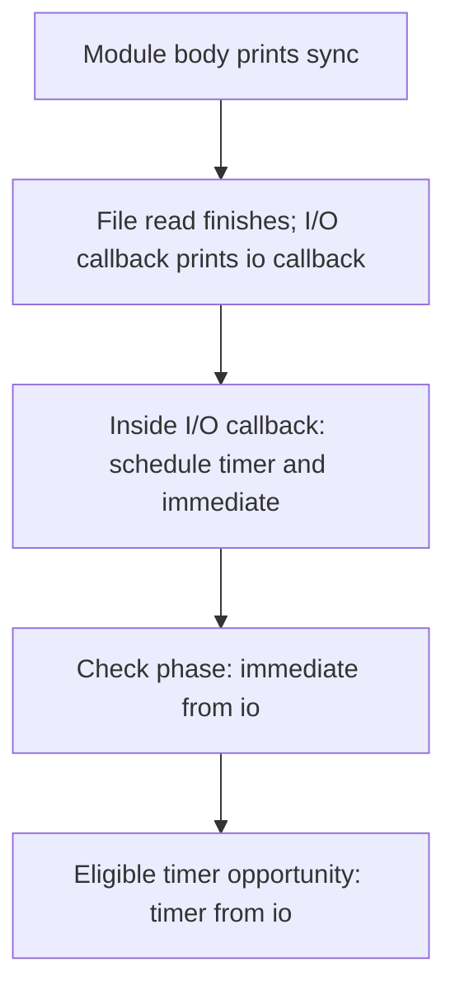
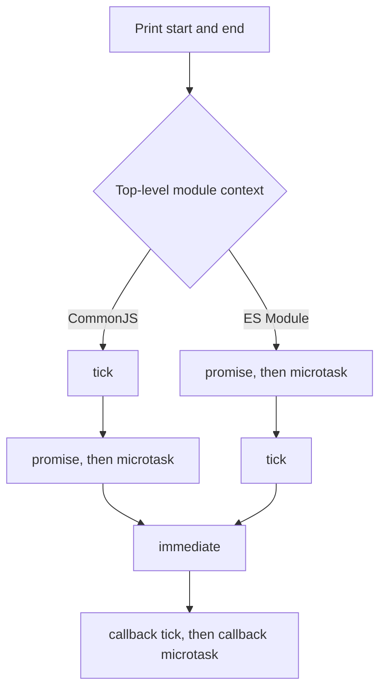
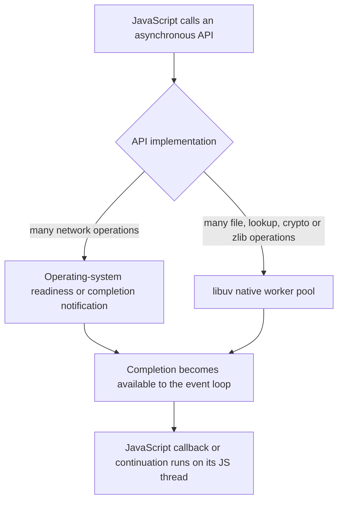
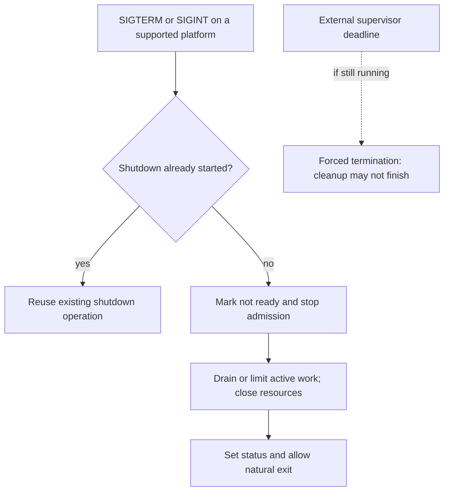
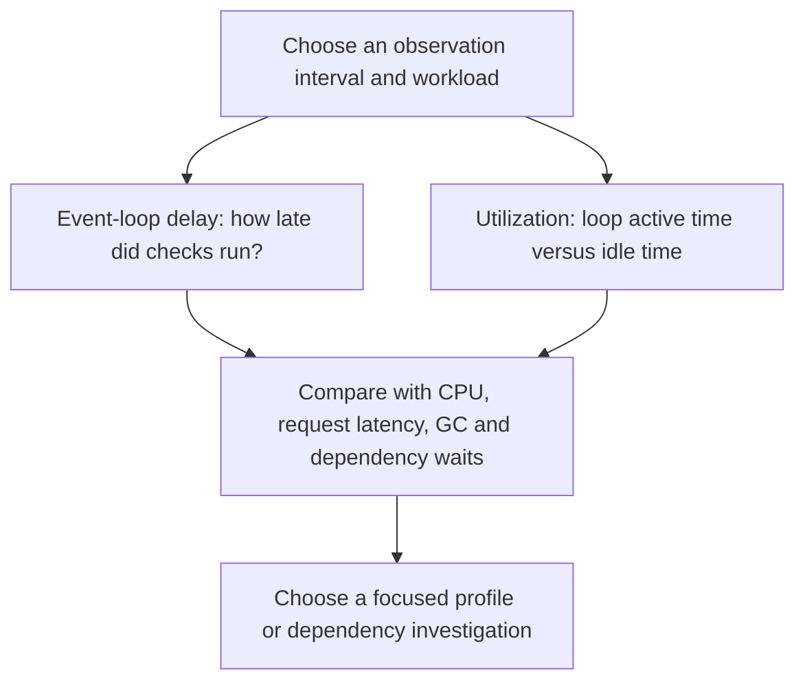
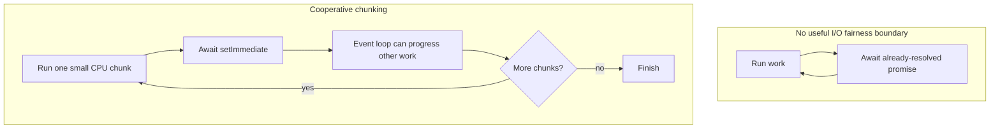

# Events and the event loop

This chapter covers event-driven contracts, EventEmitter, waiting for events and scheduling order. Standalone examples use Node.js 24.18.0, with explicit `.mjs`/`.cjs` filenames. It also covers OS event handling, libuv boundaries and measured diagnosis, completing the five supplied subtopics as study material. See the [course event-loop explanation](../module-01-nodejs-foundations.md#_8-event-loop-deep-dive) for additional context.

<span class="notes-section-label">**First pass:**</span> Start with [one listener](#t06-q01) and [one event wait](#t06-q02). Register, emit, predict the output, then remove the listener. Next explain why a long synchronous handler blocks other callbacks. Return to exact microtask ordering, libuv mechanisms, utilization measurements and starvation experiments after your HTTP app works.

**Learn the small example before expanding the complete version.** The expandable sections retain the deeper explanations and original labs for a second reading. Common mistakes, examiner follow-ups and key takeaways stay visible outside them.

<!-- tech-check: t06-q01; level: 2 -->

### How do EventEmitter listeners, error events and subscription lifetimes work?

*Study depth: Intermediate*

Level Up: L3 — Senior\
Tech Check level: ⭐, ⭐⭐

Source mapping: [R010](./requirements.md#r010), [R034](./requirements.md#r034).


<div class="notes-core-answer">

<p class="notes-core-answer__title">Core answer</p>

Event-driven code registers functions, called listeners, to respond when something happens. `EventEmitter` sends these notifications inside one process. **`emit()` calls listeners immediately, in registration order.** `prependListener()` can put a listener first. **`emit()` returns whether listeners existed**, not whether their work succeeded or finished.

Use `once()` for a listener that should run only once. To remove a listener with `off()`, pass the same function you registered. **Emitting `'error'` without an error listener throws an exception.** Remove subscriptions when you no longer need them. An emitter does not save events for replay, deliver them to another process or make a group of changes transactional.

</div>

<span class="notes-section-label">**Follow synchronous event delivery**</span>

This example has two ordinary synchronous listeners. The emitter calls both before emit returns, without waiting for any promises an async listener might return.




<span class="notes-section-label">**Start here — one working example**</span>

Save as `first-event.mjs` and run `node first-event.mjs`:

```js
import { EventEmitter } from 'node:events';

const lessons = new EventEmitter();
lessons.on('finished', title => {
  console.log(`Finished: ${title}`);
});

console.log('Before');
lessons.emit('finished', 'File reads');
console.log('After');
```

The output is `Before`, `Finished: File reads`, then `After`. `on` registers a function; `emit` calls it immediately. It does not put the listener on a background thread.

Change `on` to `once` and emit the event twice: the listener should run only for the first emission. Next, give the listener a name and pass that same function to `off` when you no longer need it. Learn these steps before studying the ordering and error cases below.


:::: details Deeper explanation and additional examples

<span class="notes-section-label">**Example — predict the delivery order and final listener count**</span>

Save as `emitter.mjs`.

```js
import { EventEmitter } from 'node:events';
export class JobEvents extends EventEmitter {
  completed(id) {
    if (!Number.isInteger(id) || id < 1) throw new TypeError('positive job ID required');
    return this.emit('completed', id);
  }
}
const jobs = new JobEvents();
const seen = [];
const regular = id => seen.push(`regular ${id}`);
jobs.on('completed', regular);
jobs.prependOnceListener('completed', id => seen.push(`first ${id}`));
seen.push(`delivered ${jobs.completed(1)}`);
jobs.off('completed', regular);
seen.push(`delivered ${jobs.completed(2)}`);
jobs.on('error', error => seen.push(`error ${error.message}`));
jobs.emit('error', new Error('fixture'));
console.log(seen.join(','));
console.log(jobs.listenerCount('completed'));
```


<span class="notes-section-label">**Detailed explanation**</span>

Output is `first 1,regular 1,delivered true,delivered false,error fixture`, then `0`. The once registration is removed before its invocation, so a recursive emission cannot invoke that same once listener again. Removing regular affects subsequent emissions. When an emission has already begun, removing another registered listener generally does not remove it from that delivery's listener set.

Avoid hidden dependencies on mutation during notification.

A custom emitter can validate domain payloads and give operations meaningful names, as completed does. It still inherits a general emit method, so this class is a teaching interface rather than enforced encapsulation; composition with a private emitter can restrict publishers more tightly.

Define payload identity/ownership too: listeners receive references, so a listener mutating an object can affect later listeners. In-process ordering is not cross-process or persisted delivery.

A synchronous listener throw propagates through emit and interrupts later delivery. A returned promise is normally ignored; an async listener's rejection needs explicit ownership or captureRejections with a suitable error path, as [related explanation](./05-asynchronous-programming.md#t05-q04) explains.

A registered error handler is not an automatic policy for every ordinary event listener throw. errorMonitor observes error events but does not consume an otherwise unhandled error.

Subscriptions retain their listener closures. Request-scoped listeners left on a long-lived emitter can retain request objects and cause duplicate processing. The default listener warning threshold is a diagnostic, not a hard capacity or evidence that increasing the threshold fixes a leak.

Dispose only subscriptions you own; removeAllListeners can break other components. A direct promise-returning function is often simpler when one caller requires one result, while a durable broker fits recoverable cross-process work.

::::

<span class="notes-section-label">**Common mistakes**</span>

- Treating emit as asynchronous or interpreting true as business success.
- Removing a fresh anonymous function instead of the registered reference.
- Raising the warning threshold without investigating listener ownership.
- Assuming a custom emitter delivers to another process or replays past events.

<span class="notes-section-label">**Examiner follow-ups**</span>

1. <span class="notes-section-label">**What is this inside a normal listener function?**</span> The emitter for an ordinary EventEmitter listener. Arrow functions retain lexical this instead.
2. <span class="notes-section-label">**Can the same listener be registered twice?**</span> Yes; both registrations can run. One off call removes one matching registration, so ownership should prevent accidental duplication.
3. <span class="notes-section-label">**Does an error listener catch an ordinary completed listener's throw?**</span> No. That synchronous throw propagates to the emitter's caller unless explicitly converted into an error event by application code.

::: tip Key takeaway
An event contract includes delivery, payload, failure and subscription lifetime, not merely a string name.
:::


---

<!-- tech-check: t06-q02; level: 2 -->

### How do you wait for events without missing them or leaking listeners?

*Study depth: Intermediate*

Level Up: L3 — Senior\
Tech Check level: ⭐

Source mapping: [R034](./requirements.md#r034).


<div class="notes-core-answer">

<p class="notes-core-answer__title">Core answer</p>

**An emitter does not save past events for future listeners.** Register all the listeners you need before starting code that might emit those events. If you wait for one event before registering for the next, the second event may already be gone.

`events.once()` returns a promise that resolves with an array of the event's arguments. When waiting for an ordinary event, it normally rejects if the emitter emits `'error'`. **Use an `AbortSignal` to cancel waits you no longer need and remove their listeners.** Attach rejection handling promptly to every promise; cancelling a wait does not necessarily stop the producer.

</div>

<span class="notes-section-label">**Register both waits before publishing**</span>

Both event promises must exist before a producer that can emit both events in the same turn starts.




<span class="notes-section-label">**Start here — one working example**</span>

Save as `first-wait.mjs`:

```js
import { EventEmitter, once } from 'node:events';

const lessons = new EventEmitter();
const ready = once(lessons, 'ready', {
  signal: AbortSignal.timeout(1000)
});
lessons.emit('ready', 'File reads');
const [title] = await ready;
console.log(title);
```

Run `node first-wait.mjs`. It prints `File reads`. Register the wait before emitting: the emitter does not keep old events for later listeners. `once` returns a promise whose result is an array of event arguments. The one-second signal prevents an absent notification from leaving the wait unlimited. In this successful example the listener is removed after delivery.

The deeper example adds several waits, cancellation cleanup and error handling. Use those patterns before turning a teaching wait into an application operation.


:::: details Deeper explanation and additional examples

<span class="notes-section-label">**Example — register before publication**</span>

Save as `wait-events.mjs`. Why are both waits created before the first await?

```js
import { EventEmitter, once } from 'node:events';
const source = new EventEmitter();
const controller = new AbortController();
try {
  const ready = once(source, 'ready', { signal: controller.signal });
  const done = once(source, 'done', { signal: controller.signal });
  const both = Promise.all([ready, done]);
  queueMicrotask(() => {
    source.emit('ready', 'R');
    source.emit('done', 'D', 2);
  });
  console.log(JSON.stringify(await both));
} finally {
  controller.abort();
}
console.log(source.listenerCount('ready'), source.listenerCount('done'),
  source.listenerCount('error'));
```


<span class="notes-section-label">**Detailed explanation**</span>

Output is `[["R"],["D",2]]`, then `0 0 0`. once resolves with all emitted arguments rather than only the first. Both event promises and their combined rejection observer exist before the publisher runs.

On successful delivery, once removes its event and special error registrations. finally aborts any remaining sibling wait if one has failed; Promise.all rejection alone does not remove a still-waiting sibling subscription.

A buggy version awaits once(source, 'ready') before creating once(source, 'done'). The publisher can emit both in one synchronous turn; the promise continuation that creates the second listener runs only afterward. Await does not rewind publication. Node's documentation also highlights this trap when multiple events are emitted within a nextTick batch.

Use controlled scheduling in tests, not an arbitrary sleep that merely makes the race less frequent.

An already aborted signal rejects the wait without waiting for a future event. After cancellation, the producer can still continue; the signal only controls this subscription unless the producer also accepts it. A later unhandled source error remains a separate source-lifetime responsibility.

When explicitly waiting for the error event itself, that event resolves as the requested event rather than being treated as the special rejection shortcut.

For repeated notifications, events.on provides an async iterator, but queued events require an admission/backpressure policy; not every producer supports pause/resume. Neither waiting helper turns a transient notification into a durable job protocol. Correlate IDs when several requests share an emitter so an unrelated event cannot satisfy the wrong request.

::::

<span class="notes-section-label">**Common mistakes**</span>

- Registering the next wait only after awaiting the previous notification.
- Cancelling only the combined promise in thought while leaving sibling listeners active.
- Forgetting that results are argument arrays or that error can reject the wait.
- Assuming abort stops the producer or removes every other subscriber.

<span class="notes-section-label">**Examiner follow-ups**</span>

1. <span class="notes-section-label">**Can an event arrive before once returns?**</span> The helper installs its listener synchronously; publication after that registration can resolve it before your await, which is fine.
2. <span class="notes-section-label">**Why not use once without a lifetime?**</span> A never-emitted event can retain listeners indefinitely. Use a caller cancellation/deadline policy and handle rejection.
3. <span class="notes-section-label">**How should you test a missed-event bug?**</span> Emit both events in one controlled callback and assert the unregistered event is absent; abort the stranded wait so the test finishes.

::: tip Key takeaway
Subscribe before publishing, attach observers promptly and cancel waits that no longer have an owner.
:::


---

<!-- tech-check: t06-q03; level: 2 -->

### How do event-loop phases relate to timers, I/O and immediates?

*Study depth: Intermediate*

Level Up: L3 — Senior\
Tech Check level: ⭐⭐

Source mapping: [R033](./requirements.md#r033), [R156](./requirements.md#r156).


<span class="notes-section-label">**Example — predict only the guaranteed order**</span>

Save as `io-order.mjs`. This reads its own small fixture source file.

```js
import { readFile } from 'node:fs';
readFile(new URL(import.meta.url), (error) => {
  if (error) { console.error('fixture read failed'); process.exitCode = 1; return; }
  console.log('io callback');
  setTimeout(() => console.log('timer from io'), 0);
  setImmediate(() => console.log('immediate from io'));
});
console.log('sync');
```

<div class="notes-core-answer">

<p class="notes-core-answer__title">Core answer</p>

The event loop decides when ready JavaScript callbacks can run. Meanwhile, the operating system and native workers can handle supported work such as network or file operations. The loop has phases for timers, pending callbacks, internal preparation, I/O polling, `setImmediate()` callbacks and close callbacks.

**A timer's delay is a minimum wait, not an exact execution time.** `setImmediate()` runs in the check phase. In the file-read callback below, an immediate scheduled alongside a zero-delay timer runs first. **Do not assume that same order at the top of a program**: the context in which you schedule them matters.

</div>

<span class="notes-section-label">**Trace the scheduling context in this example**</span>

This order applies to the shown file-read callback on the stated Node baseline. It is not a universal top-level timer/immediate ordering rule.




:::: details Deeper explanation and additional examples

<span class="notes-section-label">**Detailed explanation**</span>

The output is `sync`, `io callback`, `immediate from io`, `timer from io`. The read callback cannot interrupt the current synchronous module body. Scheduling both from that I/O cycle supplies the context needed to reason about check before the next eligible timer opportunity. A zero timeout is normalized to a minimum delay; it is not an instruction to run immediately.

Poll retrieves I/O notifications, runs eligible I/O callbacks and can wait when appropriate. Pending callbacks handle selected deferred system callbacks; close callbacks handle selected closure notifications. idle/prepare phases are runtime internals, not advice to schedule application tasks there.

JavaScript callbacks and high-priority checkpoint work can delay later callbacks even after I/O or a timer is ready.

Since libuv 1.45/Node 20, recurring timer processing happens after poll rather than both before and after it; a compatibility pass can occur before entering the loop. A phase diagram is a conceptual cycle, not proof every program starts at its first drawn box. Treat version, callback origin and current scheduling context as part of an ordering question.

The [Node learning reference](https://nodejs.org/en/learn/asynchronous-work/event-loop-timers-and-nexttick) explains these phase boundaries.

A timer's measured lateness can reflect synchronous JavaScript, GC, a saturated host or high-priority callback churn. Slow file completion could instead reflect storage or native worker contention without a blocked event loop. The event-loop diagnosis examples measure these boundaries; reproducing this ordering is not a performance diagnosis.

Moving CPU-heavy code into setImmediate **defers it but still blocks while it executes**; chunking can yield between chunks, whereas worker threads provide a separate JavaScript execution thread.

::::

<span class="notes-section-label">**Common mistakes**</span>

- Describing every asynchronous operation as a timer or a worker-pool job.
- Promising a callback fires exactly at the specified millisecond.
- Memorizing a top-level timeout/immediate order as universal.
- Equating an idle loop with an idle database, disk or remote dependency.

<span class="notes-section-label">**Examiner follow-ups**</span>

1. <span class="notes-section-label">**Does setImmediate mean no delay?**</span> No. It schedules for an appropriate check phase; current work and other callbacks still take time.
2. <span class="notes-section-label">**Does awaiting a timer offload the next computation?**</span> No. The continuation still runs JavaScript on its thread.
3. <span class="notes-section-label">**What keeps this example alive?**</span> Its pending file operation and then scheduled referenced handles, not merely the existence of a promise object.

::: tip Key takeaway
Explain scheduling in its actual callback and runtime context, not from a universal queue-order slogan.
:::


---

<!-- tech-check: t06-q04; level: 2 -->

### How do nextTick and promise microtasks differ across CommonJS and ESM?

*Study depth: Intermediate*

Level Up: L4 — Lead\
Tech Check level: ⭐⭐

Source mapping: [R157](./requirements.md#r157).


<span class="notes-section-label">**Example — run the same source as two module types**</span>

Save identical content as `queues.cjs` and `queues.mjs`. Predict the complete log order for each on the stated Node 24 baseline.

```js
console.log('start');
process.nextTick(() => console.log('tick'));
Promise.resolve().then(() => console.log('promise'));
queueMicrotask(() => console.log('microtask'));
setImmediate(() => {
  console.log('immediate');
  process.nextTick(() => console.log('callback tick'));
  queueMicrotask(() => console.log('callback microtask'));
});
console.log('end');
```

<div class="notes-core-answer">

<p class="notes-core-answer__title">Core answer</p>

`process.nextTick()` schedules work in a Node-specific queue; it is not an event-loop phase. Promise handlers and `queueMicrotask()` use the standard microtask queue. **After an ordinary Node callback, next-tick callbacks run before standard microtasks.**

**Top-level ES Module code runs in a different context.** It is already being evaluated as microtask work, so this example's top-level promise and microtask handlers run before its next-tick callback. State whether the code is CommonJS or ESM, and where it runs, before predicting the order.

Continually adding work to either queue can prevent timers and I/O callbacks from running. This is called starvation.

</div>

<span class="notes-section-label">**Compare this exact CJS and ESM trace**</span>

The branches show the example's top-level output after start and end. Both later run the immediate callback with callback tick before callback microtask.




:::: details Deeper explanation and additional examples

<span class="notes-section-label">**Detailed explanation**</span>

CommonJS output is `start`, `end`, `tick`, `promise`, `microtask`, `immediate`, `callback tick`, `callback microtask`. ESM output is `start`, `end`, `promise`, `microtask`, `tick`, `immediate`, `callback tick`, `callback microtask`. Standard microtasks here preserve their registration order.

The immediate is an ordinary Node callback in both cases, giving the same tick-before-microtask ordering inside that callback. This controlled example makes no claim about every possible nested queue interaction.

nextTick runs after the current operation completes before the loop continues; the name does not mean “next event-loop iteration.” queueMicrotask is generally the portable choice for userland microtask deferral. Prefer a real promise-returning contract when callers need completion/errors, not a scheduling primitive alone.

A throw inside queueMicrotask follows the uncaught-exception path, whereas a throw in a then handler rejects the derived promise; both still need the correct owner.

A long chain of Promise.resolve awaits is not necessarily an I/O fairness yield. Likewise, continuously refilling nextTick can keep the loop from reaching poll/check. For deliberate cooperative chunking, await an immediate between bounded chunks and measure responsiveness.

That trades throughput and interleaving complexity for fairness; it does not make a single expensive chunk preemptible. A separate worker can be appropriate for sustained CPU-heavy work.

Diagnose a real ordering bug by recording runtime/module mode, reducing to a minimal callback origin and writing assertions only for guaranteed relationships. Do not write a test requiring a top-level timer to beat an immediate simply because one local run printed that sequence.

Infinite starvation demonstrations should run only as bounded owned child processes; The later examples add safe diagnostics rather than hang this documentation process.

::::

<span class="notes-section-label">**Common mistakes**</span>

- Saying nextTick always beats every promise regardless of context.
- Treating nextTick as the timers phase or an I/O fairness yield.
- Assuming await Promise.resolve allows pending socket callbacks to run.
- Ignoring the difference between a microtask throw and a promise rejection.

<span class="notes-section-label">**Examiner follow-ups**</span>

1. <span class="notes-section-label">**Are nextTick and queueMicrotask interchangeable?**</span> No. Their queues, portability and interactions with ESM/microtask processing differ.
2. <span class="notes-section-label">**Can async/await starve I/O?**</span> Repeated immediately resolved awaits can continually schedule microtask continuations; async syntax alone does not ensure fairness.
3. <span class="notes-section-label">**Why state the filename extension?**</span> It fixes the module context without relying on a surrounding package.json or syntax detection.

::: tip Key takeaway
Ordering depends on execution context; responsiveness depends on giving the loop opportunities to progress.
:::

## practice — learner work remains required {#b10-practice--learner-work-remains-required}

- [ ] Implement an owned subscription/disposal function and assert order, once reentrancy, duplicate registration and retained listener counts.
- [ ] Reproduce a missed second event using controlled same-turn publication, then register both waits first and abort stranded siblings on failure. Assert zero owned event/error/abort listeners afterward.
- [ ] Run the I/O scheduling example and both module-mode examples, asserting guaranteed sequences. Explain why the same assertion does not apply to arbitrary top-level timer/immediate code.

Acceptance: assertions check payloads, counts, ordering, error identity and cleanup. Missing-event tests terminate via explicit abort; uncaught errors run in isolated children.

Official references checked 2026-11-04: Node 24.18 [EventEmitter and event helpers](https://nodejs.org/download/release/v24.18.0/docs/api/events.html), [process.nextTick](https://nodejs.org/download/release/v24.18.0/docs/api/process.html#processnexttickcallback-args); Node [event-loop guide](https://nodejs.org/en/learn/asynchronous-work/event-loop-timers-and-nexttick), [setImmediate/CJS–ESM ordering](https://nodejs.org/en/learn/asynchronous-work/understanding-setimmediate); libuv [design overview](https://docs.libuv.org/en/v1.x/design.html). libuv's native internals and OS backends are continued in event-loop diagnosis, rather than inferred from JavaScript print order.


---

<!-- tech-check: t06-q05; level: 2 -->

### How do OS notifications and libuv's worker pool deliver different kinds of asynchronous work?

*Study depth: Intermediate*

Level Up: L4 — Lead\
Tech Check level: ⭐⭐

Source mapping: [R071](./requirements.md#r071).


<span class="notes-section-label">**Example — what can this prove about threads?**</span>

Save as `native-work.mjs`.

```js
import { readFile } from 'node:fs/promises';
import { pbkdf2 } from 'node:crypto';
import { promisify } from 'node:util';
import { isMainThread } from 'node:worker_threads';
const derive = promisify(pbkdf2);
const [source, key] = await Promise.all([
  readFile(new URL(import.meta.url), 'utf8'),
  derive('fixture-password', 'fixture-salt', 1000, 16, 'sha256')
]);
console.log(source.includes('native-work'), key.length, isMainThread);
console.log('uv', process.versions.uv);
```

<div class="notes-core-answer">

<p class="notes-core-answer__title">Core answer</p>

libuv is the library Node uses for its event loop and many operating-system operations. **Network sockets commonly rely on operating-system notifications** that say when data or a connection is ready. Many file operations, system DNS lookups and some crypto or compression operations instead use libuv's native worker pool.

When that work finishes, JavaScript handles the result on its own event-loop thread. **The native worker pool is different from `worker_threads`**, which lets you run JavaScript on additional threads. Seeing `async` or `await` in code does not tell you which mechanism the API uses or mean its JavaScript callback runs in the native pool.

</div>

<span class="notes-section-label">**Separate native work from JavaScript completion**</span>

These are common mechanisms for the APIs discussed here. Worker threads for additional JavaScript execution are a separate tool.




:::: details Deeper explanation and additional examples

<span class="notes-section-label">**Detailed explanation**</span>

The first line is `true 16 true`; the second records the actual linked libuv version. The marker native-work is present in this source. File content and derived bytes complete before the continuation runs on the main JavaScript thread.

This output verifies API results and continuation context, not a trace of native scheduling; API documentation explains the mechanisms. The fixed password/salt and low iteration count are disposable workload inputs, not password-storage guidance.

libuv abstracts platform mechanisms such as epoll on Linux, kqueue on supported Unix systems and IOCP on Windows. Readiness says an operation can progress; completion reports completed work. These are not identical OS semantics, and Node's JavaScript interface hides much of that difference.

A socket notification still needs JavaScript processing after the current stack and checkpoint work allow it.

libuv distinguishes long-lived handles, such as a TCP listener or timer, from requests for individual operations. Resource ownership matters even though application code normally uses Node wrappers rather than uv_close directly. Native callbacks must return through the correct runtime integration; ordinary JavaScript callbacks are not run arbitrarily by OS threads.

The documented native pool defaults to 4 threads and is shared across event loops in a process. Its work can contend: **many expensive crypto tasks can delay filesystem or system resolver work even when the JavaScript loop remains responsive**. dns.lookup uses system resolution, while dns.resolve-style network DNS has a different path.

Configure UV_THREADPOOL_SIZE before startup only after workload evidence; more threads consume memory and can increase CPU contention. Exact filesystem backend details can vary by runtime/platform, so avoid treating an implementation summary as a universal guarantee.

::::

<span class="notes-section-label">**Common mistakes**</span>

- Calling worker_threads and the libuv pool the same mechanism.
- Assuming every network socket consumes one waiting pool thread.
- Increasing pool size to repair synchronous JavaScript blocking.
- Inferring native-thread execution order from a few console logs.

<span class="notes-section-label">**Examiner follow-ups**</span>

1. <span class="notes-section-label">**Why can low loop delay coexist with slow file reads?**</span> The bottleneck can be storage or waiting for native workers rather than JavaScript callback execution.
2. <span class="notes-section-label">**Can workers contend for that pool too?**</span> Yes. Separate JavaScript threads do not necessarily provide separate pools for pool-backed APIs in the same process.
3. <span class="notes-section-label">**How should you verify a suspected mechanism?**</span> Read the exact API/runtime documentation, capture relevant timings and use an appropriate trace/profile; a callback's thread identity alone does not trace its preceding native work.

::: tip Key takeaway
Separate OS notifications, native worker capacity and JavaScript execution when diagnosing asynchronous latency.
:::


---

<!-- tech-check: t06-q06; level: 2 -->

### How should OS signal handlers coordinate bounded shutdown?

*Study depth: Intermediate*

Level Up: L4 — Lead\
Tech Check level: ⭐⭐

Source mapping: [R035](./requirements.md#r035), [R112](./requirements.md#r112).


<span class="notes-section-label">**Example — test only as an owned child process**</span>

Save as `signals.mjs`. A parent waits for ready, then sends SIGTERM to this child's PID. FIXTURE_HANG=1 deliberately demonstrates the deadline path.

```js
import { setTimeout as sleep } from 'node:timers/promises';
const keepAlive = setInterval(() => {}, 1000);
let stopping = false;
function stop(signal) {
  if (stopping) return;
  stopping = true;
  console.log('stopping', signal);
  const deadline = setTimeout(() => {
    console.error('shutdown deadline');
    process.exit(1);
  }, 200);
  void (async () => {
    try {
      clearInterval(keepAlive); // Teaching stand-in for stopping new intake.
      if (process.env.FIXTURE_HANG === '1') await new Promise(() => {});
      else await sleep(10); // Teaching stand-in for a finite resource drain.
      console.log('closed');
      process.exitCode = 0;
    } catch {
      console.error('shutdown failed');
      process.exitCode = 1;
    } finally {
      clearTimeout(deadline);
      process.off('SIGTERM', onTerm);
      process.off('SIGINT', onInt);
    }
  })();
}
const onTerm = () => stop('SIGTERM');
const onInt = () => stop('SIGINT');
process.on('SIGTERM', onTerm);
process.on('SIGINT', onInt);
console.log('ready');
```

<div class="notes-core-answer">

<p class="notes-core-answer__title">Core answer</p>

`SIGTERM` and `SIGINT` ask a process to stop. On supported platforms, Node lets you listen for them. **Start shutdown once: stop accepting new work, finish active work within a limit, and close resources.** Set the exit status, then normally let Node exit naturally.

**Adding a signal listener replaces Node's normal exit behavior for that signal**, so your code must complete the shutdown. Set a final fallback deadline and use an external supervisor for a deadline the process cannot enforce itself. `SIGKILL` cannot be caught. If synchronous JavaScript blocks the thread, neither its signal callback nor its shutdown timer can run on time.

</div>

<span class="notes-section-label">**Start shutdown only once**</span>

Repeated signals should share one shutdown operation. The external supervisor supplies a deadline that blocked JavaScript cannot enforce for itself.




:::: details Deeper explanation and additional examples

<span class="notes-section-label">**Detailed explanation**</span>

The normal child logs ready, stopping SIGTERM and closed, then exits 0. The hanging child logs the deadline diagnostic and exits 1. The interval supplies explicit active work until shutdown; the pending promise alone would not keep the child alive, but the referenced deadline does. The stopping guard prevents repeated signals from starting overlapping cleanup.

Natural completion clears the owned timer and unregisters only this example's listeners.

This is an OS delivery example, not a production server implementation. Real shutdown first marks readiness false, stops new connections/jobs and preserves dependency order: active jobs must stop using a database before its pool closes. Include detached tasks, upgraded sockets, schedulers, retries and telemetry in the ownership list.

A drain rejection must not falsely imply workers have stopped. The [course shutdown section](../module-10-production-ready-applications.md#_9-graceful-shutdown) develops that implementation.

The forced process.exit is an explicit last-resort boundary in a disposable child; it can truncate buffered output and skips ordinary asynchronous cleanup. It must not be copied as the normal fix for leaked handles. A process-wide timer cannot preempt a synchronous infinite loop or endless high-priority scheduling.

The platform supervisor must enforce a longer external grace period and can ultimately force termination.

Signal availability and semantics differ on Windows and Unix-like systems. process.emit('SIGTERM') only exercises an event listener and does not prove OS delivery. Test against an owned child PID after a readiness handshake, never send a signal to an unrelated process. SIGKILL/SIGSTOP are not catchable shutdown hooks.

SIGHUP and filesystem watcher events have separate platform-specific semantics; fs.watch is an advisory change notification, not a durable audit log. If watching configuration, handle errors, coalesced/missing filenames and atomic replacement, validate reloaded data, and close the watcher on disposal.

::::

<span class="notes-section-label">**Common mistakes**</span>

- Registering a handler but leaving normal server handles alive indefinitely.
- Expecting exit listeners to perform asynchronous draining.
- Closing shared dependencies before in-flight work is finished.
- Treating a synthetic process event as a cross-platform signal integration test.

<span class="notes-section-label">**Examiner follow-ups**</span>

1. <span class="notes-section-label">**Should the deadline timer be unref'd here?**</span> No: this fixture deliberately needs it to keep the fallback alive when the only remaining work is an unsettled promise. Timer ownership is a contract choice.
2. <span class="notes-section-label">**What if a second signal arrives?**</span> This example ignores it while draining; an application can deliberately escalate, but must document/test that policy.
3. <span class="notes-section-label">**Can cleanup survive SIGKILL?**</span> No. Durable correctness requires recovery/idempotency at restart, not reliance on a final callback.

::: tip Key takeaway
A signal initiates a lifecycle protocol; resource owners and an external deadline make termination reliable.
:::


---

<!-- tech-check: t06-q07; level: 2 -->

### What do event-loop delay and utilization measure?

*Study depth: Intermediate*

Level Up: L4 — Lead\
Tech Check level: ⭐⭐

Source mapping: [R078](./requirements.md#r078), [R116](./requirements.md#r116).


<span class="notes-section-label">**Example — interpret the shape, not an exact benchmark**</span>

Save as `measure-loop.mjs`. The finite 80 ms busy wait is a deliberately bad workload for this local experiment only.

```js
import { monitorEventLoopDelay, performance } from 'node:perf_hooks';
import { setTimeout as sleep } from 'node:timers/promises';
const histogram = monitorEventLoopDelay({ resolution: 10 });
histogram.enable();
try {
  await sleep(40); // Allow the sampling timer to begin.
  histogram.reset();
  await sleep(15); // Establish samples in this window before inducing the block.
  const baseline = performance.eventLoopUtilization();
  const until = performance.now() + 80;
  while (performance.now() < until) {}
  await sleep(40); // Give the delayed sampler a chance to report.
  const interval = performance.eventLoopUtilization(baseline);
  console.log(JSON.stringify({
    samples: Number(histogram.count),
    p99Ms: histogram.percentile(99) / 1e6,
    maxMs: histogram.max / 1e6,
    utilization: interval.utilization
  }));
} finally {
  histogram.disable();
}
```

<div class="notes-core-answer">

<p class="notes-core-answer__title">Core answer</p>

`monitorEventLoopDelay()` measures how late scheduled timer-based checks run. **Its time values are in nanoseconds**, so convert them before displaying milliseconds. `eventLoopUtilization()` measures how much of the observed loop time was active rather than idle. **It is not the process's CPU percentage.**

Measure a specific interval rather than relying only on totals since startup. Report percentiles, such as p95, along with sample count and workload. Compare these measurements with CPU use, request times, garbage collection, native-worker waits and dependency times. A high value suggests where to investigate; neither metric identifies the faulty function or proves the whole service is healthy.

</div>

<span class="notes-section-label">**Use metrics to choose an investigation**</span>

Neither metric identifies the faulty function. Compare interval-based observations with other evidence before concluding what is slow.




:::: details Deeper explanation and additional examples

<span class="notes-section-label">**Detailed explanation**</span>

The JSON has samples and nonnegative duration/utilization fields; the induced block should be visible in max and commonly p99 after the sampler resumes. Do not assert exact millisecond output or a universal utilization threshold: scheduling, sampling alignment and host contention affect observations.

Without allowing the monitor to start and run again afterward, a short experiment can miss the disturbance. Empty or very short sampling windows should not be presented as reliable percentiles.

Resetting the histogram begins a new reporting window; an ELU baseline enables a corresponding delta rather than reusing a cumulative lifetime ratio. Resolution sets the sampling interval and contributes overhead. Histograms from unlike windows cannot be compared casually.

For fleet metrics, percentiles from individual instances are not generally averaged to obtain a global percentile; use an aggregation scheme designed for the metric.

High delay with high ELU suggests the loop has little opportunity to progress, but CPU profiles and GC/container evidence are still needed. A synchronous native wait can keep the loop active without high CPU. High request latency with low loop delay may point to a remote dependency, pool queue or disk.

Process CPU can also be consumed by native workers rather than the main loop. Record event timestamps and input sizes, then compare one scoped change under equivalent load.

For a process that will not exit, process.getActiveResourcesInfo can suggest resource types, but it is not a complete ownership graph or a mapping to source lines. Inspect created servers, timers, pools and subscriptions; fix their owners rather than forcing every test to exit.

The [performance course](../module-11-performance-diagnostics.md) covers profiling and wider operational signals; this question establishes independent interpretation of the basic loop measurements.

::::

<span class="notes-section-label">**Common mistakes**</span>

- Plotting nanoseconds as milliseconds or treating ELU as CPU utilization.
- Reporting p99 from an empty window without sample count.
- Diagnosing a hot JavaScript function solely from slow request latency.
- Reusing cumulative values when comparing brief experiments.

<span class="notes-section-label">**Examiner follow-ups**</span>

1. <span class="notes-section-label">**Is low delay proof the database is fast?**</span> No. Waiting for remote work can leave the loop free while requests remain slow.
2. <span class="notes-section-label">**What follows a suspected CPU hot path?**</span> Capture a representative CPU profile with bounded overhead and inspect the stack, input and GC contribution before changing architecture.
3. <span class="notes-section-label">**Why disable the monitor?**</span> Release this experiment's monitoring activity and avoid unintended continuing overhead; production monitoring instead needs an explicit owner and reporting lifecycle.

::: tip Key takeaway
Measure scheduling symptoms with units and context, then collect evidence at the suspected bottleneck.
:::


---

<!-- tech-check: t06-q08; level: 2 -->

### How can you demonstrate starvation and fix fairness safely?

*Study depth: Intermediate*

Level Up: L4 — Lead\
Tech Check level: ⭐⭐, ⭐⭐⭐

Source mapping: [R033](./requirements.md#r033), [R176](./requirements.md#r176).


<span class="notes-section-label">**Example — predict whether the immediate gets an opportunity**</span>

Save as `fairness.mjs`. Both modes do finite cheap work; this is an ordering experiment, not a realistic performance benchmark.

```js
import { setImmediate as yieldLoop } from 'node:timers/promises';
export async function countChunks(total, size, yieldBetween) {
  if (!Number.isSafeInteger(total) || total < 0 ||
      !Number.isSafeInteger(size) || size < 1) throw new TypeError('invalid bounds');
  let count = 0;
  while (count < total) {
    const end = count + Math.min(size, total - count);
    while (count < end) count++;
    if (count < total) {
      if (yieldBetween) await yieldLoop();
      else await Promise.resolve();
    }
  }
  return count;
}
let turns = 0;
const probe = yieldLoop().then(() => { turns++; });
console.log('microtasks', await countChunks(100, 10, false), turns);
await probe;
turns = 0;
const secondProbe = yieldLoop().then(() => { turns++; });
console.log('yielding', await countChunks(100, 10, true), turns);
await secondProbe;
```

<div class="notes-core-answer">

<p class="notes-core-answer__title">Core answer</p>

Starvation means some ready work cannot get a turn. A long callback can cause it, as can a chain that keeps adding next-tick callbacks or microtasks. **Repeatedly awaiting `Promise.resolve()` does not reliably give I/O callbacks a turn.**

Split suitable calculations into small chunks and await `setImmediate()` between them so the event loop can progress. **Each chunk still blocks while it runs.** Reduce unnecessary work first and measure how large a chunk can be without harming responsiveness. Sustained CPU-heavy work may need worker threads or a separate service. Run deliberately infinite examples only in a child process with an externally enforced time limit.

</div>

<span class="notes-section-label">**Compare starvation with cooperative chunking**</span>

A resolved-promise loop can keep feeding microtasks. An awaited immediate gives the event loop an opportunity between bounded CPU chunks.




:::: details Deeper explanation and additional examples

<span class="notes-section-label">**Detailed explanation**</span>

Output is `microtasks 100 0`, then `yielding 100 1`. The first loop resumes through standard microtasks and finishes before the pending immediate. The second yields through check-phase work; the already scheduled immediate can run before counting completes. This demonstrates an opportunity to progress, not a guarantee that every I/O callback finishes within a chosen latency budget.

**A count limit alone does not bound chunk duration** if each item has unbounded cost. Validate input sizes, cap per-item complexity and consider a time-based budget between safe interruption points.

Yielding introduces interleaving: another request can change shared state before the next chunk, so retain invariant checks and avoid holding scarce resources across arbitrary yields. Throughput can decrease as scheduling overhead increases; compare both throughput and tail latency.

To reproduce truly endless queue starvation, launch a child that prints ready, schedules a heartbeat and recursively schedules nextTick or queueMicrotask. The parent must impose a wall-clock timeout and forcibly terminate that owned child if necessary. An in-child timer or SIGTERM JavaScript handler may never run, so neither is a safe sole watchdog.

Do not execute such code directly in the shared docs/test process. A missing heartbeat is evidence within this controlled fixture, not proof a real outage has the same cause.

When fairness changes do not fix the service, separate admission overload, native-pool contention, GC, blocking native calls and external dependency delay. A worker pool also needs queue limits, message/result validation, time budgets and shutdown. T09 covers implementation of process/thread isolation; adding a yield here does not claim that scope is complete.

::::

<span class="notes-section-label">**Common mistakes**</span>

- Replacing nextTick recursion with microtask recursion and assuming starvation is solved.
- Using an in-process timeout to supervise a loop that prevents timers running.
- Yielding once before a single enormous CPU operation.
- Claiming a fairness ordering experiment proves production throughput or an SLA.

<span class="notes-section-label">**Examiner follow-ups**</span>

1. <span class="notes-section-label">**Can a timer interrupt the inner while?**</span> No. JavaScript runs that synchronous work to completion before another callback executes.
2. <span class="notes-section-label">**Does offloading remove resource limits?**</span> No. Workers and their input queues can saturate memory/CPU; they require bounded admission and explicit ownership too.
3. <span class="notes-section-label">**What should a regression test assert?**</span> Result correctness plus a controlled competing callback getting an opportunity between chunks, not a fragile exact duration on every machine.

::: tip Key takeaway
Fairness requires a real scheduling opportunity and bounded work; a watchdog must live outside the failure it supervises.
:::

## Revision {#group-6-revision}

EventEmitter delivers synchronous in-process notifications with explicit subscription ownership. The event loop schedules ready callbacks around high-priority checkpoints, while OS facilities and native workers provide different external execution paths. Signals begin shutdown rather than guaranteeing it.

Diagnose responsiveness with contextual scheduling experiments, loop metrics and evidence from the actual constrained resource.

<span class="notes-section-label">**Learner checklist and practical exercise**</span>

- [ ] Reproduce event delivery, missing-event and CJS/ESM scheduling cases from event delivery and scheduling.
- [ ] Explain socket notifications versus filesystem/system-DNS/native-crypto pool work without inventing a thread per connection.
- [ ] Test a shutdown child with actual OS SIGTERM after readiness: clean exit, repeated signal, failed drain and hanging-drain fallback. Record platform limits.
- [ ] Collect loop delay/ELU plus CPU and operation timings for finite blocking, yielding and waiting workloads. State units, sample counts and unproven causes.
- [ ] Reproduce infinite queue starvation only in an owned child with an external kill deadline; repair with bounded chunks and verify result/fairness.

Acceptance: retain command/runtime/platform, assertions and measurements. Close every owned timer, monitor, child and subscription. Exercise failure paths intentionally and distinguish observed behaviour from native implementation inferred from documentation. Writing or author-checking these examples does not complete learner practice.

<span class="notes-section-label">**Mixed practice — attempt all first**</span>

1. Async file reads slow down during many native crypto tasks, but the loop remains responsive. Which shared resource merits investigation?
2. A SIGTERM listener is installed but the server still accepts work. Why can the process remain alive?
3. The loop monitor's max is 80,000,000. What is its millisecond value?
4. ELU is high while CPU is low. Is that impossible?
5. A child endlessly refills nextTick and its own shutdown timer never runs. Where must the final watchdog live?
6. Does chunking with setImmediate make each chunk interruptible?

<span class="notes-section-label">**Practice answers**</span>

1. The native worker pool and storage/operation queue; measure before changing its size.
2. The listener changes default signal behaviour, while referenced server resources remain. Stop admission and drain/close owned work under a deadline.
3. 80 ms; histogram durations are nanoseconds.
4. No. An active loop can be blocked in a synchronous native wait; ELU is not CPU percentage.
5. In an external supervisor/owned parent process able to force termination independently.
6. No. It permits progress between chunks. Each chunk must itself have bounded acceptable cost.

Additional official references checked 2026-11-04: Node 24.18 [performance APIs](https://nodejs.org/download/release/v24.18.0/docs/api/perf_hooks.html), [signal events](https://nodejs.org/download/release/v24.18.0/docs/api/process.html#signal-events), [filesystem watcher caveats](https://nodejs.org/download/release/v24.18.0/docs/api/fs.html#caveats); libuv [design](https://docs.libuv.org/en/v1.x/design.html) and [native pool](https://docs.libuv.org/en/v1.x/threadpool.html). These describe stated runtime contracts; local execution does not test every OS backend.

<span id="next-batch-checkpoint"></span>

