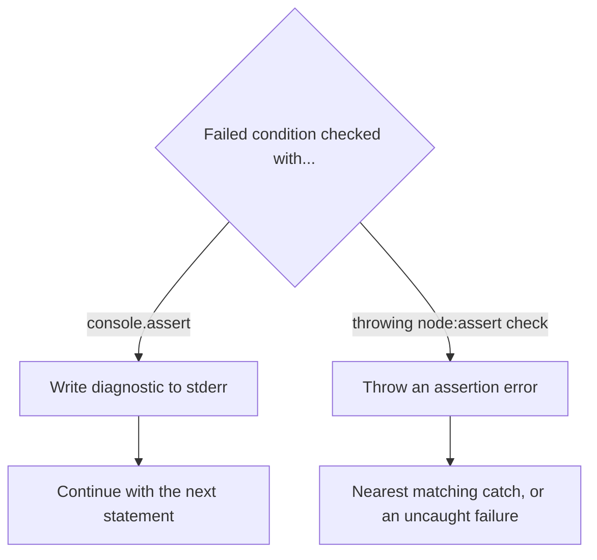
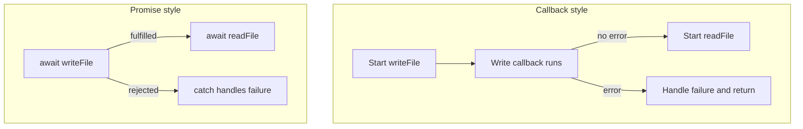
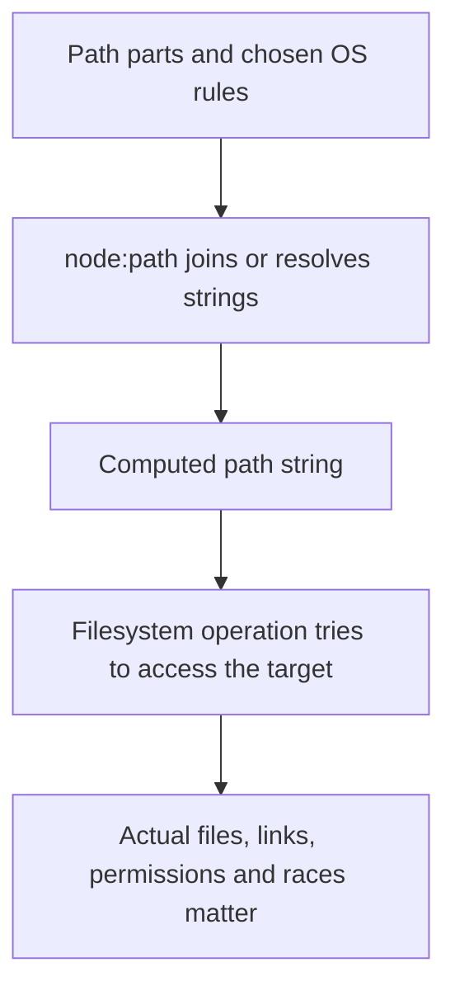
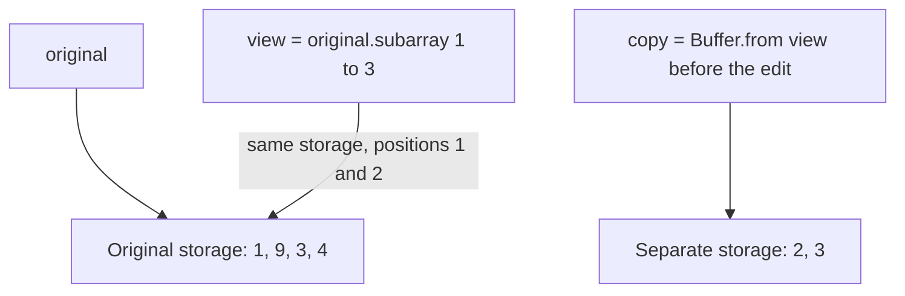
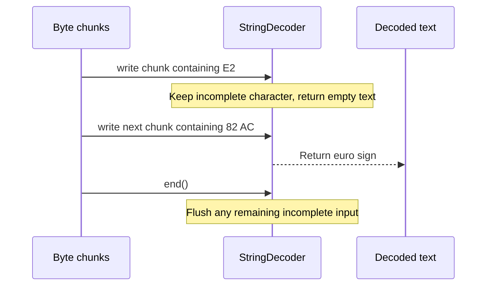
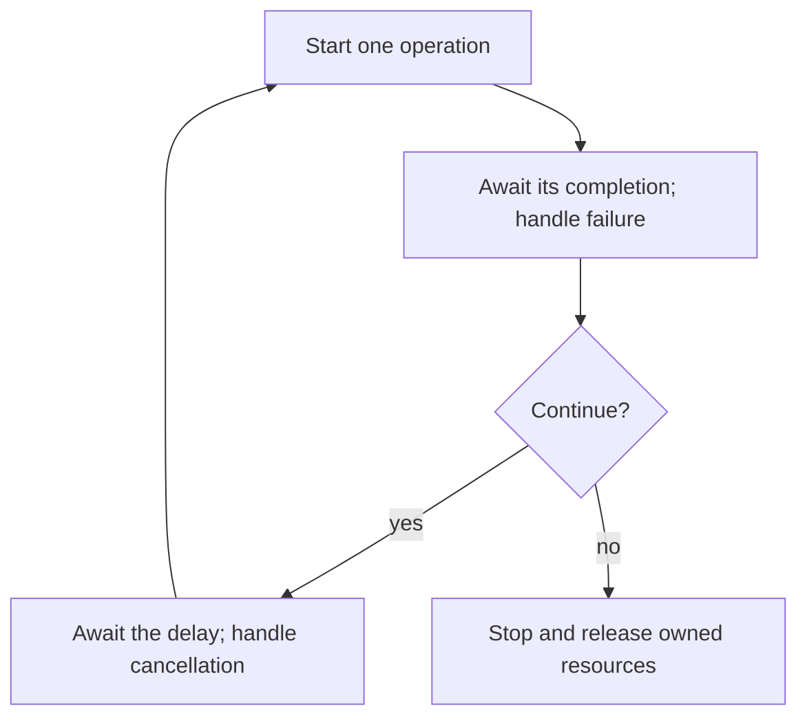
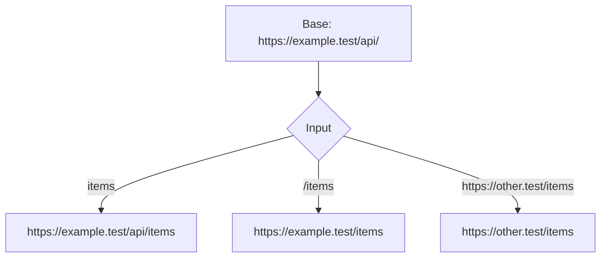
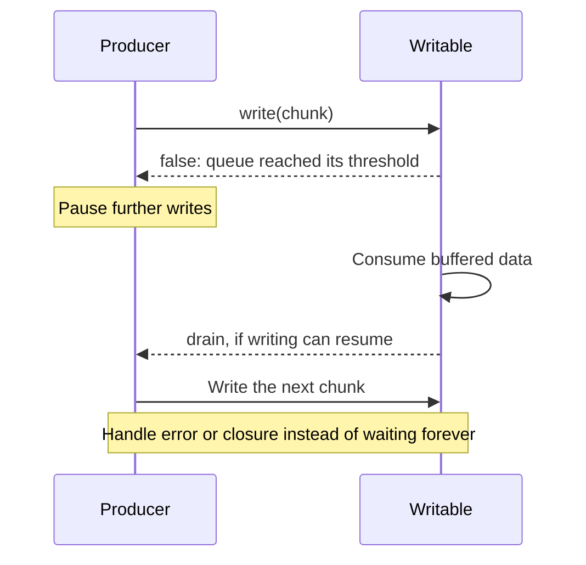
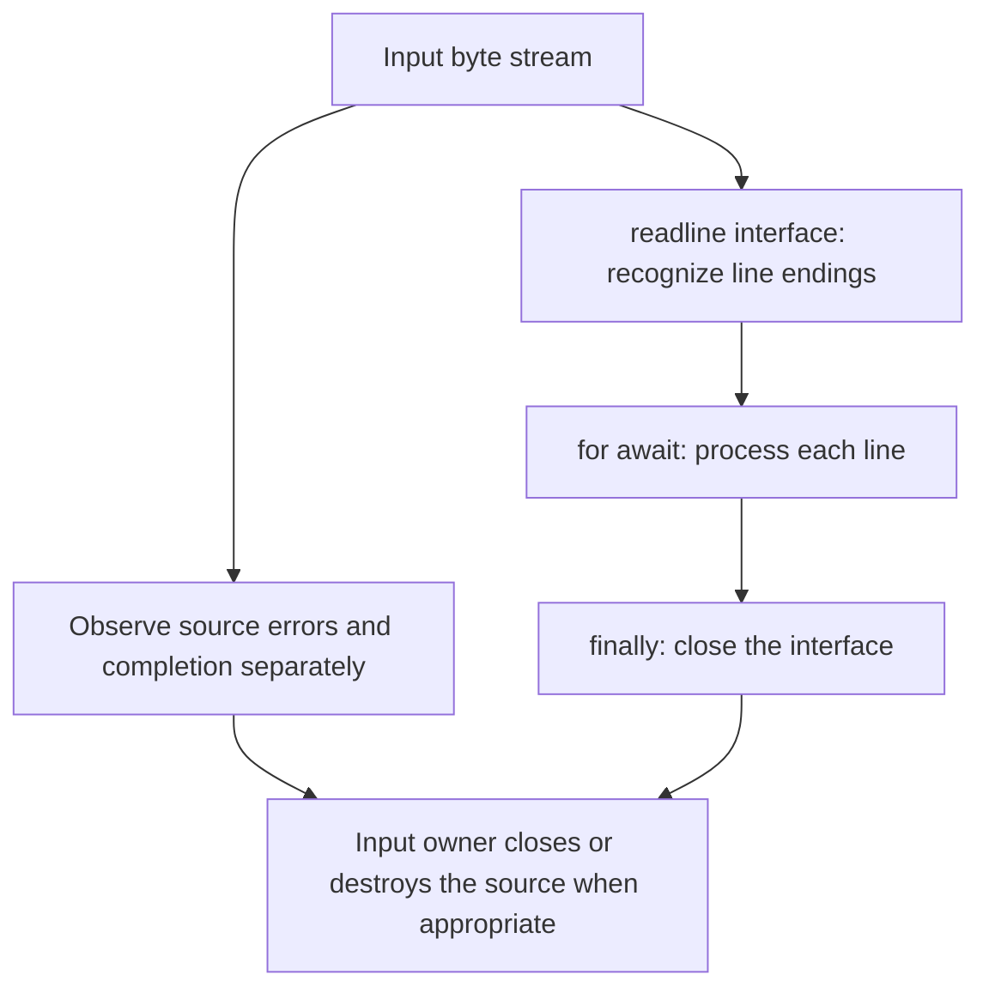
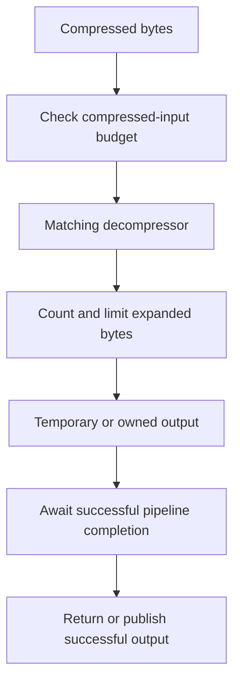

# Core Node.js APIs

This chapter covers Console, asynchronous filesystem operations, Path and OS. Examples are standalone `.mjs` files on Node.js 24.18.0 with no external dependencies. It also covers Buffer, StringDecoder, timers and URL/URI handling; as well as streams, readline, crypto and compression.


<span class="notes-section-label">**First pass:**</span> use console output, read/write one small file and build paths (questions 1–3). Then try the file-copy example in question 9. Look up OS facts, bytes, decoding, timers, URLs and readline as your CLI needs them. Custom streams, authentication helpers and bounded decompression are later labs; you do not need to implement them to finish the starter CLI.

The expandable deeper explanations preserve the additional examples. Common mistakes, examiner follow-ups and key takeaways stay visible outside them. **You can return to them after you can explain and change the starter example.** Career labels describe the eventual assessment target, not what you must master on your first reading.

<!-- tech-check: t07-q01; level: 1 -->

### How should console output, diagnostics and timing be used without obscuring application behaviour?

*Study depth: Intermediate*

Level Up: L2 — Software Engineer\
Tech Check level: ⭐

Source mapping: [R011](./requirements.md#r011).


<span class="notes-section-label">**Example — predict stdout, stderr and whether assert stops execution**</span>

Save as `console.mjs`, then run with stdout and stderr captured separately.

```js
import { performance } from 'node:perf_hooks';
const started = performance.now();
console.log(JSON.stringify({ result: 6 }));
console.warn('fixture warning');
console.assert(false, 'fixture invariant');
console.error('continued after console.assert');
const elapsed = performance.now() - started;
console.error(JSON.stringify({ event: 'completed', elapsedMs: elapsed }));
```

<div class="notes-core-answer">

<p class="notes-core-answer__title">Core answer</p>

The console helps you print values, error messages and timing information. **`console.log()` and `console.info()` write to `stdout`; `warn()` and `error()` write to `stderr`.** Keep a CLI's normal data output separate from its diagnostic messages.

**`console.assert()` prints a message when an assertion fails; it does not throw.** Use `node:assert` or explicit validation when a failure must interrupt the operation. Console writes may be synchronous or asynchronous depending on the platform and destination. Too much logging can slow the program, change timing measurements or reveal secrets, so choose what and how much to log.

</div>

<span class="notes-section-label">**Compare printing with throwing**</span>

A failed console assertion reports a message and continues. A throwing assertion changes control flow.




:::: details Deeper explanation and additional examples

<span class="notes-section-label">**Detailed explanation**</span>

stdout contains one JSON result line. stderr contains the warning, a diagnostic including fixture invariant, continued after console.assert, then a JSON event with a nonnegative elapsedMs. The process still exits successfully. Exact elapsed duration and assertion formatting are not stable business contracts.

When capturing both descriptors, do not assert a total combined order: distinct streams can be observed independently by the parent or collector.

console.time/timeLog/timeEnd track named elapsed intervals; match labels and avoid reusing one global label for overlapping requests. console.count/countReset can help count a local code path, and table/dir/trace are exploratory tools.

Object inspection formatting is not a versioned serialization format. console.trace reports a stack without inherently throwing. Inspector-oriented profiling helpers require their intended tooling; a console call alone is not a CPU profile.

performance.now or hrtime supplies monotonic elapsed measurements; Date timestamps locate events in wall-clock time and can change with clock adjustments. The example includes logging overhead in its measured interval. For meaningful performance work, isolate the operation, warm up as appropriate and measure representative distributions rather than one printed sample.

Never dump process.env, request credentials or entire user records to diagnose a failure. Select safe fields, redact secrets before output and consider terminal/control-character injection from untrusted text. Structured JSON gives parsers an explicit record shape; it does not automatically provide access control, retention or a bounded queue.

At high volume, use a logger with an explicit buffering/backpressure/failure policy. The default Console can ignore underlying write errors; **successful return is not proof a record reached durable storage**.

::::

<span class="notes-section-label">**Common mistakes**</span>

- Using console.assert as application validation or a failing test assertion.
- Mixing human progress messages into a JSON-only stdout contract.
- Assuming a console call proves durable delivery or is always nonblocking.
- Logging secrets or benchmarking the logger instead of the operation.

<span class="notes-section-label">**Examiner follow-ups**</span>

1. <span class="notes-section-label">**Does console.error set a failing exit code?**</span> No. Set process.exitCode deliberately or propagate the error to an owning boundary.
2. <span class="notes-section-label">**Can a custom Console use other streams?**</span> Yes. Instantiate Console from node:console with owned writable destinations; own their completion and errors too.
3. <span class="notes-section-label">**Should tests compare an inspected object's spacing?**</span> Usually no. Assert structured fields or captured stream contracts; inspection style can change across versions/options.

::: tip Key takeaway
Output is an interface with timing, privacy and delivery costs, not a substitute for validation.
:::


---

<!-- tech-check: t07-q02; level: 1 -->

### How do callback and promise file APIs differ, and who owns write completion?

*Study depth: Intermediate*

Level Up: L2 — Software Engineer\
Tech Check level: ⭐, ⭐⭐⭐⭐

Source mapping: [R012](./requirements.md#r012), [R111](./requirements.md#r111).


<div class="notes-core-answer">

<p class="notes-core-answer__title">Core answer</p>

Both callback-based file APIs and `node:fs/promises` can perform asynchronous file operations. The first reports the result through callback arguments; the second returns a promise you can await inside `try/catch`. Prefer the built-in promise API for new promise-based code. **`readFile()` returns bytes as a `Buffer` unless you specify a text encoding.**

**Wait for a write to finish before starting another write to the same target.** Handle failures and close any file handles you opened. By default, `writeFile()` can replace existing content. The `wx` flag creates a new file and fails if the target already exists. A completed write is not automatically a transaction or a guarantee that data will survive a system crash. Cancellation does not guarantee that nothing was written.

</div>

<span class="notes-section-label">**Wait for completion before the next file operation**</span>

Both paths express the same dependency: read only after a successful write. Each failure needs an error path.




<span class="notes-section-label">**Start here — one working example**</span>

Save as `small-file.mjs` in a learning folder:

```js
import { writeFile, readFile } from 'node:fs/promises';

try {
  await writeFile('study-message.txt', 'Hello from Node!', 'utf8');
  const text = await readFile('study-message.txt', 'utf8');
  console.log(text);
} catch {
  console.error('Could not write or read the message');
  process.exitCode = 1;
}
```

Run `node small-file.mjs`. It prints `Hello from Node!` and leaves the text file for you to inspect. **This overwrites `study-message.txt` if it already exists**, so use a learning folder. The first `await` finishes the write before the read starts. `utf8` makes the read return text. Try changing the filename to a missing subdirectory to observe an error.

This is for one small local file. The deeper example compares callbacks, raw bytes and exclusive creation without overwriting existing files.


:::: details Deeper explanation and additional examples

<span class="notes-section-label">**Example — predict bytes versus characters and exclusive creation failure**</span>

Save as `files.mjs`. All mutations stay under a newly created private temporary directory owned by this invocation.

```js
import { writeFile as writeCallback, readFile as readCallback } from 'node:fs';
import { mkdtemp, readFile, writeFile, rm } from 'node:fs/promises';
import { tmpdir } from 'node:os';
import { join } from 'node:path';
export function callbackRoundTrip(file, text) {
  return new Promise((resolve, reject) => {
    writeCallback(file, text, { encoding: 'utf8', flag: 'wx' }, error => {
      if (error) { reject(error); return; }
      readCallback(file, 'utf8', (error, value) => {
        if (error) { reject(error); return; }
        resolve(value);
      });
    });
  });
}
const directory = await mkdtemp(join(tmpdir(), 'tech-check-files-'));
try {
  const first = join(directory, 'first.txt');
  console.log(await callbackRoundTrip(first, 'café'));
  const second = join(directory, 'second.txt');
  await writeFile(second, 'café', { encoding: 'utf8', flag: 'wx' });
  console.log((await readFile(second)).length, (await readFile(second, 'utf8')).length);
  try { await writeFile(second, 'replacement', { flag: 'wx' }); }
  catch (error) { console.log(error.code); }
  console.log(await readFile(second, 'utf8'));
} finally {
  await rm(directory, { recursive: true, force: true });
}
```

<span class="notes-section-label">**Detailed explanation**</span>

Output is café, `5 4`, EEXIST, then café. UTF-8 uses five bytes for this text, while its JavaScript string has four UTF-16 code units. The callback wrapper is justified interoperability: its promise settles only after the write callback and then read callback. An error returns before a later stage can start. The native-promise path expresses the same dependency with awaits.

Don't check exists/access and then assume the write will succeed: the tree can change between check and operation. Attempt the real operation and inspect a stable error code such as ENOENT, EACCES or EEXIST. Not every failure means missing input, and platform permissions/directory-read behaviour can differ.

Preserve context/cause at a meaningful boundary without exposing sensitive paths in public diagnostics.

Whole-file reads retain the input in memory. Use them for bounded small files; streams or bounded handle reads suit larger/untrusted sources. Metadata size checks can race concurrent mutation and are not a complete byte budget. FileHandle users must close in finally; partial reads and writes require checking actual byte counts and completing a protocol deliberately.

Serialize modifications to shared files. Overlapping writeFile calls do not create ordered transactions. For publishing a replacement, a temporary sibling plus rename can improve visibility, but crash durability requires filesystem-specific flush/recovery reasoning; cross-device rename may fail.

AbortSignal support is best effort for supported APIs and can leave partial content. Exclusive creation protects this owned target from overwrite, not hostile ancestor replacement or an entire multi-file workflow.

::::

<span class="notes-section-label">**Common mistakes**</span>

- Starting the read before its required write settles.
- Assuming no encoding returns a string, or string length counts bytes.
- Swallowing every error as ENOENT or performing overlapping same-target writes.
- Applying recursive cleanup to a user-controlled path instead of an owned fixture directory.

<span class="notes-section-label">**Examiner follow-ups**</span>

1. <span class="notes-section-label">**Why wrap the callback API here?**</span> To demonstrate interoperability and let the caller await both stages. Prefer native fs/promises when no callback integration is required.
2. <span class="notes-section-label">**Does writeFile success prove crash durability?**</span> No. It signals API completion; persistence/flush/directory metadata and recovery policy are separate.
3. <span class="notes-section-label">**What if cleanup fails?**</span> Finally can replace an earlier outcome. Decide whether to preserve both errors, report cleanup separately or fail the whole operation; do not assume cleanup always succeeds.

::: tip Key takeaway
File API style changes composition; ordering, bytes, ownership and persistence still need explicit contracts.
:::


---

<!-- tech-check: t07-q03; level: 1 -->

### What does path resolve, and why is normalization not a security boundary?

*Study depth: Intermediate*

Level Up: L2 — Software Engineer\
Tech Check level: ⭐

Source mapping: [R107](./requirements.md#r107).


<span class="notes-section-label">**Example — compare lexical paths without accessing disk**</span>

Save as `paths.mjs`. Explicit posix/win32 objects make these string results independent of the host OS.

```js
import { posix, win32 } from 'node:path';
export function lexicallyWithin(api, base, candidate) {
  const relative = api.relative(api.resolve(base), api.resolve(candidate));
  return relative !== '..' && !relative.startsWith(`..${api.sep}`) &&
    !api.isAbsolute(relative);
}
console.log(posix.join('/srv/app', '/logs', 'a.txt'));
console.log(posix.resolve('/srv/app', '/logs', 'a.txt'));
console.log(posix.extname('archive.tar.gz'));
console.log(win32.basename('C:\\notes\\lesson.txt'));
console.log(lexicallyWithin(posix, '/srv/data', '/srv/data/..notes'));
console.log(lexicallyWithin(posix, '/srv/data', '/srv/data-other/file'));
```

<div class="notes-core-answer">

<p class="notes-core-answer__title">Core answer</p>

**`node:path` works with path strings; it does not inspect files.** `join()` combines path parts and cleans up separators and `..` segments. `resolve()` creates an absolute path; an absolute part farther to the right can replace the earlier parts. Helpers such as `basename()`, `dirname()` and `extname()` extract parts of the string.

The default rules follow the current operating system. Use `path.posix` or `path.win32` when you need one specific path format. **A cleaned-up path is not proof that access is safe.** The file may not exist, the caller may lack permission, or a symbolic link may point outside the intended directory. String checks alone cannot prevent every filesystem race.

</div>

<span class="notes-section-label">**Separate a path string from a real file**</span>

The path API computes a name. Accessing that name adds filesystem behavior, including permissions and symbolic links.




:::: details Deeper explanation and additional examples

<span class="notes-section-label">**Detailed explanation**</span>

Output is `/srv/app/logs/a.txt`, `/logs/a.txt`, `.gz`, lesson.txt, true and false. The name ..notes is a normal child segment, not the parent segment ... A string startsWith(base) test would incorrectly accept the data-other sibling. The helper uses relative segment boundaries and rejects an absolute result, including different Windows volumes.

It intentionally accepts the base itself; a file-only operation must require the correct opened object type too.

Resolve's cwd fallback means the same relative input can identify different locations when launched elsewhere or after chdir. User-facing project paths may intentionally use cwd. Packaged files beside an ESM module can instead use new URL('./asset.txt', import.meta.url) with an API that accepts file URLs.

Do not use url.pathname as a general file-path decoder; node:url fileURLToPath handles encoded characters and platform conventions. URL parsing is continued in a later T07 question.

For an existing path in an application-owned immutable tree, checking canonical realpath containment can detect already-present symlink escapes. realpath then open is still not atomic if another actor can swap entries. lstat or final-component no-follow checks alone do not constrain every ancestor.

Prefer opaque server-generated storage names, service-owned directories and an OS/storage boundary designed for the threat model. The [existing path-safety explanation](../module-02-standard-library.md#_4-path) discusses those limits.

Case, drive-relative Windows paths, UNC roots, separators and filesystem normalization require real platform tests. Parsing win32 strings on macOS verifies lexical behaviour only. An extension is metadata, not content validation; a .txt suffix does not prove safe text.

Decode/validate external identifiers according to their input contract before filesystem resolution, without repeated decoding that can change their meaning unexpectedly.

::::

<span class="notes-section-label">**Common mistakes**</span>

- Treating join and resolve as interchangeable or using startsWith for containment.
- Rejecting every filename beginning with two dots while missing sibling-prefix escapes.
- Assuming realpath-then-open removes hostile mutation races.
- Claiming lexical Windows examples prove Windows filesystem security.

<span class="notes-section-label">**Examiner follow-ups**</span>

1. <span class="notes-section-label">**Does path.normalize read symlinks?**</span> No; it only rewrites the string representation.
2. <span class="notes-section-label">**Does extname return .tar.gz?**</span> For archive.tar.gz it returns only .gz. An application must define compound suffix policy.
3. <span class="notes-section-label">**Does absolute mean allowed?**</span> No. It describes how a path is rooted, not who may access it.

::: tip Key takeaway
Path utilities express names; authorization and filesystem identity are separate concerns.
:::


---

<!-- tech-check: t07-q04; level: 1 -->

### Which OS facts are useful, and which should not drive automatic tuning?

*Study depth: Intermediate*

Level Up: L4 — Lead\
Tech Check level: ⭐

Source mapping: [R040](./requirements.md#r040).


<span class="notes-section-label">**Example — explain each unit and deliberate omission**</span>

Save as `os-info.mjs`. It prints no username, home directory, hostname or interface addresses.

```js
import { availableParallelism, platform, arch, totalmem, freemem, tmpdir, EOL } from 'node:os';
console.log(JSON.stringify({
  platform: platform(),
  binaryArchitecture: arch(),
  parallelismHint: availableParallelism(),
  totalBytes: totalmem(),
  freeBytes: freemem(),
  hasTemporaryDirectory: typeof tmpdir() === 'string' && tmpdir().length > 0,
  lineEnding: EOL === '\r\n' ? 'CRLF' : 'LF'
}));
```

<div class="notes-core-answer">

<p class="notes-core-answer__title">Core answer</p>

`node:os` reports facts such as the platform, architecture, system memory and temporary directory. **System information is a starting point, not a guarantee of what your application can use.** Check each value's meaning and units.

For CPU work, start with `availableParallelism()` rather than simply counting `cpus()`, then choose a worker limit based on deployment restrictions and measurements. **System memory is not the same as the process's JavaScript heap limit.** Create unique temporary resources and clean them up. Avoid casually logging hostnames, user details or network addresses.

</div>


:::: details Deeper explanation and additional examples

<span class="notes-section-label">**Detailed explanation**</span>

The JSON shape is stable but actual platform, memory and parallelism values vary. Memory values are bytes; they are not percentages or evidence that an allocation will succeed. arch describes the architecture for which this Node binary was built, not necessarily the physical machine under emulation. platform is a runtime platform identifier rather than a complete distribution/version inventory.

availableParallelism estimates useful parallelism under available system constraints, but it does not prescribe an HTTP connection limit, native pool size or database pool size. Container quotas, CPU sharing, memory per worker, other workloads and latency goals still matter.

A zero-work script should not spawn a worker for every logical CPU simply because a probe returned a large number. Process memoryUsage separates heap and native/external contributions; constrainedMemory/availableMemory can add process/container context on supported systems, but still need runtime-specific interpretation.

EOL is a platform convention. Protocols and file formats can require their own fixed newline independently of the host; JSON Lines tooling often specifies LF. tmpdir gives a candidate location, not a unique private directory or durability guarantee. Use mkdtemp under that root, keep cleanup scoped to the returned owned directory and never assume temporary data persists after restarts.

cpus provides per-logical-CPU snapshots; calculating utilization needs deltas, not interpreting cumulative counters as instantaneous percentages. loadavg has Unix-style scope and returns zeros on Windows, so a cross-platform dashboard cannot equate it with request queue length or CPU percentage. networkInterfaces, userInfo, hostname and homedir can expose identifying information; expose only necessary reviewed fields.

Avoid collecting an entire environment dump for one configuration bug.

::::

<span class="notes-section-label">**Common mistakes**</span>

- Tuning every pool from cpus().length or assuming free system memory is safe heap capacity.
- Confusing binary architecture with physical hardware or platform with full OS version.
- Using host EOL for a protocol with a specified delimiter.
- Storing shared secrets at a predictable temporary filename or exposing host inventory publicly.

<span class="notes-section-label">**Examiner follow-ups**</span>

1. <span class="notes-section-label">**Why not print tmpdir itself?**</span> This diagnostic only needs to prove configuration exists; the path can reveal local identity without helping its stated purpose.
2. <span class="notes-section-label">**Does a memory snapshot prevent out-of-memory failures?**</span> No. Concurrent allocations, quotas and other consumers can change availability immediately.
3. <span class="notes-section-label">**What should a worker-pool decision retain?**</span> Workload measurements, queue/memory limits, runtime/deployment constraints and the chosen cap, not just a hardware count.

::: tip Key takeaway
Use OS facts as scoped diagnostic inputs, then choose capacity from the workload and deployment budget.
:::

## practice — learner work remains required {#b12-practice--learner-work-remains-required}

- [ ] Capture the console fixture's two descriptors independently; assert JSON result shape, diagnostic content and successful exit after console.assert. Replace assert with a real failing validation and show the changed outcome.
- [ ] Implement both callback and promise round-trips in an owned temporary directory. Assert Unicode byte/code-unit counts, missing-parent errors, exclusive-create EEXIST and retained original content; clean up on every path.
- [ ] Test lexical path handling for child, sibling prefix, parent, ..notes, Windows volume change and packaged files launched from another cwd. Explain why lexical success cannot authorize a symlink escape.
- [ ] Produce a minimal OS report with explicit units and no identifying fields, then justify a hypothetical worker cap separately from the parallelism hint.

Acceptance: executable assertions cover results, error codes, stream separation, original-content preservation and owned cleanup. Platform-specific filesystem/security behaviours need an actual platform fixture; lexical syntax checks do not prove them.

Official references checked 2026-11-04: Node 24.18 [Console](https://nodejs.org/download/release/v24.18.0/docs/api/console.html), [filesystem contracts](https://nodejs.org/download/release/v24.18.0/docs/api/fs.html), [Path](https://nodejs.org/download/release/v24.18.0/docs/api/path.html), [OS](https://nodejs.org/download/release/v24.18.0/docs/api/os.html). The examples deliberately state their runtime baseline and filesystem/security limits.


---

<!-- tech-check: t07-q05; level: 1 -->

### How do Buffer bytes and memory ownership differ from JavaScript strings?

*Study depth: Intermediate*

Level Up: L3 — Senior\
Tech Check level: ⭐

Source mapping: [R036](./requirements.md#r036), [R118](./requirements.md#r118).


<span class="notes-section-label">**Example — predict which changes are shared**</span>

Save as `buffers.mjs`.

```js
const original = Buffer.from([1, 2, 3, 4]);
const view = original.subarray(1, 3);
const copy = Buffer.from(view);
view[0] = 9;
console.log([...original].join(','), [...copy].join(','));
const exact = new Uint8Array(view.buffer, view.byteOffset, view.byteLength);
exact[1] = 8;
console.log([...view].join(','));
console.log('𐐷'.length, Buffer.byteLength('𐐷', 'utf8'));
const record = Buffer.alloc(4);
record.writeUInt32BE(258, 0);
console.log(record.toString('hex'), record.readUInt32BE(0));
```

<div class="notes-core-answer">

<p class="notes-core-answer__title">Core answer</p>

A `Buffer` holds a fixed number of bytes and is a type of `Uint8Array`. A JavaScript string represents text using UTF-16 code units. **A string's `.length` is not its encoded byte size.** `Buffer.from(text)` encodes text into bytes.

**`Buffer.from(buffer)` copies bytes; `subarray()` and `Buffer.slice()` share the original storage.** Changing a shared view can therefore change the original buffer. `Buffer.from(arrayBuffer, offset, length)` can also share storage. Use a copy when data needs to change independently or when a small view would keep a large allocation in memory. Prefer initialized `Buffer.alloc()`; never expose uninitialized memory.

</div>

<span class="notes-section-label">**See shared bytes and copied bytes**</span>

This follows the Buffer example after view[0] = 9. The view reaches bytes in the original allocation; the copy has its own bytes.




:::: details Deeper explanation and additional examples

<span class="notes-section-label">**Detailed explanation**</span>

Output is `1,9,3,4 2,3`, `9,8`, `2 4`, and `00000102 258`. Both view and exact share original's memory, while copy keeps its initial bytes. A Buffer's byteOffset and byteLength matter: its .buffer may describe a larger allocation, especially for pooled small buffers.

Constructing a view over that entire ArrayBuffer can expose bytes outside the intended logical range. Pass the view itself where supported, or explicitly preserve its offset and length.

A small view can keep a much larger backing store alive. Copying the needed bytes trades allocation/copy cost for lifetime isolation; even a copied small buffer may participate in a pool, so do not assume .buffer has precisely its logical length. Repeated Buffer.concat during accumulation repeatedly copies retained data and can become expensive.

Accumulate under explicit byte limits or use a streaming design rather than growing a single buffer indefinitely.

Buffer.allocUnsafe avoids guaranteed zero initialization and must be completely overwritten before any read, logging or transmission. A short file read can leave part of an allocated region unused; expose only initialized bytes actually read. Do not claim unsafe allocation is necessary without measurement.

Inspect process.memoryUsage external/arrayBuffers and RSS as well as heap: Buffer-backed growth can escape a heap-only dashboard, and arrayBuffers is included within external accounting rather than a separate value to add blindly.

For binary protocols, specify field widths, signedness and endianness; explicit read/write methods make that contract visible. Range/bounds errors are useful failures, not a reason to truncate unchecked input. Base64 and hex encode bytes for text transport; neither encrypts nor validates a complete message. Keep binary data as bytes until the format actually calls for decoding.

::::

<span class="notes-section-label">**Common mistakes**</span>

- Expecting Buffer.slice to copy like Array.slice.
- Passing buf.buffer without retaining byteOffset/byteLength.
- Counting Unicode string code units as wire bytes.
- Exposing unwritten allocUnsafe bytes or treating heap size as all process memory.

<span class="notes-section-label">**Examiner follow-ups**</span>

1. <span class="notes-section-label">**Is Buffer.from(arrayBuffer) necessarily independent?**</span> No. That overload shares its backing memory; Buffer.from(buffer) copies the buffer's logical bytes.
2. <span class="notes-section-label">**When is a copy useful despite its cost?**</span> When the consumer outlives the producer's mutable view, or retaining a small region would retain a much larger allocation.
3. <span class="notes-section-label">**Does Buffer.concat impose an admission budget?**</span> No. The caller must bound input lengths and retained queues before allocating.

::: tip Key takeaway
Track byte range, backing-store lifetime and mutation ownership separately from text meaning.
:::


---

<!-- tech-check: t07-q06; level: 1 -->

### How does StringDecoder preserve text across arbitrary byte chunks?

*Study depth: Intermediate*

Level Up: L1 — Junior\
Tech Check level: ⭐

Source mapping: [R013](./requirements.md#r013).


<span class="notes-section-label">**Example — split a UTF-8 character in the middle**</span>

Save as `decoding.mjs`.

```js
import { StringDecoder } from 'node:string_decoder';
const bytes = Buffer.from('A€𐐷Z');
const chunks = [bytes.subarray(0, 2), bytes.subarray(2, 5), bytes.subarray(5)];
const naive = chunks.map(chunk => chunk.toString('utf8')).join('');
const decoder = new StringDecoder('utf8');
const decoded = chunks.map(chunk => decoder.write(chunk)).join('') + decoder.end();
console.log(naive === 'A€𐐷Z', decoded === 'A€𐐷Z');
const truncated = new StringDecoder('utf8');
console.log(JSON.stringify(truncated.write(Buffer.from([0xe2]))));
console.log(JSON.stringify(truncated.end()));
try {
  new TextDecoder('utf-8', { fatal: true }).decode(Buffer.from([0xe2]));
} catch (error) { console.log(error.name); }
```

<div class="notes-core-answer">

<p class="notes-core-answer__title">Core answer</p>

Data arriving in chunks can split a UTF-8 character between two chunks. **Decoding each chunk separately can damage the text.** `StringDecoder` keeps an incomplete character's bytes and combines them with bytes from the next `write()`. Call `end()` when the stream finishes, and use a separate decoder for each text stream.

**`StringDecoder` tolerates invalid input rather than rejecting all of it.** Invalid or unfinished characters may become replacement characters. For strict UTF-8 checks, use `TextDecoder` with `fatal: true` and handle streaming and the final flush correctly. Decoding characters does not identify complete application messages or limit their size.

</div>

<span class="notes-section-label">**Trace a character split across chunks**</span>

The euro sign uses UTF-8 bytes E2 82 AC. The decoder waits for the missing bytes instead of decoding the first byte by itself.




:::: details Deeper explanation and additional examples

<span class="notes-section-label">**Detailed explanation**</span>

Output is `false true`, then `""`, `"�"`, and TypeError. The first truncated write buffers an incomplete sequence without emitting text; end signals no more bytes will arrive and produces the replacement. Omitting end can silently discard a final incomplete tail. Flushing after every chunk instead destroys the state needed to assemble split characters.

A decoder is encoding-specific. UTF-8 is not interchangeable with latin1 or UTF-16LE, and guessing from a filename is not a sound protocol. StringDecoder handles the boundaries its supported encoding defines; it does not normalize Unicode, combine application grapheme clusters, validate JSON or identify line-delimited records.

A correctly decoded combining mark can still arrive in a different string fragment from its preceding character.

For strict incremental TextDecoder use decode(chunk, {stream:true}) for each chunk, then decode() to flush; fatal errors can surface during a chunk or final flush. Use a fresh/reset lifecycle for each independent message stream. In Node readable streams, setEncoding('utf8') integrates decoding state, but also changes delivered values and buffering units; stream design is continued in streams, crypto and compression.

Enforce byte budgets before unbounded accumulation and record/decoded-length limits as required by the format. A giant delimiter-free line can exhaust memory even with correct decoding. Distinguish transport truncation, invalid encoding and invalid application content; a replacement character might be acceptable for a log viewer but unacceptable for an integrity-sensitive message.

::::

<span class="notes-section-label">**Common mistakes**</span>

- Creating a new decoder for every chunk or forgetting the final flush.
- Treating tolerant decoding as proof input was valid UTF-8.
- Assuming one chunk is one character, line or JSON document.
- Decoding arbitrary binary data and assuming it can round-trip losslessly.

<span class="notes-section-label">**Examiner follow-ups**</span>

1. <span class="notes-section-label">**Can every byte split of valid UTF-8 be decoded correctly?**</span> With a stateful decoder and final flush, yes for this encoding contract; test all split positions, not only one fortunate chunking.
2. <span class="notes-section-label">**Does decoder.end mean a record delimiter?**</span> No. It means the logical input has ended; message framing belongs to the surrounding protocol.
3. <span class="notes-section-label">**Why might strict decoding be preferable?**</span> A protocol may require rejecting malformed/truncated bytes rather than interpreting a repaired string with changed meaning.

::: tip Key takeaway
Keep decoding state across transport chunks, and define whether malformed text is tolerated or rejected.
:::


---

<!-- tech-check: t07-q07; level: 1 -->

### How do timers interact with async work, cancellation and process lifetime?

*Study depth: Intermediate*

Level Up: L2 — Software Engineer\
Tech Check level: ⭐

Source mapping: [R014](./requirements.md#r014), [R113](./requirements.md#r113).


<span class="notes-section-label">**Example — explain cancellation and repeated-work ordering**</span>

Save as `timers.mjs`. No assertion depends on an exact elapsed millisecond count.

```js
import { setTimeout as sleep } from 'node:timers/promises';
const controller = new AbortController();
const pending = sleep(60_000, 'late', { signal: controller.signal });
const observed = pending.catch(error => error.name);
controller.abort();
console.log(await observed);
const background = setTimeout(() => console.log('unexpected background'), 60_000);
console.log(background.hasRef());
background.unref();
console.log(background.hasRef());
clearTimeout(background);
let active = 0, peak = 0;
for (let iteration = 0; iteration < 3; iteration++) {
  active++; peak = Math.max(peak, active);
  try { await sleep(1); }
  finally { active--; }
  if (iteration < 2) await sleep(1);
}
console.log('peak', peak, 'active', active);
```

<div class="notes-core-answer">

<p class="notes-core-answer__title">Core answer</p>

**A timer's delay is the earliest time its callback may become ready, not a guaranteed execution time.** Other work can delay it. Cancel callback timers with `clearTimeout()` or `clearInterval()`. Promise-based timers can be awaited and cancelled using an `AbortSignal`.

Timers normally keep Node running. **`unref()` allows Node to exit without waiting for that timer; it does not cancel it.** `setInterval()` does not wait for an async callback to finish, so several runs can overlap. To avoid overlap, await the operation and then await the delay before starting the next run. Handle errors and provide a way to stop the loop.

</div>

<span class="notes-section-label">**Avoid overlapping timer work**</span>

This is an awaited repetition loop. The next operation begins after the previous operation and the chosen delay finish.




:::: details Deeper explanation and additional examples

<span class="notes-section-label">**Detailed explanation**</span>

Output is AbortError, true, false, and `peak 1 active 0`. The abort rejection is observed immediately. The background timer is explicitly cleared after demonstrating its reference state; no delayed callback should print. unref alone would permit a later callback if other work kept the process alive. A pending promise by itself is not a guarantee the process stays alive.

The finite loop serializes operations. Waiting after completion creates fixed-delay behaviour: start-to-start time includes work duration plus the delay.

A fixed-rate scheduler instead needs an explicit policy for missed ticks, overlap, skipped runs or catch-up. setInterval with an async callback can start the next invocation while an earlier one is awaiting I/O; catch errors within the owned chain and do not accidentally accumulate an unlimited backlog.

Validate externally supplied delays. On the stated Node baseline, timer delays outside the supported range or below 1 are normalized, and fractional values are truncated; enormous numbers do not reliably create enormous deadlines. setImmediate targets check-phase opportunities rather than a zero-delay timeout, with context-sensitive ordering covered in [T06](./06-events-and-event-loop.md#t06-q03).

A timeout race selects a response, not resource termination. Release deadline handles in finally, propagate a supported signal and retain supervision of operations that ignore it. refresh reschedules an existing timeout using its existing duration, useful for an idle timer whose ownership is clear.

CPU-blocked JavaScript can prevent both timers and cleanup running; use an external supervisor for a hard process boundary. Promise-based setInterval provides async iteration but still needs an intentional backlog and shutdown policy; it is not an automatic distributed scheduler.

::::

<span class="notes-section-label">**Common mistakes**</span>

- Assuming unref cancels or guarantees the callback will run.
- Using setInterval(async...) as if it waits for each invocation.
- Promising exact timing or accepting invalid/overflowing external delays.
- Clearing a deadline when headers arrive while body work remains unbounded.

<span class="notes-section-label">**Examiner follow-ups**</span>

1. <span class="notes-section-label">**What should own a periodic task?**</span> A component with a stop signal, in-flight completion promise, error policy and cleanup; shutdown should stop new runs and supervise the active run.
2. <span class="notes-section-label">**Can a timeout interrupt a synchronous loop?**</span> No. Its callback needs the JavaScript thread to progress.
3. <span class="notes-section-label">**Does a timer survive process restart?**</span> No. Durable scheduled jobs require persisted scheduling/claim/recovery semantics elsewhere.

::: tip Key takeaway
Timers control scheduling intent; the owner controls overlap, failure, cancellation and lifetime.
:::


---

<!-- tech-check: t07-q08; level: 1 -->

### How should URL and URI components be parsed and encoded?

*Study depth: Intermediate*

Level Up: L1 — Junior\
Tech Check level: ⭐

Source mapping: [R015](./requirements.md#r015).


<span class="notes-section-label">**Example — predict duplicate parameters and relative resolution**</span>

Save as `urls.mjs`. These .test addresses are parsed only; no request is made.

```js
import { pathToFileURL, fileURLToPath } from 'node:url';
import { resolve } from 'node:path';
const target = new URL('items?tag=a&tag=b', 'https://example.test/api/');
target.searchParams.set('q', 'a+b & café');
console.log(target.pathname, JSON.stringify(target.searchParams.getAll('tag')));
console.log(new URL(target.href).searchParams.get('q'));
console.log(new URL('/items', 'https://example.test/api/').pathname);
console.log(new URLSearchParams('q=a+b').get('q'));
console.log(encodeURIComponent('a/b?c'));
try { decodeURIComponent('%zz'); }
catch (error) { console.log(error.name); }
const ownedName = resolve('fixture space#.txt');
console.log(fileURLToPath(pathToFileURL(ownedName)) === ownedName);
```

<div class="notes-core-answer">

<p class="notes-core-answer__title">Core answer</p>

Use `URL` to parse a URL or resolve it against a base, and `URLSearchParams` to handle query parameters. This avoids many mistakes from joining strings manually. Relative URLs depend on the base path and its trailing slash. **An absolute URL can replace the base origin**, including its host.

**Encode individual values using the rules for where they appear in the URL.** Do not encode a complete URL as if it were one component or decode data repeatedly. In form-style query encoding, `+` means a space; a literal plus must be encoded. Use `pathToFileURL()` and `fileURLToPath()` for file-path conversion. A URL that parses successfully can still point somewhere the application must not access.

</div>

<span class="notes-section-label">**See what the URL base contributes**</span>

All three inputs use the same base. A relative path keeps /api/, a leading slash replaces that path, and an absolute URL can replace the host.




:::: details Deeper explanation and additional examples

<span class="notes-section-label">**Detailed explanation**</span>

Output is `/api/items ["a","b"]`, `a+b & café`, `/items`, `a b`, `a%2Fb%3Fc`, URIError and true. get returns the first matching value, getAll retains duplicates, append adds another value and set replaces values for that key. Define whether duplicates are allowed before using a value for an authorization or business decision.

Constructing URLSearchParams from an object stringifies values; it is not a nested-object schema or an array-preserving substitute for explicit repeated pairs.

A base ending /api/ resolves items beneath that directory; a base ending /api can treat api as its last file-like segment. A leading slash resets the pathname. Absolute and scheme-relative input can select a different host, so a trusted base does not constrain untrusted references automatically.

Inspect the parsed protocol/origin/credentials and apply the application contract rather than testing a raw hostname substring.

URI encoding is context-specific. encodeURI preserves structural delimiters for a whole URI, while encodeURIComponent escapes component data such as a slash in an opaque identifier. Neither supplies path authorization or prevents every injection in another syntax.

URLSearchParams already decodes query values; a second decode can change their meaning, such as turning literal percent sequences into delimiters. Malformed percent escapes can throw in decodeURIComponent; WHATWG query parsing has tolerant behaviours, so do not assume every parser rejects the same input.

A fetch policy additionally needs destination controls, redirect handling and DNS/address rules appropriate to the threat model; parsing alone does not prevent SSRF. A syntactically valid redirect can still send a user to an unwanted origin. This example performs no network validation.

For file URLs, pathname remains URL-encoded and has platform-specific rooting rules; fileURLToPath handles conversion, while pathToFileURL escapes spaces, hashes and percent signs. Round-tripping a name does not prove the file exists or is authorized.

::::

<span class="notes-section-label">**Common mistakes**</span>

- Concatenating unescaped query values or treating plus as always literal.
- Ignoring duplicate parameters or performing repeated decoding.
- Assuming new URL(input, trustedBase) confines the result to the base origin.
- Reading a file URL's pathname directly as a portable filesystem path.

<span class="notes-section-label">**Examiner follow-ups**</span>

1. <span class="notes-section-label">**Is a fragment sent as part of an HTTP request target?**</span> No. It is URL client-side fragment state; do not expect a server to receive it as a query field.
2. <span class="notes-section-label">**Does URLSearchParams validate a page number?**</span> No. Parse the resulting string with explicit type/range/duplicate rules.
3. <span class="notes-section-label">**Should arbitrary URLs be logged whole?**</span> No. Credentials and query tokens can be sensitive; log reviewed redacted fields under the diagnostic policy.

::: tip Key takeaway
Parse structure, encode component data once and authorize the resulting meaning separately.
:::

## practice — learner work remains required {#b13-practice--learner-work-remains-required}

- [ ] Prove Buffer view/copy mutations and exact ArrayBuffer offsets; test endian/range cases without exposing unsafe memory.
- [ ] Decode valid UTF-8 at every possible byte split and compare to the original, then test truncated/malformed input with tolerant and fatal decoding including final flush.
- [ ] Demonstrate nonoverlapping polling, cancellation and cleared handles. Use owned children to show unref permits exit and referenced timers keep a process alive; avoid exact timing assertions.
- [ ] Test duplicate query keys, literal plus/space, trailing-base-slash resolution, absolute-origin replacement, malformed escapes and file-URL round trips. State that parsing is not fetch authorization.

Acceptance: assertions check byte identity, mutation isolation, decoded content, expected errors, active-run counts and owned cleanup. No external network requests are required.

Additional official references checked 2026-11-04: Node 24.18 [Buffer](https://nodejs.org/download/release/v24.18.0/docs/api/buffer.html), [StringDecoder](https://nodejs.org/download/release/v24.18.0/docs/api/string_decoder.html), [timers](https://nodejs.org/download/release/v24.18.0/docs/api/timers.html), [URL and file conversions](https://nodejs.org/download/release/v24.18.0/docs/api/url.html); ECMAScript [URI encoding/decoding](https://tc39.es/ecma262/multipage/global-object.html#sec-uri-handling-functions). Fetch/redirect security requires its own application policy, not just a successful parse.


---

<!-- tech-check: t07-q09; level: 1 -->

### How do streams and backpressure bound work across a pipeline?

*Study depth: Intermediate*

Level Up: L4 — Lead\
Tech Check level: ⭐, ⭐⭐⭐⭐

Source mapping: [R042](./requirements.md#r042), [R115](./requirements.md#r115).


<div class="notes-core-answer">

<p class="notes-core-answer__title">Core answer</p>

Streams process data in chunks. A Readable produces data, a Writable receives it, a Duplex does both, and a Transform changes incoming chunks into outgoing chunks. **Backpressure tells a fast producer to slow down for a slower consumer.**

**When `write()` returns `false`, the chunk was accepted, but you must pause further writes.** Wait for `drain` or handle a failure. Prefer awaiting `pipeline()` when connecting streams: it helps coordinate data flow, errors, completion and cleanup.

`highWaterMark` is a queue threshold, not a strict limit on total memory. Also limit chunk sizes, data expansion, active asynchronous work and other queues your application keeps.

</div>

<span class="notes-section-label">**Follow backpressure**</span>

A false return means the chunk was accepted. Pause before sending the next chunk; do not resend the accepted one.




<span class="notes-section-label">**Start here — one working example**</span>

Create a small `source.txt` file and save this beside it as `copy.mjs`:

```js
import { createReadStream, createWriteStream } from 'node:fs';
import { pipeline } from 'node:stream/promises';

try {
  await pipeline(
    createReadStream('source.txt'),
    createWriteStream('copy.txt', { flags: 'wx' })
  );
  console.log('Copy finished');
} catch {
  console.error('Could not copy the file');
  process.exitCode = 1;
}
```

Run `node copy.mjs` from that folder. Open `copy.txt` and compare it with the source. Run again: `wx` makes the operation fail rather than replace an existing copy.

The readable stream supplies chunks; the writable stream receives them. `pipeline` coordinates their speed and reports completion or failure. This is backpressure: the reader slows down when the writer cannot keep up. A failed copy can leave a partial destination file; reliable publication is a later step. Learn to connect existing streams before implementing custom stream classes below.


:::: details Deeper explanation and additional examples

<span class="notes-section-label">**Example — predict output and identify who owns completion**</span>

Save as `streams.mjs`. Each source is used once; these finite strings are trusted fixture data.

```js
import { Readable, Transform, Writable } from 'node:stream';
import { pipeline } from 'node:stream/promises';
export async function upperCaseTo(input, output, signal) {
  const upper = new Transform({
    transform(chunk, encoding, callback) {
      callback(null, chunk.toString('ascii').toUpperCase());
    }
  });
  await pipeline(input, upper, output, { signal });
}
let text = '';
const source = Readable.from([Buffer.from('ab'), Buffer.from('cd')], { objectMode: false });
const destination = new Writable({
  highWaterMark: 1,
  write(chunk, encoding, callback) {
    text += chunk.toString('ascii');
    setImmediate(callback);
  }
});
await upperCaseTo(source, destination);
console.log(text, destination.writableFinished);
```

<span class="notes-section-label">**Detailed explanation**</span>

Output is `ABCD true`. The slow write callback tells the destination when it has finished managing each chunk; returning early while retaining unlimited work elsewhere would defeat end-to-end flow control. pipeline settles after the destination's appropriate completion boundary, not just when the last source chunk was seen.

A pipeline failure normally destroys connected unfinished stages. Use fresh stages after failure rather than assuming every destroyed stream can be reused safely.

A Transform has independently buffered readable and writable sides. Binary thresholds concern byte buffering, while object mode counts objects; one object can retain a huge payload. A single oversized chunk can exceed a highWaterMark.

The example's ascii conversion is deliberately limited to trusted ASCII: arbitrary UTF-8 would require stateful decoding across boundaries before text transformation. Uppercasing is not a general binary transformation.

Do not mix data events, readable events, pipe and async iteration casually on one source; competing consumers can make ownership and mode transitions obscure. A data listener with async work is not automatically awaited by the emitter.

Use an appropriate pipeline stage or sequential consumption, and explicitly limit any parallel work. pipeline's AbortSignal coordinates cancellation of supporting stages, but custom async generators must propagate/cooperate with the signal, and completed destination side effects are not rolled back.

Readable end means no more readable data; writable finish follows end and completed writes; close means the resource closed and may occur after failure. None alone means a file is crash-durable or a remote database transaction committed. Manual pipe handles ordinary adjacent flow but leaves coordinated failure/completion to the caller.

On HTTP sockets, pipeline destruction may close the connection before a separate error response can be sent; design the response boundary intentionally.

::::

<span class="notes-section-label">**Common mistakes**</span>

- Ignoring write(false), retrying the already accepted chunk, or assuming highWaterMark is a strict allocation limit.
- Calling a transform callback before asynchronous chunk work finishes.
- Collecting all chunks while claiming constant-memory streaming.
- Treating end, finish and close as interchangeable success signals.

<span class="notes-section-label">**Examiner follow-ups**</span>

1. <span class="notes-section-label">**What if the destination fails while waiting for drain?**</span> Failure must be observed too; an isolated wait for drain is insufficient lifecycle supervision. Prefer pipeline.
2. <span class="notes-section-label">**Can a transform emit multiple output chunks?**</span> Yes. Expansion still needs demand-aware output and byte/record limits.
3. <span class="notes-section-label">**Does backpressure restrict total simultaneous requests?**</span> No. Admission/concurrency limits must also bound the number of pipelines.

::: tip Key takeaway
Backpressure is an end-to-end cooperation contract, not a guarantee obtained by choosing one threshold.
:::


---

<!-- tech-check: t07-q10; level: 1 -->

### How should readline own line processing, input errors and closure?

*Study depth: Intermediate*

Level Up: L4 — Lead\
Tech Check level: ⭐

Source mapping: [R041](./requirements.md#r041).


<span class="notes-section-label">**Example — predict CRLF and final-line handling**</span>

Save as `lines.mjs`. countLines takes ownership of its input: do not pass shared stdin to this helper.

```js
import { Readable } from 'node:stream';
import { finished } from 'node:stream/promises';
import { createInterface } from 'node:readline';
export async function countLines(input) {
  const lines = createInterface({ input, crlfDelay: Infinity });
  let failed = false, failure;
  const inputDone = finished(input, { cleanup: true }).catch(error => {
    failed = true; failure = error; lines.close();
  });
  let count = 0;
  try {
    for await (const line of lines) count++;
    await inputDone;
    if (failed) throw failure;
    return count;
  } finally {
    lines.close();
    input.destroy();
    await inputDone;
  }
}
console.log(await countLines(Readable.from(['one\r', '\ntwo\nlast'])));
```

<div class="notes-core-answer">

<p class="notes-core-answer__title">Core answer</p>

`readline` turns an input stream into lines, or provides an interactive question interface. You can read lines with `for await...of`. `crlfDelay: Infinity` makes a Windows-style CRLF pair count as one line ending even when its bytes arrive in separate chunks.

**Close the readline interface when you finish, and separately manage its input stream.** Closing the interface does not necessarily close that stream. Watch the source stream's errors and completion explicitly because the async iterator does not forward every input error. **`readline` does not limit the size of a line.** It may also buffer lines, so add input limits when processing untrusted data.

</div>

<span class="notes-section-label">**Separate line handling from input ownership**</span>

The interface turns chunks into lines, but the underlying stream has its own errors and lifetime.




:::: details Deeper explanation and additional examples

<span class="notes-section-label">**Detailed explanation**</span>

Output is 3: one, two and the final unterminated last line. Delimiters are removed from returned strings, so this is not byte-preserving copying. Empty lines count as lines; a final newline does not create an extra trailing empty record in this fixture. A UTF-8 byte stream needs correct decoding state; readline's line extraction does not make every downstream parser or record valid.

The helper installs a handled completion observer before the first await. If the source fails, it captures the original reason and closes the interface to unblock consumption, then reports failure rather than presenting a partial count as success. finally closes the interface, destroys its owned input and observes input settlement.

Cleanup can mask earlier failures if additional cleanup operations throw; retain an explicit policy when extending it.

Creating the interface begins consumption. Delaying subscription while unrelated work awaits can miss data, so begin iteration promptly. Async iteration serializes this consumer's loop body but is not a complete admission budget for a fast producer; slow per-line processing may retain queued lines.

For untrusted NDJSON, use bounded byte framing and decoding with record/total/concurrency limits, not an unlimited string remainder. See the [bounded framing discussion](../module-03-events-buffers-streams.md#_13-framing-and-protocol-boundaries).

For interactive prompts, node:readline/promises offers awaited question with AbortSignal. Validate answers as external strings, avoid printing secrets and close the interface in finally. Cancellation of a question needs an owner; an open interface can keep a program alive.

TTY editing, history and control-key semantics differ from piped input, so test the actual mode rather than assume a file-stream test proves a terminal experience.

::::

<span class="notes-section-label">**Common mistakes**</span>

- Assuming closing the interface necessarily closes the file stream.
- Ignoring input errors because the loop has a try/catch.
- Awaiting unrelated initialization after starting consumption but before subscribing.
- Calling line-oriented input memory-bounded without a line-size policy.

<span class="notes-section-label">**Examiner follow-ups**</span>

1. <span class="notes-section-label">**Does Infinity disable timeout for all operations?**</span> No. Here it configures CRLF separation handling, not an application deadline.
2. <span class="notes-section-label">**Is a blank line automatically invalid?**</span> The application format decides. readline only extracts it.
3. <span class="notes-section-label">**Should a helper destroy process.stdin?**</span> Only under explicit ownership; this helper requires an owned input, not a shared process resource.

::: tip Key takeaway
Line extraction, input lifetime and record validation are three distinct responsibilities.
:::


---

<!-- tech-check: t07-q11; level: 4 -->

### Which crypto primitive fits hashing, authenticity, secrecy and passwords?

*Study depth: Intermediate*

Level Up: L3 — Senior\
Tech Check level: ⭐⭐⭐⭐

Source mapping: [R038](./requirements.md#r038).


<span class="notes-section-label">**Example — verify exact bytes and reject malformed tags**</span>

Save as `crypto.mjs`. The random key is an ephemeral fixture key; no real credential is read or printed.

```js
import { createHash, createHmac, randomBytes, timingSafeEqual } from 'node:crypto';
export function verifyHexHmac(key, body, supplied) {
  if (typeof supplied !== 'string' || !/^[0-9a-fA-F]{64}$/.test(supplied)) return false;
  const expected = createHmac('sha256', key).update(body).digest();
  const actual = Buffer.from(supplied, 'hex');
  return actual.length === expected.length && timingSafeEqual(actual, expected);
}
const key = randomBytes(32);
const body = Buffer.from('{"value":1}');
const tag = createHmac('sha256', key).update(body).digest('hex');
console.log(createHash('sha256').update('abc').digest('hex'));
console.log(verifyHexHmac(key, body, tag));
console.log(verifyHexHmac(key, Buffer.from('{"value":2}'), tag));
console.log(verifyHexHmac(key, body, 'zz'));
console.log(randomBytes(32).length);
```

<div class="notes-core-answer">

<p class="notes-core-answer__title">Core answer</p>

Choose the tool for the question you need to answer:

- **A hash helps detect whether bytes changed**, but does not prove who supplied them.
- **An HMAC checks authenticity using a shared secret.** Digital signatures use a private key for signing and a public key for checking.
- Encryption keeps content secret. Use an established authenticated encryption scheme and follow its key and nonce rules so changes can also be detected.
- **Passwords need a salted, deliberately expensive password-hashing function**, rather than a fast general-purpose hash.

Generate secrets with a cryptographic random API, not `Math.random()`. Validate encoded authentication values before comparing their bytes in constant time. Security also depends on protecting keys and preventing attackers from reusing old valid messages.

</div>


:::: details Deeper explanation and additional examples

<span class="notes-section-label">**Detailed explanation**</span>

The digest is the SHA-256 known vector for abc, followed by true, false, false and 32. Strict validation for exactly 64 hexadecimal characters prevents permissive hex decoding from accepting partial or malformed tags. timingSafeEqual requires equal byte lengths; this helper checks length before comparing.

It does not claim the entire request handler is constant-time, nor that public format/length validation hides every observable branch.

Hash exact bytes under a defined serialization contract. Re-parsing JSON and reserializing it can change whitespace or key order, so a signed provider callback commonly needs the original bounded body. The tag authenticates knowledge of a shared key, not which of several key holders sent it.

**It does not prevent replay**: timestamp/nonce/identifier validation and an application replay policy are additional requirements. A public checksum supplied with tampered content is not authenticity if an attacker can replace both.

For passwords, choose a maintained password-hashing implementation and current reviewed cost policy; OWASP recommends Argon2id, with scrypt an alternative when unavailable.

Node's asynchronous scrypt is a built-in option, but parameters, memory budget, unique salt, stored algorithm/version parameters, verification and migration policy still need a tested implementation. Do not copy the low-iteration workload used in T06 as password guidance. Bound expensive authentication work and account for native-pool contention.

For reversible secret data, use established authenticated-encryption protocols/libraries or a reviewed AES-GCM design; never reuse a nonce under one key, retain authentication tags and reject authentication failure before trusting plaintext. Do not invent encryption schemes or manage production keys in source files.

Use separate keys/purposes, controlled storage, rotation and recovery. TLS, token signing and password hashing solve different problems; randomUUID identifiers are not automatically an authorization mechanism. More complete identity/security flows remain T13/T14 rather than being credited by this API question.

::::

<span class="notes-section-label">**Common mistakes**</span>

- Using SHA-256 alone for passwords or Base64 for secrecy.
- Comparing decoded tags without strict input parsing/equal-length handling.
- Signing a transformed body while verifying a different byte representation.
- Forgetting replay, key rotation, nonce uniqueness or crypto workload admission.

<span class="notes-section-label">**Examiner follow-ups**</span>

1. <span class="notes-section-label">**Can HMAC recover the original message?**</span> No. It authenticates under a shared key; it is not encryption.
2. <span class="notes-section-label">**Does digest hex output change hash strength?**</span> It is a representation of the same digest bytes, not extra entropy.
3. <span class="notes-section-label">**Why not print the generated key for debugging?**</span> That exposes the secret and undermines authentication; retain reviewed diagnostics without key material.

::: tip Key takeaway
Choose the primitive for its security property and implement the surrounding byte, key and protocol contracts.
:::


---

<!-- tech-check: t07-q12; level: 1 -->

### How do you compress or decompress data without unbounded expansion?

*Study depth: Intermediate*

Level Up: L3 — Senior\
Tech Check level: ⭐

Source mapping: [R043](./requirements.md#r043).


<span class="notes-section-label">**Example — compress, enforce output budget and decode**</span>

Save as `compression.mjs`. The compressed input is a small owned fixture; maxBytes is a trusted operational limit.

```js
import { gzip } from 'node:zlib';
import { createGunzip } from 'node:zlib';
import { promisify } from 'node:util';
import { Readable, Transform, Writable } from 'node:stream';
import { pipeline } from 'node:stream/promises';
export async function decompressBounded(compressed, maxBytes, signal) {
  if (!Buffer.isBuffer(compressed) || compressed.length > 64 * 1024 ||
      !Number.isSafeInteger(maxBytes) || maxBytes < 0 || maxBytes > 1024 * 1024) {
    throw new TypeError('invalid fixture budget');
  }
  let bytes = 0;
  const chunks = [];
  const limit = new Transform({
    transform(chunk, encoding, callback) {
      if (chunk.length > maxBytes - bytes) { callback(new Error('expanded output limit')); return; }
      bytes += chunk.length;
      callback(null, chunk);
    }
  });
  const sink = new Writable({ write(chunk, encoding, callback) { chunks.push(chunk); callback(); } });
  await pipeline(Readable.from([compressed], { objectMode: false }), createGunzip(), limit, sink, { signal });
  return Buffer.concat(chunks, bytes);
}
const input = Buffer.from('small fixture\n'.repeat(20));
const packed = await promisify(gzip)(input);
console.log((await decompressBounded(packed, 1024)).equals(input));
try { await decompressBounded(packed, 8); }
catch (error) { console.log(error.message); }
```

<div class="notes-core-answer">

<p class="notes-core-answer__title">Core answer</p>

`node:zlib` can compress and decompress data using formats such as gzip and deflate, through buffer or stream APIs. Choose a decoder that matches the compressed format. **Compression makes data smaller; it does not keep it secret or prove who sent it.** Use `pipeline()` to connect compression streams and handle failures.

**Limit both compressed input and decompressed output.** A small compressed file can expand into a huge amount of data. Backpressure slows the flow but does not limit the total amount produced or the CPU time used. Also limit concurrent operations and execution time, support cancellation, and publish the output as successful only after the whole operation succeeds.

</div>

<span class="notes-section-label">**Put limits on both sides of decompression**</span>

This shows the successful data path. Exceeding a limit or encountering a pipeline error must fail the operation before publishing success.




:::: details Deeper explanation and additional examples

<span class="notes-section-label">**Detailed explanation**</span>

Output is true, then expanded output limit. The transform rejects before forwarding an output chunk that would exceed its total budget. It cannot prevent the decompressor from allocating/producing that current chunk first, so this is an output-retention limit rather than a strict bound on every native allocation.

This helper retains the entire accepted output and concatenates it, temporarily increasing memory beyond the retained chunks alone. It is appropriate only for its small explicit budget; a real large export should stream to an owned destination.

The helper also caps compressed input at 64 KiB and accepted output budget at 1 MiB. It accepts only an already materialized Buffer, so upstream network/download buffering is outside its guarantee. Enforce ingress limits while receiving data too.

Corrupt/truncated gzip should reject rather than be treated as valid plaintext; do not enable permissive finishing options merely to hide integrity errors. Checksums detect corruption, not a malicious sender's authenticity.

Gzip, zlib-wrapped deflate and raw deflate are different formats. Brotli or another runtime-supported codec can be useful alternatives, but compatibility and CPU/memory costs matter more than collecting algorithm names. Compression level trades CPU for size; frequent flushes can reduce compression efficiency.

Asynchronous native work still competes for resources, and large synchronous compression blocks JavaScript. Measure the whole service under its concurrency budget.

For HTTP, distinguish Content-Encoding from Content-Type, negotiate supported encodings and account for cache variation; a compressed body's byte count differs from its decompressed size. Avoid compressing attacker-controlled guesses alongside secrets in a context that exposes compressed lengths.

For file output, use an owned temporary artifact and publish only after successful pipeline completion under a recovery policy; abort or error can leave partial files requiring cleanup.

::::

<span class="notes-section-label">**Common mistakes**</span>

- Treating small compressed size or highWaterMark as a decompressed total budget.
- Using the wrong wrapper/decoder or accepting truncated input as normal success.
- Assuming a streaming output limit bounds CPU, source buffering and native memory too.
- Publishing partial output, ignoring cancellation or confusing compression with encryption.

<span class="notes-section-label">**Examiner follow-ups**</span>

1. <span class="notes-section-label">**Could an oversized chunk be created before the limit rejects?**</span> Yes. The downstream budget does not preempt a decoder's current output allocation.
2. <span class="notes-section-label">**Is maxOutputLength a substitute for every stream limit?**</span> No. It applies to supporting convenience APIs; stream and upstream admission need their own controls.
3. <span class="notes-section-label">**Why retain a deadline even with a byte budget?**</span> Small accepted output does not imply cheap decompression or a source that finishes promptly.

::: tip Key takeaway
Budget ingress, expansion, retention and computation independently; only completed output is a candidate artifact.
:::

## Revision {#group-7-revision}

Core APIs expose different contracts: diagnostics are output interfaces; files require ordered completion and ownership; paths and URLs describe names rather than authorization; buffers require explicit bytes and lifetime; decoders retain character state; timers require scheduling ownership; streams coordinate demand; readline extracts lines; crypto supplies specific security properties; compression transforms representation while creating expansion risks.

<span class="notes-section-label">**Learner checklist and integrated exercise**</span>

- [ ] Complete the filesystem and system API/buffers, timers and URLs practices.
- [ ] Implement a bounded trusted-log import using an owned input, explicit UTF-8/record policy and a slow destination. Demonstrate pipeline success, source/transform/destination errors and abort with cleanup.
- [ ] Test readline CRLF, empty/final lines, missing input and source failure; explain its line-budget limitations and choose a bounded frame parser for hostile input.
- [ ] Verify HMAC exact bytes, tampering, malformed tag, wrong key and replay-policy rejection. Keep all fixture keys synthetic and unlogged.
- [ ] Round-trip a bounded gzip artifact; reject corrupt/truncated input, excessive expansion and cancellation. Remove partial owned output and compare decompressed bytes, not compressed size alone.

Acceptance: prove values, failure identities/codes, termination, resource cleanup and stated budgets. Measure a slow consumer under representative concurrency before claiming a memory/throughput result. No exercise completion or professional readiness is inferred from these notes.

<span class="notes-section-label">**Recall, compare and apply**</span>

Try each question without opening its answer. Explain the reason, not just the term; then expand **Show answer** to check. Diagram questions link back to the visual so you can trace its parts and arrows.

<!-- revision-covers: t07-q01 -->

<span class="notes-section-label">**1. Predict — console.assert(false, 'bad input') is followed by a write to storage. Does the assertion prevent the write, and what should control a required failure?**</span>

::: details Show answer

No: console.assert reports a diagnostic and does not throw, so the next statement can run. Use explicit validation or a throwing assertion when the operation must stop. Keep normal stdout data separate from stderr diagnostics and avoid assuming console timing is uniform across destinations.

[Revisit the explanation and examples](#t07-q01).

:::


---

<!-- revision-covers: t07-q02 -->

<span class="notes-section-label">**2. Compare — How do callback and promise writeFile APIs report completion, and why must another write to the same target wait? What changes with the wx flag?**</span>

::: details Show answer

The callback receives an error/result contract; the promise settles and can be awaited in try/catch. Both require observing completion before starting another write to the same target. The wx flag requests creation that fails when the target exists; successful completion still does not prove a transaction or crash durability, and handles you open need closing.

[Revisit the explanation and examples](#t07-q02).

:::


---

<!-- revision-covers: t07-q03 -->

<span class="notes-section-label">**3. Diagnose — A normalized path looks inside the allowed directory. Why is that insufficient to authorize a file read or prove the target stays there?**</span>

::: details Show answer

**Path helpers transform strings, not filesystem permissions.** A normalized path can still be missing, unauthorized or redirected by a symbolic link.

[Revisit the explanation and examples](#t07-q03).

:::


---

<!-- revision-covers: t07-q04 -->

<span class="notes-section-label">**4. Choose — A host reports many CPUs and plenty of free memory. Why should the application not automatically allocate that many workers or treat that memory as its heap budget?**</span>

::: details Show answer

Host totals do not specify the resources actually available to this application or its container. availableParallelism is a useful starting hint for CPU concurrency, but deployment quotas, other traffic and measurements still determine a safe worker limit. System memory, process RSS and the JavaScript heap limit are different quantities; do not turn free host memory into an unchecked allocation budget.

[Revisit the explanation and examples](#t07-q04).

:::


---

<!-- revision-covers: t07-q05 -->

<span class="notes-section-label">**5. Predict and explain diagram — In the [Buffer example](#t07-q05), a subarray view is copied with Buffer.from before view[0] is changed. Which bytes change, and why can a tiny view retain a large allocation?**</span>

::: details Show answer

The edit changes the view and the overlapping original bytes, because they share storage. The earlier Buffer.from copy keeps its own previous bytes. Any live view can keep its backing allocation reachable, so choose copying versus sharing from both mutation and lifetime requirements; text length and encoded byte size are separate measures.

[Revisit the explanation and examples](#t07-q05).

:::


---

<!-- revision-covers: t07-q06 -->

<span class="notes-section-label">**6. Explain diagram — Trace UTF-8 bytes E2 followed by 82 AC through the [decoder diagram](#t07-q06). Why can separate chunk decoding damage the euro sign, and what must happen at end of input?**</span>

::: details Show answer

The first byte is only part of the euro sign, so StringDecoder retains it rather than decoding that chunk independently. The next write completes the character. Call end to flush remaining state; tolerant replacement behavior does not establish strict UTF-8 validity or message framing.

[Revisit the explanation and examples](#t07-q06).

:::


---

<!-- revision-covers: t07-q07 -->

<span class="notes-section-label">**7. Compare — An interval starts async work that takes longer than its interval. Why can runs overlap, and how do clearTimeout/clearInterval and unref solve different problems?**</span>

::: details Show answer

An interval does not await the promise returned by its callback, so another run can start before the previous work finishes. An awaited operation followed by an awaited delay expresses non-overlapping repetition. Clearing cancels the timer; unref only lets Node exit without waiting for it, and neither makes timing exact.

[Revisit the explanation and examples](#t07-q07).

:::


---

<!-- revision-covers: t07-q08 -->

<span class="notes-section-label">**8. Predict — With base https://example.test/api/, how do items, /items and https://other.test/items resolve? Does successful parsing authorize the destination?**</span>

::: details Show answer

They resolve to https://example.test/api/items, https://example.test/items and https://other.test/items respectively. A leading slash replaces the path; an absolute URL can replace the origin. Parse and encode components with the appropriate URL APIs, but enforce destination permission separately.

[Revisit the explanation and examples](#t07-q08).

:::


---

<!-- revision-covers: t07-q09 -->

<span class="notes-section-label">**9. Scenario — write returned false. Must you resend that chunk?**</span>

::: details Show answer

No. It was accepted; stop sending more until drain or failure.

[Revisit the explanation and examples](#t07-q09).

:::


---

<!-- revision-covers: t07-q09 -->

<span class="notes-section-label">**10. Compare — How do pipeline backpressure, highWaterMark and a total-output budget solve different problems?**</span>

::: details Show answer

Backpressure coordinates producer demand with a slower consumer, and pipeline helps own errors, completion and cleanup across connected streams. highWaterMark is a queue threshold rather than a strict total-memory or total-output cap. Separately limit chunks, expansion, active work and retained application queues; an accepted write that returns false must not be resent.

[Revisit the explanation and examples](#t07-q09).

:::


---

<!-- revision-covers: t07-q10 -->

<span class="notes-section-label">**11. Scenario — A readline loop counts some records, then its source fails. Is the partial count automatically a success?**</span>

::: details Show answer

No. Observe source errors and apply an explicit partial-result contract; countLines rejects.

[Revisit the explanation and examples](#t07-q10).

:::


---

<!-- revision-covers: t07-q10 -->

<span class="notes-section-label">**12. Predict — The input chunks are one followed by a split CRLF, then two and a final unterminated line. Which boundaries does readline reconstruct, and why is a post-line length check not a hard input-memory limit?**</span>

::: details Show answer

With the lesson input ["one\r", "\ntwo\nlast"] and crlfDelay: Infinity, there are three logical lines: one, two and last. Chunk boundaries and a split CRLF do not create extra application lines. readline may accumulate a huge line before your body checks it, so hostile input needs earlier byte/framing budgets. Observe source errors and manage the interface and input stream separately.

[Revisit the explanation and examples](#t07-q10).

:::


---

<!-- revision-covers: t07-q11 -->

<span class="notes-section-label">**13. Scenario — Does a public SHA-256 checksum establish who sent a payload?**</span>

::: details Show answer

No. Use an appropriate shared-key MAC or signature plus a trusted key/protocol.

[Revisit the explanation and examples](#t07-q11).

:::


---

<!-- revision-covers: t07-q11 -->

<span class="notes-section-label">**14. Scenario — What is missing from a valid HMAC check if replay must be rejected?**</span>

::: details Show answer

A timestamp/nonce/identifier and replay policy appropriate to the protocol, with persistence/atomicity where necessary.

[Revisit the explanation and examples](#t07-q11).

:::


---

<!-- revision-covers: t07-q11 -->

<span class="notes-section-label">**15. Choose — Compare a public hash, an HMAC, a digital signature, authenticated encryption and password hashing. Which property would a fast checksum fail to provide for passwords?**</span>

::: details Show answer

**Hash: change detection; HMAC/signature: authenticity; encryption: secrecy; password hashing: expensive salted verification.** Choose the primitive for the goal and protect its keys. A public hash does not prove sender identity; passwords need a reviewed deliberately expensive scheme rather than fast repeated guessing. Generate secrets cryptographically and treat replay, encoding validation and key handling as separate protocol responsibilities.

[Revisit the explanation and examples](#t07-q11).

:::


---

<!-- revision-covers: t07-q12 -->

<span class="notes-section-label">**16. Scenario — A 64 KiB compressed input expands to 100 MiB. Which budget was insufficient?**</span>

::: details Show answer

Compressed ingress limits alone do not bound expanded output. Add output, time/concurrency and upstream/resource controls.

[Revisit the explanation and examples](#t07-q12).

:::


---

<!-- revision-covers: t07-q12 -->

<span class="notes-section-label">**17. Scenario — A gunzip pipeline writes half a file then rejects. Can the filename be advertised as a finished export?**</span>

::: details Show answer

No. Clean up or mark the owned partial artifact; publish only on successful completion under the chosen recovery policy.

[Revisit the explanation and examples](#t07-q12).

:::


Additional official references checked 2026-11-04: Node 24.18 [streams](https://nodejs.org/download/release/v24.18.0/docs/api/stream.html), [readline](https://nodejs.org/download/release/v24.18.0/docs/api/readline.html), [crypto](https://nodejs.org/download/release/v24.18.0/docs/api/crypto.html), [zlib](https://nodejs.org/download/release/v24.18.0/docs/api/zlib.html); OWASP [password storage](https://cheatsheetseries.owasp.org/cheatsheets/Password_Storage_Cheat_Sheet.html) and [cryptographic storage](https://cheatsheetseries.owasp.org/cheatsheets/Cryptographic_Storage_Cheat_Sheet.html). No claim of production security review follows from local fixture execution.

<span id="next-batch-checkpoint"></span>
