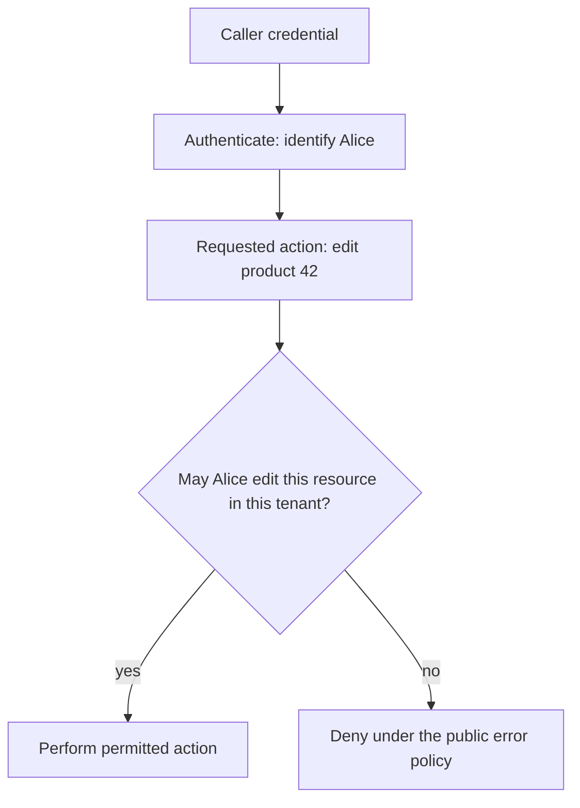
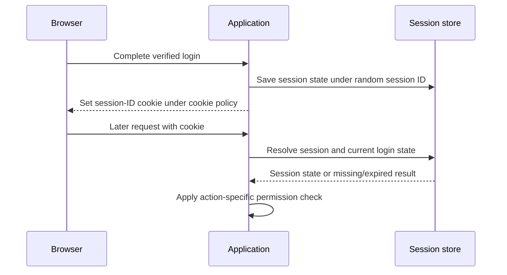
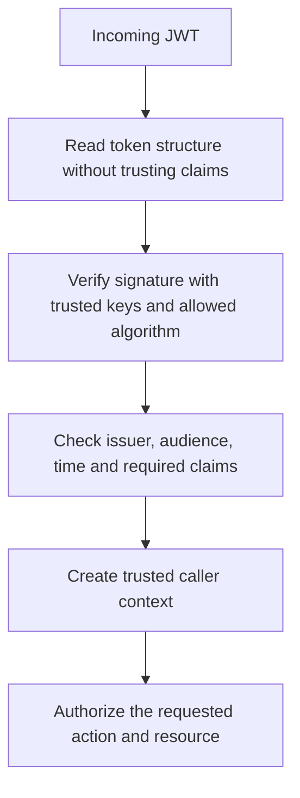
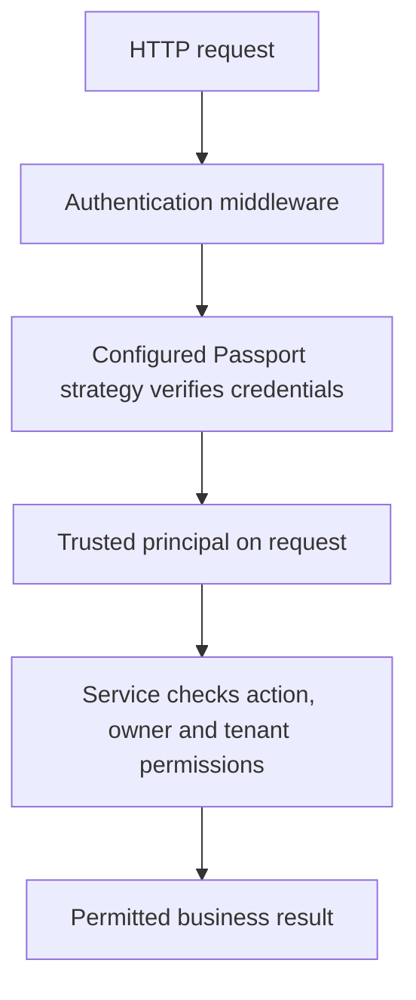
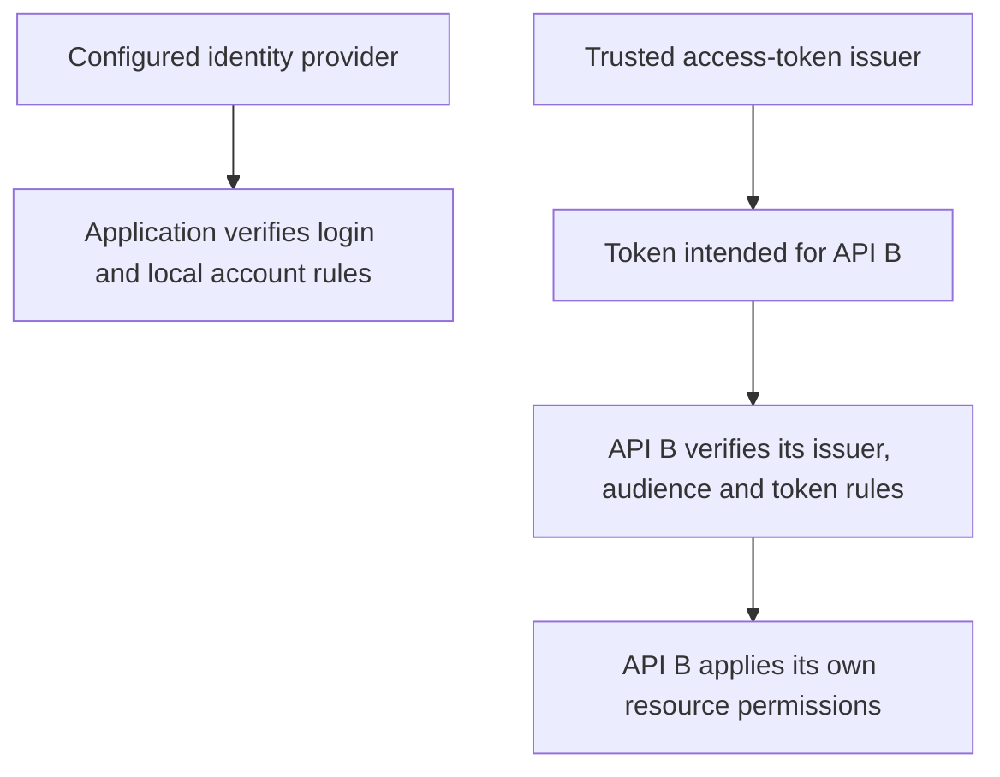
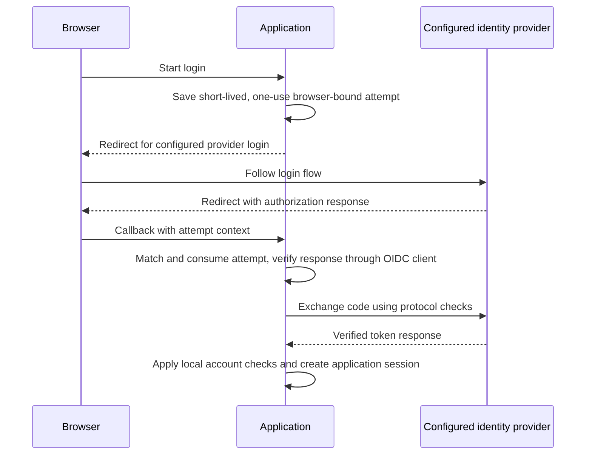
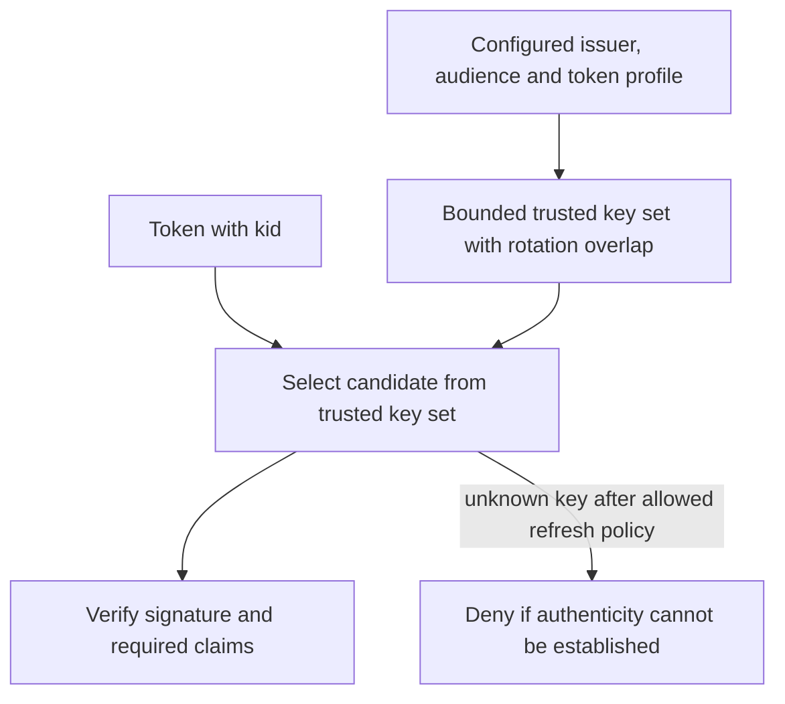
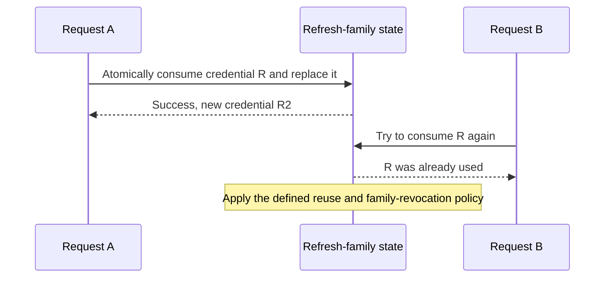

# Authentication and authorization

<span class="notes-section-label">**Section 3 reading path:**</span> Start when the PostgreSQL-backed service works. Add [ownership checks](#t13-q01), the [browser-session model](#t13-q02) and [token verification](#t13-q03) to the same Learning Progress operations. Follow the authentication module for the full session/CSRF setup. Passport shows another integration approach; external identity providers are an extension. Advanced OIDC, key rotation and refresh-race questions t13-q06–q08 belong to Section 4. Keep the handoff’s verified identity for both HTTP and CLI.

For unfamiliar technical terms, use the [Section 3 vocabulary guide](./index.md#section-3-vocabulary).

Use the existing Express 5/PostgreSQL application as the primary browser-session implementation. This chapter adds examination questions and bounded token examples on Node.js 24; it does not introduce a second identity platform. Security references were checked on 2026-11-05. The [full authentication module](../module-09-authentication-authorization.md) contains the session, password-reset and refresh-family implementation.

<!-- tech-check: t13-q01; level: 3 -->

## How do authentication and authorization differ?

*Study depth: Foundational*

Level Up: L1 — Junior\
Tech Check level: ⭐⭐⭐⭐

Source mapping: [R051](./requirements.md#r051).


<div class="notes-core-answer">

<p class="notes-core-answer__title">Core answer</p>

**Authentication checks who the caller is; authorization checks what that caller may do.** For example, a valid login can establish Alice's identity, but it does not allow her to edit Bob's product.

**Check permission for each action and resource on the server.** Consider the tenant or organization, resource owner, requested operation and relevant state. A hidden UI button or a known resource ID is not a permission check.

</div>

<span class="notes-section-label">**A valid login is only the first boundary**</span>

Authentication supplies a trusted identity. The service checks the specific action against resource ownership and other policy.




:::: details Deeper explanation and additional examples

A role groups permissions. Attribute-based rules also check facts such as tenant, owner, resource state or time. Deny access unless an explicit rule allows it. Apply checks to background tasks and every API route. Hiding a button can improve usability, but does not enforce access. Knowing an ID is not proof of permission.

```js [ownership-policy.mjs]
import assert from 'node:assert/strict';

function mayEdit(actor, product) {
  return Boolean(
    actor &&
      product &&
      actor.tenantId === product.tenantId &&
      Array.isArray(actor.permissions) &&
      actor.permissions.includes('products:write') &&
      product.status !== 'archived',
  );
}
const actor = { tenantId: 'a', permissions: ['products:write'] };
assert.equal(mayEdit(actor, { tenantId: 'a', status: 'active' }), true);
assert.equal(mayEdit(actor, { tenantId: 'b', status: 'active' }), false);
assert.equal(mayEdit(actor, { tenantId: 'a', status: 'archived' }), false);
assert.equal(mayEdit(null, { tenantId: 'a' }), false);
```

In the cumulative project, map the product example to study-item ownership: a verified `userId` scopes that user’s item lookup, write and report. Use two users for the required denial tests; you do not need to invent an organization hierarchy merely because this comparison fixture uses `tenantId`.

Trust `actor` only after verifying credentials and mapping them to server-controlled identity. In the database adapter, include `WHERE id=$1 AND tenant_id=$2` in the operation itself. This avoids reading another tenant’s item or checking ownership separately from the write. If permissions can change concurrently, protect the permission check and sensitive change within the required consistency boundary.

Return 401 for absent/unusable authentication, normally with the API's `WWW-Authenticate` challenge; 403 for a known caller without permission. A consistent 404 policy can conceal object existence. Do not turn a database outage into “invalid password”; operational errors need a separate path without leaking details.

::::

<span class="notes-section-label">**Practice and acceptance**</span>

Create two tenants and test read/update/delete using the other's IDs, including a direct service call. Accept only with zero cross-tenant disclosure/mutation and a deliberate 401/403/404 policy. Reference: [OWASP authorization](https://cheatsheetseries.owasp.org/cheatsheets/Authorization_Cheat_Sheet.html).

---

<!-- tech-check: t13-q02; level: 3 -->

## When should a browser use a session rather than a JWT?

*Study depth: Intermediate*

Level Up: L3 — Senior\
Tech Check level: ⭐⭐⭐

Source mapping: [R019](./requirements.md#r019).


<div class="notes-core-answer">

<p class="notes-core-answer__title">Core answer</p>

With a server-side session, the browser holds a random session ID and the server stores the associated login state. **This guide uses sessions as the practical default for its browser application.** A signed token can be useful when an API needs credentials that another service can verify independently.

**Choose based on the client, who must trust whom, and how access can be revoked.** Do not assume that JWTs are automatically more secure or easier to scale. Either approach still needs secure credential handling and a deliberate expiry and logout policy.

</div>

<span class="notes-section-label">**Picture a server-side browser session**</span>

The cookie carries an opaque identifier; the login state is stored on the server. Expiry and revocation belong to the session policy.




:::: details Deeper explanation and additional examples

The session cookie contains a random ID. A shared server-side store links it to the account and manages expiry and revocation. Multiple application copies need the same store and signing configuration. Generate a new session ID after login or a privilege change to prevent session fixation, and save it before responding. Logout removes server-side state and clears the cookie with matching path/domain settings.

For HTTPS, configure `Secure`, `HttpOnly` and `SameSite` appropriately. A `__Host-` cookie also requires Secure, path `/` and no Domain attribute. Trust only the actual proxy chain in Express; do not trust arbitrary forwarded headers. `HttpOnly` prevents JavaScript from reading the cookie. It does not prevent malicious scripts from sending authenticated requests.

The browser sends cookie credentials automatically. Protect state-changing requests with a session-bound CSRF token and trusted-origin checks. SameSite adds protection but is not the whole strategy. Cross-site `SameSite=None` requires Secure and careful handling of browser cookie rules. CORS controls browser access to responses; it does not provide authentication or CSRF protection by itself.

A bearer access token can be replayed by whoever holds it. Keep it short-lived; do not log it or put it in URLs. Browser local storage is readable by injected scripts. A backend-for-frontend can keep provider tokens on the server and expose only its session to the browser.

Refresh credentials need persistent server-side state, protected storage, rotation and detection of reuse. Define how to revoke the whole related token family. Two simultaneous refreshes need an atomic rule; generating another token is not enough. Revocation cannot undo work already authorized and running. Configure both idle expiry and a maximum session lifetime. Revoke access after password reset or account disable.

::::

<span class="notes-section-label">**Practice and acceptance**</span>

Use the [existing session workbench](../module-09-authentication-authorization.md#_2-choosing-an-authentication-approach). Prove login rotates the ID, mutation without a CSRF token fails, logout invalidates replay and two replicas share the session. Test refresh reuse separately if you choose the token path. References: [OWASP sessions](https://cheatsheetseries.owasp.org/cheatsheets/Session_Management_Cheat_Sheet.html), [express-session](https://expressjs.com/en/resources/middleware/session/).

---

<!-- tech-check: t13-q03; level: 3 -->

## What must a JWT verifier actually verify?

*Study depth: Intermediate*

Level Up: L3 — Senior\
Tech Check level: ⭐⭐⭐

Source mapping: [R019](./requirements.md#r019).


<div class="notes-core-answer">

<p class="notes-core-answer__title">Core answer</p>

**Check the JWT signature with trusted keys and explicitly allowed algorithms.** Then check its issuer, intended audience, expiry and other time rules, and the claims your application requires. The issuer is who created it; the audience identifies who it is intended for.

**Decoding a JWT only reads its contents; it does not prove they are trustworthy.** A signature protects against unauthorized changes but does not hide the contents through encryption. Even a correctly verified token must pass a separate permission check for the requested resource and action.

</div>

<span class="notes-section-label">**Separate token parsing, verification and permission**</span>

The token is untrusted until the verifier completes its checks. Signature verification alone is not the full acceptance rule.




:::: details Deeper explanation and additional examples

A compact JWS token contains an encoded header, payload and signature. The header is untrusted until verification succeeds. Do not accept arbitrary algorithms or fetch a token-supplied URL. Use `kid` only to select among keys from the configured trusted issuer. Limit and cache JWKS key-list refreshes. An unknown key is a verification problem, not permission to accept an unsigned token.

The following standalone fixture uses `jose` 6.1.3 and Node.js 24. Generate local keys only for the demonstration; real services load a reviewed issuer configuration and protected signing keys. Install in a disposable example directory, not the docs root: `npm install --save-exact jose@6.1.3`.

```js [verified-token.mjs]
import assert from 'node:assert/strict';
import { generateKeyPair, SignJWT, jwtVerify } from 'jose';

const { privateKey, publicKey } = await generateKeyPair('RS256');
const issuer = 'https://issuer.example';
const audience = 'products-api';
const now = Math.floor(Date.now() / 1000);
async function issue(aud = audience, expires = now + 120) {
  return new SignJWT({ tenant: 'acme', scope: 'products:read' })
    .setProtectedHeader({ alg: 'RS256', typ: 'at+jwt' })
    .setIssuer(issuer)
    .setAudience(aud)
    .setSubject('user-1')
    .setIssuedAt(now)
    .setExpirationTime(expires)
    .sign(privateKey);
}
async function verify(token) {
  const { payload } = await jwtVerify(token, publicKey, {
    algorithms: ['RS256'],
    issuer,
    audience,
    typ: 'at+jwt',
    requiredClaims: ['sub', 'iat', 'exp'],
    clockTolerance: 5,
  });
  if (
    typeof payload.sub !== 'string' ||
    !payload.sub ||
    typeof payload.tenant !== 'string' ||
    !payload.tenant ||
    typeof payload.scope !== 'string'
  ) {
    throw new TypeError('invalid application claims');
  }
  return Object.freeze({
    id: payload.sub,
    tenantId: payload.tenant,
    permissions: Object.freeze(payload.scope.split(' ').filter(Boolean)),
  });
}
assert.equal((await verify(await issue())).id, 'user-1');
await assert.rejects(verify(await issue('other-api')));
await assert.rejects(verify(await issue(audience, now - 60)));
const token = await issue();
const [header, body, signature] = token.split('.');
const modified = Buffer.from(JSON.stringify({ sub: 'admin' })).toString('base64url');
await assert.rejects(verify(`${header}.${modified}.${signature}`));
```

The `typ` value is part of this example issuer’s contract. Other providers may use a different access-token profile. An ID token proves login to its client; do not use it as an API access token. Signed claims can become outdated after an account is disabled, a key is compromised or a user logs out. Immediate invalidation may need a server-side check or revocation/version record. Clock tolerance allows small clock differences; it must not bypass expiry.

::::

<span class="notes-section-label">**Practice and acceptance**</span>

Add wrong issuer/key, missing expiry, future `nbf`, malformed claims and revoked-account cases. Accept only when all reject without exposing raw tokens in logs, while a known good access token reaches a separate permission check. References: [jose APIs](https://github.com/panva/jose), [JWT security BCP](https://www.rfc-editor.org/rfc/rfc8725.html), [OWASP REST security](https://cheatsheetseries.owasp.org/cheatsheets/REST_Security_Cheat_Sheet.html).

---

<!-- tech-check: t13-q04; level: 4 -->

## Where do authentication middleware and Passport strategies fit?

*Study depth: Intermediate*

Level Up: L4 — Lead\
Tech Check level: ⭐⭐⭐⭐

Source mapping: [R050](./requirements.md#r050), [R083](./requirements.md#r083), [R125](./requirements.md#r125).


<div class="notes-core-answer">

<p class="notes-core-answer__title">Core answer</p>

Authentication middleware verifies credentials and adds a small amount of trusted caller information to the request. This caller information is often called a principal. Passport uses a strategy to handle a particular authentication method, such as a password or bearer token.

**Passport authentication does not decide all application permissions.** Your application still checks which resources and actions the caller may access. It must also configure each strategy securely and manage session storage, expiry and cleanup where sessions are used.

</div>

<span class="notes-section-label">**Place the strategy before business authorization**</span>

The strategy handles its configured credential method. The application still owns resource permissions.




:::: details Deeper explanation and additional examples

An Express request pipeline commonly runs a size-limited body parser, session/credential middleware, authentication, input validation and use-case permission checks. Put error middleware last. `passport.session()` needs session middleware before it. A route registered before a guard is not protected by adding that guard later.

The integration shape below assumes an existing injected `passport` instance with a reviewed local strategy and configured session serialization, plus `csrfGuard`, `allowProductRead` and a router. It is not a complete runnable server:

```js [passport-wiring.mjs]
app.use(sessionMiddleware); // shared store, production cookie policy
app.use(passport.initialize());
app.use(passport.session()); // restores an existing login session
app.post('/login', csrfGuard, passport.authenticate('local'), (req, res) => {
  res.sendStatus(204);
});
app.use('/products', requireSessionUser, allowProductRead, productsRouter);
```

A local strategy receives credentials and calls its completion callback once. Pass an error for an operating failure, `false` for invalid credentials, or the public account identity for success. Catch rejected password-check promises and call `done(error)`. Use an established password-hashing implementation such as Argon2id with reviewed settings, generic failure responses and abuse limits. Never store plaintext passwords or use fast SHA hashes as password storage.

Save a stable account ID in the session, not a password hash or full account object. When restoring the session, load current allowed account state and define cache/revocation rules. For bearer APIs, disable login-session creation with `{ session: false }` where the strategy supports it. Local-password, OIDC and bearer strategies handle different protocols. Choose the maintained strategy your application needs.

::::

<span class="notes-section-label">**Debugging and acceptance**</span>

An endlessly redirecting callback can mean the cookie was not stored, proxy trust is wrong, session save failed or callback configuration differs. Inspect sanitized status/correlation logs, not credential contents. Exercise missing/invalid credentials, a failed store, a disabled account and a route mounted before guards. Accept only with bounded failures and no successful unguarded path. References: [Passport overview](https://www.passportjs.org/concepts/authentication/), [strategy contract](https://www.passportjs.org/concepts/authentication/strategies/), [Passport sessions](https://www.passportjs.org/concepts/authentication/sessions/).

---

<!-- tech-check: t13-q05; level: 4 -->

## How do third-party login and service-to-service identity work?

*Study depth: Advanced*

Level Up: L4 — Lead\
Tech Check level: ⭐⭐⭐⭐

Source mapping: [R084](./requirements.md#r084), [R085](./requirements.md#r085), [R186](./requirements.md#r186).


<div class="notes-core-answer">

<p class="notes-core-answer__title">Core answer</p>

OpenID Connect lets an application use an external identity provider for login. OAuth access tokens allow specified API access. **Each receiving service must verify a credential intended for that service**, then apply its own permission rules.

Configure which issuer you trust and which audience you accept. **A caller-supplied identity header is not proof of identity.** A trusted provider's login also does not automatically grant membership or administrator rights inside your application. Services need an explicit, trusted way to pass identity and limit authority between them.

</div>

<span class="notes-section-label">**Keep trust local to each receiving service**</span>

A credential accepted at one boundary is not automatically appropriate for another audience.




:::: details Deeper explanation and additional examples

For the optional external-login path, handle authorization-code login in the backend-for-frontend using a maintained OIDC client. Configure PKCE, an exact registered redirect URI, a state value bound to the login attempt, and nonce checks when required by the flow. Exchange the code on the server, validate identity and create the existing session. Do not implement the protocol yourself or choose the legacy implicit/password grant for a new application.

Identify users by the stable `(issuer, subject)` pair. Email can change or be shared by identities from different issuers. Linking accounts needs proof; do not merge them automatically. A valid provider login does not grant local tenant membership, ownership or administrator rights. When comparing identity providers, consider protocols, multi-factor authentication, recovery, data location, outages, cost and data export.

For a machine job, use workload identity or a client-credentials flow with limited permissions and a short lifetime. A gateway can authenticate at the edge, but downstream services still need trusted identity information and local permission checks. Remove caller-supplied identity headers at that boundary. Verify a token intended for the downstream audience, or exchange it for a more limited token. Forwarding a broad token everywhere increases the damage if it leaks.

mTLS authenticates a transport peer and protects its channel; application authorization still determines which operation that peer may perform. Rotate credentials, bound key-cache refresh and fail closed when authenticity cannot be established. An identity-provider outage may allow existing valid sessions under your expiry policy; it must not switch protected routes into anonymous success.

::::

<span class="notes-section-label">**Practice and acceptance**</span>

Draw browser→backend→provider and service→service trust boundaries. In an isolated test tenant, prove state/redirect mismatch rejection, wrong-audience downstream denial and disabled local membership despite a valid provider login. Record provider outage and cleanup behavior. These real-provider checks remain learner work. References: [OAuth security BCP](https://www.rfc-editor.org/rfc/rfc9700.html), [OIDC Core validation](https://openid.net/specs/openid-connect-core-1_0.html#IDTokenValidation), [OWASP OAuth guidance](https://cheatsheetseries.owasp.org/cheatsheets/OAuth2_Cheat_Sheet.html).

---

<!-- tech-check: t13-q06; level: 4 -->

## How do you bind an OIDC callback to the browser that started login?

*Study depth: Advanced*

Level Up: L4 — Lead\
Tech Check level: ⭐⭐⭐⭐

Source mapping: [R084](./requirements.md#r084), [R186](./requirements.md#r186).


<div class="notes-core-answer">

<p class="notes-core-answer__title">Core answer</p>

When login starts, save a short-lived login attempt that belongs to that browser, the configured identity provider and the expected callback address. **The attempt must be usable only once.** Store the protocol values needed to match and verify the later response.

**A callback containing a code is not yet a logged-in application session.** Use a maintained OIDC client to check the response and exchange the code according to the protocol. Only after successful verification and local account checks should the application create its own session. A response from another browser, provider or login attempt must not be accepted as this one.

</div>

<span class="notes-section-label">**Bind the callback to one login attempt**</span>

This is a protocol overview. The maintained OIDC client owns the detailed response and code-exchange verification.




:::: details Deeper explanation and additional examples

For authorization-code login, generate independent random state, nonce and PKCE verifier. Store them server-side under the browser's anonymous session with creation/expiry and a safe local return destination. Send the S256 challenge, state and nonce to the configured issuer. On callback, atomically consume the matching transaction, verify the exact callback/issuer and pass the stored verifier/nonce into the OIDC client's code exchange/validation. Do not accept a return URL, issuer or redirect selected by callback input.

The following pure fixture models the binding/one-use decision only. Its in-memory mutation is **not** a multi-replica session store or an OIDC implementation. Production needs an atomic shared-store operation and a reviewed strategy/client with code/ID-token validation.

```js [login-transaction.mjs]
import assert from 'node:assert/strict';
import { randomBytes } from 'node:crypto';
function transaction(browserSession, now) {
  return {
    browserSession,
    state: randomBytes(32).toString('base64url'),
    expiresAt: now + 120_000,
    used: false,
    returnPath: '/products',
  };
}
function consume(tx, browserSession, state, now) {
  if (
    !tx ||
    tx.used ||
    tx.expiresAt <= now ||
    tx.browserSession !== browserSession ||
    typeof state !== 'string' ||
    state !== tx.state
  )
    throw new Error('invalid login transaction');
  tx.used = true;
  return tx.returnPath;
}
const now = 1000,
  tx = transaction('anonymous-a', now);
assert.throws(() => consume(tx, 'anonymous-b', tx.state, now));
assert.throws(() => consume(tx, 'anonymous-a', 'wrong', now));
assert.equal(consume(tx, 'anonymous-a', tx.state, now), '/products');
assert.throws(() => consume(tx, 'anonymous-a', tx.state, now));
const expired = transaction('anonymous-a', now);
assert.throws(() => consume(expired, 'anonymous-a', expired.state, now + 120_000));
```

State binds the authorization response to its transaction; PKCE binds code redemption to the verifier; OIDC nonce binds the ID token to the request. They are related defenses, not interchangeable names. Keep each value out of shared logs. Multiple browser tabs need distinct transactions and a deliberate bounded store policy; overwriting one global state field causes intermittent failures.

After protocol verification, map `(issuer,subject)` to the local account, apply current tenant/account policy, regenerate the application session and save it before redirecting to the validated local path. A provider email is not enough proof to link accounts. A failed exchange consumes this attempt; let the user start a new login rather than replaying a stale code indefinitely.

::::

<span class="notes-section-label">**Debugging and acceptance**</span>

Check callback URI/proxy origin, transaction cookie scope/SameSite, expired state, nonce and PKCE mismatch separately. Never “fix” a callback loop by disabling validation. Exercise wrong browser, replay, expiry, parallel tabs, provider error and local disabled account. Accept only with the real configured client/strategy denying invalid cases and the application creating exactly one rotated session. References: [OIDC code flow](https://openid.net/specs/openid-connect-core-1_0.html#CodeFlowAuth), [OAuth security BCP](https://www.rfc-editor.org/rfc/rfc9700.html), [Passport strategy boundary](https://www.passportjs.org/concepts/authentication/strategies/).

---

<!-- tech-check: t13-q07; level: 4 -->

## How do key rotation and token profiles avoid confused trust?

*Study depth: Advanced*

Level Up: L4 — Lead\
Tech Check level: ⭐⭐⭐, ⭐⭐⭐⭐

Source mapping: [R019](./requirements.md#r019), [R085](./requirements.md#r085).


<div class="notes-core-answer">

<p class="notes-core-answer__title">Core answer</p>

Configure which issuer, token purpose and keys the service trusts. A token profile defines the kind of token and the claims it must contain. Check its intended recipient, time limits and application-specific claims as well as its signature.

**The token's `kid` chooses among trusted keys; it does not authorize arbitrary key downloads.** Plan how old and new keys overlap during rotation, and limit that overlap and key-refresh work. **If authenticity cannot be established, deny access.** Do not trust an unknown key just because the identity provider is unavailable.

</div>

<span class="notes-section-label">**Rotate within a configured trust set**</span>

kid selects a candidate trusted key. Unknown keys do not become trusted merely because verification or refresh is unavailable.




:::: details Deeper explanation and additional examples

This jose 6.1.3 fixture models trusted key-set replacement locally; it makes no HTTP/JWKS request. New tokens use the new key while the verifier temporarily accepts the old key for already issued, still-valid tokens. Removing an old key rejects its tokens; emergency compromise response may require earlier removal plus explicit revocation/reconciliation.

```js [rotating-token-keys.mjs]
import assert from 'node:assert/strict';
import {
  generateKeyPair,
  exportJWK,
  SignJWT,
  createLocalJWKSet,
  jwtVerify,
} from 'jose';
const old = await generateKeyPair('RS256'),
  fresh = await generateKeyPair('RS256');
async function publicJwk(pair, kid) {
  return { ...(await exportJWK(pair.publicKey)), kid, alg: 'RS256', use: 'sig' };
}
const oldJwk = await publicJwk(old, 'old'),
  newJwk = await publicJwk(fresh, 'new');
async function issue(pair, kid, aud = 'products-api') {
  return new SignJWT({ tenant: 'a', scope: 'products:read' })
    .setProtectedHeader({ alg: 'RS256', typ: 'at+jwt', kid })
    .setIssuer('https://issuer.example')
    .setAudience(aud)
    .setSubject('u1')
    .setIssuedAt()
    .setExpirationTime('2m')
    .sign(pair.privateKey);
}
const verify = (token, keys) =>
  jwtVerify(token, createLocalJWKSet({ keys }), {
    issuer: 'https://issuer.example',
    audience: 'products-api',
    algorithms: ['RS256'],
    typ: 'at+jwt',
    requiredClaims: ['sub', 'iat', 'exp'],
    maxTokenAge: '3m',
    clockTolerance: 5,
  });
const previous = await issue(old, 'old'),
  current = await issue(fresh, 'new');
await verify(previous, [oldJwk, newJwk]);
await verify(current, [oldJwk, newJwk]);
await assert.rejects(verify(current, [oldJwk]));
await assert.rejects(verify(previous, [newJwk]));
await assert.rejects(verify(await issue(fresh, 'new', 'other-api'), [newJwk]));
await assert.rejects(verify(await issue(fresh, 'unknown'), [newJwk]));
```

Real remote JWKS resolution needs a fixed issuer/discovery trust policy, TLS verification, bounded fetch time/size, cache lifetime and refresh cooldown to avoid attacker-driven fetch storms. Preserve only valid cached keys under the explicit outage policy; do not accept an unknown key because the identity provider is down. Monitor key errors without recording tokens. Key rotation and per-account logout/revocation are different mechanisms.

A resource server accepts its **access-token** profile, not whatever signed token is convenient. An ID token's audience is the OIDC client, and its purpose is login verification. Never substitute it for an API credential. The earlier [application-claim validation](#t13-q03) still applies after this signature/registered-claim fixture. For internal calls, authenticate the service and preserve a constrained delegation contract; do not turn any gateway header into unrestricted user authority.

::::

<span class="notes-section-label">**Practice and acceptance**</span>

Test overlapping/retired keys, wrong issuer/audience/type/algorithm, missing time claims, future nbf, stale issuance and malformed tenant/scope. Simulate bounded JWKS outage/unknown-kid traffic only against owned endpoints. Accept with no invalid-token success, no uncontrolled refresh and a documented compromise/revocation policy. References: [jose key-set resolver](https://github.com/panva/jose/blob/main/docs/jwks/local/functions/createLocalJWKSet.md), [JWT security BCP](https://www.rfc-editor.org/rfc/rfc8725.html).

---

<!-- tech-check: t13-q08; level: 4 -->

## How do refresh rotation, revocation and sensitive writes survive races?

*Study depth: Advanced*

Level Up: L4 — Lead\
Tech Check level: ⭐⭐⭐, ⭐⭐⭐⭐

Source mapping: [R019](./requirements.md#r019), [R085](./requirements.md#r085).


<div class="notes-core-answer">

<p class="notes-core-answer__title">Core answer</p>

Refresh rotation replaces a refresh credential with a new one. A refresh family links credentials descended from the same login. **Save that family state durably and coordinate updates so concurrent requests cannot both use the same credential successfully.** Define what happens when an already used credential reappears.

For sensitive actions, explicitly check current account or credential versions where required. **A valid signature does not prove the account's permissions are still current.** Revocation affects later checks; it does not undo a change that already committed. Coordinate these checks with the business write when correctness depends on their happening together.

</div>

<span class="notes-section-label">**Make refresh consumption a durable decision**</span>

Both requests may present the same credential, but the durable state transition must prevent two successful consumptions.




:::: details Deeper explanation and additional examples

Use the existing [account/refresh/reset implementation](../module-09-authentication-authorization.md) as the owner. A server stores only a digest of a high-entropy refresh credential plus account/family, expiry, consumed/revoked state and replacement relationship. Hashing an unpredictable token for lookup differs from password hashing a human secret. Raw credentials travel only through the reviewed client/cookie channel.

A rotation transaction locks the family/account state in a consistent order, checks current credential version and family status, consumes the presented unused token and inserts its replacement before committing. A unique digest and conditional update prevent two winners. If a consumed credential reappears, apply the defined family-revocation policy and commit that revocation before reporting denial; throwing inside a transaction and rolling back the revocation defeats the policy.

```sql [refresh-transition.sql]
-- Integration predicate within the locked family/account transaction.
-- $1 is a server-computed token digest; $2 is the current family ID.
UPDATE refresh_credentials
SET consumed_at = clock_timestamp()
WHERE digest=$1 AND family_id=$2
  AND consumed_at IS NULL AND revoked_at IS NULL
  AND expires_at > clock_timestamp()
RETURNING account_id, family_id;
```

The predicate is not the complete workflow: a zero-row result still needs safe lookup/reuse classification, replacement insertion and final commit under the same owner. Do not implement the family as two independent pool queries. A lost response after a successful rotation leaves the client uncertain. A strict replay policy may revoke a family after a benign duplicate; document this trade-off and serialize client refresh attempts. A grace window must retain proof/binding and avoid allowing an attacker to mint unlimited replacements.

For sensitive writes, stale session permissions can be insufficient. Recheck current membership/credential version within the business transaction where the invariant requires it; otherwise document the maximum stale authorization window. Add recent-auth/MFA requirements for account linking, credential changes or destructive administration. Step-up authentication is a scoped time-limited property, not a permanent admin role.

Service-to-service access has another axis: identify the workload, limit audience/scopes and authorize current resource ownership. Token exchange can narrow delegation. mTLS proves the connecting peer under its trust configuration; it does not independently prove end-user permission. Keep audit records of safe actor/operation/resource/result IDs, never the refresh credential.

::::

<span class="notes-section-label">**Practice and acceptance**</span>

Run two concurrent refreshes, replay the consumed token, reset the password during an active session and inject a response loss after commit. Accept with one rotation winner, observed committed revocation, no stale-version sensitive mutation and a deliberate client recovery policy. Local token fixtures do not prove these database/provider races; they remain separate integration/learner tasks. References: [OAuth refresh-token protection](https://www.rfc-editor.org/rfc/rfc9700.html#section-4.14), [OWASP session lifecycle](https://cheatsheetseries.owasp.org/cheatsheets/Session_Management_Cheat_Sheet.html), [transaction isolation](https://www.postgresql.org/docs/18/transaction-iso.html).

## Revision and practical checkpoint

For one mutation explain credential verification, account state, permission/tenant predicate, CSRF policy, expiry and audit logging. Then demonstrate denial as carefully as success. Keep raw passwords, cookies and tokens out of logs. Local policy and JWT fixture checks support the material; they do not prove the entire deployed authentication system is secure or complete your practice.

### Mixed practice

1. A JWT signature is valid but its audience is another API. May this route accept it?
2. An authenticated tenant A user sends a tenant B product ID with a valid CSRF token. What must reject it?

<span class="notes-section-label">**Answer guide — read after attempting both cases**</span>

1. No. Signature authenticity alone does not establish intended recipient, time validity, token profile or current permission. Reject at credential validation.
2. The server-side resource authorization and tenant-scoped persistence predicate. CSRF protection proves neither ownership nor permission; test every alternate route too.
