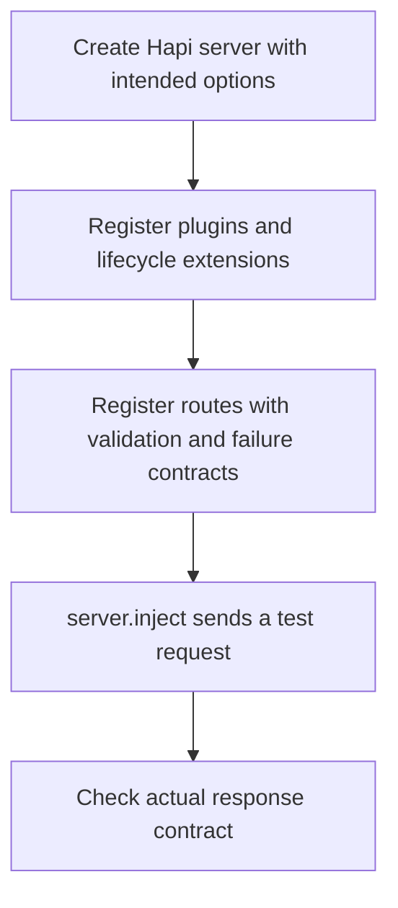
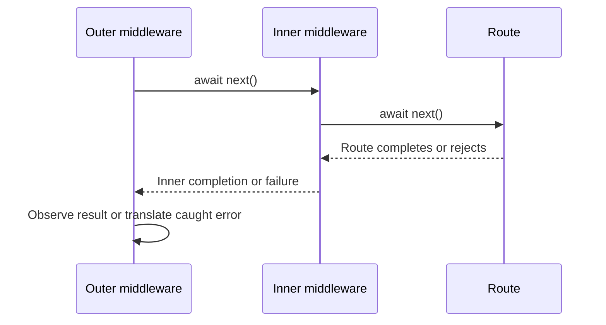
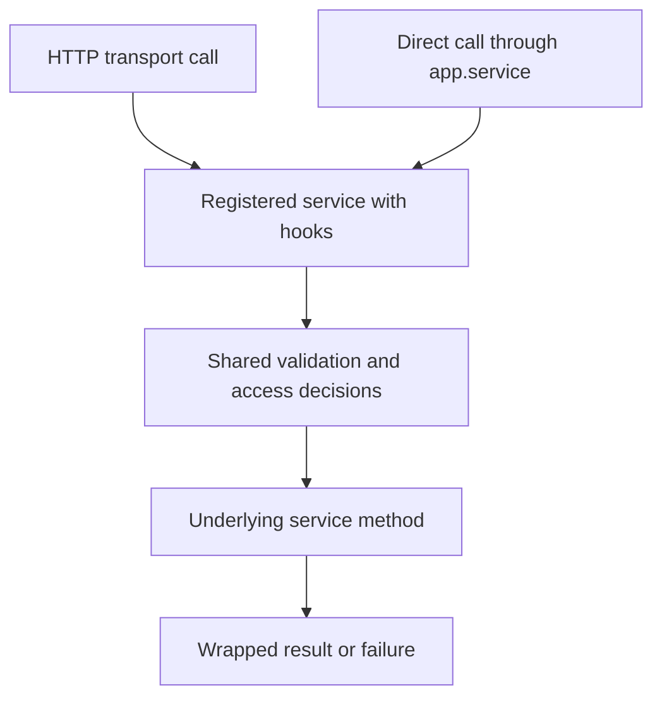
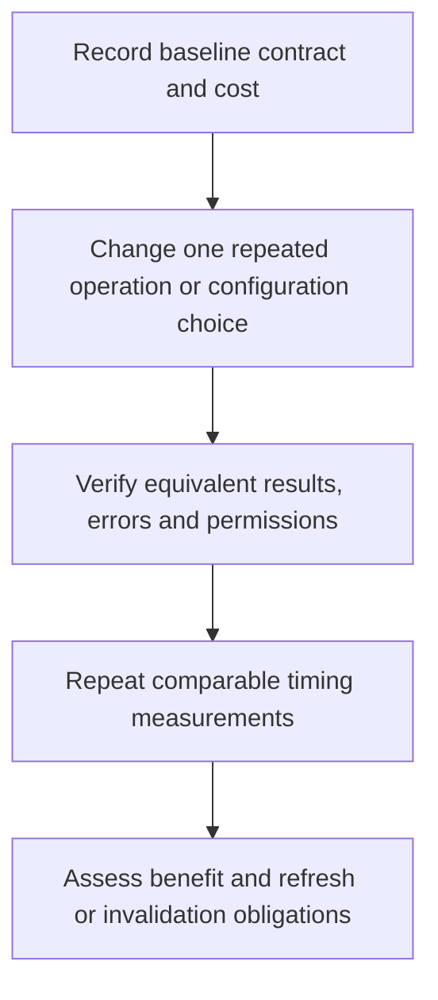

# Hapi, Koa and Feathers in practice

These small companions extend the [framework comparison](./16-frameworks.md#t16-q02). Build the Express application first, then use these examples to recognize how another framework expresses the same boundary. They cover configuration, a read route, failure handling and an optimization exercise without requiring three more complete applications.

Use Node 24 and a separate empty learning directory. Install the packages there, save the three files below, then run each with `node <filename>.mjs`. Keep the generated lockfile and use `npm ci` when repeating the experiment. The major versions below define the API families; record exact installed versions with `npm ls --depth=0`. Do not add these dependencies to the documentation site's package.json.

```sh
npm init -y
npm install @hapi/hapi@21 koa@3 @feathersjs/feathers@5 @feathersjs/koa@5 @feathersjs/errors@5
npm ls --depth=0
```

Verified locally with Node 24.18.0, Hapi 21.4.13, Koa 3.3.0, Feathers core/errors 5.0.50 and Feathers Koa 5.0.51.

Each sample exposes public, fixed catalogue data. It is not a production authentication or persistence implementation. A real product endpoint needs current authorization, tenant scoping and a bounded data source. The catalogue is read-only so failure cases cannot accidentally mutate it.

<!-- tech-check: t16-q19; level: 2 -->

## How does Hapi organize configuration, routes and plugins?

*Study depth: Foundational to intermediate*

Level Up: L2 — Software Engineer\
Tech Check level: ⭐, ⭐⭐

Source mapping: [R121](./requirements.md#r121), [R167](./requirements.md#r167), [R153](./requirements.md#r153).


The chart lists Hapi at basic, intermediate and advanced levels. This question targets routing/lifecycle practice; the final question supplies the advanced experiment. The single Level Up ranking is the intended career target for this lesson; the source link retains the full proficiency matrix.

<div class="notes-core-answer">

<p class="notes-core-answer__title">Core answer</p>

Hapi collects server options and route definitions around a server instance. Plugins group registration work; lifecycle extensions act at named stages. **Make each route's validation and failure contract visible**, then test it through `server.inject` without opening a network listener.

</div>

<span class="notes-section-label">**Separate registration from the request check**</span>

server.inject exercises the configured Hapi request behavior without opening a listening port.




:::: details Deeper explanation and additional examples

```js [hapi-catalogue.mjs]
import assert from 'node:assert/strict';
import Hapi from '@hapi/hapi';
const server = Hapi.server({ host: '127.0.0.1', port: 0, debug: false });
const rows = new Map([['1', { id: '1', name: 'Pen' }]]);
await server.register({
  name: 'catalogue',
  version: '1.0.0',
  register: async (instance) => {
    instance.route({
      method: 'GET',
      path: '/products/{id}',
      handler: (request, h) => {
        const { id } = request.params;
        if (!/^[1-9][0-9]{0,5}$/.test(id))
          return h.response({ error: 'invalid id' }).code(400);
        const row = rows.get(id);
        return row ? { ...row } : h.response({ error: 'not found' }).code(404);
      }
    });
  }
});
try {
  for (const [id, status, body] of [
    ['1', 200, { id: '1', name: 'Pen' }],
    ['2', 404, { error: 'not found' }],
    ['bad', 400, { error: 'invalid id' }]
  ]) {
    const response = await server.inject({ method: 'GET', url: `/products/${id}` });
    assert.equal(response.statusCode, status);
    assert.deepEqual(response.result, body);
  }
  assert.equal((await server.inject('/missing')).statusCode, 404);
  console.log('Hapi route contracts pass.');
} finally {
  await server.stop({ timeout: 1000 });
}
```

<span class="notes-section-label">**Explain the boundaries**</span>

The configured zero port avoids fixing a shared local port if you later call `server.start()`. Injection exercises Hapi dispatch without proving TLS, proxy or socket behavior. Test those separately before deployment. `debug: false` keeps this exercise quiet; production needs an explicit logging policy.

The ID check bounds the accepted identifier before lookup. In a larger application, put schemas in route validation and reuse application errors rather than duplicating checks in each handler. Plugin registration is the place to compose a route group; it does not by itself isolate database access or grant authorization. Use a pre-handler/auth strategy for access decisions and an appropriate lifecycle extension for response normalization. Preserve status codes when translating failures.

::::

<span class="notes-section-label">**Practice and acceptance**</span>

Extract the read operation into an injected repository. Inject a repository failure and verify a controlled 500 response with no raw exception details. Add `onPreResponse` tracing and record the stage reached for success, invalid input, missing route and thrown error. Use `try/finally` to stop the server even when an assertion fails. Explain which result is a client error and which is an operational failure.

Reference: [Hapi server, routing, extensions and injection API](https://github.com/hapijs/hapi/blob/master/API.md).

---

<!-- tech-check: t16-q20; level: 2 -->

## How does Koa middleware unwind around a route?

*Study depth: Foundational to intermediate*

Level Up: L2 — Software Engineer\
Tech Check level: ⭐, ⭐⭐

Source mapping: [R123](./requirements.md#r123), [R168](./requirements.md#r168), [R153](./requirements.md#r153).


<div class="notes-core-answer">

<p class="notes-core-answer__title">Core answer</p>

A Koa middleware receives a context and a continuation. **Awaiting next lets outer middleware observe downstream completion or failure.** Register error translation before the route so it can catch rejected downstream work. Routing/body parsing are separate choices; this tiny GET-only example matches its one route explicitly.

</div>

<span class="notes-section-label">**Watch Koa middleware unwind**</span>

The outer middleware awaits downstream work, so its post-next code runs after the route completes. Rejections can return through that await.




:::: details Deeper explanation and additional examples

```js [koa-catalogue.mjs]
import assert from 'node:assert/strict';
import { createServer } from 'node:http';
import { once } from 'node:events';
import Koa from 'koa';
const app = new Koa();
const trace = [];
const rows = new Map([['1', { id: '1', name: 'Pen' }]]);
app.use(async (ctx, next) => {
  trace.push('enter');
  try {
    await next();
  } catch (error) {
    ctx.status = error.status === 400 ? 400 : 500;
    ctx.body = { error: ctx.status === 400 ? 'invalid id' : 'internal error' };
  } finally {
    trace.push('leave');
  }
});
app.use(async (ctx) => {
  const match = /^\/products\/([^/]+)$/.exec(ctx.path);
  if (ctx.method !== 'GET' || !match) {
    ctx.status = 404;
    ctx.body = { error: 'not found' };
    return;
  }
  const id = match[1];
  ctx.assert(/^[1-9][0-9]{0,5}$/.test(id), 400, 'invalid id');
  const row = rows.get(id);
  ctx.status = row ? 200 : 404;
  ctx.body = row ? { ...row } : { error: 'not found' };
});
const server = createServer(app.callback());
try {
  server.listen(0, '127.0.0.1');
  await once(server, 'listening');
  const base = `http://127.0.0.1:${server.address().port}`;
  for (const [id, status, body] of [
    ['1', 200, { id: '1', name: 'Pen' }],
    ['2', 404, { error: 'not found' }],
    ['bad', 400, { error: 'invalid id' }]
  ]) {
    trace.length = 0;
    const response = await fetch(`${base}/products/${id}`, {
      signal: AbortSignal.timeout(3000)
    });
    assert.equal(response.status, status);
    assert.deepEqual(await response.json(), body);
    assert.deepEqual(trace, ['enter', 'leave']);
  }
  console.log('Koa response and unwind contracts pass.');
} finally {
  if (server.listening)
    await new Promise((resolve, reject) => server.close(e => e ? reject(e) : resolve()));
}
```

<span class="notes-section-label">**Explain the boundaries**</span>

Remove `await` before `next()` as a negative experiment and observe the trace/error behavior; do not keep that change. The outer function must own the downstream promise to translate a rejection. This differs from Express's callback-oriented `next` contract.

The two middleware functions are composed once when creating the application. Keep request state in `ctx.state` or local variables, not in one global mutable object. The global trace here is only for sequential test requests; concurrent requests need separate trace ownership. A production router must define method handling, encoded paths and route precedence; the manual matcher is deliberately limited. Body limits and proxy trust require explicit configuration if those features are added.

::::

<span class="notes-section-label">**Practice and acceptance**</span>

Add a maintained router and a separate POST exercise with bounded JSON parsing. Verify malformed/oversized bodies, wrong methods and downstream rejection. Add a trace entry before and after `await next()` in two middleware layers and predict the complete order. Accept only when failures remain sanitized and the listener closes after a failed assertion.

Reference: [Koa application and middleware cascading](https://koajs.com/).

---

<!-- tech-check: t16-q21; level: 2 -->

## How does a Feathers service share behavior across direct and HTTP calls?

*Study depth: Foundational to intermediate*

Level Up: L2 — Software Engineer\
Tech Check level: ⭐, ⭐⭐

Source mapping: [R124](./requirements.md#r124), [R125](./requirements.md#r125), [R153](./requirements.md#r153).


<div class="notes-core-answer">

<p class="notes-core-answer__title">Core answer</p>

Feathers registers services whose methods are wrapped with hooks. A transport exposes selected methods over HTTP or another protocol. **Put shared validation and access decisions in the service boundary**, and call the wrapped service through `app.service` so direct calls also pass through hooks.

</div>

<span class="notes-section-label">**Share the wrapped service boundary**</span>

Direct application calls use app.service so they pass through the same hooks as the transport path.




:::: details Deeper explanation and additional examples

```js [feathers-catalogue.mjs]
import assert from 'node:assert/strict';
import { once } from 'node:events';
import { feathers } from '@feathersjs/feathers';
import { koa, rest, errorHandler } from '@feathersjs/koa';
import { BadRequest, NotFound } from '@feathersjs/errors';
const app = koa(feathers());
app.use(errorHandler());
app.configure(rest());
const rows = new Map([['1', { id: '1', name: 'Pen' }]]);
app.use('products', {
  async get(id) {
    const row = rows.get(String(id));
    if (!row) throw new NotFound('not found');
    return { ...row };
  }
}, { methods: ['get'] });
app.service('products').hooks({
  before: {
    get: [async context => {
      if (!/^[1-9][0-9]{0,5}$/.test(String(context.id)))
        throw new BadRequest('invalid id');
    }]
  }
});
let server;
try {
  server = await app.listen({ port: 0, host: '127.0.0.1' });
  if (!server.listening) await once(server, 'listening');
  const base = `http://127.0.0.1:${server.address().port}`;
  assert.deepEqual(await app.service('products').get('1'), { id: '1', name: 'Pen' });
  await assert.rejects(app.service('products').get('bad'), { code: 400 });
  await assert.rejects(app.service('products').get('2'), { code: 404 });
  for (const [id, status] of [['1', 200], ['2', 404], ['bad', 400]]) {
    const response = await fetch(`${base}/products/${id}`, {
      signal: AbortSignal.timeout(3000)
    });
    const body = await response.json();
    assert.equal(response.status, status);
    if (status === 200) assert.deepEqual(body, { id: '1', name: 'Pen' });
    else assert.equal(body.code, status);
  }
  console.log('Feathers direct and HTTP contracts pass.');
} finally {
  if (server?.listening) await app.teardown();
}
```

<span class="notes-section-label">**Explain the boundaries**</span>

Only `get` is exposed by this registration. The Koa transport translates the HTTP path to a service call; structured errors retain their status. The hook checks a direct server-side call too. Calling the original raw service object would bypass its wrapper. For mutation exercises add parsing, schema validation and method-specific permissions rather than simply exposing every method.

An internal call is not automatically authorized to act for any tenant. Validate the caller's trusted identity/context and do not treat a missing transport provider as permission. A real database adapter and Socket.IO subscriptions need additional lifecycle and channel authorization checks. This read-only example proves neither persistence nor real-time publication.

::::

<span class="notes-section-label">**Practice and acceptance**</span>

Add a fake repository and a before hook that enforces a trusted tenant identity. Test matching/mismatched identity through both a direct call and a transport fixture; external callers must not be able to forge trusted params through query strings. Observe that hooks run only through the registered wrapper. Keep teardown in the failure path.

References: [Feathers services](https://feathersjs.com/api/services), [hooks](https://feathersjs.com/api/hooks), [Koa transport and lifecycle](https://feathersjs.com/api/koa).

---

<!-- tech-check: t16-q22; level: 4 -->

## How do you optimize these frameworks without changing their contracts?

*Study depth: Advanced experiment building on intermediate examples*

Level Up: L4 — Lead\
Tech Check level: ⭐⭐⭐⭐

Source mapping: [R130](./requirements.md#r130), [R188](./requirements.md#r188), [R153](./requirements.md#r153).


<div class="notes-core-answer">

<p class="notes-core-answer__title">Core answer</p>

Choose one measured cost while preserving the same route, validation, permissions and error behavior. **Equivalent results and failure behavior come before timing comparisons.** Framework configuration determines where repeated work happens; it does not remove application consistency or invalidation requirements.

</div>

<span class="notes-section-label">**Verify the contract before timing**</span>

A configuration change is useful only if it preserves the behavior being compared.




:::: details Deeper explanation and additional examples

Use the three runnable examples as the baseline. Extend each repository with the same fixed public metadata operation from the [Express experiment](./16-advanced-api-frameworks.md#t16-q18). First compute it for every successful read; then compute the immutable value once during application setup. In both versions return the same metadata field. This is an application-work experiment, not a ranking of Hapi, Koa and Feathers.

| Framework | Place the invariant computation | Preserve on every request/call | Specific pitfall to inspect |
|---|---|---|---|
| Hapi | Plugin registration or an explicitly owned shared service | Route validation and current auth/pre-handler policy | A cache key omitting tenant, user or representation can reuse unauthorized data |
| Koa | Application setup, captured by route middleware | Middleware order, awaited error flow and request-local state | A shared mutable object can leak state between requests |
| Feathers | Service setup or injected repository initialization | Service hooks and any transport-specific response projection | Caching before identity/filter hooks can bypass the intended boundary |

For the read-only samples, an immutable global metadata value is safe to reuse. For mutable or tenant-dependent data, define bounded storage, key scope, expiry/invalidation and behavior during concurrent updates before introducing a cache. Build request-local projections rather than mutating cached objects. A faster path that skips hooks or returns stale permission-dependent fields fails the experiment.

<span class="notes-section-label">**Worked experiment procedure**</span>

1. Run the positive and invalid/missing-ID checks unchanged against baseline and candidate. Add unauthorized/tenant-denial cases when adding authentication; the public examples alone cannot establish that contract.
2. Count digest/repository invocations to establish which repeated work was removed. Expect one invariant initialization in the candidate and repeated work in the baseline; check the same response fields in both.
3. Warm both variants and alternate run order. Use the same runtime, dependency lockfile, request mix, payload, client concurrency and duration. Report p50/p95/p99, throughput, errors, CPU and event-loop delay.
4. Use HTTP for all three if comparing end-to-end measurements. Hapi injection, a direct Feathers call and an HTTP request include different costs and cannot be treated as equivalent latency samples.
5. Repeat under concurrent requests and injected repository failure. Verify response isolation and listener/service teardown. Keep timing observations separate from deterministic correctness assertions.

::::

<span class="notes-section-label">**Practice and acceptance**</span>

Submit the before/after invocation counts, contract results and repeated measurements for one framework, then explain how to port the change to the other two. Include a rejected optimization—for example, moving tenant filtering outside the per-request path—and explain the violated invariant. A local loopback result does not prove production capacity. Use the [performance methodology](./12-performance-and-v8.md#t12-q02) before proposing a rollout.

## Revision

Try each question without opening its answer. Explain the reason, not just the term; then expand **Show answer** to check. Diagram questions link back to the visual so you can trace its parts and arrows.

<!-- revision-covers: t16-q19 -->

<span class="notes-section-label">**1. Scenario — Why is Hapi injection not an end-to-end network benchmark?**</span>

::: details Show answer

Injection avoids a real socket/proxy/TLS path, so it measures a different boundary.

[Revisit the explanation and examples](#t16-q19).

:::


---

<!-- revision-covers: t16-q20 -->

<span class="notes-section-label">**2. Scenario — Why can a Koa outer error handler miss a downstream rejection when `next()` is not awaited?**</span>

::: details Show answer

The outer middleware no longer awaits and owns that downstream completion/failure.

[Revisit the explanation and examples](#t16-q20).

:::


---

<!-- revision-covers: t16-q20 -->

<span class="notes-section-label">**3. Explain diagram — Trace the return path in the [Koa middleware diagram](#t16-q20). Why can an outer try/catch observe a downstream rejection through await next, unlike Express continuation?**</span>

::: details Show answer

Koa middleware awaits the promise representing downstream work, so completion or rejection unwinds through the outer await. The outer catch can then own that rejection. Omitting the await detaches that local completion/error boundary. Express next advances its middleware chain rather than returning the same Koa-style downstream completion promise.

[Revisit the explanation and examples](#t16-q20).

:::


---

<!-- revision-covers: t16-q21 -->

<span class="notes-section-label">**4. Scenario — Why should Feathers callers use `app.service('products')` rather than the original service object?**</span>

::: details Show answer

The registered wrapper supplies hooks and other service behavior.

[Revisit the explanation and examples](#t16-q21).

:::


---

<!-- revision-covers: t16-q22 -->

<span class="notes-section-label">**5. Scenario — What makes a global catalogue response cache different from immutable public build metadata?**</span>

::: details Show answer

Catalogue responses can vary by tenant, permissions and mutable data; their scope and invalidation must be enforced.

[Revisit the explanation and examples](#t16-q22).

:::
