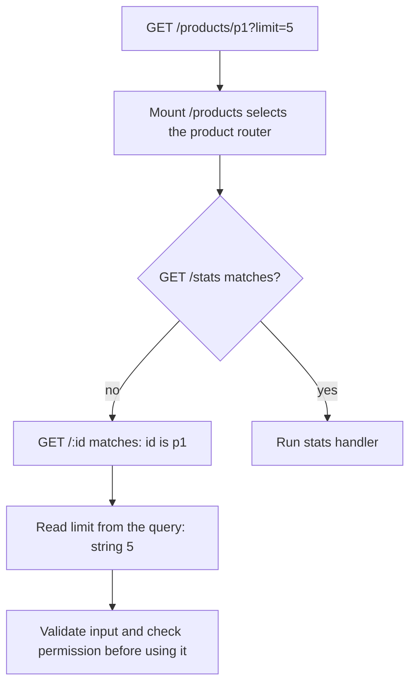
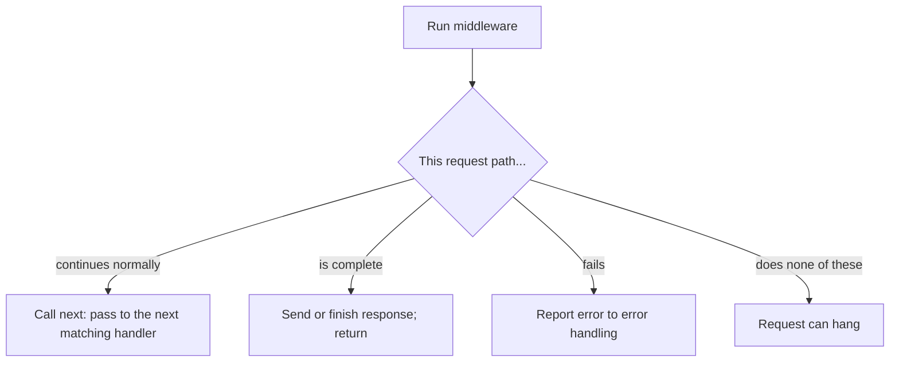
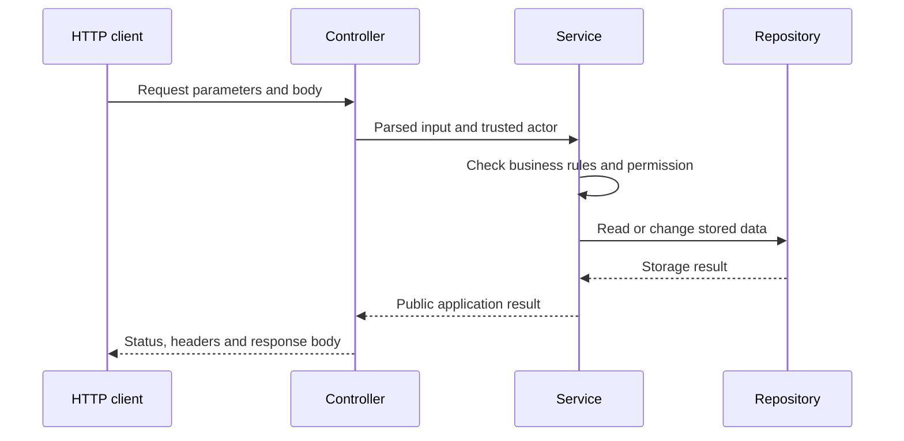
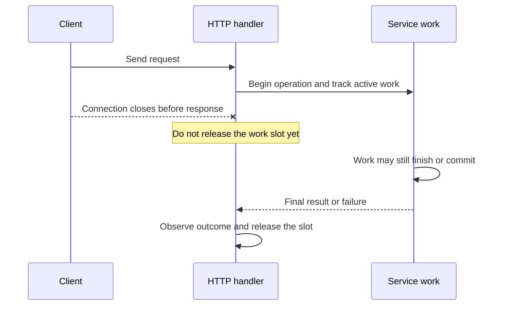
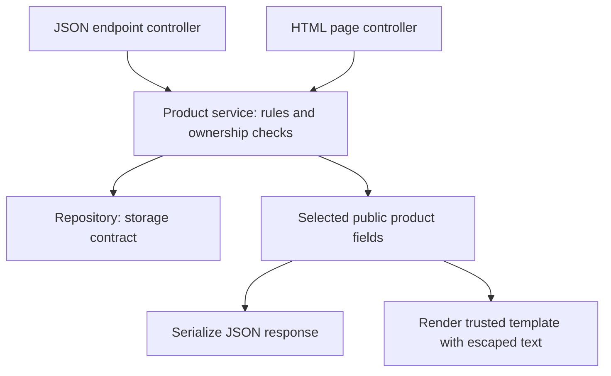
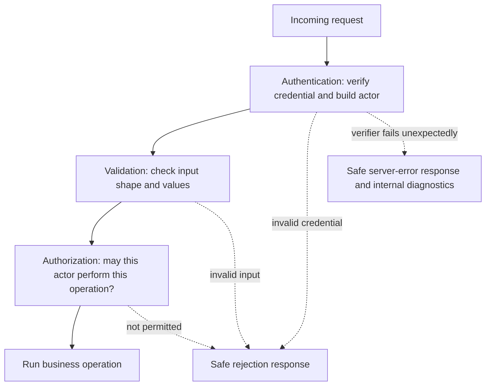
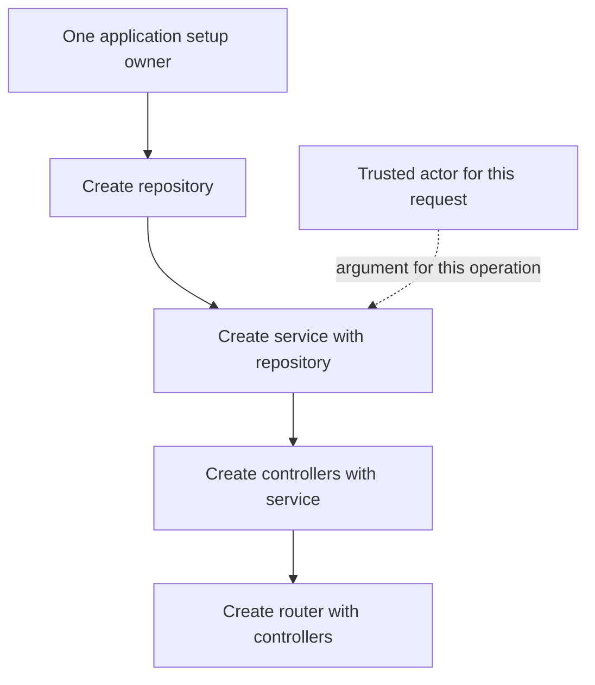
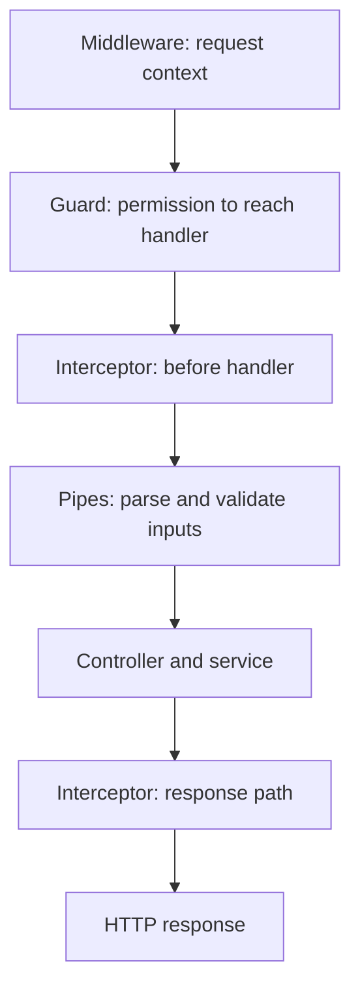
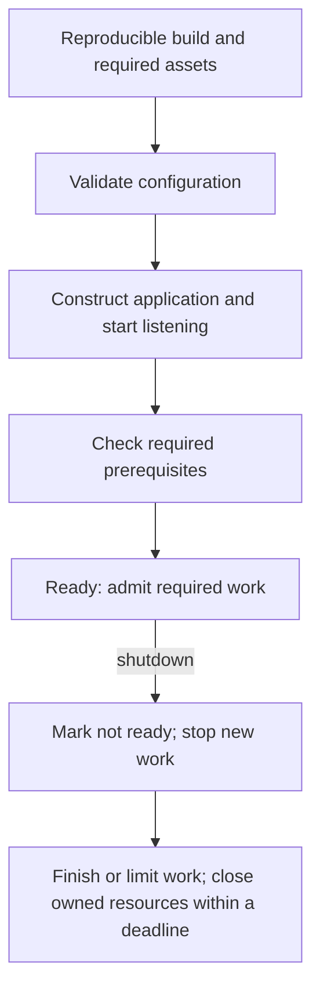

# Express and NestJS applications

This lesson starts **Building Node.js Applications**. It follows [Framework foundations](./16-frameworks.md) (questions 1–4) and [Build a Foundations CLI](./progressive-projects.md#project-1-foundations-cli). The questions here continue the framework topic with questions 5–13.

## Express applications with NestJS alongside {#application-frameworks}

**Learn both Express and NestJS in small steps.** Start with the two Express routes in question 5, try the Nest starter below, then add middleware (question 6), controllers/services (question 7), and error handling (question 10). Return to CRUD and request-lifetime details after a basic request and HTTP test work.

Express shows the request/response mechanics directly. Nest groups them into controllers, providers and modules. Later questions introduce guards, pipes, filters, interceptors and lifecycle hooks alongside the relevant Express concern. The full companions remain available; you do not need to assemble every feature before your first response.

The examples use Express 5.2.1, Nest 11.1.6 and Node 24.18.0 in separate lab folders. The Products API teaches framework concepts; Project 2 applies those concepts to the existing Learning Progress application. Its Project 1 contracts remain the source of truth for that homework.


---

<!-- tech-check: t16-q05; level: 2 -->

### How do Express routes match methods, paths and parameters?

*Study depth: Intermediate*

Level Up: L1 — Junior\
Tech Check level: ⭐⭐

Source mapping: [R122](./requirements.md#r122), [R167](./requirements.md#r167).


<div class="notes-core-answer">

<p class="notes-core-answer__title">Core answer</p>

An Express route matches an HTTP method and a path pattern, including any prefix where its router is mounted. Use a `Router` to group related routes. **Register specific paths before overlapping parameter routes**: for example, `/stats` before `/:id`, so `stats` is not mistaken for an ID.

**A route match does not make its input valid or authorized.** Check decoded path parameters, query values and body fields separately, and verify that the caller may perform the requested action.

</div>

<span class="notes-section-label">**Follow a mounted route**</span>

Read downward for GET /products/p1?limit=5. The query is separate from the path parameter.




<span class="notes-section-label">**Start here — one working example**</span>

Start a separate `products-routing-lab` folder, run `npm init -y`, then `npm install --save-exact express@5.2.1`. Keep the generated lockfile. Save two files:

`products-app.mjs`:

```js
import express from 'express';

export function createProductsApp() {
  const app = express();
  const products = [{ id: 'p1', name: 'Book' }];

  app.get('/products', (_req, res) => {
    res.json({ items: products });
  });
  app.get('/products/:id', (req, res) => {
    const product = products.find(item => item.id === req.params.id);
    if (!product) {
      res.status(404).json({ error: 'PRODUCT_NOT_FOUND' });
      return;
    }
    res.json(product);
  });
  return app;
}
```

`products-server.mjs`:

```js
import { createProductsApp } from './products-app.mjs';

const server = createProductsApp().listen(3000, '127.0.0.1', () => {
  console.log('Open http://127.0.0.1:3000/products');
});
server.on('error', () => {
  console.error('Could not start the Products server');
  process.exitCode = 1;
});
```

Run `node products-server.mjs`. Visit `/products`, `/products/p1` and `/products/missing`: expect the list, the Book object and a 404 error. `:id` captures one path segment in `req.params.id`. Keep the app separate from listening so tests can import it. Stop the local server with Ctrl+C.

This first lab serves a fixed product with no user input written to storage. The complete router below adds controllers, more methods and route-ordering cases.

<span class="notes-section-label">**NestJS bridge — the same route**</span>

In Nest, `@Controller('products')` supplies the prefix and `@Get(':id')` marks the method handling an item request. `@Param('id')` supplies the captured string. A method can return an object and Nest sends its JSON response. Run the small [Nest starter](#nest-starter) after these two Express routes, before the full CRUD catalogue. Both frameworks are part of the first pass.


:::: details Deeper explanation and additional examples

<span class="notes-section-label">**Predict before reading**</span>

For a router mounted at `/products`, does its `/:id` route include the `/products` prefix? If `/stats` comes after `/:id`, which handler might receive it? Does `?limit=5` become a path parameter?

`product-router.mjs` — routing only; the supplied controllers own behavior:

```js
// file: product-router.mjs
import { Router } from 'express';
export function createProductRouter(controllers) {
  const names = ['list', 'get', 'stats', 'page', 'create', 'update', 'remove'];
  if (names.some(name => typeof controllers?.[name] !== 'function')) {
    throw new TypeError('Product controllers required');
  }
  const router = Router();
  router.get('/page', controllers.page);
  router.get('/stats', controllers.stats);
  router.route('/').get(controllers.list).post(controllers.create);
  router.route('/:id').get(controllers.get).patch(controllers.update).delete(controllers.remove);
  return router;
}
```

Mount it with `app.use('/products', createProductRouter(controllers))`. For a routing-only check, supply handlers that return a small fixed marker; that verifies matching without claiming CRUD or persistence. Real controllers and services follow in separate questions.


<span class="notes-section-label">**Explanation and edge cases**</span>

`GET /products/p1?limit=5` matches `/:id` with `req.params.id === 'p1'`; the query is separate. Inside a mounted router, `req.url` is relative to the mount while `req.originalUrl` retains the incoming URL. Do not log the latter indiscriminately: paths/query values may contain sensitive data.

The literal `/stats` must come before the overlapping `/:id` GET route. Express ordinarily supports HEAD via a matching GET route when a separate HEAD handler is absent; the response has no body. Unknown methods do not automatically become a complete custom 405 policy. If the API requires 405, define method fallbacks and the `Allow` header deliberately. Automatic OPTIONS behavior and explicit handlers must agree.

Express 5 path syntax differs from old Express 4 string-pattern examples: use documented named wildcards/optional groups and validate values in code rather than copy old inline-regexp strings blindly. For nested routers, parent parameters require `Router({ mergeParams: true })` when the child needs them; their existence still does not establish authorization.

<span class="notes-section-label">**NestJS alongside**</span>

`@Controller('products')` supplies a prefix; `@Get(':id')` and `@Param('id')` bind a handler and value. `@Query('limit')` is a separate source. A TypeScript annotation such as `limit: number` does not convert an incoming string by itself; use an explicit pipe or validated DTO. The runnable companion later shows `DefaultValuePipe`/`ParseIntPipe` and bound checks.

::::

Common mistakes: repeating the mount prefix inside every route; letting a generic parameter swallow a reserved path; expecting TypeScript or matching to validate values; assuming every missing method is automatically 405.

<span class="notes-section-label">**Examiner follow-ups**</span>

1. <span class="notes-section-label">**Can two routers use `/:id` safely?**</span> Yes, with intentional distinct mounts and contracts; avoid accidental overlap/order dependence.
2. <span class="notes-section-label">**Does query order select a different route?**</span> Route path matching and query interpretation are distinct. Validate duplicates and allowed values explicitly.
3. <span class="notes-section-label">**Is a route handler necessarily a controller class?**</span> No. Express accepts functions; a controller is an architectural responsibility, not required class syntax.

::: tip Key takeaway
Separate matching, input interpretation and permissions. Route ordering is observable behavior.
:::

Practice — learner work still required: mount marker controllers and test collection, item, stats, HEAD, unknown path and malformed input. Acceptance: demonstrate the reserved-path order bug, restore it, and explain which validations still belong elsewhere.

Official references: [Express routing](https://expressjs.com/en/guide/routing/), [Express 5 migration](https://expressjs.com/en/guide/migrating-5/), [Nest controllers](https://docs.nestjs.com/controllers).


### Nest starter {#nest-starter}

**Keep NestJS in your first pass.** Run the two Express routes in question 5 first, then build the same small read API here. You need only three Nest roles to begin: a controller receives a request, a provider supplies behavior/data, and a module registers them. A decorator is an annotation such as `@Get()` that gives Nest information about a class or method.

Create a separate `first-nest-lab` folder. This companion uses TypeScript because Nest's decorators need compilation; the main project remains plain JavaScript. Use Node 24 and keep the lockfile.

```sh
mkdir first-nest-lab
cd first-nest-lab
npm init -y
npm pkg set type=commonjs
npm install --save-exact @nestjs/common@11.1.6 @nestjs/core@11.1.6 @nestjs/platform-express@11.1.6 reflect-metadata@0.2.2 rxjs@7.8.2
npm install --save-dev --save-exact typescript@5.9.3 @types/node@24.10.0
```

Save as `first-nest.ts`:

```ts
import 'reflect-metadata';
import { Controller, Get, Injectable, Module, NotFoundException, Param } from '@nestjs/common';
import { NestFactory } from '@nestjs/core';

@Injectable()
class ProductsService {
  list() {
    return [{ id: 'p1', name: 'Book' }];
  }
}

@Controller('products')
class ProductsController {
  constructor(private readonly products: ProductsService) {}

  @Get()
  list() {
    return { items: this.products.list() };
  }

  @Get(':id')
  get(@Param('id') id: string) {
    const product = this.products.list().find(item => item.id === id);
    if (!product) throw new NotFoundException();
    return product;
  }
}

@Module({ controllers: [ProductsController], providers: [ProductsService] })
class AppModule {}

export function createFirstNestApp() {
  return NestFactory.create(AppModule, { logger: false });
}

if (require.main === module) {
  void createFirstNestApp().then(async app => {
    try {
      await app.listen(3001, '127.0.0.1');
      console.log('Open http://127.0.0.1:3001/products');
    } catch (error) {
      await app.close();
      throw error;
    }
  }).catch(() => {
    console.error('Could not start the Nest server');
    process.exitCode = 1;
  });
}
```

Save as `tsconfig.json`:

```json
{
  "compilerOptions": {
    "target": "ES2022",
    "module": "CommonJS",
    "moduleResolution": "Node",
    "strict": true,
    "experimentalDecorators": true,
    "emitDecoratorMetadata": true,
    "skipLibCheck": true,
    "outDir": "dist"
  },
  "include": ["first-nest.ts"]
}
```

Add `"build": "tsc -p tsconfig.json"` and `"start": "node dist/first-nest.js"` to `package.json` scripts. Run `npm run build`, then `npm start`. Visit `/products` and `/products/p1`: both return the same successful data as Express, on port 3001. `/products/missing` returns 404; Nest's default error body differs from the Express teaching body. Stop the server with Ctrl+C.

The controller asks for `ProductsService` in its constructor; Nest creates and supplies it because the module registers that provider. This is dependency injection. `@Get(':id')` and `@Param('id')` replace manual path matching and parameter access; returning an object replaces the Express `res.json(...)` call. The `require.main` check starts listening only when this compiled file is run directly, so a test can import its factory.

Change the provider's product name and observe both routes. Then trace controller → provider without looking at the annotations. You do not need guards, pipes, interceptors or custom filters to understand this first request. Add them one concern at a time through the later questions; **they remain part of the Applications learning path**. The full authenticated, validated Nest companion in question 11 is the next version, not a replacement for this first exercise.

Official references: [Nest controllers](https://docs.nestjs.com/controllers), [providers](https://docs.nestjs.com/providers), [modules](https://docs.nestjs.com/modules). This uses the pinned Nest 11 setup above; ordinary Node TypeScript stripping does not compile its decorator/metadata syntax.

---

<!-- tech-check: t16-q06; level: 2 -->

### How does middleware compose request behavior without hanging or responding twice?

*Study depth: Intermediate*

Level Up: L2 — Software Engineer\
Tech Check level: ⭐⭐

Source mapping: [R123](./requirements.md#r123), [R168](./requirements.md#r168).


<div class="notes-core-answer">

<p class="notes-core-answer__title">Core answer</p>

**Express middleware runs in registration order.** Each path through a middleware function must send or finish a response, pass control with `next()`, or report an error. If it does none of these, the request can hang.

Register checks before the routes they protect and keep error middleware last. **Do not call `next()` after sending the response.** Also, `next()` does not return a promise for all later work. Writing `await next()` does not make Express wait for downstream handlers as Koa does.

</div>

<span class="notes-section-label">**Choose one middleware outcome**</span>

Middleware runs in registration order, but each branch must make a deliberate control-flow choice. Sending and calling next is not a valid double completion.




<span class="notes-section-label">**Start here — one working example**</span>

In `createProductsApp()` from the previous question, insert this middleware after creating `app` and before registering its routes:

```js
app.use((_req, res, next) => {
  res.setHeader('X-Study-Lab', 'products');
  next();
});
```

Restart the server and inspect a response's headers: `X-Study-Lab` should be `products`. The middleware does its work, then `next()` lets routing continue. Temporarily remove `next()`: the request waits because this function neither continues nor sends a response. Cancel that request and restore `next()` before continuing.

Next, move the middleware after the routes: a route that already sends its response does not reach it. This makes registration order visible without adding authentication or lifecycle listeners yet.

<span class="notes-section-label">**NestJS bridge — middleware first, guards later**</span>

A Nest app can register this same three-argument middleware with `app.use(...)` before `app.init()` or `app.listen()`. Try it in `createFirstNestApp()` from the [starter](#nest-starter) and inspect the same header. Use a guard later when deciding whether a selected handler may run; learn pipes when converting/validating its inputs, then filters when translating errors. The dedicated Nest comparisons and full companion below retain those steps.


:::: details Deeper explanation and additional examples

<span class="notes-section-label">**Predict before reading**</span>

Which happens first: authentication or JSON parsing? What does `next()` return? If the response finishes and then closes, should one request produce two completion records?

`application.mjs` — a composition factory; all policy callbacks are explicit:

```js
// file: application.mjs
import express from 'express';
import { randomUUID } from 'node:crypto';
export function createApplication({ router, authenticate, errorHandler, observe = () => {}, viewsDirectory }) {
  if (typeof router !== 'function' || typeof authenticate !== 'function' ||
      typeof errorHandler !== 'function' || errorHandler.length !== 4 ||
      typeof observe !== 'function') throw new TypeError('Application policies required');
  const app = express();
  app.disable('x-powered-by');
  if (viewsDirectory !== undefined) {
    if (typeof viewsDirectory !== 'string') throw new TypeError('Trusted views path required');
    app.set('view engine', 'ejs');
    app.set('views', viewsDirectory);
  }
  app.use((req, res, next) => {
    const requestId = randomUUID();
    res.locals.requestId = requestId;
    res.setHeader('X-Request-Id', requestId);
    const complete = outcome => {
      res.removeListener('finish', finished);
      res.removeListener('close', closed);
      const method = ['GET', 'HEAD', 'POST', 'PATCH', 'DELETE', 'OPTIONS'].includes(req.method)
        ? req.method : 'OTHER';
      try { observe({ requestId, method, status: res.statusCode, outcome }); }
      catch { /* Fixture policy: reporting failure must not send another response. */ }
    };
    const finished = () => complete('finished');
    const closed = () => complete('aborted');
    res.once('finish', finished);
    res.once('close', closed);
    next();
  });
  app.use(authenticate);
  app.use(express.json({ limit: '1kb', inflate: false }));
  app.use('/products', router);
  app.use((_req, res) => res.status(404).json({ error: { code: 'ROUTE_NOT_FOUND' } }));
  app.use(errorHandler);
  return app;
}
```

For routing-only tests, pass an explicit fixture authenticator that calls `next()` and a four-argument fixed 500 error handler. That is a public test boundary, not private API authentication. The real fixture credential verifier and error mapping are supplied later; this factory has no automatic allow-all default.


<span class="notes-section-label">**Reason about ordering and ownership**</span>

The request ID is application-generated, not blindly copied from a client header. The observer records a bounded method label/status/outcome, not raw paths, tokens or request bodies. Its finish/close listeners remove each other so ordinary completion is recorded once. An aborted connection's current status is not proof of successful delivery.

Authentication before the parser can reject an unauthorized request without spending its body-parsing budget. Route-specific parsers or permission checks may need another arrangement; define that order from the threat model. The parser limit does not bound total service memory or all open connections.

The contained observer failure is an explicit teaching policy for that reporting callback, not permission to suppress business failures. A production reporting owner needs a reviewed fallback/metric when its sink is unavailable. No raw observer exception is exposed to the response here.

<span class="notes-section-label">**NestJS alongside**</span>

Nest middleware still performs request/response/next work, but authentication/authorization often belongs in a guard because it can inspect the selected handler's metadata. Pipes parse/validate inputs; interceptors surround handler execution; exception filters translate exceptions. Nest's request lifecycle orders these mechanisms; naming everything “middleware” loses useful boundaries. An Express `await next()` pattern does not become Koa-style composition merely because it appears in an async function.

::::

Common mistakes: forgetting both `next` and a response; placing a parser after its route; logging whole incoming URLs; treating a finish event as business commit; swallowing all errors because a logger callback is contained.

<span class="notes-section-label">**Examiner follow-ups**</span>

1. <span class="notes-section-label">**Does returning from middleware continue the chain?**</span> No. Call `next()` deliberately when continuing.
2. <span class="notes-section-label">**Does a close event roll back work?**</span> No. Resource cancellation and durable business outcome are separate decisions.
3. <span class="notes-section-label">**Why keep error-handler arity explicit?**</span> Express recognizes the four-argument error signature; defaults/rest parameters can obscure that contract.

::: tip Key takeaway
Compose policies in a deliberate order and give both the request and its reporting callbacks clear completion owners.
:::

Practice — learner work still required: record pipeline order, test a denied request before parsing, and confirm exactly one completion event for success. Acceptance: observer failure does not create a second response, and no path/token/body appears in its record. Add abort-specific evidence separately.

Official references: [Express middleware](https://expressjs.com/en/guide/using-middleware/), [Nest request lifecycle](https://docs.nestjs.com/faq/request-lifecycle), [Nest middleware](https://docs.nestjs.com/middleware).


---

<!-- tech-check: t16-q07; level: 2 -->

### What belongs in a controller rather than a service or repository?

*Study depth: Intermediate*

Level Up: L3 — Senior\
Tech Check level: ⭐⭐

Source mapping: [R124](./requirements.md#r124).


<span class="notes-section-label">**Example — locate the decisions**</span>

Who interprets `?limit=10`, who decides whether a product may be edited, and who knows how a product is stored? A thin controller should not perform all three jobs.

<span class="notes-section-label">**`catalog-errors.mjs`**</span>

```js
// file: catalog-errors.mjs
export class CatalogError extends Error {
  constructor(code) {
    if (!['INVALID_INPUT', 'MISSING', 'CONFLICT', 'FORBIDDEN', 'UNAUTHENTICATED'].includes(code)) {
      throw new TypeError('Unknown catalog error');
    }
    super('Catalog operation failed');
    this.name = 'CatalogError';
    this.code = code;
  }
}
```

`product-controllers.mjs` — the service returns public DTOs, not storage rows:

```js
// file: product-controllers.mjs
import { CatalogError } from './catalog-errors.mjs';
export function createProductControllers(service) {
  const methods = ['list', 'get', 'stats', 'create', 'update', 'remove'];
  if (methods.some(name => typeof service?.[name] !== 'function')) {
    throw new TypeError('Catalog service required');
  }
  return {
    async list(req, res) {
      const raw = req.query.limit ?? '10';
      if (typeof raw !== 'string' || !/^[1-9][0-9]?$/.test(raw) || Number(raw) > 50 ||
          Object.keys(req.query).some(key => key !== 'limit')) {
        throw new CatalogError('INVALID_INPUT');
      }
      res.json({ items: await service.list({ limit: Number(raw), actor: req.actor }) });
    },
    async page(req, res) {
      res.render('products', { items: await service.list({ limit: 10, actor: req.actor }) });
    },
    async get(req, res) { res.json(await service.get(req.params.id, req.actor)); },
    async stats(req, res) { res.json(await service.stats(req.actor)); },
    async create(req, res) {
      const product = await service.create(req.body, req.actor);
      res.status(201).location(`/products/${encodeURIComponent(product.id)}`).json(product);
    },
    async update(req, res) {
      res.json(await service.update(req.params.id, req.body, req.actor));
    },
    async remove(req, res) {
      await service.remove(req.params.id, req.actor);
      res.status(204).end();
    }
  };
}
```

<div class="notes-core-answer">

<p class="notes-core-answer__title">Core answer</p>

**A controller translates between HTTP and an application operation.** It reads request values, calls a service, then chooses the response data, status and headers. Interpreting a query or setting a `Location` header is real controller work; a small controller need not be empty.

**A service implements business rules; a repository accesses storage.** Keep Express `req`, `res` and HTTP status choices out of reusable service and repository code. This lets other callers use the same rules without pretending to be HTTP requests.

</div>

<span class="notes-section-label">**Separate transport, rules and storage**</span>

The arrows show a call and its result. HTTP details stay at the controller boundary.




:::: details Deeper explanation and additional examples

<span class="notes-section-label">**Reasoning and edge cases**</span>

Duplicate query values can arrive as an array, so `Number(req.query.limit)` is not a complete contract. The controller accepts exactly one decimal value from 1 to 50 and rejects unknown query fields. Missing and invalid input are different cases. Resource/body business validation remains in the reusable service.

`req.actor` must come from trusted authentication middleware, never a submitted owner/role field. The later service rechecks permission/ownership so non-HTTP callers cannot bypass business authorization. Returning a DTO from the service is a deliberate boundary; verify its field projection against real storage, not only a response mock.

Express 5 observes each returned async handler promise. After a response is sent, the handler does not call `next()` again. A 204 has no JSON body. The Location path assumes this lab's `/products` mount; configure it consistently if an external API prefix changes.

<span class="notes-section-label">**NestJS alongside**</span>

A Nest controller typically injects an `@Injectable()` service through its constructor and uses `@Get`, `@Post`, `@Param`, `@Body` and `@Query` for transport bindings. Returning a DTO lets the standard adapter serialize it; using `@Res()` directly switches to adapter-specific response ownership and can require explicitly sending the response. Type annotations do not perform runtime validation. The companion below uses standard returns rather than raw-response mode.

::::

Common mistakes: SQL inside controllers; service methods accepting Express Request; raw entity serialization; forwarding the same failure twice; accidental status 200 for a create or content on 204.

<span class="notes-section-label">**Examiner follow-ups**</span>

1. <span class="notes-section-label">**Can a service run from a job?**</span> Yes, with explicit inputs/security context and dependencies; it should not need an HTTP object.
2. <span class="notes-section-label">**Why not mock every private helper?**</span> That verifies the current implementation arrangement, not the public use-case contract.
3. <span class="notes-section-label">**Where are transactions chosen?**</span> At the use-case boundary that knows which persistence steps must form one invariant, not independently in each controller call.

::: tip Key takeaway
Controllers translate protocols; services enforce use cases; repositories isolate persistence. Boundaries should keep changes local.
:::

Practice — learner work still required: test controller responses and exact service inputs, including duplicated/invalid limits. Acceptance: Location/status/body are intentional, 204 is empty, and service calls contain plain values plus trusted actor context, not req/res.

Official references: [Express response API](https://expressjs.com/en/5x/api/response/), [Nest controllers](https://docs.nestjs.com/controllers), [Nest providers](https://docs.nestjs.com/providers).


---

<!-- tech-check: t16-q08; level: 2 -->

### How do request completion, client disconnect and business completion differ?

*Study depth: Intermediate*

Level Up: L3 — Senior\
Tech Check level: ⭐⭐

Source mapping: [R123](./requirements.md#r123), [R131](./requirements.md#r131).


<span class="notes-section-label">**Predict before reading**</span>

The client disconnects while a service is awaiting a database reply. Is the service promise canceled? If `res.json()` returns normally, has the client certainly received and used the data? Can an error handler replace a response whose headers are already sent?

<div class="notes-core-answer">

<p class="notes-core-answer__title">Core answer</p>

Reading the request, finishing the response, completing application work and committing a database change are separate events. **A disconnected client does not automatically stop service work or undo a committed change.** The response's `finish` event means local output finished; it does not prove the remote application received and processed it.

**Track active work until it actually finishes, even if the client leaves.** Pass cancellation to operations that support it and handle their final outcome. If a late failure happens after response headers were sent, pass it to error handling instead of sending a second response.

</div>

<span class="notes-section-label">**Separate connection lifetime from work lifetime**</span>

This is one possible disconnect scenario. Losing the client does not prove that the service stopped or the write was undone.




:::: details Deeper explanation and additional examples

<span class="notes-section-label">**Follow the lab's successful request**</span>

1. Node accepts an HTTP message; the application creates a safe request identifier.
2. Authentication supplies a trusted actor; the parser handles the allowed bounded representation.
3. The router selects a handler; the controller interprets transport input.
4. The service checks rules/permissions and asks its repository for data.
5. The controller emits a public response; the application records its finish or aborted-close outcome once.

An early error skips the ordinary response path into error middleware. A late error cannot replace committed headers; use the [error-boundary explanation](./10-error-handling.md#t10-q06). A completed HTTP 200 can still be truncated or fail during body consumption at the client.

<span class="notes-section-label">**Worked ownership pattern**</span>

The quote API's [admission handler](./15-testing.md#t15-q04) uses this structure:

```js
// Conceptual excerpt; the testing chapter contains the complete executable owner.
active++;
try {
  const result = await service.quote(id, quantity);
  res.json(result);
} finally {
  active--;
}
```

Its slot is released when the service settles, not simply when a client closes a response. Releasing on close while work is still running can allow more expensive work than intended. The pattern bounds only the stated handler work, not parser allocations, all sockets or every downstream resource.

For request-bound optional work, propagate an AbortSignal to APIs that actually support cancellation, clean up listeners and observe the final promise. A Promise race only ends one wait. For a durable payment/order/outbox workflow, define persistent outcome/reconciliation separately; client disappearance cannot be treated as proof of rollback.

<span class="notes-section-label">**NestJS alongside**</span>

Nest's typical lifecycle is middleware → guards → interceptors before the handler → pipes/handler → interceptor response path, with exception filters for uncaught exceptions in their scope. Interceptors wrap an Observable result, so operators such as `finalize` can observe termination, while `tap` on success alone misses some failures. Neither mechanism automatically cancels every driver or rolls back durable work. Guards can reject before the handler; test that denied requests do not invoke the use case.

::::

<span class="notes-section-label">**Debugging decisions**</span>

If requests hang, locate whether the chain failed to continue/respond, a dependency never settled, or a resource remained active after response completion. Record phases/outcomes without raw body/token values. Use a controlled deferred dependency or completion event to reproduce the race, not an arbitrary sleep. An expected HTTP disconnect is not automatically a fatal process error.

Common mistakes: returning 200 before required work completes; releasing admission only on successful work; treating finish as remote acknowledgement; canceling durable work without an outcome policy; trying to JSON-respond after headersSent.

<span class="notes-section-label">**Examiner follow-ups**</span>

1. <span class="notes-section-label">**Can work continue after the response?**</span> Yes, but it needs a deliberate supervisor/durable owner; a floating promise is not one.
2. <span class="notes-section-label">**Does abort mean nothing happened?**</span> No. The remote or persistence outcome may require reconciliation.
3. <span class="notes-section-label">**Does every exception reach every filter?**</span> No. Framework scope/order and the actual async ownership determine that; detached work is not automatically part of the handler.

::: tip Key takeaway
Own transport and business lifetimes separately, then connect cancellation only where the operation's contract supports it.
:::

Practice — learner work still required: hold service work behind an event-controlled gate, disconnect a client, and verify that admission stays occupied until work settles. Acceptance: no early slot release, no second response, cleanup after both success/rejection, and an explicit policy for durable work. The Testing chapter's gate/recovery test is a starting point, not proof of every disconnect case.

Official references: [Node HTTP response lifecycle](https://nodejs.org/download/release/v24.18.0/docs/api/http.html), [Nest request lifecycle](https://docs.nestjs.com/faq/request-lifecycle), [Nest interceptors](https://docs.nestjs.com/interceptors).

---

<!-- tech-check: t16-q09; level: 2 -->

### How do CRUD endpoints and an HTML page share business rules safely?

*Study depth: Intermediate*

Level Up: L2 — Software Engineer\
Tech Check level: ⭐⭐

Source mapping: [R124](./requirements.md#r124).


<span class="notes-section-label">**Predict before reading**</span>

A PATCH carries `ownerId`, a negative price and a stale version. Should the controller spread it into storage? If two requests update version 1 concurrently, should both silently overwrite the same record?

<span class="notes-section-label">**`catalog-domain.mjs`**</span> — an intentionally process-local repository and reusable service:

```js
// file: catalog-domain.mjs
import { randomUUID } from 'node:crypto';
import { CatalogError } from './catalog-errors.mjs';
const fail = code => { throw new CatalogError(code); };
const validId = id => typeof id === 'string' && /^[a-z0-9-]{1,64}$/.test(id);
const project = row => ({ id: row.id, name: row.name,
  unitPriceCents: row.unitPriceCents, version: row.version });
function owner(actor, write = false) {
  if (!validId(actor?.id) || typeof actor.canWrite !== 'boolean') fail('UNAUTHENTICATED');
  if (write && !actor.canWrite) fail('FORBIDDEN');
  return actor.id;
}
function fields(value, allowed) {
  if (!value || typeof value !== 'object' || Array.isArray(value) ||
      Object.keys(value).some(key => !allowed.includes(key))) fail('INVALID_INPUT');
}
function name(value) {
  if (typeof value !== 'string' || !value.trim() || value.trim().length > 80) {
    fail('INVALID_INPUT');
  }
  return value.trim();
}
function price(value) {
  if (!Number.isSafeInteger(value) || value < 1 || value > 1_000_000) fail('INVALID_INPUT');
  return value;
}
export function createMemoryCatalog() {
  const rows = new Map();
  const find = (id, actorId) => {
    const row = rows.get(id);
    if (!row || row.ownerId !== actorId) fail('MISSING');
    return row;
  };
  return {
    listOwned(actorId, limit) {
      return [...rows.values()].filter(row => row.ownerId === actorId).slice(0, limit)
        .map(row => ({ ...row }));
    },
    getOwned(id, actorId) { return { ...find(id, actorId) }; },
    countOwned(actorId) { return [...rows.values()].filter(row => row.ownerId === actorId).length; },
    insert(row) {
      if (rows.has(row.id)) fail('CONFLICT');
      rows.set(row.id, { ...row });
      return { ...row };
    },
    updateOwned(id, actorId, version, patch) {
      const row = find(id, actorId);
      if (row.version !== version) fail('CONFLICT');
      const updated = { ...row, ...patch, version: row.version + 1 };
      rows.set(id, updated);
      return { ...updated };
    },
    removeOwned(id, actorId) { find(id, actorId); rows.delete(id); }
  };
}
export function createCatalogService(repository, { newId = randomUUID } = {}) {
  const required = ['listOwned', 'getOwned', 'countOwned', 'insert', 'updateOwned', 'removeOwned'];
  if (required.some(key => typeof repository?.[key] !== 'function') ||
      typeof newId !== 'function') throw new TypeError('Catalog dependencies required');
  const checkedId = id => { if (!validId(id)) fail('INVALID_INPUT'); return id; };
  return {
    async list({ limit, actor }) {
      const actorId = owner(actor);
      if (!Number.isInteger(limit) || limit < 1 || limit > 50) fail('INVALID_INPUT');
      return (await repository.listOwned(actorId, limit)).map(project);
    },
    async get(id, actor) { return project(await repository.getOwned(checkedId(id), owner(actor))); },
    async stats(actor) { return { count: await repository.countOwned(owner(actor)) }; },
    async create(input, actor) {
      const actorId = owner(actor, true);
      fields(input, ['name', 'unitPriceCents']);
      const row = { id: newId(), name: name(input.name),
        unitPriceCents: price(input.unitPriceCents), ownerId: actorId, version: 1 };
      if (!validId(row.id) || ['stats', 'page'].includes(row.id)) {
        throw new TypeError('Invalid generated identity');
      }
      return project(await repository.insert(row));
    },
    async update(id, input, actor) {
      const actorId = owner(actor, true);
      checkedId(id);
      fields(input, ['name', 'unitPriceCents', 'version']);
      if (!Number.isSafeInteger(input.version) || input.version < 1 ||
          (!Object.hasOwn(input, 'name') && !Object.hasOwn(input, 'unitPriceCents'))) {
        fail('INVALID_INPUT');
      }
      const patch = {};
      if (Object.hasOwn(input, 'name')) patch.name = name(input.name);
      if (Object.hasOwn(input, 'unitPriceCents')) patch.unitPriceCents = price(input.unitPriceCents);
      return project(await repository.updateOwned(id, actorId, input.version, patch));
    },
    async remove(id, actor) { await repository.removeOwned(checkedId(id), owner(actor, true)); }
  };
}
```

<div class="notes-core-answer">

<p class="notes-core-answer__title">Core answer</p>

CRUD means create, read, update and delete. Define which fields clients may send, how IDs are generated, and which status and response body each operation returns. **Check the caller's permission and resource ownership in the shared business service.** Return deliberately selected public data objects, often called DTOs, rather than raw storage records.

An HTML page can call the same service as a JSON API. **Escape untrusted text for the place where it appears in HTML** so product names and other data cannot become executable markup. Be honest about storage guarantees: an in-memory adapter does not provide durable or shared storage just because the endpoints work.

</div>

<span class="notes-section-label">**Share rules across two presentations**</span>

Both entry points call the same authorized service. Only the final presentation differs.




:::: details Deeper explanation and additional examples

<span class="notes-section-label">**API behavior and trade-offs**</span>

The controllers return 201 with a Location header for create, 200 for get/list/update, and 204 without content for delete. Missing records and another owner's records share MISSING so the read does not disclose cross-owner existence. Read-only actors can read their own data but cannot mutate it. Owner/role/version fields are never mass-assigned from a create body.

PATCH requires the expected version and at least one changed field. The repository's check-and-update occurs without an await inside one synchronous Map operation, so concurrent calls in this one process cannot both update the same old version. **A real database needs an atomic conditional UPDATE/constraint/transaction**; this Map is **not persistent or multi-instance storage**. Lists are deliberately bounded, not a complete stable pagination protocol.

<span class="notes-section-label">**HTML alongside JSON**</span>

Install `ejs@3.1.10` in the lab and save **`products.ejs`** in a trusted views directory:

```html
<!-- file: products.ejs -->
<!doctype html>
<html lang="en"><meta charset="utf-8"><title>Products</title>
<body><h1>Products</h1><ul>
<% items.forEach(item => { %>
  <li><%= item.name %> — <%= item.unitPriceCents %> cents</li>
<% }) %>
</ul></body></html>
```

The finished router/controller factories above include `/products/page` before `/:id`. The controller calls `res.render('products', { items })`; configure `view engine` and a trusted views directory during composition below. `<%=` escapes HTML text; do not substitute unescaped `<%-` for product names. Text escaping is not a universal URL/script/CSS policy, and templates/engine options must never be supplied by a request.

<span class="notes-section-label">**NestJS alongside**</span>

Nest uses `@Post`, `@Get`, `@Patch` and `@Delete` for the same HTTP responsibilities; `@HttpCode(204)` is an explicit no-content choice. An injected provider can implement the same business rules, while `@Render`/configured views are a separate presentation adapter. Decorators do not supply persistence, ownership or optimistic locking automatically. The Nest companion remains a read-focused introduction rather than duplicating this complete CRUD implementation.

::::

<span class="notes-section-label">**Common mistakes:**</span> spreading a body into an entity; accepting client-selected owner/role; calling a Map a production database; overwriting concurrent edits silently; rendering product names as raw HTML.

<span class="notes-section-label">**Examiner follow-ups**</span>

1. <span class="notes-section-label">**Is PATCH automatically idempotent?**</span> No. Its operation contract determines repeatability; this version check makes stale replay conflict rather than silently reapply.
2. <span class="notes-section-label">**Is the version field a complete distributed design?**</span> No. Its check must be atomic in the actual shared store and its conflict policy must be exposed deliberately.
3. <span class="notes-section-label">**Does JSON output need HTML escaping?**</span> Serialize proper JSON; apply output-context protections where the client renders it. Double-escaping data in the repository corrupts unrelated consumers.

::: tip Key takeaway
Share use cases between representations, and keep validation, ownership, concurrency and output encoding explicit at their proper boundaries.
:::

**Practice — learner work still required:** create/list/read/update/delete a product, race two version 1 updates, and render a name containing HTML. Acceptance: one concurrent edit conflicts, other owners cannot read/edit, invalid owner/price fields fail, 204 stays empty and the page escapes the name. Reproduce persistence/concurrency against a real database before claiming shared-store guarantees.

**Official references:** [Express routing](https://expressjs.com/en/guide/routing/), [Express template engines](https://expressjs.com/en/guide/using-template-engines/), [EJS escaping tags](https://ejs.co/), [Nest controllers](https://docs.nestjs.com/controllers).

---

<!-- tech-check: t16-q10; level: 2 -->

### How do authentication, validation and error middleware work together?

*Study depth: Intermediate*

Level Up: L2 — Software Engineer\
Tech Check level: ⭐⭐

Source mapping: [R125](./requirements.md#r125), [R169](./requirements.md#r169).


<span class="notes-section-label">**Predict before reading**</span>

A request claims `ownerId: 'alice'` in JSON but presents Bob's credential. Which identity should the service use? If the verifier itself fails, is the credential necessarily invalid? Should a body-parser error return its original body to the caller?

<span class="notes-section-label">**`http-policies.mjs`**</span>

```js
// file: http-policies.mjs
import { CatalogError } from './catalog-errors.mjs';
export function requireActor(verifyAccessToken) {
  if (typeof verifyAccessToken !== 'function') throw new TypeError('Verifier required');
  return async function authenticate(req, res, next) {
    const match = /^Bearer ([A-Za-z0-9_-]{1,128})$/i.exec(req.get('authorization') ?? '');
    const actor = match ? await verifyAccessToken(match[1]) : null;
    if (actor === null) { next(new CatalogError('UNAUTHENTICATED')); return; }
    if (typeof actor?.id !== 'string' || !/^[a-z0-9-]{1,64}$/.test(actor.id) ||
        typeof actor.canWrite !== 'boolean') throw new TypeError('Invalid verified actor');
    req.actor = Object.freeze({ id: actor.id, canWrite: actor.canWrite });
    next();
  };
}
const domain = Object.freeze({
  INVALID_INPUT: [400, 'INVALID_INPUT'], MISSING: [404, 'PRODUCT_NOT_FOUND'],
  CONFLICT: [409, 'CONFLICT'], FORBIDDEN: [403, 'FORBIDDEN'],
  UNAUTHENTICATED: [401, 'UNAUTHENTICATED']
});
const parser = Object.freeze({
  'entity.parse.failed': [400, 'MALFORMED_JSON'], 'entity.too.large': [413, 'BODY_TOO_LARGE'],
  'encoding.unsupported': [415, 'UNSUPPORTED_ENCODING'],
  'charset.unsupported': [415, 'UNSUPPORTED_CHARSET']
});
export function catalogErrorHandler(error, _req, res, next) {
  if (res.headersSent) { next(error); return; }
  let result = [500, 'INTERNAL_ERROR'];
  if (error instanceof CatalogError && Object.hasOwn(domain, error.code)) {
    result = domain[error.code];
  } else if (error && typeof error.type === 'string' && Object.hasOwn(parser, error.type) &&
      error.status === parser[error.type][0]) {
    result = parser[error.type];
  }
  const [status, code] = result;
  if (status === 401) res.set('WWW-Authenticate', 'Bearer realm="catalog"');
  res.status(status).json({ error: { code, requestId: res.locals.requestId } });
}
```

**`catalog-app.mjs`** — wire the actual policies; no listener opens during import:

```js
// file: catalog-app.mjs
import { fileURLToPath } from 'node:url';
import { createMemoryCatalog, createCatalogService } from './catalog-domain.mjs';
import { createProductControllers } from './product-controllers.mjs';
import { createProductRouter } from './product-router.mjs';
import { createApplication } from './application.mjs';
import { requireActor, catalogErrorHandler } from './http-policies.mjs';
export function createCatalogApp({ verifyAccessToken, observe, repository = createMemoryCatalog(),
  newId, viewsDirectory = fileURLToPath(new URL('.', import.meta.url)) } = {}) {
  const service = createCatalogService(repository, { newId });
  const router = createProductRouter(createProductControllers(service));
  return createApplication({ router, authenticate: requireActor(verifyAccessToken),
    errorHandler: catalogErrorHandler, observe, viewsDirectory });
}
```

**Fixture verifier:** supply an async lookup over a server-owned Map from fixed test tokens to actors, returning `null` for unknown tokens. For example, map `fixture-alice` to `{ id: 'alice', canWrite: true }` and `fixture-reader` to `{ id: 'alice', canWrite: false }`. These are **disposable lab credentials**, not JWTs or a production login/token design. Never treat a Bearer prefix alone as verification.

<div class="notes-core-answer">

<p class="notes-core-answer__title">Core answer</p>

Authentication establishes who the caller is by verifying credentials. Validation checks whether input has the required shape and values. Authorization checks whether that caller may perform this action on this resource. **A valid login does not grant permission to every operation.** Build trusted caller information on the server rather than accepting a submitted user ID or role as proof.

Apply these checks in a deliberate order, and translate recognized errors into safe HTTP responses. **An authentication dependency failing is not evidence that the user's credentials were invalid.** Unexpected verifier or dependency failures remain server failures and need appropriate diagnostics.

</div>

<span class="notes-section-label">**Keep the three checks distinct**</span>

This is the lab's simplified request path. A dependency outage is a server failure, rather than proof of an invalid credential.




:::: details Deeper explanation and additional examples

<span class="notes-section-label">**Reasoning and security boundaries**</span>

The verifier returns an actor or null under an explicit contract; a malformed verifier result is an internal failure. An outage rejects its promise, which Express 5 forwards to the error handler. The handler returns fixed fields and a generated request ID, not error messages, body, stack, SQL or tokens.

The service enforces read-only/owner rules even for non-HTTP callers. **Client-supplied identity/role fields are rejected** by the create/update allowlist. Pagination and stats filter the owner **before** limiting/counting, rather than fetching another owner's data and hiding a few fields afterward.

401 has a Bearer challenge; 403 means an authenticated actor lacks the capability; this lab uses 404 for another owner's resource to avoid disclosing existence. These are documented choices, not evidence that status codes alone enforce security.

For production tokens use a reviewed verifier/session system with signature/trust, expiry/revocation, issuer/audience and permission rules as appropriate; see the Authentication/Security topics. Cookie-based browser authentication also needs its appropriate CSRF/origin policy. This opaque test-token Map does not implement those systems.

<span class="notes-section-label">**NestJS alongside**</span>

A guard can verify a credential and return/throw a deliberate decision, using handler metadata for authorization. A `ValidationPipe` with explicit class DTO rules can validate/transform input; `whitelist` and `forbidNonWhitelisted` help control unknown fields but do not authorize ownership. An exception filter translates known exceptions. Interfaces/type aliases disappear at runtime, so they cannot alone provide a validation schema.

The runnable companion uses a real guard and explicit parsing pipes with a tiny fixture credential; the main Express service remains the full ownership/CRUD implementation. Do not read raw adapter response/status behavior into every Nest platform configuration.

::::

<span class="notes-section-label">**Common mistakes:**</span> trusting body/header user IDs; accepting any Bearer string; mapping verifier outage to 401; accepting arbitrary error.status; spreading parser/driver errors into JSON; assuming DTO decorators enforce resource permissions.

<span class="notes-section-label">**Examiner follow-ups**</span>

1. <span class="notes-section-label">**Can authenticated users read every product?**</span> No. Identity and resource authorization are separate checks.
2. <span class="notes-section-label">**Why validate again inside the service?**</span> Other adapters/jobs can call it without the HTTP controller.
3. <span class="notes-section-label">**What does the opaque fixture prove?**</span> Policy composition and credential lookup behavior, not production token issuance, password storage or a JWT trust model.

::: tip Key takeaway
Only a trusted verifier establishes actor context; the use case still checks permissions, and a separate boundary controls public failures.
:::

**Practice — learner work still required:** run valid, missing, unknown and read-only credentials; attempt cross-owner access and mass assignment. Acceptance: denied/invalid requests do not mutate storage, verifier outage returns safe 500, and no response/observer record contains a credential or private diagnostic. Replace the fixture with your actual reviewed authentication adapter before production use.

**Official references:** [Express error handling](https://expressjs.com/en/guide/error-handling/), [OWASP authorization](https://cheatsheetseries.owasp.org/cheatsheets/Authorization_Cheat_Sheet.html), [Nest guards](https://docs.nestjs.com/guards), [Nest validation](https://docs.nestjs.com/techniques/validation), [Nest filters](https://docs.nestjs.com/exception-filters).

<!-- tech-check: t16-q11; level: 2 -->

### How do modules, services and injection keep an application reusable?

*Study depth: Intermediate*

Level Up: L4 — Lead\
Tech Check level: ⭐⭐

Source mapping: [R129](./requirements.md#r129).


<span class="notes-section-label">**Predict before reading**</span>

If a service is a singleton, can it store `currentUser` for every request? Does an Express Router or Nest module automatically create a transaction? Can the service run without an HTTP controller?

<div class="notes-core-answer">

<p class="notes-core-answer__title">Core answer</p>

**Connect the application's components in one clear setup location.** Give repositories and configuration to services, then give services to controllers. A module groups related components and exposes what others need. Dependency injection means supplying those components instead of having each consumer create or find them itself.

**Do not store the current request's user in a shared singleton.** Another request could overwrite it; pass request-specific identity explicitly. Routers and dependency containers organize code, but they do not automatically enforce resource permissions or make operations transactional.

</div>

<span class="notes-section-label">**See construction order and request context**</span>

Solid arrows mean “supply this dependency”. Request identity is passed for each call, rather than stored in the shared service.




:::: details Deeper explanation and additional examples

<span class="notes-section-label">**Express composition**</span>

`createCatalogApp()` composes repository → service → controllers → router → middleware. Its default repository is created per factory call, not during module import. Two app instances therefore have separate Maps. Inject repositories and ID generators through explicit arguments instead of modifying global state or private helpers.

The repository contract includes owner filtering and atomic expected-version updates. A database adapter must preserve those semantics with actual shared-store operations. A fake that omits them can make service tests misleading. Allocate infrastructure such as a pool at the intended application boundary, not per request. Pass trusted actor context as an argument rather than assigning `service.currentUser`.

<span class="notes-section-label">**NestJS alongside — runnable introduction**</span>

Nest supplies a dependency container. `@Injectable()` providers implement capabilities, `@Controller()` adapts HTTP, and `@Module()` declares providers/controllers and exported capabilities. Default providers are shared within an application context. Request scope is a deliberate lifetime choice with costs, not a substitute for separating request state.

This companion is **read-focused**: it demonstrates a controller, guard, parsing pipes, a safe filter, an interceptor and lifecycle hooks. Express remains the full CRUD/ownership implementation. The fixed credential below is a disposable lab gate, not production authentication.

In a separate companion folder install:

```bash
npm init -y
npm install --save-exact @nestjs/common@11.1.6 @nestjs/core@11.1.6 @nestjs/platform-express@11.1.6 reflect-metadata@0.2.2 rxjs@7.8.2
npm install --save-dev --save-exact typescript@5.9.3 @types/node@24.10.0 @types/express@5.0.3
```

Save **`nest-side.ts`**:

```ts
// file: nest-side.ts
import 'reflect-metadata';
import { randomUUID } from 'node:crypto';
import {
  ArgumentsHost, BadRequestException, CallHandler, CanActivate, Catch,
  Controller, DefaultValuePipe, ExceptionFilter, ExecutionContext, Get,
  HttpException, Injectable, Module, NestInterceptor, NotFoundException,
  OnModuleDestroy, OnModuleInit, Param, ParseIntPipe, Query, UnauthorizedException,
  UseGuards
} from '@nestjs/common';
import { NestFactory } from '@nestjs/core';
import type { Request, Response, NextFunction } from 'express';
import { Observable, finalize } from 'rxjs';

@Injectable()
export class SideCatalog implements OnModuleInit, OnModuleDestroy {
  readonly lifecycle: string[] = [];
  private readonly rows = [{ id: 'p1', name: 'Book', unitPriceCents: 500, version: 1 }];
  onModuleInit() { this.lifecycle.push('initialized'); }
  onModuleDestroy() { this.lifecycle.push('destroyed'); }
  list(limit: number) {
    if (!Number.isInteger(limit) || limit < 1 || limit > 50) throw new BadRequestException();
    return this.rows.slice(0, limit).map(row => ({ ...row }));
  }
  get(id: string) {
    if (!/^[a-z0-9-]{1,64}$/.test(id)) throw new BadRequestException();
    const row = this.rows.find(item => item.id === id);
    if (!row) throw new NotFoundException();
    return { ...row };
  }
}
@Injectable()
export class SideAccessGuard implements CanActivate {
  canActivate(context: ExecutionContext): boolean {
    const req = context.switchToHttp().getRequest<Request>();
    const match = /^Bearer ([A-Za-z0-9_-]{1,128})$/i.exec(req.headers.authorization ?? '');
    if (match?.[1] !== 'fixture-reader') {
      context.switchToHttp().getResponse<Response>()
        .setHeader('WWW-Authenticate', 'Bearer realm="side-catalog"');
      throw new UnauthorizedException();
    }
    return true;
  }
}
@Injectable()
export class SideTrace implements NestInterceptor {
  readonly events: string[] = [];
  private record(value: string) {
    this.events.push(value);
    if (this.events.length > 100) this.events.shift();
  }
  intercept(_context: ExecutionContext, next: CallHandler): Observable<unknown> {
    this.record('before');
    return next.handle().pipe(finalize(() => this.record('settled')));
  }
}
@Catch()
export class SideSafeFilter implements ExceptionFilter {
  catch(error: unknown, host: ArgumentsHost) {
    const requested = error instanceof HttpException ? error.getStatus() : 500;
    const status = [400, 401, 403, 404, 409].includes(requested) ? requested : 500;
    host.switchToHttp().getResponse<Response>().status(status).json({
      error: { code: status === 500 ? 'INTERNAL_ERROR' : `HTTP_${status}` }
    });
  }
}
@Controller('products')
@UseGuards(SideAccessGuard)
export class SideProductsController {
  constructor(private readonly catalog: SideCatalog) {}
  @Get()
  list(@Query('limit', new DefaultValuePipe(10), ParseIntPipe) limit: number) {
    return { items: this.catalog.list(limit) };
  }
  @Get('stats')
  stats() { return { count: this.catalog.list(50).length }; }
  @Get('fixture-failure')
  failure() { throw new Error('PRIVATE_SIDE_SENTINEL'); }
  @Get(':id')
  get(@Param('id') id: string) { return this.catalog.get(id); }
}
@Module({ controllers: [SideProductsController],
  providers: [SideCatalog, SideAccessGuard, SideTrace], exports: [SideCatalog] })
export class SideCatalogModule {}
@Module({ imports: [SideCatalogModule] })
class SideAppModule {}
export async function createSideApp() {
  const app = await NestFactory.create(SideAppModule, { logger: false });
  app.use((_req: Request, res: Response, next: NextFunction) => {
    res.setHeader('X-Request-Id', randomUUID());
    next();
  });
  app.useGlobalFilters(new SideSafeFilter());
  app.useGlobalInterceptors(app.get(SideTrace));
  return app;
}
if (require.main === module) {
  void createSideApp().then(async app => {
    try {
      app.enableShutdownHooks(['SIGTERM', 'SIGINT']);
      await app.listen(3001, '127.0.0.1');
      console.log('SIDE_CATALOG_LISTENING');
    } catch (error) {
      await app.close();
      throw error;
    }
  }).catch(() => { console.error('SIDE_START_FAILED'); process.exitCode = 1; });
}
```

Create **`tsconfig.json`**:

```json
{
  "compilerOptions": {
    "target": "ES2022", "module": "CommonJS", "moduleResolution": "Node",
    "strict": true, "experimentalDecorators": true, "emitDecoratorMetadata": true,
    "esModuleInterop": true, "skipLibCheck": true, "outDir": "dist"
  },
  "include": ["nest-side.ts"]
}
```

Compile with `npx tsc -p tsconfig.json`, then run `node dist/nest-side.js`. Node's ordinary type stripping is **not a replacement for compiling decorator/metadata syntax**. Request `/products?limit=1` using `Authorization: Bearer fixture-reader`. Stop the local server afterward. `fixture-failure` is deliberately broken to exercise the filter; remove it from any real application.

The companion uses Nest 11.1.6's Express adapter, not a Fastify portability claim. Interfaces/type aliases are erased; an injection token must exist at runtime, such as a class or explicit string/symbol. Export only capabilities that other modules should consume. `app.get()` is useful for diagnostics/testing but should not replace normal constructor injection throughout business code.

::::

<span class="notes-section-label">**Common mistakes:**</span> mutable shared actor state, indiscriminately global/request-scoped providers, interface-only runtime tokens, or treating a provider override as evidence that the production adapter works.

<span class="notes-section-label">**Examiner follow-ups**</span>

1. <span class="notes-section-label">**Can Express use injection?**</span> Yes. The explicit factory arguments already provide it; a container is an optional tool.
2. <span class="notes-section-label">**Does singleton mean one object across all replicas?**</span> No. Each process/application context has its own instances.
3. <span class="notes-section-label">**Does a module create a transaction?**</span> No. The use-case/persistence owner defines that boundary explicitly.

::: tip Key takeaway
Make dependency direction and lifetime explicit; framework conventions do not replace business contracts.
:::

<span class="notes-section-label">**Practice — learner work still required:**</span> create two service/app contexts and prove their state/provider instances are separate. Acceptance: no shared actor state, deliberate module visibility, and real-adapter tests distinguished from overrides.

<span class="notes-section-label">**Official references:**</span> [Nest modules](https://docs.nestjs.com/modules), [providers](https://docs.nestjs.com/providers), [scopes](https://docs.nestjs.com/fundamentals/injection-scopes), [TypeScript metadata](https://www.typescriptlang.org/tsconfig/emitDecoratorMetadata.html).

---

<!-- tech-check: t16-q12; level: 2 -->

### Which extension points and lifecycle hooks should own cross-cutting work?

*Study depth: Intermediate, with deeper framework internals optional*

Level Up: L4 — Lead\
Tech Check level: ⭐⭐

Source mapping: [R131](./requirements.md#r131).


<span class="notes-section-label">**Predict before reading**</span>

Should authorization run in a success-only response interceptor? Does an initialization hook mean the service is ready to accept traffic? If a destroy hook exists, will it always run after a crash or a forced kill?

<div class="notes-core-answer">

<p class="notes-core-answer__title">Core answer</p>

**Choose a hook based on when it runs and what it controls.** Request middleware, guards, pipes, interceptors and filters handle different parts of a request, such as permissions, input checks, observation and error responses. Application or provider lifecycle hooks handle setup and disposal of resources.

**A lifecycle hook does not guarantee cleanup after a crash or within a deadline.** You still need explicit resource closing, time limits and cleanup when startup succeeds only partly. Hooks also do not coordinate independent server instances by themselves.

</div>

<span class="notes-section-label">**Follow the Nest request hooks**</span>

This is a simplified successful handler path. Guards or pipes can reject early; uncaught exceptions go to filters in their applicable scope.




:::: details Deeper explanation and additional examples

| Responsibility | Express-oriented owner | Nest-oriented owner |
|---|---|---|
| Request context | Early middleware | Middleware or scoped context mechanism |
| Handler permission | Explicit middleware plus service authorization | Guard plus service authorization |
| Input interpretation | Controller/validator middleware | Parsing/validation pipe or DTO boundary |
| Handler result observation | An explicitly owned promise/response observer | Interceptor around the handler Observable |
| Public exception translation | Final four-argument error middleware | Scoped/global exception filter |
| Provider initialization | Composition/startup owner | `onModuleInit` / application bootstrap hooks as appropriate |
| Disposal | Explicit close/drain owner | Module/application shutdown hooks plus resource-specific close logic |

<span class="notes-section-label">**Read the runnable companion as a lifecycle example**</span>

`SideCatalog` records initialization and destruction on its own provider instance. `app.init()` initializes the application; `app.close()` runs the relevant disposal path. The isolated checks can obtain that provider, inspect its lifecycle record and close the context **without listening on a port**. These records demonstrate hook invocation, not closure of a real database pool—the companion has none.

`SideTrace` records `before` and uses RxJS `finalize` for settlement, including an error. A success-only `tap` callback would not express the same cleanup rule. The tiny trace retains at most 100 fixed labels; it is a lab observer, not a production metrics collector or business audit trail. Its global registration uses the container-created provider rather than constructing a second instance manually.

A guard can reject before the interceptor/handler executes. A pipe can reject input before business logic. A filter maps a scoped exception; it does not gain ownership of detached work merely because that work was started by a handler. Do not put permission checks only in an interceptor's successful response path.

<span class="notes-section-label">**Shutdown is a separate state transition**</span>

For the companion CLI, `enableShutdownHooks(['SIGTERM', 'SIGINT'])` opts into signal-triggered lifecycle handling. Calling `app.close()` explicitly also exercises the application disposal path. Signals/platform support and test-process ownership still matter; do not install duplicate process-wide handlers for every imported module.

A real service should stop admission/readiness, supervise active work, close sockets/consumers/pools in an intentional order and enforce a shutdown deadline. Nest hook names do not guarantee those resources finish before a platform's kill deadline. Do not put the same close responsibility in several hooks without idempotence/order rules.

If startup acquires a pool and a later step fails, the composition owner must clean up the already acquired resource. If the process is forcibly killed or crashes, hooks may not execute at all; durable recovery must live outside assumptions about finalizers.

::::

<span class="notes-section-label">**Common mistakes:**</span> opening a connection per request in a lifecycle callback; relying on hooks after SIGKILL; double-closing resources; treating an interceptor's completion as database commit; placing essential state only in memory because a shutdown hook exists.

<span class="notes-section-label">**Examiner follow-ups**</span>

1. <span class="notes-section-label">**Does `onModuleInit` alone prove readiness?**</span> No. It is one initialization phase; define the application's complete readiness contract and await required dependencies.
2. <span class="notes-section-label">**Should a hook hide its close failure?**</span> Not silently. The lifecycle policy needs bounded reporting/failure and an external replacement/recovery strategy.
3. <span class="notes-section-label">**Must all Nest providers be request-scoped?**</span> No. Shared stateless capabilities are often appropriate; isolate request-specific state deliberately.

::: tip Key takeaway
Use framework hooks as well-placed entry points into explicit owners, not as a replacement for lifecycle design.
:::

<span class="notes-section-label">**Practice — learner work still required:**</span> observe initialization and explicit-close hooks once per app, test interceptor settlement on success/rejection, and inject a failing resource initialization into an owned composition fixture. Acceptance: partial startup is cleaned up, close is idempotent/bounded, and crash recovery assumptions are stated. Advanced framework internals remain optional enrichment.

<span class="notes-section-label">**Official references:**</span> [Nest lifecycle events](https://docs.nestjs.com/fundamentals/lifecycle-events), [request lifecycle](https://docs.nestjs.com/faq/request-lifecycle), [interceptors](https://docs.nestjs.com/interceptors), [RxJS finalize](https://rxjs.dev/api/operators/finalize).

---

<!-- tech-check: t16-q13; level: 2 -->

### What must change when a framework app moves from a lab to deployment?

*Study depth: Intermediate; advanced operations remain separate*

Level Up: L3 — Senior\
Tech Check level: ⭐⭐

Source mapping: [R126](./requirements.md#r126), [R131](./requirements.md#r131).


<span class="notes-section-label">**Predict before reading**</span>

The server binds successfully, but its template was not copied into the artifact. Is startup healthy? Two replicas each use the in-memory repository: do they share products? Does a framework shutdown hook guarantee all work finishes before the platform kills the process?

<div class="notes-core-answer">

<p class="notes-core-answer__title">Core answer</p>

**Deploy a build that can be reproduced**, with the intended Node version, dependencies, templates and other assets. Validate configuration before accepting traffic. Manage credentials securely, and trust proxy-provided information only under an explicit configuration.

**Listening, liveness and readiness answer different questions.** Listening means the port is open; liveness checks whether the process responds; readiness checks whether it can handle its required work. Give startup and shutdown one clear owner, with a time limit for stopping.

Plan storage, sessions and background jobs for the number of server instances. **A process-local `Map` is neither shared across instances nor preserved after restart.** Use appropriate shared, durable storage when those properties are required.

</div>

<span class="notes-section-label">**Separate startup, readiness and shutdown**</span>

This is a deliberate lifecycle, rather than a guarantee that hooks run after a crash. Listening alone is not readiness.




:::: details Deeper explanation and additional examples

<span class="notes-section-label">**`catalog-server.mjs`**</span> — executable ownership for this loopback-only lab:

```js
// file: catalog-server.mjs
import { createServer } from 'node:http';
import { once } from 'node:events';
import { access } from 'node:fs/promises';
import { constants } from 'node:fs';
import { resolve } from 'node:path';
import { pathToFileURL } from 'node:url';
import { createCatalogApp } from './catalog-app.mjs';
export function readLabPort(env) {
  const raw = env.PORT ?? '3000';
  if (typeof raw !== 'string' || !/^[0-9]{1,5}$/.test(raw) || Number(raw) > 65535) {
    throw new TypeError('Invalid lab PORT');
  }
  return Number(raw);
}
export async function startCatalog(port) {
  if (!Number.isInteger(port) || port < 0 || port > 65535) throw new TypeError('Invalid port');
  await access(new URL('./products.ejs', import.meta.url), constants.R_OK);
  const actors = new Map([
    ['fixture-alice', Object.freeze({ id: 'alice', canWrite: true })],
    ['fixture-reader', Object.freeze({ id: 'alice', canWrite: false })]
  ]);
  const app = createCatalogApp({ verifyAccessToken: async token => actors.get(token) ?? null });
  let ready = true;
  let closing;
  const server = createServer((req, res) => {
    if (req.url === '/live' || req.url === '/ready') {
      if (req.method !== 'GET' && req.method !== 'HEAD') {
        res.writeHead(405, { Allow: 'GET, HEAD' }); res.end(); return;
      }
      const healthy = req.url === '/live' || ready;
      res.writeHead(healthy ? 200 : 503, { 'Content-Type': 'application/json' });
      res.end(req.method === 'HEAD' ? undefined : JSON.stringify({ status: healthy ? 'ok' : 'not-ready' }));
      return;
    }
    app(req, res);
  });
  function close() {
    if (closing) return closing;
    ready = false;
    closing = new Promise((resolveClose, rejectClose) => {
      const deadline = setTimeout(() => {
        process.exitCode = 1;
        server.closeAllConnections();
      }, 2000);
      server.close(error => {
        clearTimeout(deadline);
        server.removeListener('error', runtimeError);
        error ? rejectClose(error) : resolveClose();
      });
    });
    return closing;
  }
  function runtimeError() {
    console.error('CATALOG_SERVER_ERROR');
    process.exitCode = 1;
    void close().catch(() => { process.exitCode = 1; });
  }
  const listening = once(server, 'listening');
  server.listen(port, '127.0.0.1');
  await listening;
  server.on('error', runtimeError);
  return { port: server.address().port, close };
}
if (process.argv[1] && pathToFileURL(resolve(process.argv[1])).href === import.meta.url) {
  void startCatalog(readLabPort(process.env)).then(owner => {
    const stop = () => {
      void owner.close().catch(() => { process.exitCode = 1; }).finally(() => {
        process.removeListener('SIGTERM', stop);
        process.removeListener('SIGINT', stop);
      });
    };
    process.on('SIGTERM', stop);
    process.on('SIGINT', stop);
    console.log(JSON.stringify({ port: owner.port }));
  }).catch(() => { console.error('CATALOG_START_FAILED'); process.exitCode = 1; });
}
```

Run `node catalog-server.mjs`; use `PORT=0` in this **owned lab** to obtain an ephemeral address from the readiness line. Unlike the earlier fixed-port configuration exercise, this executable deliberately permits `0`. The credential Map remains a fixture, so this server is not a production authentication template.

`/live` reports that the local HTTP owner can answer. `/ready` reflects the explicitly checked lab prerequisites and switches false during controlled shutdown. Here those prerequisites are application construction and a readable trusted template; no database is present. Availability of a readable file does not prove every template rendering case, and a listener is not proof of real dependency readiness.

The owner first stops readiness/admission, asks ordinary HTTP connections to close and escalates after two seconds. Repeated close calls share one promise. `closeAllConnections()` does not close upgraded WebSocket sessions; pools, workers and consumers would need their own disposal and deadline budget. A forced termination deadline is not a successful clean shutdown.

<span class="notes-section-label">**Deployment decisions beyond the lab**</span>

| Concern | Required decision/evidence |
|---|---|
| Artifact | Correct entry point, lockfile install, compiled code and copied templates/static assets |
| Configuration | Validate required values before serving; use intended secret configuration without logging it |
| Runtime | Supported Node/framework versions, native dependency/platform compatibility and appropriate memory/CPU limits |
| Proxy/TLS | Intended TLS hops, timeout/body limits, allowed host/origin rules and narrowly configured proxy trust |
| State | Shared durable database/session/outcome state where replicas require it; Map contents vanish on restart |
| Health | Liveness versus actual required-dependency readiness, with a bounded observation policy |
| Shutdown | Stop new work, drain/close under the platform budget, retain durable recovery/outcome ownership |
| Delivery | Tests/build/artifact verification, migrations and rollback compatibility; logs/metrics with reviewed fields |

Do not set `trust proxy` to an unrestricted value merely to make client IPs look correct. Express's interpretation of forwarded headers must match the actual trusted proxy path. Do not let a browser CORS configuration stand in for server-side authorization. A migration or background consumer can create irreversible effects even when an HTTP deployment is rolled back; plan those transitions separately.

<span class="notes-section-label">**NestJS alongside**</span>

Build TypeScript and ship the emitted application plus required assets/dependencies. Configure providers and readiness for the real infrastructure. `enableShutdownHooks` opts into supported signal handling, but a slow hook can still exceed the platform's deadline. Close an already-created application if listening/startup fails. The companion's CLI includes that cleanup, while its programmatic factory lets a test/application owner call `init`, `listen` and `close` explicitly.

::::

<span class="notes-section-label">**Common mistakes:**</span> shipping only JavaScript while views are missing; `latest`/unlocked dependency drift; starting one connection pool per request; treating a Map as shared persistence; returning healthy before required initialization; assuming framework hooks always run after a kill.

<span class="notes-section-label">**Examiner follow-ups**</span>

1. <span class="notes-section-label">**Does `/live` need to query every dependency?**</span> Not necessarily. Distinguish process liveness from readiness and avoid an expensive health probe causing its own outage.
2. <span class="notes-section-label">**Can two replicas use this Map repository unchanged?**</span> They can run, but clients see separate transient data. That does not satisfy a shared durable catalog contract.
3. <span class="notes-section-label">**Does a passing local smoke test prove deployment behavior?**</span> No. Verify the intended proxy, configuration, persistence and operational path separately.

::: tip Key takeaway
Deployment is the complete runtime/lifecycle contract around the framework, not just a successful listen call.
:::

<span class="notes-section-label">**Practice — learner work still required:**</span> start the owned executable, verify health versus protected API behavior, provoke an occupied-port startup failure and stop it cleanly. Acceptance: startup fails without claiming readiness, assets are present, shutdown releases resources, and replica/persistence limits are explained. Full cloud/CI/migration operations remain in their dedicated topics.

<span class="notes-section-label">**Official references:**</span> [Express production practices](https://expressjs.com/en/advanced/best-practice-performance.html), [proxy trust](https://expressjs.com/en/guide/behind-proxies.html), [Node HTTP shutdown](https://nodejs.org/download/release/v24.18.0/docs/api/http.html), [Nest lifecycle](https://docs.nestjs.com/fundamentals/lifecycle-events).


## Application revision

| Responsibility | Express example | NestJS companion |
|---|---|---|
| Routing | Router, ordered literals and parameters | Controller and method decorators |
| HTTP boundary | Controllers translate input/results | Controllers and parsing pipes |
| Business behavior | Injected service and repository contract | Injectable catalog provider |
| Access policy | Verified actor middleware plus service ownership checks | Fixture guard; read-only companion |
| Safe failures | Final four-argument error middleware | Exception filter |
| Cross-cutting observation | Bounded finish/close observer | Interceptor with finalization |
| Resource ownership | Explicit server owner and idempotent close | Application initialization/close hooks |

**Explain the decisions, not just the method names.** Why do literal routes precede parameter routes? Why does an authenticated actor still need authorization? What does a disconnected client tell you about a database write? Which state survives a restart?

### Mixed application practice

Learner practice is separate from the author’s example checks. Keep these unchecked until you perform them and retain the evidence.

- [ ] Build the Express catalog from the listed files; explain the router → controller → service → repository flow.
- [ ] Add a field through validation, storage, public DTO and HTML rendering without accepting owner fields from the client.
- [ ] Demonstrate unauthorized, forbidden, missing, malformed, oversized, stale-version and unexpected-failure responses; show that private error text is absent.
- [ ] Write service and real HTTP tests, including two users and conflicting updates. Record what each boundary proves.
- [ ] Run the NestJS companion, trace guard/pipe/controller/interceptor/filter behavior and explain the provider lifetime.
- [ ] Provoke a startup failure and stop the executable cleanly. Explain what remains unproven about proxies, multiple replicas and durable storage.

<span class="notes-section-label">**Acceptance:**</span> explain and reproduce each result, close owned resources, preserve the task template’s build/test configuration, and distinguish fixture credentials/in-memory state from production infrastructure. A passing example does not establish production readiness or complete your practice.
