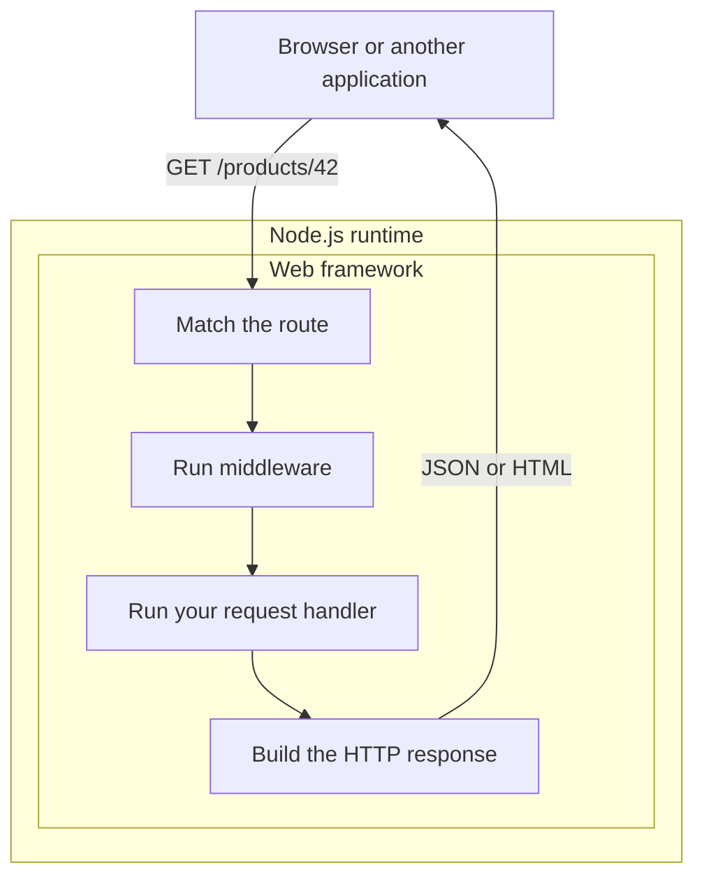
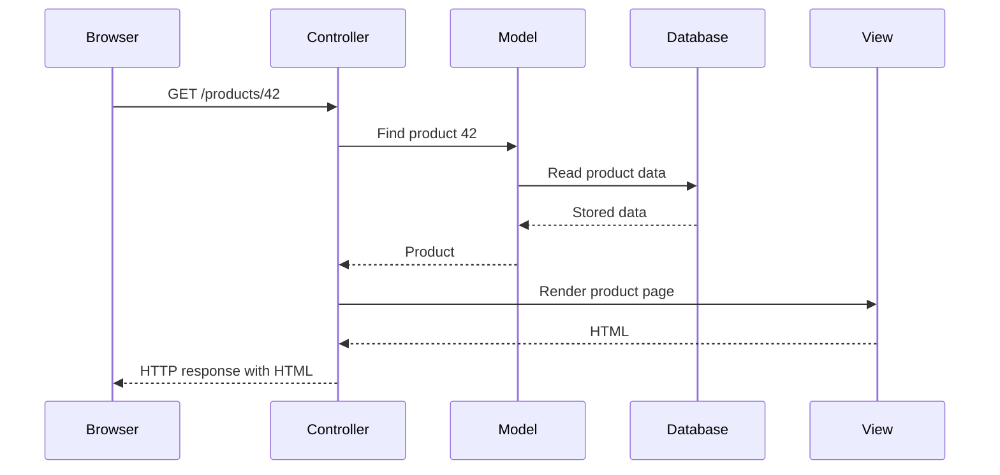
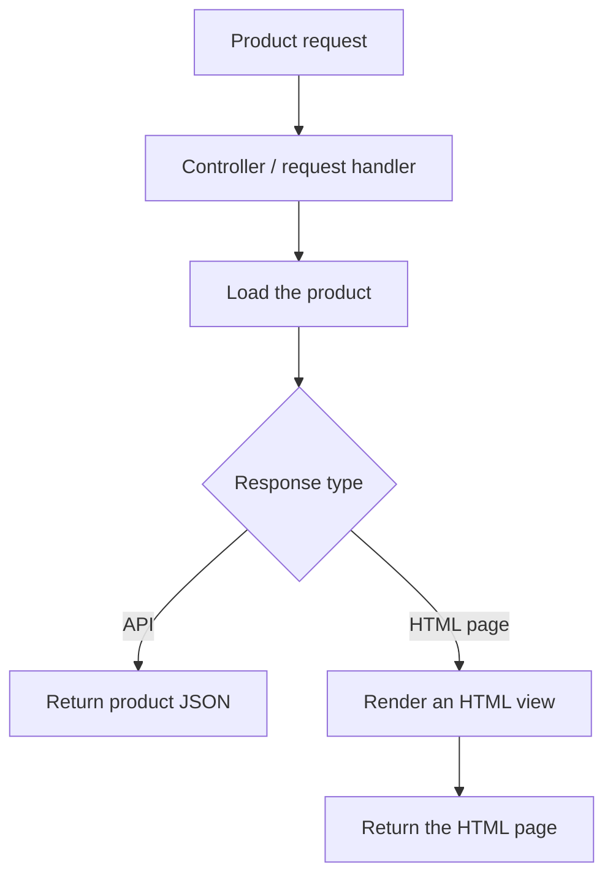
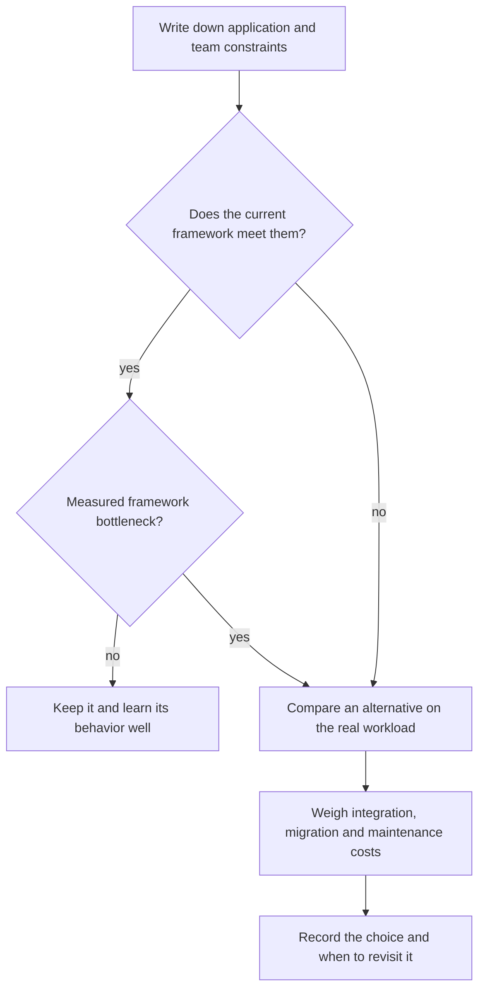
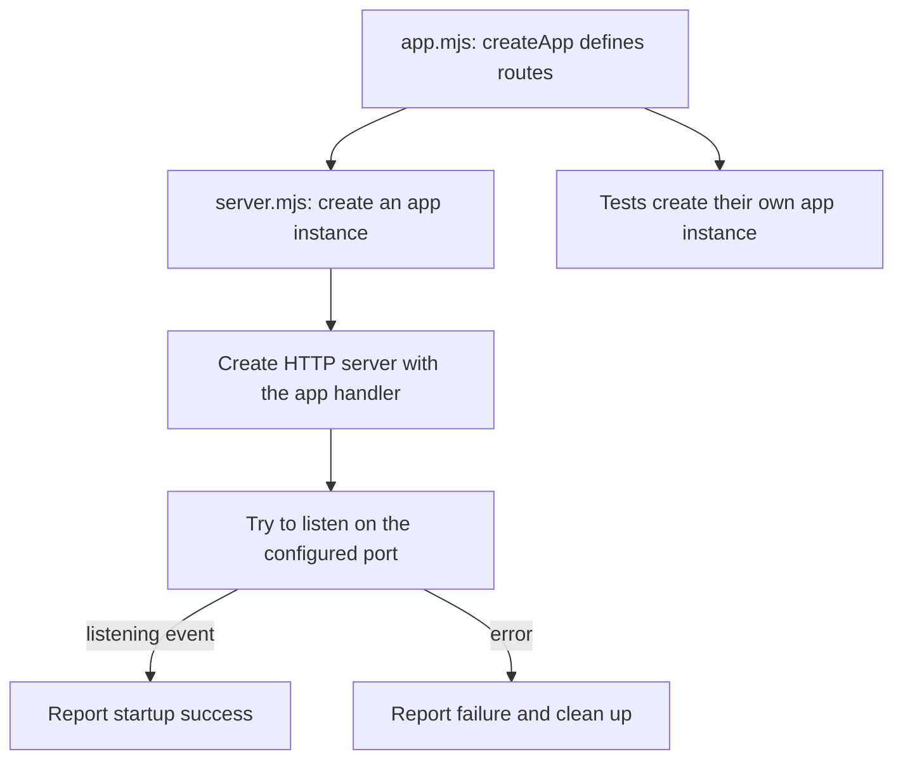
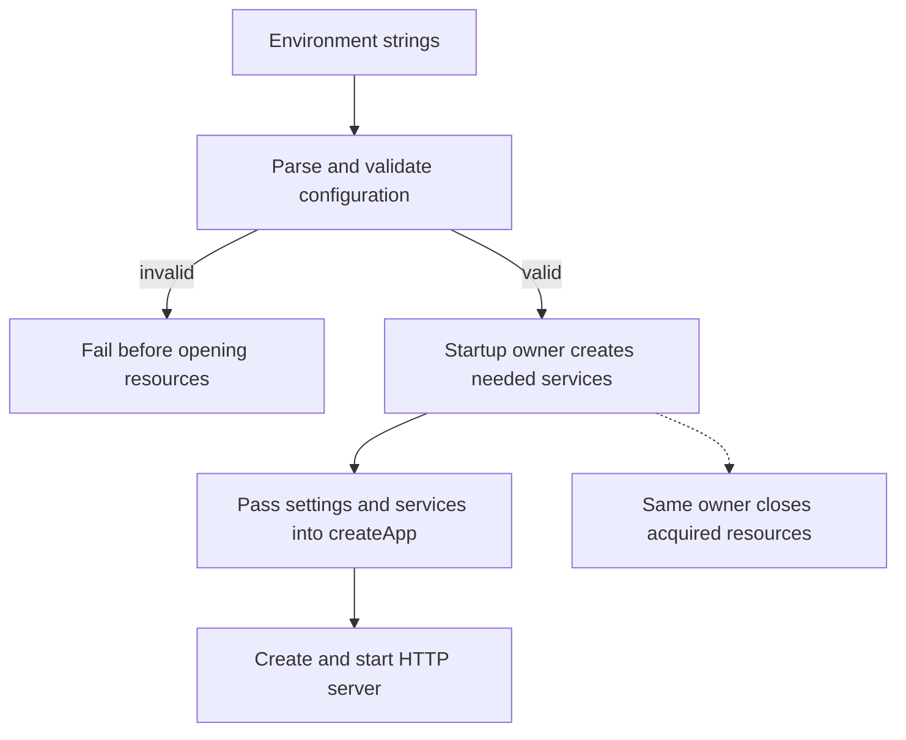

# Framework foundations

This page contains **questions 1–4 only**, the framework basics for Node.js Foundations. After the revision checklist, continue to **Build a Foundations CLI**. Express and NestJS application work comes afterwards on a separate page.

Use a separate learning folder for the runnable example. The initial Foundations lab has no authentication or persistence. The later [Express and NestJS lesson](./16-framework-applications.md) adds fixture authentication and an in-memory repository, with their production limitations made explicit.

<span class="notes-section-label">**First pass:**</span> read the Core answers in questions 1–4, install Express and run the two-file `/hello` example in question 3. Learn one route before adding configuration and controlled shutdown. Framework comparisons are reference reading. Questions 5–13 are on the separate [Express and NestJS page](./16-framework-applications.md), in Building Node.js Applications.

The expandable deeper explanations preserve the additional examples. Common mistakes, examiner follow-ups and key takeaways stay visible outside them. **You can return to them after you can explain and change the starter example.** Career labels describe the eventual assessment target, not what you must master on your first reading.

<!-- tech-check: t16-q01; level: 1 -->

### What does a web framework provide, and how do MVC, full-stack frameworks and API frameworks differ?

*Study depth: Foundational*

Level Up: L1 — Junior\
Tech Check level: ⭐

Source mapping: [R120](./requirements.md#r120), [R128](./requirements.md#r128), [R154](./requirements.md#r154).


<span class="notes-section-label">**Think before reading**</span>

A service receives `GET /products/42` and returns JSON. Another service renders an HTML product page. Must they use different runtimes? Does installing a framework automatically provide a product database?

<div class="notes-core-answer">

<p class="notes-core-answer__title">Core answer</p>

A web framework helps build HTTP applications. It handles common tasks such as matching routes, running middleware, creating responses and passing errors to handlers. **Node runs the program and provides the underlying networking APIs.**

**MVC separates data and its behavior (model), presentation (view) and request handling (controller).** An API commonly returns data such as JSON instead of rendering an HTML view. A full-stack framework provides or connects more parts of the application, such as routing, rendering and data access. These categories can overlap: one framework can support both MVC pages and an API.

</div>

<span class="notes-section-label">**See the request path**</span>

Read downward to follow a request through the framework inside Node. The response can contain JSON or HTML.




:::: details Deeper explanation and additional examples

<span class="notes-section-label">**Detailed explanation**</span>

With `node:http`, you can inspect a request and write a response directly. Once multiple endpoints need path matching, body parsing and shared policies, a framework avoids repeatedly building that plumbing. It does not eliminate the need to understand HTTP or resource ownership.

| Concept | Responsibility | Example decision |
|---|---|---|
| Model | Application data and relevant behavior | What makes a product valid? |
| View | Presentation of application state | Render an HTML product page |
| Controller | Translate a request into an application operation and response | Fetch a product and choose the response |
| API transport | Expose application capabilities over a protocol | Return JSON with an appropriate status |
| Full-stack conventions | Integrate multiple application concerns | Coordinate routing, rendering and data access |

A model is not necessarily an ORM entity. Returning JSON does not automatically make an interface RESTful: resource semantics, HTTP methods, caching and status contracts still matter. An API can reuse services and repositories without having server-rendered views.

Express is deliberately flexible. It can support an MVC arrangement or a JSON API, but does not impose a database layer, dependency-injection container or business architecture. **Installing it does not establish authentication, authorization, runtime validation or durable storage**.

<span class="notes-section-label">**Walkthrough — one product, two response types**</span>

Both services can run on Node.js. **Returning JSON or HTML does not require a different runtime.** Node.js runs the server code and provides networking APIs. The framework adds tools for handling HTTP requests. Your application supplies the product rules and data.


| Framework feature | What it does for this request |
|---|---|
| Routing | Selects the handler for `GET /products/42` |
| Route parameters | Makes the product identifier `42` available to your code |
| Middleware | Runs shared steps, such as logging or checking a login, when configured |
| Response helpers | Help send JSON or HTML with an HTTP status code |
| Error handling | Passes failures to configured error handlers |

These tools do not decide which products exist or who may access them. Your application must implement those rules.

<span class="notes-section-label">**MVC — separate three responsibilities**</span>

MVC is a way to organise application code. The controller receives the request, asks the model for the product, and chooses a response. The model handles application data and related behaviour. The view prepares the presentation, such as an HTML page.



This diagram shows one possible design. A model can use a service or repository to reach storage; it does not have to query a database directly. **The model is application code, not the database itself.**

For example, the product data could be:

```json
{
  "id": 42,
  "name": "Keyboard",
  "price": 15000
}
```

An HTML view could present it as:

```html
<h1>Keyboard</h1>
<p>Price: 15000 HUF</p>
```

<span class="notes-section-label">**An API returns data for another client to use**</span>

An API can return the JSON product above. A web frontend, mobile application or another server can use that data. A server-rendered page instead returns HTML for the browser to display.



One Node.js application can provide both routes:

```text
GET /api/products/42 → JSON product data
GET /products/42     → HTML product page
```

An API can still have controllers, models, services and repositories. It does not need a server-rendered HTML view.

<span class="notes-section-label">**Full-stack frameworks connect more application parts**</span>

A full-stack framework supports several parts of an application together, such as pages, routing, server-side handlers, rendering and data-access integrations. Its exact features depend on the framework. An API-focused framework mainly helps build endpoints that other clients call.

**Installing a framework does not create your product database.** Even when database tools are included, you still need to configure storage, define the product structure and provide the data. Authentication and access rules also need deliberate setup.

| Concept | Question it answers | Product example |
|---|---|---|
| Node.js runtime | What runs the server-side JavaScript? | Runs the product service |
| Web framework | What helps handle HTTP requests and responses? | Routes the request and helps send a response |
| MVC | How do we separate responsibilities? | Model handles product data, view presents it, controller handles the request |
| API-focused framework | How do we expose operations to other clients? | Provides a product endpoint returning JSON |
| Full-stack framework | How do we connect several application parts? | Connects product pages, server handlers and data-access tools |

These categories overlap. A full-stack framework can serve HTML pages and a JSON API, and both can share the same product logic.

<span class="notes-section-label">**Example answer**</span>

Both services can use Node and Express. The JSON service might call `res.json(product)`; the HTML service can use a configured template engine. Both still need a product source and business rules. A framework change need not force a change to those rules if HTTP concerns are kept at the boundary.

::::

<span class="notes-section-label">**Common mistakes**</span>

- Calling Node a web framework rather than a runtime.
- Treating MVC as three folders regardless of dependency boundaries.
- Assuming a “full-stack” label guarantees every database or authentication choice is built in.
- Putting persistence queries and business decisions into every route because a framework permits it.

<span class="notes-section-label">**Examiner follow-ups**</span>

1. <span class="notes-section-label">**Can an API have controllers?**</span> Yes. Controllers adapt transport inputs and outputs; they do not require server-rendered HTML.
2. <span class="notes-section-label">**Must a small app have three layers?**</span> No. Preserve meaningful responsibilities without creating empty forwarding layers just for a diagram.
3. <span class="notes-section-label">**When is raw Node HTTP enough?**</span> A small, tightly bounded endpoint or protocol exercise may need little routing infrastructure. Reassess as shared HTTP concerns grow.

::: tip Key takeaway
A framework provides HTTP mechanics; your application still owns its contracts, business rules and dependencies.
:::

<span class="notes-section-label">**Practice — learner work still required**</span>

For a product lookup, write a responsibility map covering transport, business rules, storage and presentation. Acceptance: explain where input validation belongs, which pieces could survive an Express-to-another-framework migration, and why returning JSON alone does not prove REST conformance.

Official references: [Express FAQ: structure and database boundaries](https://expressjs.com/en/starter/faq/), [Express API overview](https://expressjs.com/en/5x/api/).


---

<!-- tech-check: t16-q02; level: 1 -->

### How should you choose a framework without learning every alternative?

*Study depth: Foundational → Intermediate*

Level Up: L1 — Junior\
Tech Check level: ⭐, ⭐⭐, ⭐⭐⭐⭐

Source mapping: [R120](./requirements.md#r120), [R153](./requirements.md#r153).


<span class="notes-section-label">**Decision exercise — attempt first**</span>

An existing team maintains an Express service. A new internal endpoint needs two routes and a repository adapter. Someone proposes rewriting the service in a different framework because a benchmark shows higher requests per second. What evidence would justify the change?

<div class="notes-core-answer">

<p class="notes-core-answer__title">Core answer</p>

**Choose a framework that fits the application and the team.** Consider where it must run, what the team knows, which integrations it needs, and how startup, requests and shutdown work. Measure any performance problem before choosing a tool to fix it.

**Learn one main framework well**, including how it handles errors and application structure. Compare alternatives when they solve a specific problem. A framework being faster in a simple benchmark is not enough reason to rewrite an existing service; consider real workloads and the cost of migration and maintenance.

</div>

<span class="notes-section-label">**Make a framework decision from evidence**</span>

A benchmark is one input to an investigation. A change needs a requirement or measured benefit that justifies its costs.




:::: details Deeper explanation and additional examples

<span class="notes-section-label">**Detailed explanation**</span>

For this guide, Express 5 is the primary stack because its small routing and middleware surface makes HTTP boundaries visible. This is a teaching choice, not a claim that it is the best option for every workload.

| Alternative | Main comparison question | Cost to evaluate |
|---|---|---|
| Express | Do we want a flexible HTTP middleware/router foundation? | The team must choose structure and supporting integrations |
| Koa | Do we want middleware composed around `await next()` and a request context? | Express middleware is not automatically interchangeable; select compatible integrations |
| NestJS | Do we benefit from modules, controllers and injected providers? | Learn the framework's lifecycle and conventions; account for the selected HTTP adapter |
| Hapi | Does the existing service or team rely on its route/plugin lifecycle? | Evaluate its own plugin contracts rather than importing Express assumptions |
| Feathers | Do service abstractions and HTTP/real-time integration fit our application? | Understand service hooks, adapters and authorization boundaries |

These are comparison leads. The exercise does not require installation of every alternative or mastery of every framework named in the source list.

A useful decision record names the requirement, alternatives, evidence, costs and a condition for revisiting the choice. For the scenario, preserve Express unless a requirement cannot reasonably be met or measurements show a material bottleneck attributable to the framework.

Database latency, synchronous CPU work and excessive payloads often dominate an endpoint. Replacing the router will not automatically fix these. Measure a representative workload, including validation and storage, rather than extrapolating from a trivial response benchmark.

::::

<span class="notes-section-label">**Common mistakes**</span>

- Selecting technology only because it is familiar, without checking whether deployment constraints fit.
- Selecting technology only because it is new, without considering migration and maintenance costs.
- Comparing framework overhead while ignoring downstream operations and security behavior.
- Treating a framework's architectural conventions as proof of good application boundaries.

<span class="notes-section-label">**Examiner follow-ups**</span>

1. <span class="notes-section-label">**When would stronger conventions help?**</span> Shared modules and explicit dependency boundaries may reduce inconsistency across a growing team; those benefits must outweigh added concepts and constraints.
2. <span class="notes-section-label">**Can the existing code limit a choice?**</span> Yes. Middleware, integrations, tests and operational knowledge have replacement costs; compatibility is part of the decision.
3. <span class="notes-section-label">**How do you investigate performance claims?**</span> Reproduce the actual workload, measure latency distributions and saturation, identify where time is spent, and compare equivalent behavior before proposing a migration.

::: tip Key takeaway
Choose for requirements and maintainability, then measure. Learning one stack deeply is more useful than collecting framework names.
:::

<span class="notes-section-label">**Practice — learner work still required**</span>

Write a one-page decision record for the scenario. Acceptance: compare Express with one alternative, name two constraints and one measurable success criterion, and explain the cost and rollback approach for a migration. Keeping Express is a valid conclusion.

Official references: [Koa middleware composition](https://koajs.com/), [NestJS concepts](https://docs.nestjs.com/), [Hapi](https://hapi.dev/), [Feathers overview](https://feathersjs.com/). Only Express is executed in the following lab. For runnable alternatives, continue with [Hapi, Koa and Feathers configuration, routes and lifecycle](./16-framework-alternatives.md).


---

<!-- tech-check: t16-q03; level: 1 -->

### How do you install Express and separate the application from its HTTP server?

*Study depth: Foundational → Intermediate*

Level Up: L1 — Junior\
Tech Check level: ⭐

Source mapping: [R121](./requirements.md#r121), [R155](./requirements.md#r155).


<div class="notes-core-answer">

<p class="notes-core-answer__title">Core answer</p>

Install Express as a runtime dependency because the running server needs it. **Keep creating the Express app separate from starting the server.** The app defines how requests are handled; a separate startup file creates the HTTP server, starts listening and handles shutdown.

**The HTTP server manages the port and connections.** Creating an Express app does not prove that a port is available. Report startup success only after the server confirms it is listening. This separation also lets tests import the app without unexpectedly starting a server.

</div>

<span class="notes-section-label">**Separate request behavior from listening**</span>

The app defines responses. The startup file owns the listening server; tests can import the app without opening a port at import time.




<span class="notes-section-label">**Create a separate lab folder**</span>

```bash
mkdir express-foundations-lab
cd express-foundations-lab
npm init -y
npm install --save-exact express@5.2.1
```

Keep `package.json` and `package-lock.json` together; a clean checkout uses `npm ci`. `.mjs` selects ES Modules without changing `package.json`'s module type.


<span class="notes-section-label">**Start here — one working example**</span>

Start with these two files.

`first-app.mjs`:

```js
import express from 'express';

export function createApp() {
  const app = express();
  app.get('/hello', (_request, response) => {
    response.json({ message: 'Hello!' });
  });
  return app;
}
```

`first-server.mjs`:

```js
import { createApp } from './first-app.mjs';

const server = createApp().listen(3000, '127.0.0.1', () => {
  console.log('Open http://127.0.0.1:3000/hello');
});
server.on('error', () => {
  console.error('Could not start the server');
  process.exitCode = 1;
});
```

Run `node first-server.mjs` from your lab folder and open the printed address. You should see `{"message":"Hello!"}`. `get` matches an HTTP GET request for `/hello`; `json` sends a JSON response. `_request` is an ordinary parameter name indicating that this handler does not use it.

The app file defines responses without opening a port. The server file starts listening. Stop this local exercise with Ctrl+C. It uses the default signal behavior; the optional next version adds a controlled shutdown deadline. Keep it on the loopback address shown here while learning.


:::: details Deeper explanation and additional examples

<span class="notes-section-label">**Predict before running**</span>

If a test imports `app.mjs`, should it immediately open port 3000? If a port is occupied, does constructing an Express application detect that failure?

Save this as `app.mjs`:

```js
import express from 'express';

export function createApp({ label = 'study' } = {}) {
  if (typeof label !== 'string' || !/^[a-z][a-z0-9-]{0,31}$/.test(label)) {
    throw new TypeError('Invalid application label');
  }
  const app = express();
  app.disable('x-powered-by');
  app.get('/health', (_req, res) => {
    res.json({ status: 'ok', service: label });
  });
  app.use((_req, res) => {
    res.status(404).json({ error: 'NOT_FOUND' });
  });
  return app;
}
```

Save this as `server.mjs`:

```js
import { createServer } from 'node:http';
import { once } from 'node:events';
import { createApp } from './app.mjs';

const port = 3000;
const label = 'study';
const server = createServer(createApp({ label }));
let stopping = false;
function stop() {
  if (stopping) return;
  stopping = true;
  const deadline = setTimeout(() => {
    process.exitCode = 1;
    server.closeAllConnections();
  }, 5000);
  server.close(error => {
    clearTimeout(deadline);
    process.removeListener('SIGINT', stop);
    process.removeListener('SIGTERM', stop);
    if (error) process.exitCode = 1;
  });
}

try {
  const listening = once(server, 'listening');
  server.listen(port, '127.0.0.1');
  await listening;
  process.on('SIGINT', stop);
  process.on('SIGTERM', stop);
  console.log(`Listening at http://127.0.0.1:${port}`);
} catch {
  console.error('HTTP_START_FAILED');
  process.exitCode = 1;
}
```

Run `node server.mjs` and request `http://127.0.0.1:3000/health` in another terminal or browser. Expect status 200 with `{"status":"ok","service":"study"}`; an unmatched path returns JSON with status 404. Stop the server with Ctrl+C.

<span class="notes-section-label">**Detailed explanation**</span>

`createApp()` returns a new middleware/router stack. It can be imported without binding a port, and separate instances can have different configuration. The server entry point composes that handler with Node HTTP, reports readiness after `listening`, and turns bind failure into a nonzero exit status.

`once(server, 'listening')` is registered before `listen()`; Node's event helper rejects when an `error` occurs while waiting. This makes `EADDRINUSE` an observable startup failure. Do not print a success message before binding actually succeeds.

The shutdown owner stops accepting new connections and allows active ordinary HTTP requests to finish. After five seconds, the lab destroys remaining HTTP connections and sets a failing exit status. The referenced deadline is cleared on closure. This is a small local server: upgraded sockets, databases, worker pools and durable jobs would need their own shutdown owners.

`/health` here is liveness, **not database readiness**. It proves this handler can respond. Removing `x-powered-by` avoids one disclosure header; it does not establish application security.

::::

<span class="notes-section-label">**Common mistakes**</span>

- Installing Express only as a development dependency while expecting production runtime imports to work.
- Importing a module that unexpectedly starts a server during every test.
- Assuming an Express app and a listening server are the same object.
- Calling `process.exit()` immediately on a signal, interrupting responses and buffered output.
- Treating this unauthenticated local lab as a public deployment template.

<span class="notes-section-label">**Examiner follow-ups**</span>

1. <span class="notes-section-label">**Why keep the lockfile?**</span> It records the resolved dependency graph so clean installations can reproduce it; it does not remove the need to review updates.
2. <span class="notes-section-label">**How would a test avoid a fixed-port conflict?**</span> Create its own HTTP server and request port `0`, then read the assigned address and close it afterward.
3. <span class="notes-section-label">**Does an unknown route reach error middleware automatically?**</span> No. Register a terminal not-found response after the routes. An unmatched route is not itself a thrown exception.

::: tip Key takeaway
Build the app without side effects; let the entry point own startup, the listening socket and bounded shutdown.
:::

<span class="notes-section-label">**Practice — learner work still required**</span>

Run two servers on the same port. Acceptance: the second exits unsuccessfully without claiming readiness; the first still responds. Import `app.mjs` without running `server.mjs` and verify that the process exits without opening a port. Stop the running service and confirm it releases its socket.

Official references: [Express installation](https://expressjs.com/en/starter/installing/), [Express 5 migration requirements](https://expressjs.com/en/guide/migrating-5/), [Node 24 HTTP lifecycle](https://nodejs.org/download/release/v24.18.0/docs/api/http.html#servercloseallconnections).


---

<!-- tech-check: t16-q04; level: 1 -->

### How should configuration and dependencies enter an application?

*Study depth: Foundational → Intermediate*

Level Up: L1 — Junior\
Tech Check level: ⭐

Source mapping: [R126](./requirements.md#r126).


<span class="notes-section-label">**Predict before reading**</span>

What should happen if `PORT` is `3000garbage`, `0`, an empty string, or missing? Should a request handler re-read `process.env` on every request? Does `process.env.ENABLED === 'false'` become false when passed to `Boolean()`?

<div class="notes-core-answer">

<p class="notes-core-answer__title">Core answer</p>

**Read and validate settings once at startup, before opening servers or database connections.** Convert environment strings into the numbers, booleans and other values the application expects. A value can be present and still be invalid, and it may contain a secret that must not be logged.

**Pass checked settings and needed services into the application.** For example, pass a configured product service to a route instead of creating a database connection inside every request. Keep the code that creates these resources together, and make that code responsible for closing them when startup fails or the application stops.

</div>

<span class="notes-section-label">**Build dependencies in one startup owner**</span>

Arrows show startup dependencies. If a later step fails after resources were acquired, the startup owner must close those resources.




<span class="notes-section-label">**Worked example**</span>

Save `config.mjs` alongside the previous files:

```js
export function readConfig(env) {
  const rawPort = env.PORT ?? '3000';
  if (typeof rawPort !== 'string' || !/^[0-9]{1,5}$/.test(rawPort)) {
    throw new TypeError('PORT must contain only decimal digits');
  }
  const port = Number(rawPort);
  if (port < 1 || port > 65535) {
    throw new RangeError('PORT must be between 1 and 65535');
  }
  const label = env.SERVICE_LABEL ?? 'study';
  if (typeof label !== 'string' || !/^[a-z][a-z0-9-]{0,31}$/.test(label)) {
    throw new TypeError('Invalid SERVICE_LABEL');
  }
  return Object.freeze({ port, label });
}
```

In `server.mjs`, add `import { readConfig } from './config.mjs';` and replace the two hard-coded constants with:

```js
const { port, label } = readConfig(process.env);
```

The rest of the entry point stays the same. From the lab directory, use Node 24's `--env-file` option with a local `.env` file:

```dotenv
PORT=3000
SERVICE_LABEL=catalog
```

Run `node --env-file=.env server.mjs`. The health response now identifies `catalog`. Keep secret-bearing environment files out of version control; an example configuration should contain names and placeholders rather than credentials.


:::: details Deeper explanation and additional examples

<span class="notes-section-label">**Detailed explanation**</span>

The port policy intentionally rejects an empty string, fractional values, whitespace, signs, suffixes and `0`. Port `0` remains useful in a test-owned server, but is excluded from this runnable service's configured contract. **Missing means default; present-but-invalid means failure**. Do not use `parseInt()` to accept a malformed suffix accidentally.

Configuration validation runs before `createServer()` or listening. An invalid configuration throws during startup, producing a nonzero process exit without binding a port. `Object.freeze()` prevents changes to the returned object's properties; it would not deeply freeze future nested objects.

`Boolean('false')` is true because the nonempty string is truthy. A future boolean option needs an explicit accepted vocabulary, such as exactly `'true'` or `'false'`, and a rejection policy for other values. Do not silently broaden the configuration contract.

Dependencies are capabilities. Today `createApp({ label })` receives a value. With storage, composition might pass a product-service object with a documented asynchronous method. Routes should receive that capability rather than create a fresh database pool per request or import mutable global test state.

Keep module imports, packages and application dependencies distinct: an npm dependency supplies executable code; an injected dependency supplies a specific application's configured capability. A constructor parameter is not proof of a valid implementation—validate its interface where appropriate and exercise failure behavior.

If startup later opens a database and HTTP binding fails, startup must close the acquired database resource. If no database is used, do not open one just to satisfy an architectural diagram. Multi-resource readiness and cleanup are higher-level lifecycle work, not completed by this basic lab.

::::

<span class="notes-section-label">**Common mistakes**</span>

- Reading configuration throughout business logic, making tests depend on the process's ambient environment.
- Letting different modules apply different defaults to the same setting.
- Logging the complete environment or connection string to diagnose startup.
- Assuming TypeScript types validate deployment strings at runtime.
- Installing packages during each service startup rather than producing a reproducible artifact beforehand.

<span class="notes-section-label">**Examiner follow-ups**</span>

1. <span class="notes-section-label">**Should invalid configuration be retried indefinitely?**</span> No. Fail clearly before serving traffic; an operator must correct it. A bounded dependency retry is a different policy.
2. <span class="notes-section-label">**Why not read environment variables inside every handler?**</span> Startup parsing gives a consistent snapshot and a testable boundary; dynamic configuration needs a deliberate refresh and validation design.
3. <span class="notes-section-label">**Can dependencies be replaced in tests?**</span> Yes, when their contracts are explicit. A fake can isolate a service; integration tests must still verify the real adapter and lifecycle separately.

::: tip Key takeaway
Parse configuration once, reject invalid values before opening resources, and pass explicit values and capabilities to the application.
:::

<span class="notes-section-label">**Practice — learner work still required**</span>

Check defaults and valid custom settings, then try `PORT=''`, `PORT=0`, `PORT=65536`, `PORT=3.5`, `PORT=3000x` and a label containing spaces. Acceptance: invalid settings fail before listening; valid settings produce the expected health JSON; changing one app instance's label does not change another. Do not print any real secrets.

Official references: [Node 24 environment files](https://nodejs.org/download/release/v24.18.0/docs/api/cli.html#--env-filefile), [Express application API](https://expressjs.com/en/5x/api/application/), [Express FAQ: application structure](https://expressjs.com/en/starter/faq/).

## Foundations revision

<span class="notes-section-label">**Framework-basics checklist**</span>

- [ ] Explain runtime versus framework and MVC versus a JSON API.
- [ ] Justify one primary framework and compare one alternative.
- [ ] Install a pinned runtime dependency and reproduce it from the lockfile.
- [ ] Build an importable app without opening a listener.
- [ ] Explain the app/server distinction and diagnose a port conflict.
- [ ] Validate configuration before resource acquisition and stop the local service cleanly.


<span class="notes-section-label">**Recall, compare and apply**</span>

Try each question without opening its answer. Explain the reason, not just the term; then expand **Show answer** to check. Diagram questions link back to the visual so you can trace its parts and arrows.

<!-- revision-covers: t16-q01 -->

<span class="notes-section-label">**1. Scenario — A service returns HTML today and JSON tomorrow. Which concerns must change, and which can remain?**</span>

::: details Show answer

The transport/presentation response changes; business rules and storage can remain when boundaries are explicit. New contracts still require tests.

[Revisit the explanation and examples](#t16-q01).

:::


---

<!-- revision-covers: t16-q01 -->

<span class="notes-section-label">**2. Explain diagram — In the [framework request diagram](#t16-q01), which responsibilities belong to Node, the framework and application code? How does MVC differ from merely returning JSON?**</span>

::: details Show answer

**Node supplies the runtime; frameworks organize HTTP handling.** MVC separates model, view and controller; an API commonly returns data instead of a rendered page. The framework matches routes and composes request handling; the application supplies its business rules and data. MVC describes responsibilities, and returning JSON alone does not supply persistence, authorization or a complete REST contract.

[Revisit the explanation and examples](#t16-q01).

:::


---

<!-- revision-covers: t16-q02 -->

<span class="notes-section-label">**3. Scenario — A faster framework benchmark appears, but your database accounts for nearly all endpoint latency. What should you measure first?**</span>

::: details Show answer

Profile the real request and its database operations before changing the HTTP adapter. Compare equivalent behavior and include migration cost.

[Revisit the explanation and examples](#t16-q02).

:::


---

<!-- revision-covers: t16-q03 -->

<span class="notes-section-label">**4. Scenario — A test imports the application and never exits. What side effects should you inspect?**</span>

::: details Show answer

Look for module-level listeners, database connections, timers or background work. Importing this lab's `app.mjs` alone should acquire none of them.

[Revisit the explanation and examples](#t16-q03).

:::


---

<!-- revision-covers: t16-q04 -->

<span class="notes-section-label">**5. Scenario — A deployment sets `PORT=3000junk`. Why might one parser accept it, and what should this lab do?**</span>

::: details Show answer

`parseInt()` can accept a numeric prefix. This lab validates the entire string and rejects the malformed setting before binding.

[Revisit the explanation and examples](#t16-q04).

:::


## References and scope

The [Express and architecture course](../module-06-express-architecture.md) provides broader examples; these questions focus on the Foundations exam scope.

## Foundations complete — start the CLI task

**This is the end of Framework foundations.** After working through questions 1–4 and the revision checklist above, continue to [Practice: Build a Foundations CLI](./progressive-projects.md#project-1-foundations-cli).

You do not need to complete the Express catalog or the NestJS starter before starting the CLI. After the CLI task, begin Building Node.js Applications with [Express and NestJS](./16-framework-applications.md#application-frameworks).
